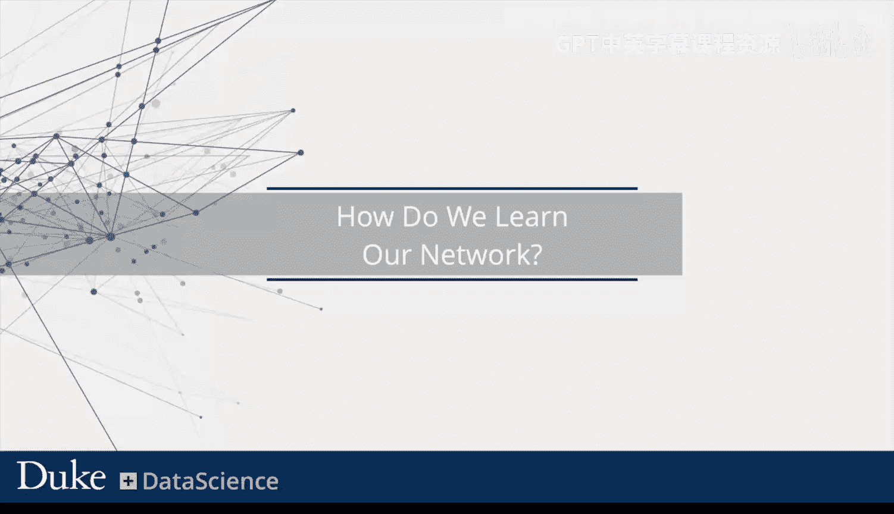
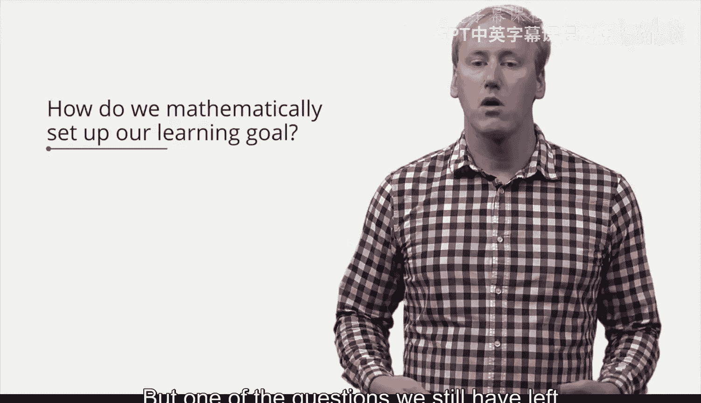
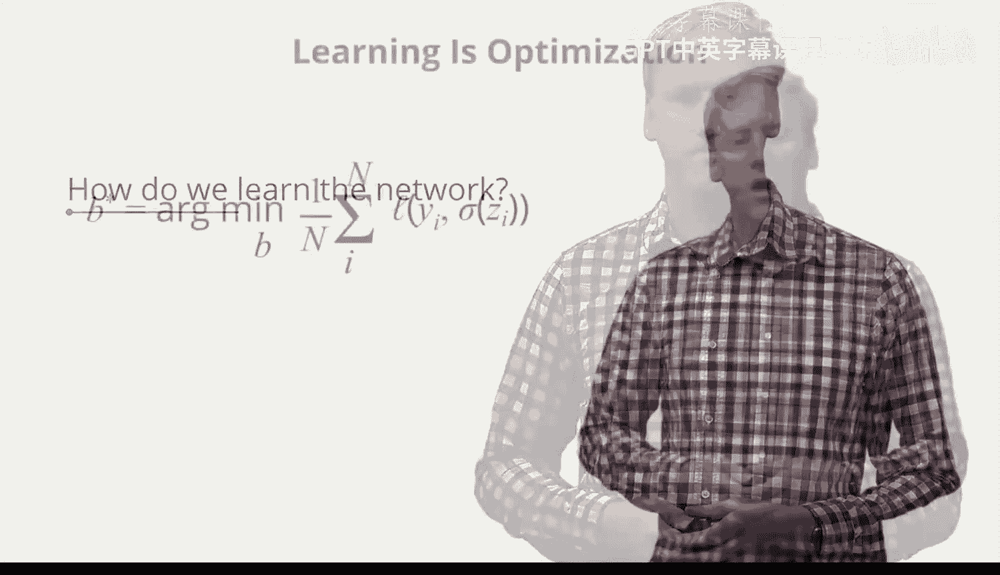
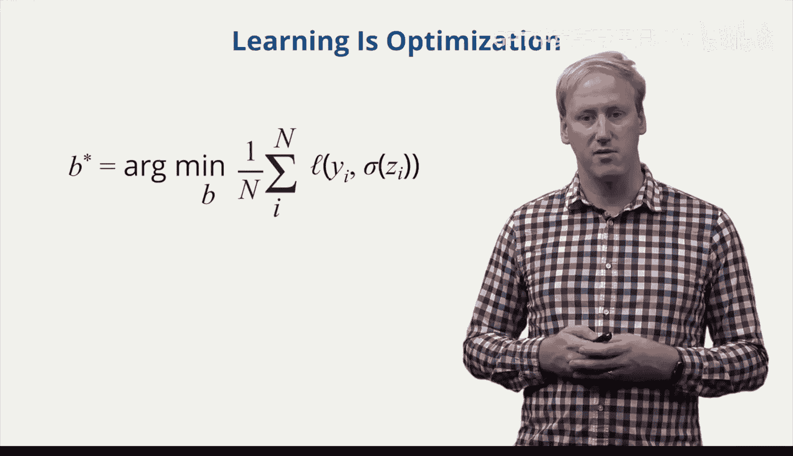
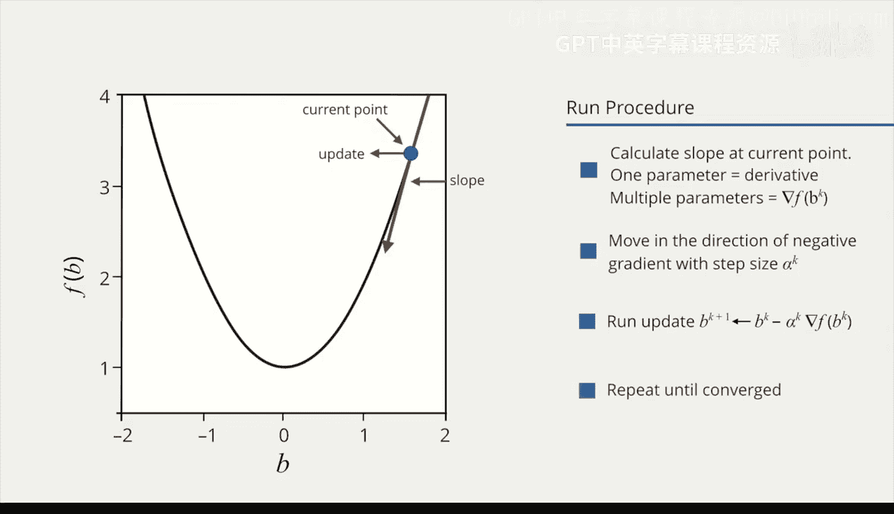

#  026：如何学习网络 🧠

在本节课中，我们将要学习如何通过优化算法来训练神经网络。我们已经定义了网络结构和学习目标，现在需要探讨如何从数学描述出发，实际地找到最优参数。

---

上一节我们介绍了如何定义网络和学习目标，本节中我们来看看如何通过优化算法来学习网络参数。

学习本身将转化为一个优化问题。我们的目标是找到能够最小化平均损失的参数。我们可以将最优参数 **B**  ̂ 定义为：

**B**  ̂ = argmin_B [ L(B) ]

其中，平均损失函数 L(B) 是在所有训练数据样本上计算的：

L(B) = (1/N) * Σ_{i=1}^{N} loss( y_i, f(x_i; B) )

那么，我们如何实际找到最小化这个函数的参数呢？如何优化 **B** 以最小化 L(B)？

---

为了做到这一点，我们需要讨论**梯度下降法**。梯度下降法是一个非常著名的数学优化算法，历史悠久。我们不从纯数学角度讨论，而是直观地理解其过程。

我们的目标是，对于某个数学函数（例如我们的平均损失函数），找到其最小值。下图右侧展示了一个简单的一维函数，我们希望找到使该函数值最小的参数 **B**。

虽然在这个可视化图中，我们一眼就能看出最小值在0附近，但对于高维和复杂的函数，我们无法直接绘制并观察其最小值。因此，我们需要一种算法来帮助我们寻找最小值。

一种方法是：从一个特定的参数值开始（例如图中蓝色圆圈标记的1.5附近）。在当前点，我们可以计算出函数的**斜率**。斜率指示了函数值上升或下降的方向。

如果我们想找到最小值，就应该朝着“下坡”的方向移动。在当前点，斜率告诉我们：向右移动是“上坡”，向左移动是“下坡”。因此，我们应该向左移动一步。

以下是梯度下降的步骤：

1.  **初始化**：从一个初始参数值 **B**^0 开始。
2.  **迭代更新**：重复以下步骤，直到满足收敛条件：
    *   计算当前参数点 **B**^k 处损失函数的**梯度**（对于单参数是导数，对于多参数是梯度向量）。梯度指向函数值上升最快的方向。
    *   向**负梯度**方向（即函数值下降最快的方向）移动一小步。更新公式为：
        **B**^{k+1} = **B**^k - α^k * ∇L(**B**^k)
        其中，**α^k** 是第 k 次迭代的**学习率**（步长），它控制着我们移动的幅度。
3.  **收敛**：当参数更新变化很小或达到预设迭代次数时，停止更新。

这个过程就像一个人在山坡上，通过反复感知脚下最陡的下坡方向并迈出一小步，最终走到山谷底部。

---

我们已经讨论了梯度下降的基本原理。接下来，我们需要探讨如何在拥有海量数据时，让这个方法高效工作。这将在后续的课程中详细展开。

---

本节课中我们一起学习了：
1.  网络学习的目标是找到最小化平均损失函数的参数，这是一个优化问题。
2.  **梯度下降法**是解决此问题的核心算法。其核心思想是：计算当前点的梯度，并沿着负梯度方向（下降方向）更新参数。
3.  参数更新遵循公式：**B**^{k+1} = **B**^k - α * ∇L(**B**^k)，其中 α 是学习率。
4.  这个过程迭代进行，直到算法收敛到（接近）最优解。