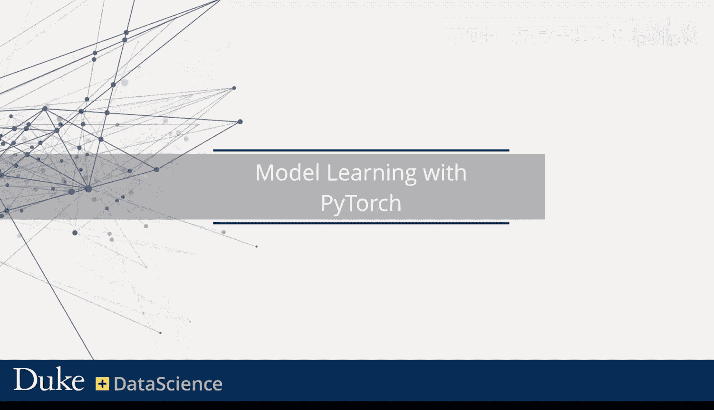
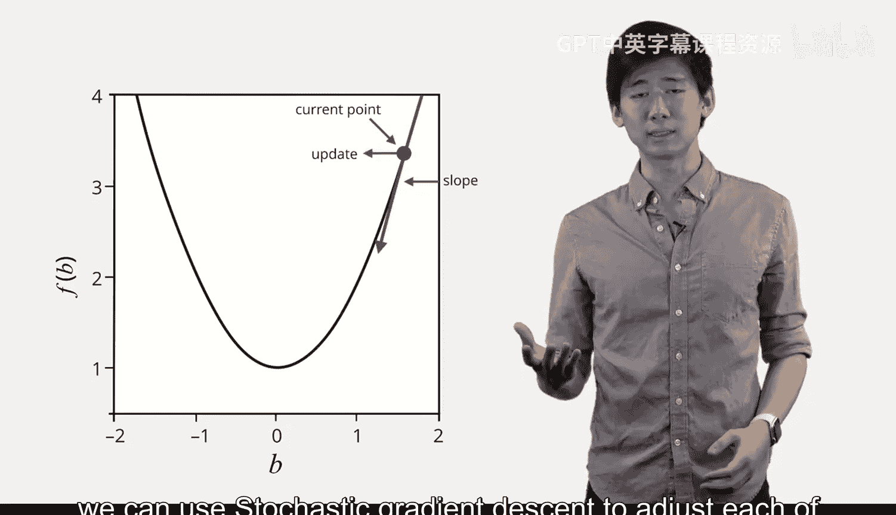
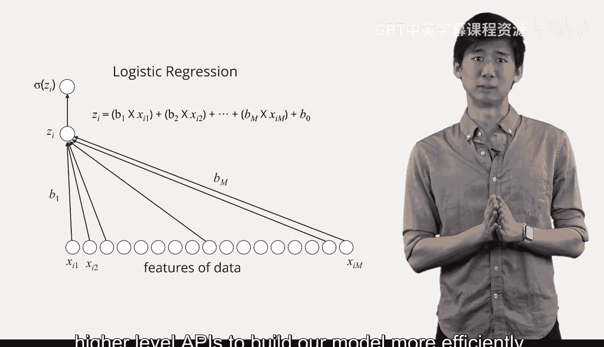

#  029：使用PyTorch进行模型学习

在本节课中，我们将学习如何将之前介绍的机器学习核心概念——损失函数和随机梯度下降——应用于实践。我们将使用PyTorch框架，编写一个逻辑回归模型来对MNIST数据集中的手写数字进行分类。完成训练后，我们将评估模型性能，并可视化其学习到的内容。课程将从基础的PyTorch操作开始，最后介绍如何使用更高级的API以面向对象的方式高效构建模型。

## 回顾核心概念

在模块2中，我们学习了神经网络如何从数据中学习。其核心是定义一个**损失函数**，该函数能将模型的表现不佳程度量化为一个单一数值。

**损失函数**的公式可以表示为：
`L(θ) = 1/N * Σ L_i(f(x_i; θ), y_i)`
其中，`θ`代表模型参数，`f`是模型，`x_i`和`y_i`是样本数据和真实标签。

我们可以使用**随机梯度下降**算法来调整网络中的每个参数，从而提升模型性能。其参数更新公式为：
`θ = θ - η * ∇L(θ)`
其中，`η`是学习率，`∇L(θ)`是损失函数关于参数的梯度。

## 实践：用逻辑回归分类MNIST

在模块2中，逻辑回归被用作贯穿始终的示例来阐述这些概念。在本节中，我们将把这些概念付诸实践，实际编写一个可工作的模型，使用逻辑回归对MNIST数据集中的数字进行分类。

以下是实现逻辑回归模型的主要步骤：

1.  **数据准备**：加载MNIST数据集，并进行必要的预处理，如归一化。
2.  **模型定义**：定义逻辑回归模型的结构，即一个线性层后接一个Sigmoid激活函数（对于二分类）或Softmax函数（对于多分类）。
3.  **损失函数与优化器**：选择交叉熵损失函数和随机梯度下降优化器。
4.  **训练循环**：在多个周期内，让模型遍历训练数据，计算损失，反向传播梯度，并更新参数。
5.  **模型评估**：在测试集上评估模型的准确率等性能指标。
6.  **结果可视化**：可以可视化模型学习到的权重，观察其识别数字的模式。

一旦模型训练完成，我们就可以评估其性能。作为一个额外的收获，我们还可以可视化它实际学习到了什么。

## 从基础代码到高级API

我们将首先使用基础的、低层次的PyTorch操作来编写代码。这有助于我们理解底层机制。

但是，我们将以看到如何通过使用更高级的API，以更面向对象的方式重构我们的代码作为结束，从而更高效地构建我们的模型。

## 作业延伸：构建多层感知机

作为一项作业，你将把我们的逻辑回归模型扩展为一个**多层感知机**。这是在模块1中介绍过的模型。

你应该会发现，它的性能优于我们简单的逻辑回归模型。

## 总结

本节课中，我们一起学习了如何将理论概念转化为实际代码。我们使用PyTorch实现了一个逻辑回归模型，用于MNIST数字分类，并理解了从数据加载、模型定义、训练到评估的完整流程。我们还对比了基础操作与高级API在构建模型方式上的不同。最后，我们为下一步学习——构建更复杂的多层感知机模型——做好了准备。