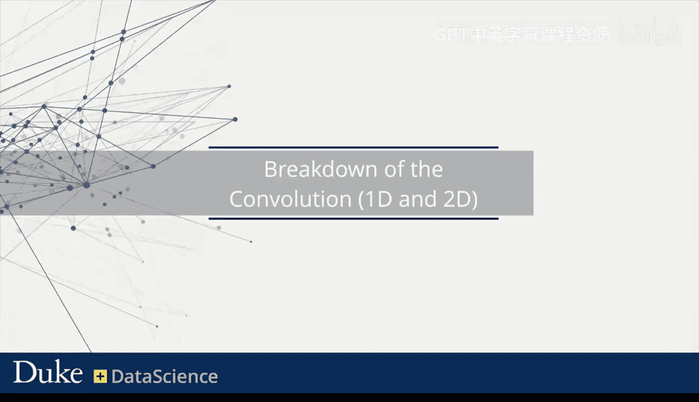
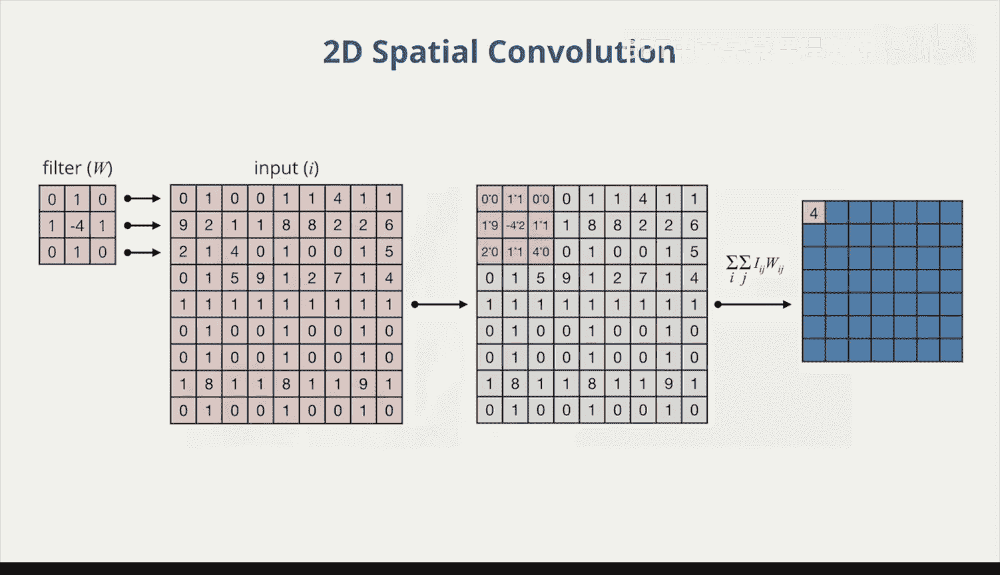
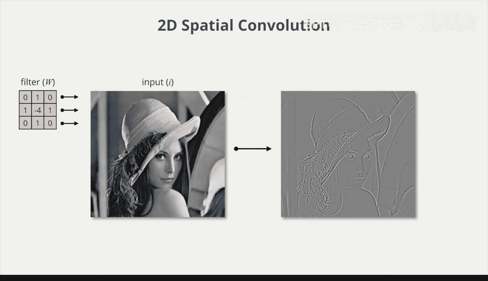
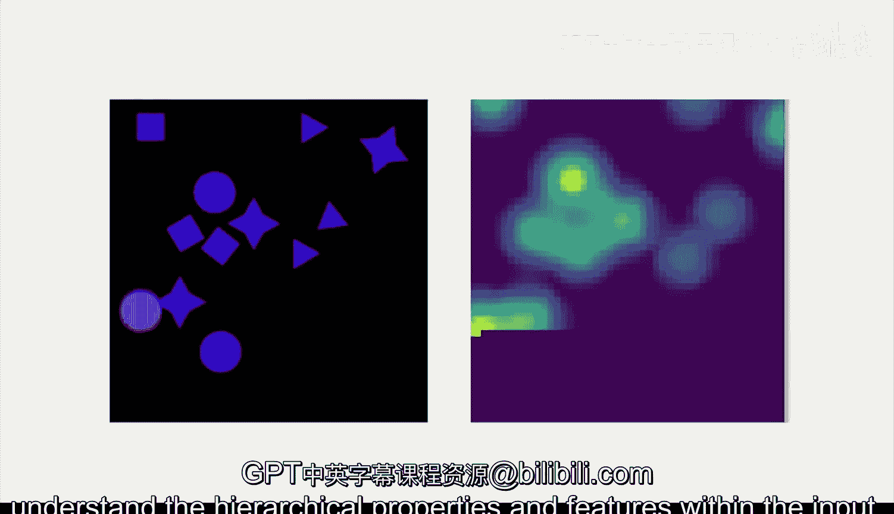

#  031：一维与二维卷积分解

在本节课中，我们将要学习卷积神经网络（CNN）的核心操作——卷积运算。我们将从一维信号入手，理解卷积的基本概念，然后将其扩展到二维图像处理中，并展示卷积如何用于提取图像特征。

## 卷积运算概述

卷积神经网络的一般架构是：输入图像经过一系列卷积滤波器处理，通过卷积运算生成特征图。这个过程会重复多次，最终得到图像的高级表示，以供分类器使用。那么，卷积运算具体是什么呢？

## 一维卷积详解

卷积本质上是两个信号相互滑动的过程，用于在目标信号中搜索特定特征。我们先从一维信号开始介绍。

假设我们有两个一维信号：一个方波信号 **F** 和一个锯齿波信号 **G**。卷积的数学定义如下：

**公式：** `(F * G)[n] = Σ_{m=-∞}^{∞} F[m] * G[n - m]`

这个公式的含义是：对于每个位置 `n`，将信号 **G** 翻转并平移后，与信号 **F** 逐点相乘，然后将所有乘积结果求和。这个求和值就是卷积在位置 `n` 的输出值。这个操作会针对不同的 `n` 值（即 **G** 相对于 **F** 的不同平移量）重复进行。

以下是几个计算示例：

*   **当 n = -5 时**：信号 **G** 先向左平移5个单位，然后进行翻转（沿中线反射）。接着，将翻转平移后的红色信号与蓝色信号 **F** 逐点相乘并求和。此时，两个信号重叠区域的面积（积分）为15，因此卷积结果为15。
*   **当 n = 0 时**：信号 **G** 不进行平移，只进行翻转。然后与 **F** 相乘求和，重叠面积更大，结果为20。
*   **当 n = 10 时**：信号 **G** 向右平移10个单位并翻转。此时重叠区域变小，卷积结果也变小。
*   **当平移量很大时**：如果两个信号完全没有重叠，相乘结果处处为零，求和后卷积值即为0。

这个过程可以通过动画直观展示：一个红色方波信号在蓝色方波信号上滑动。随着红色信号的移动，当它与蓝色信号重叠时，相乘后会产生一个面积值。图中黑线描绘的正是这个面积值随平移量变化的结果，即整个卷积输出。

**一维卷积的意义在于**：卷积滤波器 **G** 可以用来从信号 **F** 中提取与自身匹配的特征。如果特征匹配良好，卷积输出值就会很高。

例如，假设滤波器 **G** 与信号 **F** 在零平移时完美匹配，卷积结果会在多个区域累积较大的正值面积。但如果使用一个不匹配的长方波滤波器，在中间区域，正负值相乘会产生很大的负面积，从而从总和中减去，导致最终的卷积值低于匹配滤波器的情况。

## 从一维到二维卷积

在卷积神经网络中，我们需要对二维图像应用二维滤波器。其原理与一维完全相同，只是滤波器具有二维空间范围。

在上图中，一个3x3的滤波器被应用到下方图像的某个区域。与一维情况类似，进行逐元素相乘然后求和，这个和值就是该特定平移位置下的卷积结果。然后，这个滤波器在图像上滑动，直到与图像的每一个位置都进行卷积运算。

为了更直观地理解，假设滤波器是一个“十字形”图案，而图像中也存在一个十字形特征。当滤波器与图像特征部分重叠时，卷积输出一个正值；当完全重合时，输出值最高（图中显示为深紫色）；随着滤波器滑离该特征，输出值逐渐降低。最终，得到的卷积特征图（或称热图）会在图像中存在对应特征的位置呈现高亮区域。

## 二维卷积的数字示例

让我们用具体数字演示二维卷积。这里有一个滤波器 **W**，我们将其应用到输入图像上。

以下是单次卷积操作的步骤：
1.  将滤波器 **W** 放置在输入图像的左上角。
2.  进行逐元素乘法。
3.  对重叠区域所有元素的乘积结果求和。
4.  将求和结果填入输出特征图的对应位置。在本例中，这个值为4。

图中左侧展示的滤波器是一个实际用于图像处理的真实滤波器，它是一个**边缘检测器**。为了展示运行此滤波器如何生成有意义的特征图，这里使用了一张黑白照片。将此滤波器滑动遍历整个图像后，卷积运算的结果生成了一幅新图像，其中清晰地检测出了该滤波器设计要寻找的特征——即图像的边缘。

## 核心要点总结

最后，我们再次强调二维卷积在特征提取中的作用。在卷积神经网络中，一个滤波器（本例中是一个圆形）在图像上从左到右、从上到下移动。

当滤波器与图像中与之对应的特征（如蓝色圆形）重叠时，会产生一个高幅值的“热点”，在右侧的热图中表现为高卷积值。而当滤波器与不匹配的形状重叠时，卷积运算的输出值则较低。

由此可见，这个圆形滤波器在扫过图像的过程中，能够突出显示特定特征，并在右侧形成特征图。这些特征图可以被网络的上游层利用，以理解输入图像内部的层次化属性和特征。

**本节课总结**：我们一起学习了卷积运算的核心原理。我们从一维信号的卷积定义和计算过程开始，理解了其通过滑动匹配来提取特征的机制。然后，我们将这一概念扩展到二维空间，详细讲解了滤波器如何在图像上滑动并进行乘加运算以生成特征图。通过边缘检测器的实例，我们看到了卷积操作如何从原始图像中提取出有意义的特征（如边缘），这些特征图构成了卷积神经网络理解视觉信息的基础。