#  032：卷积层的核心组件 🧩

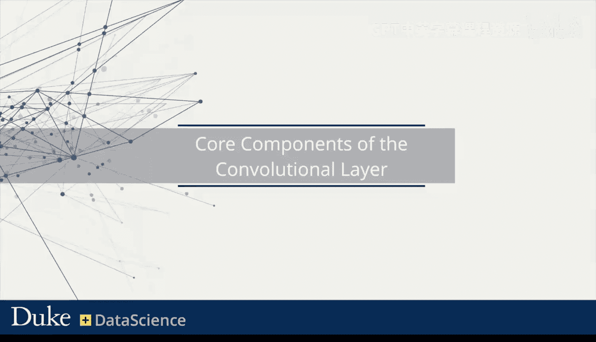

在本节课中，我们将深入探讨卷积神经网络（CNN）中卷积层的核心组件。这些组件是系统从图像中提取有意义特征的基础。我们将逐一介绍卷积层、激活函数、池化层和全连接层。首先，让我们从卷积层开始。

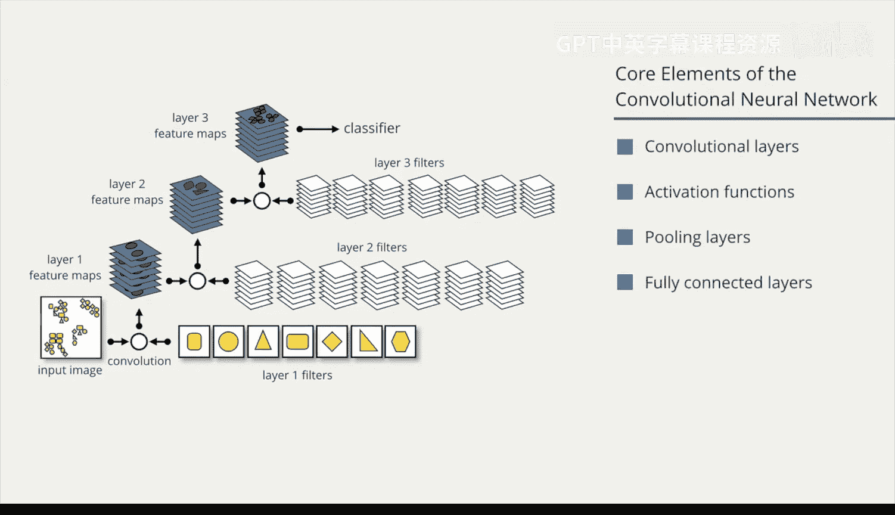

## 卷积层详解

上一节我们介绍了卷积神经网络的基本概念，本节中我们来看看卷积层的具体构成。卷积操作是核心，但在设计系统时，用户可以选择卷积的多个特征，包括卷积核大小、卷积步长和卷积核数量。

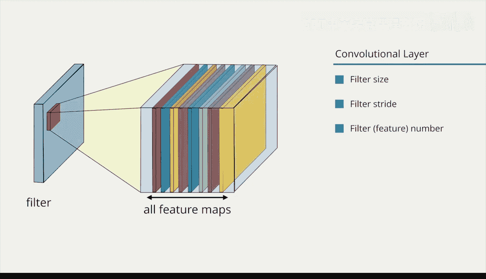

### 卷积核大小

卷积核大小如其字面意思所示。之前展示的卷积操作通常使用 3x3 的配置，即卷积核为 3x3。这个卷积核在图像上滑动，生成特征图。

你也可以改变卷积核的大小。例如，右侧展示了一个 5x5 的卷积核。更大的卷积核可能包含更多关于其搜索特征的信息，从而生成不同的特征图。

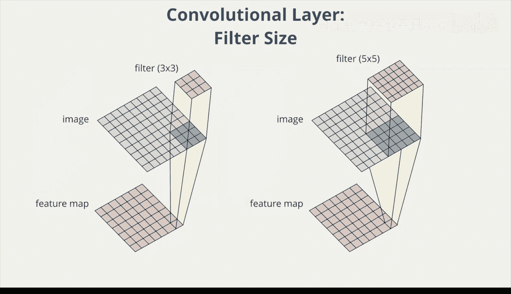

通常，卷积核大小在 3x3 到 7x7 之间。经验法则是，卷积核应足够大以捕捉小的局部特征（例如空间中的边缘），但不应过大以至于同时寻找多个复杂特征（例如一个圆形和一个三角形）。这种对应关系应让网络更高层来处理。

### 卷积步长

卷积步长定义了卷积核每次移动的距离。之前展示的是步长为 1 的情况，这意味着卷积核每次移动一个像素，从而生成特征图。

如果增加步长，卷积核在图像上滑动时会跳过更多像素。例如，右侧展示了步长为 2 的情况，卷积核每次移动两个像素。这会导致生成的特征图尺寸变小。

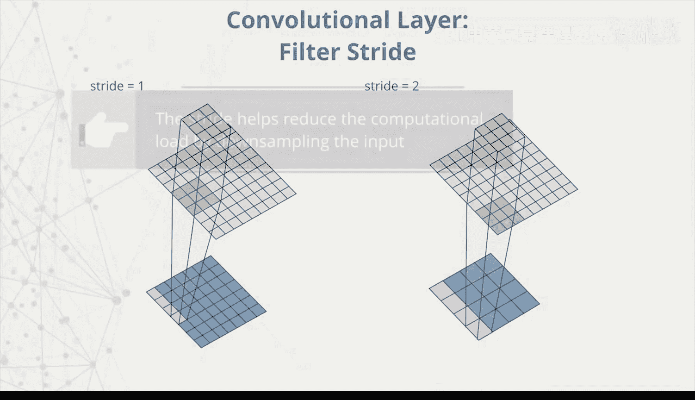

步长有助于通过下采样输入来减少计算负载。

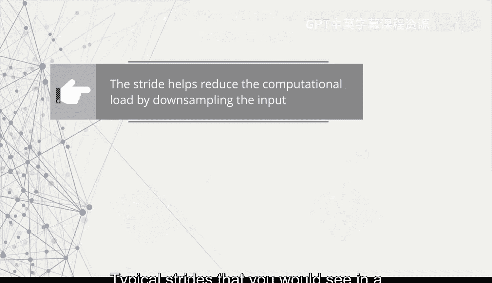

在神经网络中，常见的步长范围是 1 到 2，有时会稍高，但 1 到 2 非常普遍。

### 卷积核数量

卷积核数量决定了网络在每一层中寻找的独特特征或过滤器的数量。

在这个特定示例中，展示了六个基本构建块（如六边形、矩形、圆形等）。为了在各自的特征图中隔离出所有这些特征，你需要为每一个配备一个卷积核。你可以拥有比这更多的卷积核。

核心思想是，卷积核数量决定了在输入上运行的独特特征检测器的数量。

这些就是卷积层的核心组件。我想换个角度展示一下：对于我们使用的每个卷积核，我们都会生成一个特征体积，并传递给网络的更高层。

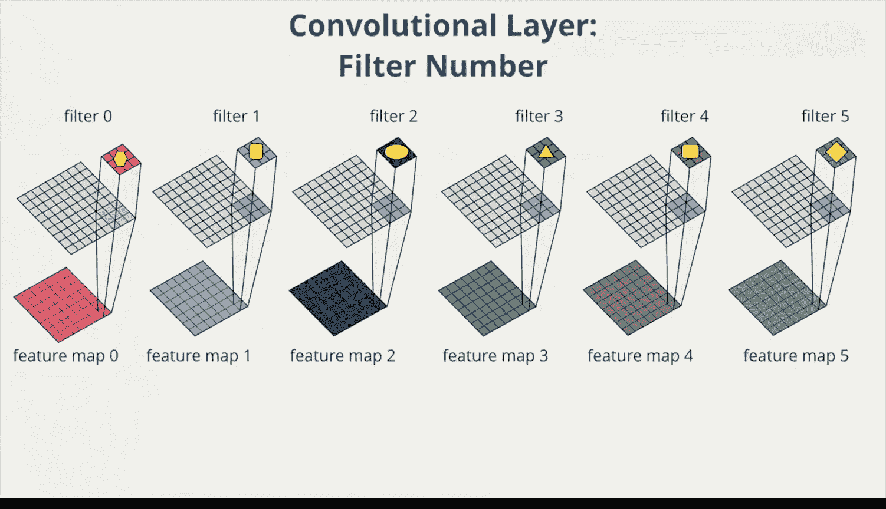

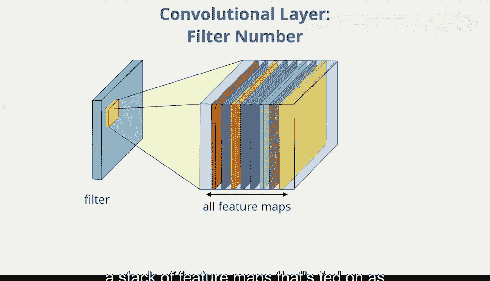

如果我们这里有一个单独的卷积核（例如提取红色特征图），同时有另一个卷积核（例如紫色）在输入上运行并生成自己独特的特征图，那么对于你拥有的所有不同卷积核，这个过程会持续进行。这样，你就构建了一个特征图堆叠而成的体积，作为输入馈送到网络的下一层。

## 处理输入体积

回想之前的玩具示例，我们有第二层卷积核在特征图上运行。因此，需要在特征图堆叠上运行的卷积核，也必须具有一定的深度，以覆盖馈送到该层作为输入的所有特征图。

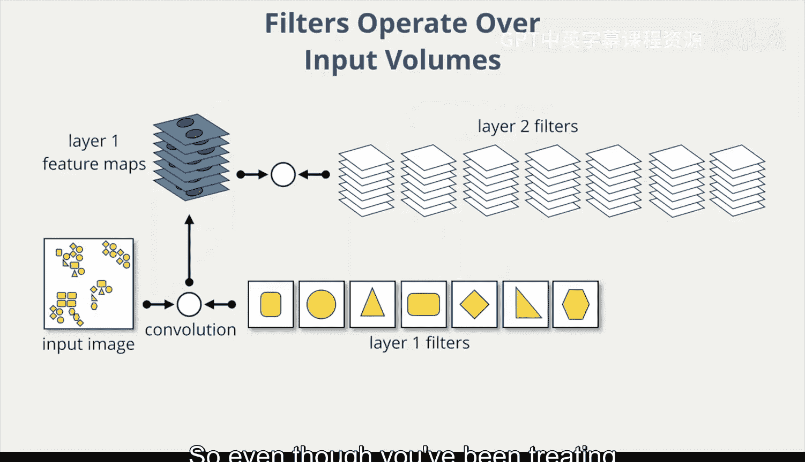

这一点在第一层也同样成立。尽管我们一直将输入图像视为单通道（例如灰度）图像，但彩色图像实际上有三个通道：红色、绿色和蓝色通道。这些通道共同定义了每个像素的颜色。

第一层的卷积核在处理输入图像时，需要具有对应于每个颜色通道的权重。因此，你可以将这些卷积核视为在每个输入通道中都具有二维范围，这样每个卷积核都对应一个深度为 3（对应三个通道）的堆叠。

所以，在任何情况下，这些卷积核主要都是在输入体积上运行，尤其是在进行卷积并构建了特征图堆叠之后。

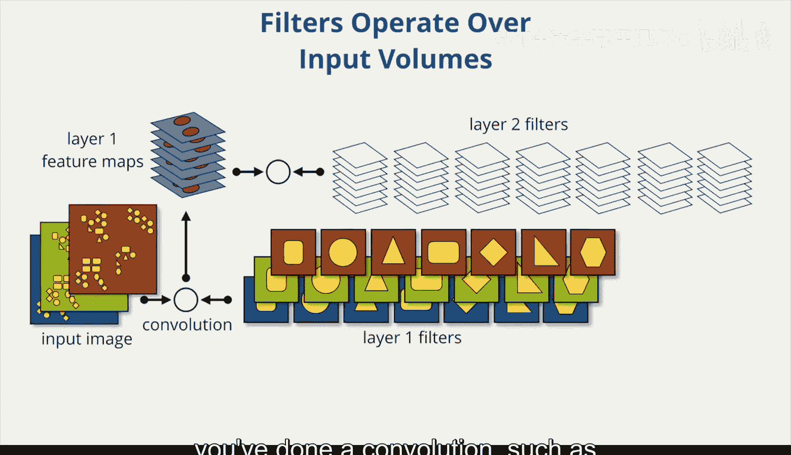

## 卷积操作总结

为了将这一切放回我们原始动画的上下文中，当我们滑动这个卷积核时，我们实际上是在操作一个小立方体。例如，一个 3x3x3 的卷积核，其权重对应于图像输入的每个切片（通道）。图像输入可能是 9x9x3，其中 3 对应三个颜色通道。

这个操作的结果是，我们仍然进行逐元素相乘然后求和，从而为该特定卷积核得到一个单一的二维特征图。

这个动画总结了我所讨论的卷积层操作。左侧是一个输入体积，在本例中有三个切片。你可以将其视为具有红、绿、蓝通道的输入图像，我们称之为输入 `I`。

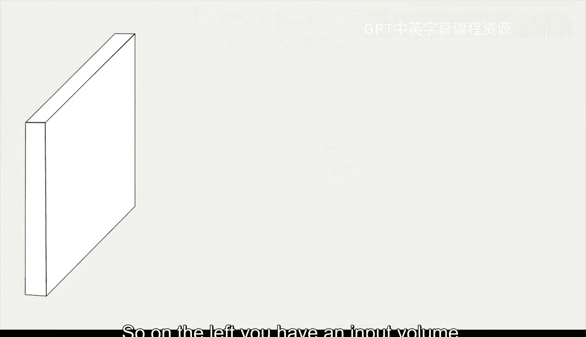

我们使用类似 Python 的数组表示法来索引所有这些切片。顶部是 `I[:, :, 0]`，这表示输入的第 0 个索引（即第一个）切片的所有行和所有列，可能是红色通道。下面是 `I[:, :, 1]`（绿色通道）和 `I[:, :, 2]`（蓝色通道）。

我想让你理解的是，卷积核 `W0` 具有对应于输入所有相应通道中空间位置的权重。因此，卷积核实际上是三维的，它具有二维空间范围和深度范围。

你仍然是在进行卷积核中所有值与输入中相应值的逐元素相乘，求和，然后将结果存入对应于卷积核 0 的特征图中的单个值。

对于第二个卷积核 `W1`，你执行完全相同的操作。但该卷积求和的结果被存入第二个特征图 `feature map 1` 中的相应位置。

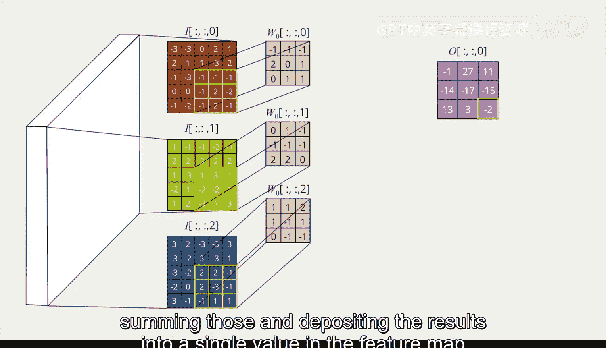

---

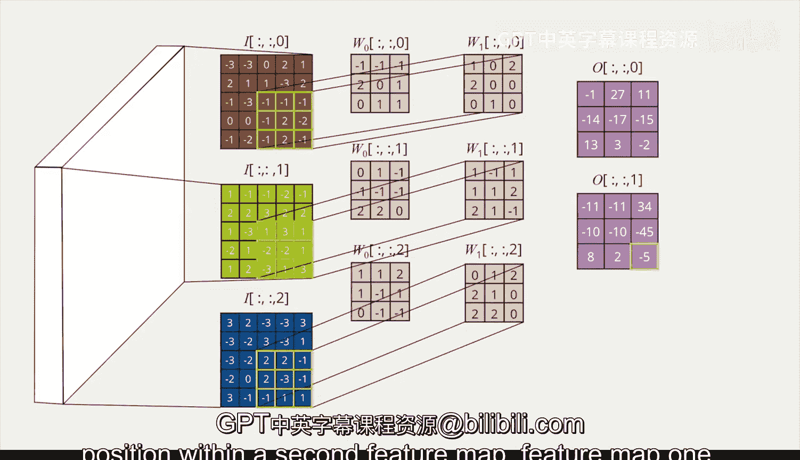

本节课中我们一起学习了卷积神经网络中卷积层的核心组件。我们详细探讨了卷积核大小、步长和数量的选择及其影响，理解了卷积核如何在多通道输入体积上操作以生成特征图堆叠。这些组件是构建有效 CNN 以从图像中提取特征的基础。