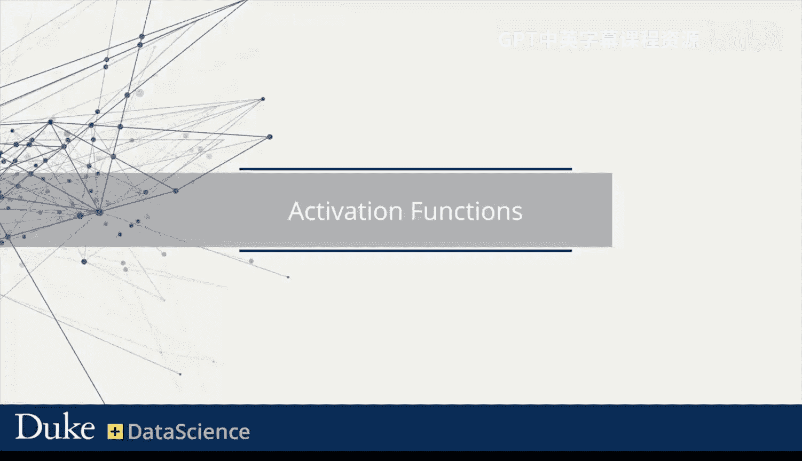
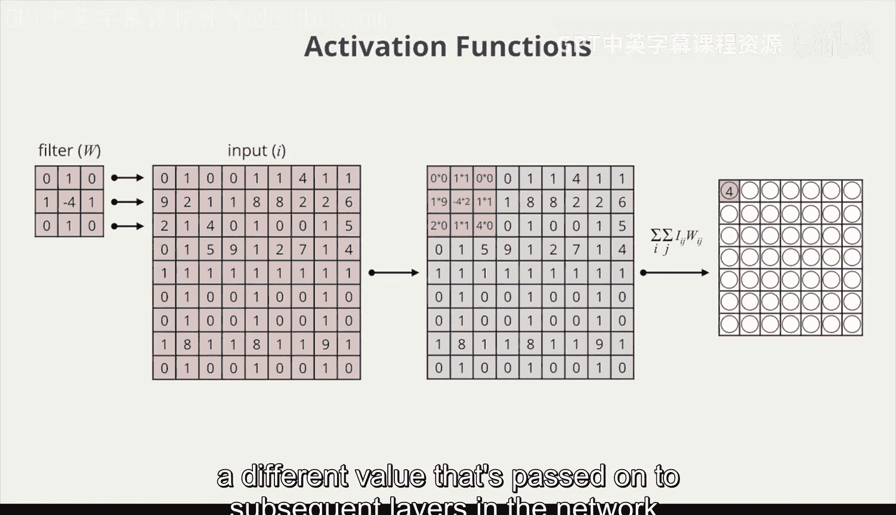
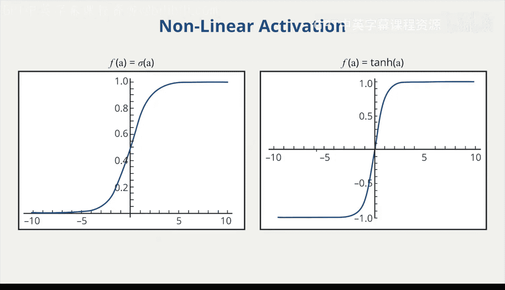
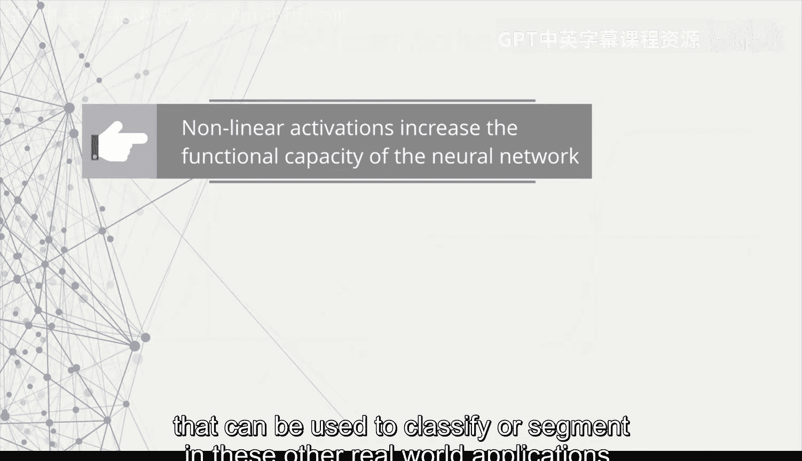
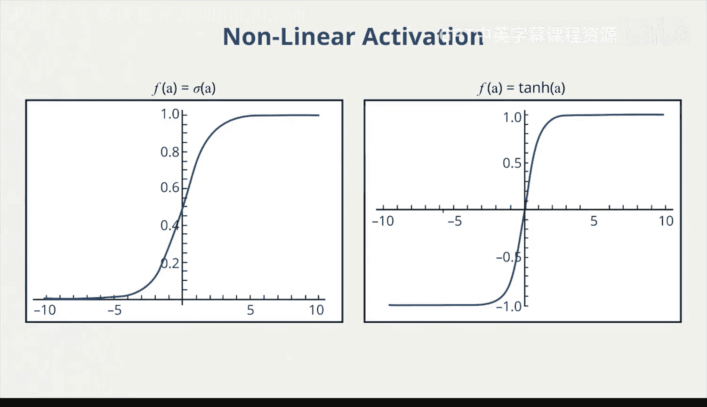
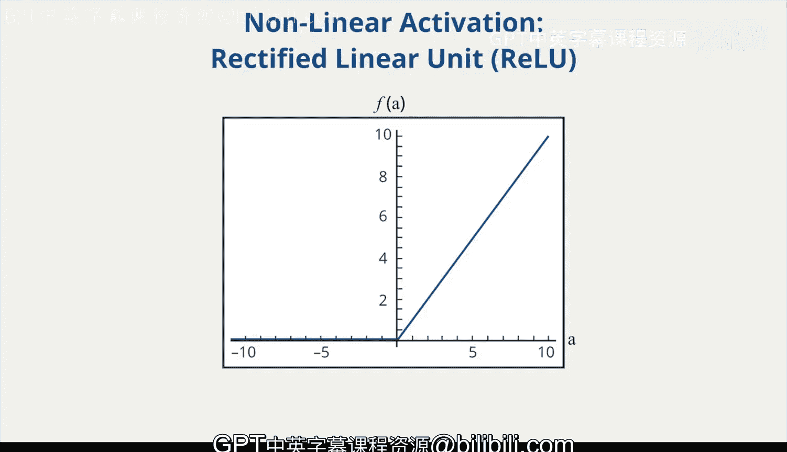

#  033：激活函数

在本节课中，我们将要学习神经网络中的第二个核心组件——激活函数。我们将了解它的作用、常见的类型，以及它们如何影响网络的学习能力。

---

上一节我们介绍了卷积操作，它负责从输入数据中提取特征。本节中我们来看看，卷积运算得到的数值如何通过激活函数进行转换，从而赋予神经网络强大的非线性表达能力。

回想一下将滤波器应用于图像输入的示例。我们进行逐元素相乘，然后求和，这就是卷积操作。求和的结果被放置在输出特征图的一个像素位置上。实际上，特征图中每个位置都代表一个人工神经元。它接收输入，并可能将其转换为不同的值，传递给网络中的后续层。

如果我们放大其中一个红色圆圈，这就是一个单独的人工神经元。它接收一些输入，这里我们展示三个输入值 `X1`、`X2`、`X3`。对于每个输入，都有一个对应的权重 `W1`、`W2`、`W3`。用这些权重与输入进行卷积的结果是一个和 `A`，它同样是逐元素相乘后的总和。

但通常我们不会直接将 `A` 传递给网络的后续层，而是会应用一个函数来处理这个输入，以产生不同类型的输出。

这是什么意思呢？一种最简单的形式是**线性激活**。到目前为止，我在展示卷积操作时，一直默认使用的就是这种形式：将卷积求和得到的值 `A` 直接输出。因此，线性激活函数对值 `A` 应用后的结果就是 `A` 本身，输入到输出没有发生任何变换。

然而，在设计神经网络时，我们实际使用的是**非线性激活函数**。你可能在逻辑回归或多层感知机中见过它们。这些非线性激活函数意味着，对于输入到人工神经元的 `A`，我们不是原样输出，而是以非线性的方式转换这个值。这极大地增强了神经网络的功能容量，因为它允许网络表示输入特征之间的非线性关系。这对于分类、分割等实际应用中的特征提取非常强大。

以下是两种经典的非线性激活函数：

*   **Sigmoid函数**：对于给定的输入值 `A`，它将结果压缩在 0 和 1 之间。在逻辑回归中，可以将其视为产生一个介于 0 和 1 之间的概率输出。
    *   **公式**：`σ(A) = 1 / (1 + e^(-A))`
*   **双曲正切函数**：它接收某个值 `A`，并进行类似的压缩，但将值压缩在 -1 和 1 之间。
    *   **公式**：`tanh(A) = (e^A - e^(-A)) / (e^A + e^(-A))`

虽然这些非线性激活函数在神经网络中曾非常强大，但它们也带来了一些问题。如果你注意到这些图的顶部或底部，会看到非常平坦的区域。在这些区域，即使输入值 `A` 变化很大，输出结果的变化也非常小。这意味着当数值以截然不同的方式变化时，神经网络能获得的信号非常微弱。这有时会导致网络训练停滞，不利于学习进行分类所需的特征表示。

因此，人们开始使用另一种类型的非线性激活函数。

**修正线性单元** 是一种非常简单的函数：对于输入 `A` 的任何负值，函数应用的结果是 0；如果输入值 `A` 大于 0，则返回 `A` 本身。其非线性特性非常简单，就是取输入值 `A` 和 0 之间的最大值。

*   **公式/代码**：`ReLU(A) = max(0, A)`

当这种非线性被引入到网络每一层的所有神经元时，网络表示输入信息的能力会显著提高。

---

本节课中我们一起学习了激活函数。我们了解到，激活函数是人工神经元中对卷积结果进行非线性变换的关键组件。我们介绍了线性激活、Sigmoid函数、双曲正切函数以及目前更常用的ReLU函数。理解不同激活函数的特性，对于设计和优化神经网络至关重要。