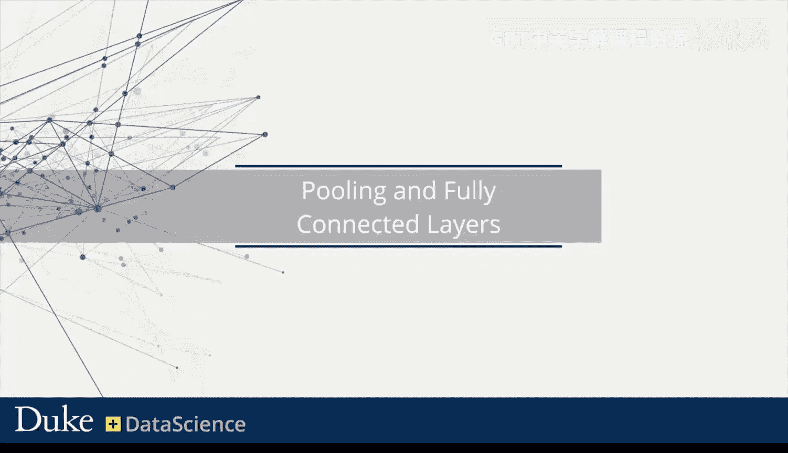
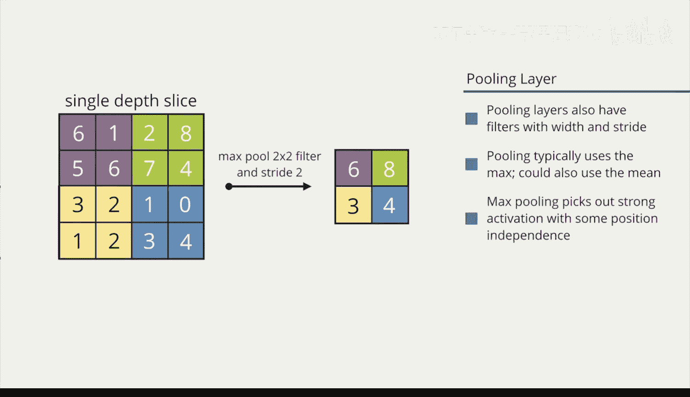
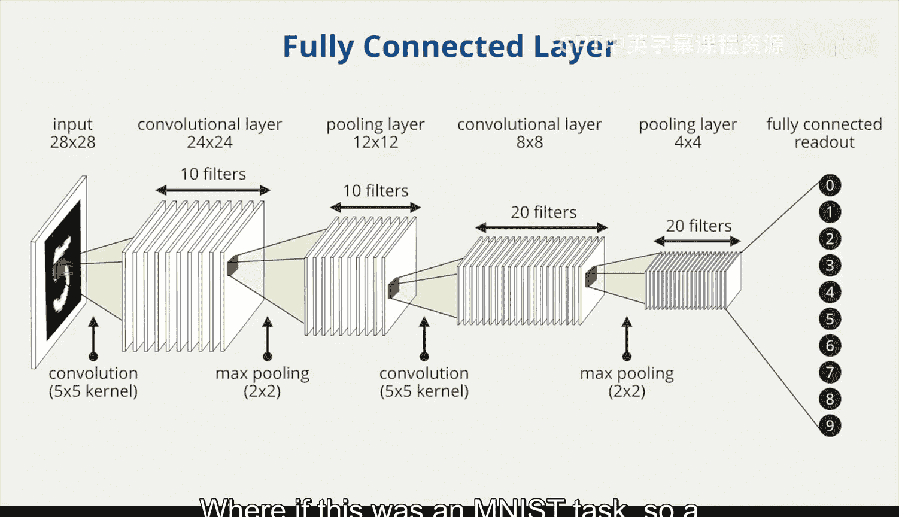
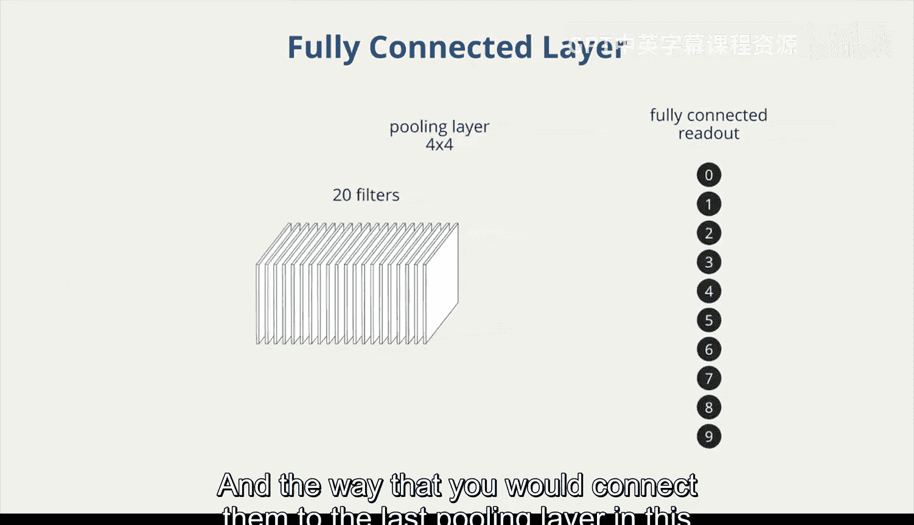
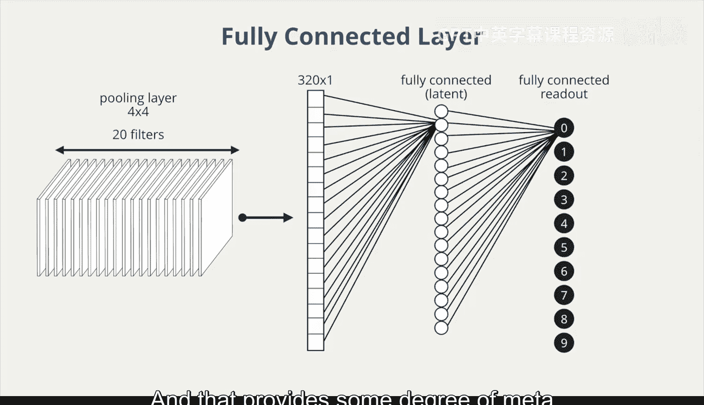

#  034：池化层与全连接层

在本节课中，我们将学习卷积神经网络（CNN）的另外两个核心组件：池化层和全连接层。我们将了解池化层如何通过下采样来降低计算复杂度、防止过拟合并增强平移不变性。随后，我们将探讨如何通过全连接层将提取到的高级特征映射到最终的分类结果。

## 池化层

上一节我们介绍了卷积层和激活函数，本节中我们来看看池化层。池化层通常应用在卷积和激活操作之后，其作用是减小传递给网络后续层的输入尺寸。

池化操作降低了整个网络的计算复杂度，使其更易于训练。它还能对抗过拟合，并通过提供一定程度的**平移不变性**来提升模型鲁棒性。平移不变性是指，无论某个特定特征出现在图像的左上角、中间还是右下角，神经网络都能正确识别它。这意味着，无论该特征在图像中如何平移，神经网络都能判断其身份。

那么这是如何实现的呢？池化层也有一个类似卷积核的“过滤器”，但它不进行卷积运算，而是将过滤器窗口内的所有值聚合为一个单一值。

以下是池化操作的两种常见方式：

*   **最大池化**：取窗口内的最大值。
*   **平均池化**：取窗口内所有值的平均值。通常更常用的是最大池化。

以一个2x2的窗口、步长为2的最大池化为例。这个2x2的窗口从左上角开始，依次移动到右上角、左下角和右下角。在每个窗口中，只取最大值，并将该值赋给输出中对应的位置。

例如，在左上角窗口中，最大值是6，那么输出对应位置就是6。右上角窗口最大值是8，输出就是8。左下角和右下角则分别是3和4。

关于平移不变性，可以这样理解：假设左上角窗口内有一个6，无论这个6具体位于该窗口的左上角还是右下角，最大池化操作都会将这个6传递到输出中。这样，神经网络就不必过分关心特征在局部区域内的精确位置，只要该信息对最终分类不是必需的，模型就能忽略它。因此，最大池化能在一定程度上提取强烈的激活信号，同时忽略其精确位置信息。

## 全连接层

在一个典型的卷积神经网络中，我们堆叠了之前介绍过的组件：首先通过卷积层构建特征图，接着是激活函数（图中未显示），然后进行最大池化来下采样特征图。这些操作（卷积、激活、池化）会反复堆叠多次，从而构建出图像特征的高级表示。

那么，这些高级特征是如何被处理并最终得出分类结果的呢？答案就是使用类似于之前学过的**多层感知机**。在CNN中，我们称这些层为**全连接层**。

最简单的形式是一个**全连接读出层**。例如，在一个手写数字分类任务中，你会有10个神经元，分别对应0到9这10个输出类别。

将这些神经元连接到网络中最后一个池化层的方法，是首先将池化层的输出**展平**或**向量化**。假设经过一系列卷积、激活和池化操作后，最终得到一个4x4x20的特征体积。你需要将这个三维体积转换成一个一维向量。

然后，读出层中的每个神经元都与这个向量化后的高级特征表示中的所有上游元素**全连接**。这意味着每个神经元都有一组权重，连接到向量中的每一个元素。图中仅展示了对应数字“0”类别的单个读出神经元的连接，但实际上，对应“1”、“2”等其他类别的神经元也同样会连接到该向量的所有元素。

与多层感知机类似，你也可以在CNN中使用**多层全连接神经元**。例如，可以在池化层和最终的分类读出层之间，加入一个或多个中间**隐含层**。这些隐含层的神经元与上游池化层展平后的向量全连接，而最终的分类读出神经元则与这个隐含层全连接。这种结构能够学习更复杂的元特征表示，从而有助于解决分类问题。

## 总结

本节课中，我们一起学习了卷积神经网络的两个关键部分。我们了解了**池化层**（特别是最大池化）如何通过下采样来减少数据维度、控制过拟合并提供平移不变性。随后，我们探讨了**全连接层**如何将卷积和池化后得到的高级特征图展平，并通过类似于传统神经网络的结构，最终映射到具体的分类输出。池化层和全连接层的结合，使得卷积神经网络能够高效地从图像中提取并理解复杂的模式。