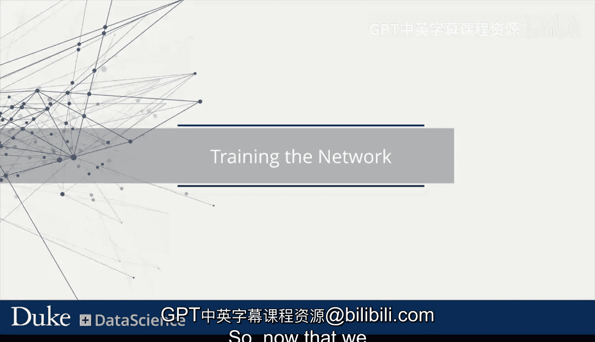
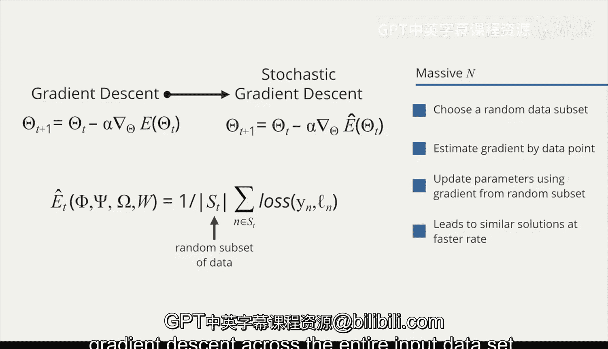

#  035：网络训练 🧠

在本节课中，我们将学习如何训练一个卷积神经网络。我们将回顾网络的前向传播过程，并详细介绍如何使用梯度下降法来优化网络参数，使其能够准确预测输入图像的标签。

---

上一节我们介绍了卷积层和池化层的基本操作。本节中，我们来看看如何通过梯度下降来训练整个网络。

我们假设有一组输入图像。每张输入图像都有一个对应的真实标签。对于一个二元分类任务，例如糖尿病视网膜病变检测，标签可以是+1（表示不健康的视网膜）或-1（表示健康的视网膜）。

对于每一张输入图像 \( I_n \)（第n张图像），我们将其输入卷积神经网络进行处理。以下是处理步骤：

以下是网络前向传播的核心步骤：

1.  **第一层卷积**：使用第一层的滤波器（表示为 \( \phi_1, \phi_2, ..., \phi_K \)，共K个）对输入图像 \( I_n \) 进行卷积操作。该操作由函数 \( F \) 表示，其输出是**第一层特征图** \( M_n \)。公式表示为：
    \[
    M_n = F(I_n; \phi_1, \phi_2, ..., \phi_K)
    \]

2.  **第二层卷积**：使用第二层的滤波器（表示为 \( \psi_1, \psi_2, ..., \psi_K \)）对第一层特征图 \( M_n \) 进行卷积操作。输出是**第二层特征图** \( L_n \)。公式表示为：
    \[
    L_n = F(M_n; \psi_1, \psi_2, ..., \psi_K)
    \]

3.  **第三层卷积**：使用第三层的滤波器（表示为 \( \omega_1, \omega_2, ..., \omega_K \)）对第二层特征图 \( L_n \) 进行卷积操作。输出是**第三层特征图** \( G_n \)。公式表示为：
    \[
    G_n = F(L_n; \omega_1, \omega_2, ..., \omega_K)
    \]

4.  **全连接层与分类**：最终的特征图 \( G_n \) 被送入一个或多个全连接层（表示为函数 \( \mathcal{L} \)），该层具有权重矩阵 \( W \)。全连接层将特征图转换为该输入图像的**预测标签** \( \hat{l}_n \)。公式表示为：
    \[
    \hat{l}_n = \mathcal{L}(G_n; W)
    \]

整个网络的目标是找到一组参数（所有卷积层的滤波器和全连接层的权重），使得网络的预测标签 \( \hat{l}_n \) 尽可能接近真实标签 \( l_n \)。

我们通过设置一个损失函数来衡量预测与真实标签之间的差异。对于二元分类任务，通常使用**二元交叉熵**函数。我们的目标是**最小化所有输入图像上的平均损失**，这个平均损失被称为**经验风险函数** \( E \)。

该风险函数是所有层滤波器参数 \( \phi, \psi, \omega \) 和全连接层权重 \( W \) 的函数。为简化表示，我们将所有这些参数统称为 \( \theta \)。训练的目标就是找到能够最小化 \( E(\theta) \) 的参数 \( \theta \)。一旦找到，我们就得到了一个可以输入图像并正确预测其是否患有糖尿病视网膜病变的系统。

---

由于经验风险函数 \( E(\theta) \) 通常非常复杂且存在于高维空间，我们使用**梯度下降**法来寻找最优参数。

梯度下降的核心思想是：在当前的参数估计点，计算风险函数的梯度（即多维斜率），然后沿着梯度的反方向更新参数，从而逐步降低损失值。

梯度下降的更新公式如下：
\[
\theta_{\text{new}} = \theta_{\text{old}} - \alpha \cdot \nabla E(\theta_{\text{old}})
\]
其中：
*   \( \alpha \) 是**学习率**，决定了每次更新的步长。
*   \( \nabla E(\theta_{\text{old}}) \) 是在当前参数 \( \theta_{\text{old}} \) 处计算的风险函数梯度。

这个过程可以形象地理解为“下山”：我们根据当前位置的坡度（梯度）方向，决定下一步往哪里走才能更快到达山谷（损失最小值）。

---

在实际操作中，计算整个数据集上的真实梯度（称为“批量梯度下降”）计算量巨大。因此，我们通常使用**随机梯度下降**或其变种。

随机梯度下降的核心是：在每次参数更新时，我们不使用全部数据来计算梯度，而是**随机抽取一个数据子集（称为“小批量”或“mini-batch”）**，仅计算该子集上的梯度，并用这个估计的梯度来更新参数。

这种方法在实践中非常有效，因为它能以更快的速度引导我们找到接近最优的解，同时避免了巨大的计算开销。

---

本节课中我们一起学习了卷积神经网络的训练流程。我们回顾了从输入图像到输出预测的前向传播步骤，明确了训练的目标是最小化经验风险。接着，我们介绍了使用梯度下降法来优化网络参数的原理，并解释了在实际中更高效的随机梯度下降方法。通过这个过程，网络能够自动学习到从图像中提取有效特征并做出准确预测的能力。