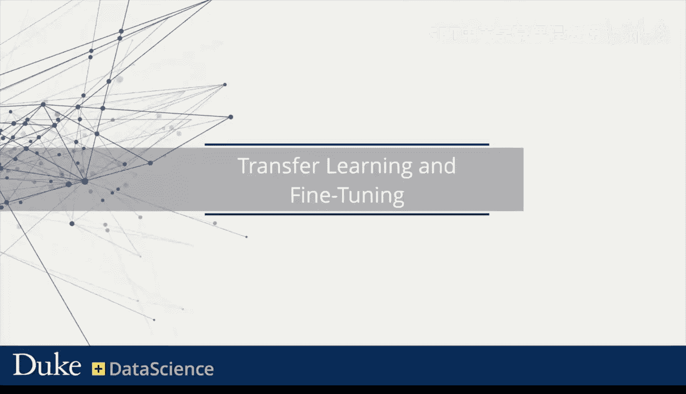
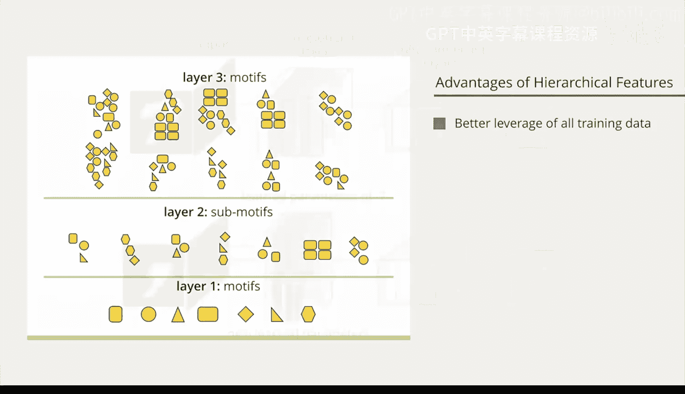
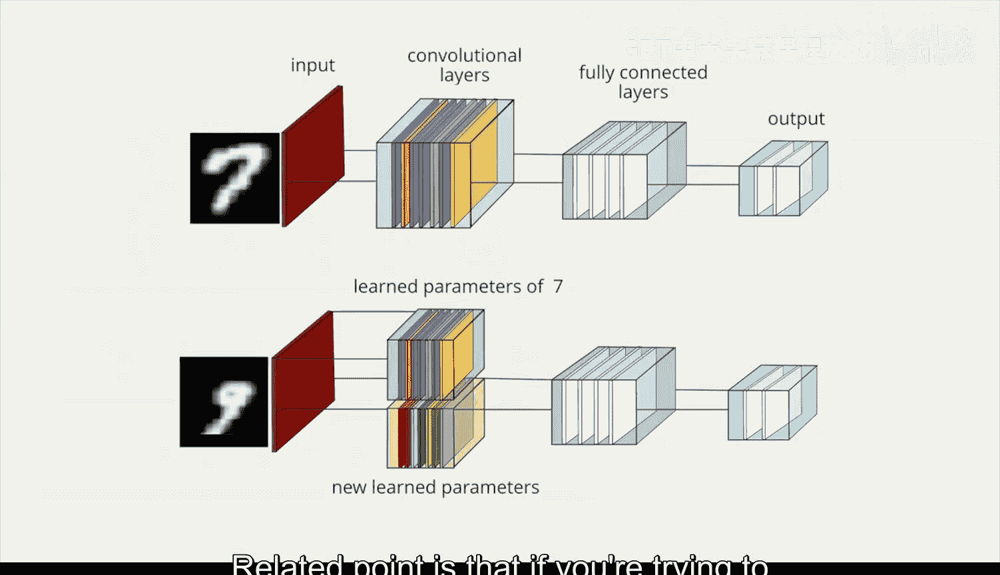
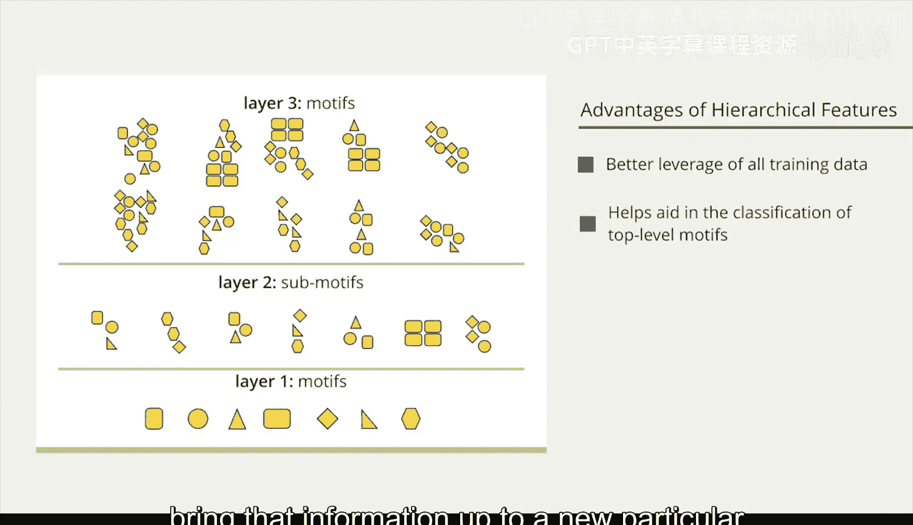
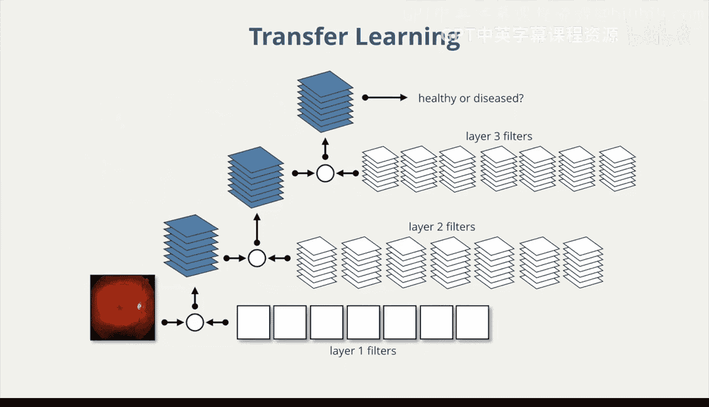
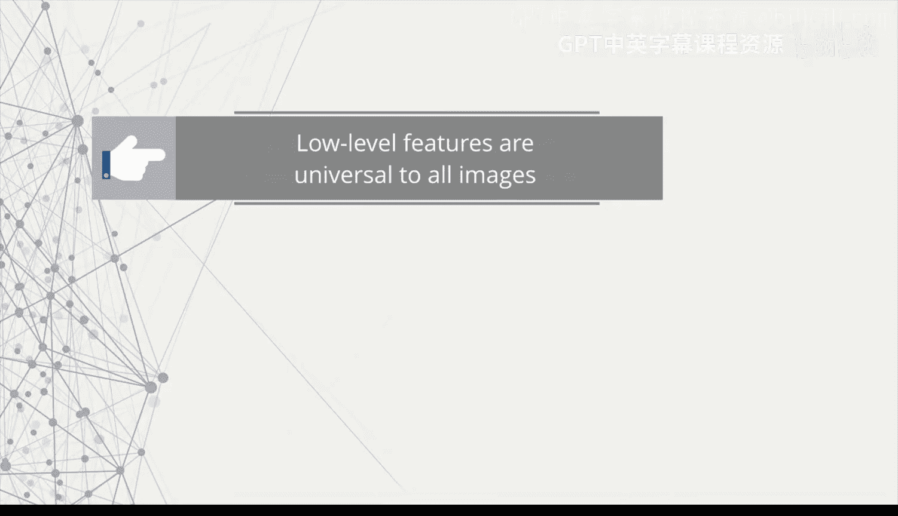
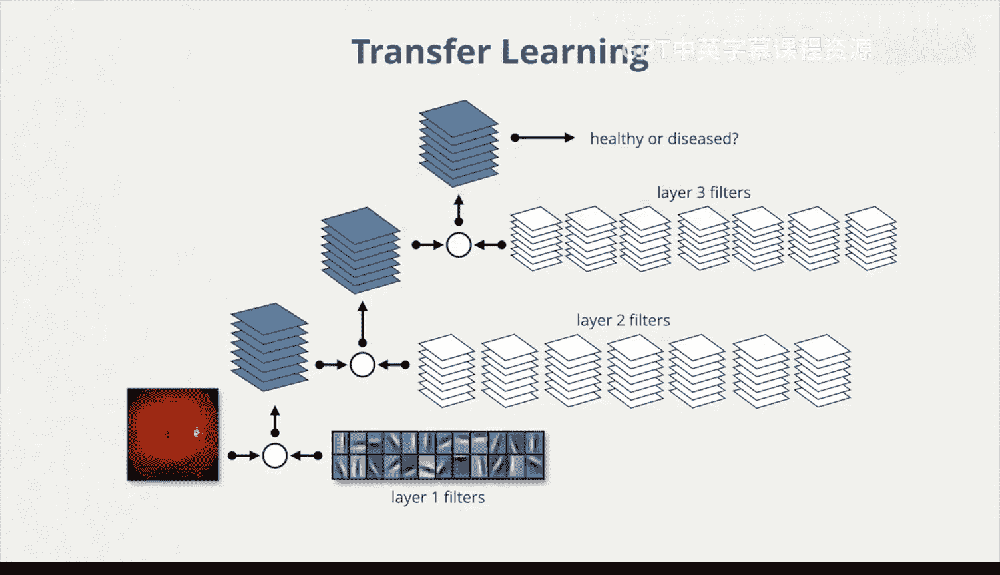
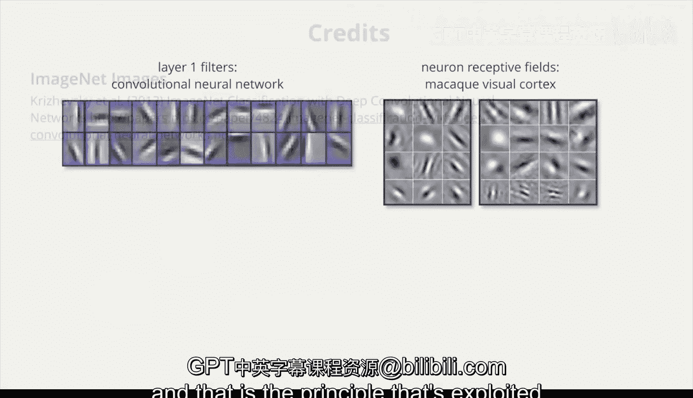

#  036：迁移学习与微调 🧠

在本节课中，我们将要学习迁移学习（Transfer Learning）的概念及其在卷积神经网络（CNN）中的应用。迁移学习是一种强大的技术，它允许我们利用在一个大型数据集上预训练的模型，来加速和提高另一个相关任务的学习效果。

---

## 图像特征分层表示的优势

上一节我们介绍了卷积神经网络如何分层提取图像特征。本节中我们来看看这种分层表示的主要优势。

卷积神经网络按顺序提取图像特征。这种分层表示的一大优势在于，通过学习和共享图像高层部分（即这些高层图案）中的统计相似性，我们能更好地利用所有训练数据。

这意味着，假设你正在构建一个手写数字分类系统，需要区分数字9和7。由于数字9和7共享一些低层元素，你可以通过观察数字7来学习数字9的基本构建模块。因此，在整个训练集中，你可以从其他样本中学到很多知识，以帮助你分类感兴趣的样本。这非常强大。

一个相关的要点是，如果你每次都试图独立学习某个高层过滤器，无异于重复造轮子。例如，一个高层“7”特征和一个高层“9”特征。当你引入一个新类别进行分类时，你将无法利用已学到的低层特征知识来帮助你构建表示以识别和分类这个新类别。这正是卷积神经网络的一个特别强大的特性。

因此，能够利用网络在低层学到的知识，并将这些信息应用到网络的新特定任务中，这个过程就称为**迁移学习**。

---

## 什么是迁移学习？

在迁移学习中，你需要一个已经在先前大型数据库分类任务（例如ImageNet图像分类竞赛）上训练好的网络。然后，你在感兴趣的领域进行额外的训练。

以糖尿病视网膜病变诊断为例。在训练神经网络时，你输入一张视网膜图像。这张图像被网络的所有层消化并提取特征，然后在网络顶部做出分类决策，判断视网膜是健康还是有病变。

事实证明，在这篇论文以及大多数同类研究中，他们使用了在ImageNet数据上预训练网络的权重进行初始化，这极大地提高和改善了模型性能。

原因在于，顶层的特征（有时仅指分类器中的全连接层）是高度专门化于特定任务或特定领域的。而低层的特征，即这些包含基本构建模块的层，对所有图像来说是通用的。

一旦你从一个大数据集中学到了这些低层特征，就不一定需要重新学习它们，因为视网膜图像中的低层构建模块同样出现在猫、汽车等其他图像中。因此，你可以通过重用网络、将另一个网络在不同图像分类任务中学到的知识迁移到当前感兴趣的分类任务上，来加速整个训练过程。这就是所谓的迁移学习。

---

## 低层特征的通用性

为了更清晰地阐明这一点，低层特征对所有图像是通用的。

在左侧，我想向你展示卷积神经网络第一层的过滤器。这些是小型边缘检测器，用于提取不同方向的边缘。你可以看到非常相似的感受野，或者说能激活右侧真实猴子视觉皮层中单个神经元的图像特征。

一个真实的哺乳动物视觉系统同样提取这些低层模式来构建其自身的表示，进而在生物大脑中构建对真实世界的感知。由此可见，这些特定的低层特征提取器具有某种非常基础和根本的特性。这正是迁移学习过程所利用的原理。

---

## 总结

本节课中我们一起学习了迁移学习。我们了解到，卷积神经网络的分层结构使得低层特征（如边缘、纹理）具有通用性。通过利用在大型数据集（如ImageNet）上预训练的网络权重，我们可以将这些通用的低层知识迁移到新的、数据可能较少的特定任务（如医学图像诊断）中。这不仅能显著加快训练速度，还能提高模型在新任务上的性能，是一种非常高效且强大的机器学习技术。