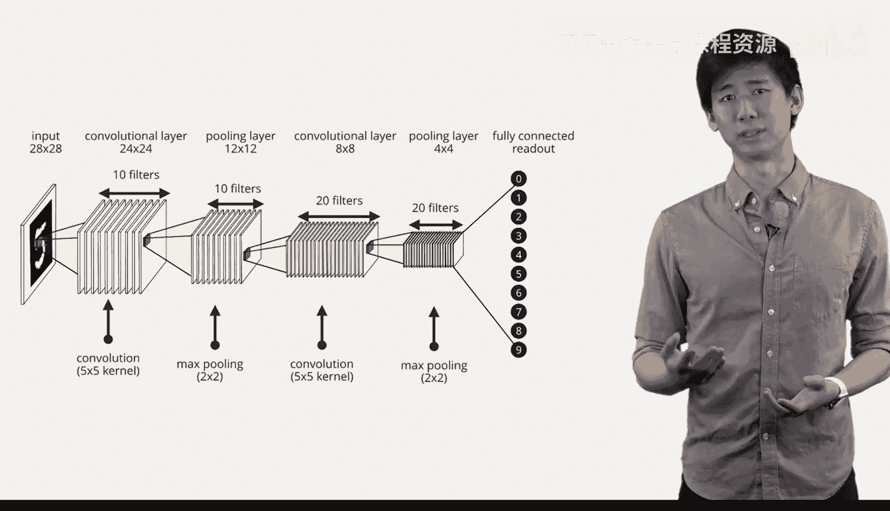

#  037：使用PyTorch实现CNN 🧠

在本节课中，我们将学习如何使用PyTorch实现卷积神经网络（CNN）。CNN是计算机视觉领域取得重大突破的核心技术，几乎在所有先进的视觉模型中都有应用。我们将介绍CNN的主要构建模块，并简要了解PyTorch的视觉库TorchVision，它提供了许多预训练的CNN模型和权重，方便我们在自己的应用中使用。

## 计算机视觉与CNN 🖼️

计算机视觉是深度学习取得最大成功的领域之一。卷积神经网络（通常缩写为CNN）构成了几乎所有先进视觉模型的主要部分。

上一节我们介绍了深度学习的基本概念，本节中我们来看看如何在PyTorch中构建CNN。

## CNN的主要构建模块 🧱

以下是CNN在PyTorch中的主要构建模块：

1.  **卷积层**：用于提取图像特征。
2.  **池化层**：用于降低特征图的空间维度。
3.  **激活函数**：如ReLU，用于引入非线性。
4.  **全连接层**：用于最终的分类或回归任务。

## 使用TorchVision加载预训练模型 📚

TorchVision是PyTorch的视觉库。通过TorchVision，我们可以轻松加载许多先进的CNN及其预训练权重，用于我们自己的应用程序。

## 作业任务：构建自己的CNN 🛠️

在作业中，你将构建自己的CNN。与多层感知机相比，CNN的性能应该会略有提升。

```python
# 示例：一个简单的CNN模型结构
import torch.nn as nn

class SimpleCNN(nn.Module):
    def __init__(self):
        super(SimpleCNN, self).__init__()
        self.conv1 = nn.Conv2d(1, 32, kernel_size=3, stride=1, padding=1)
        self.pool = nn.MaxPool2d(kernel_size=2, stride=2)
        self.fc = nn.Linear(32 * 14 * 14, 10)
    
    def forward(self, x):
        x = self.pool(nn.functional.relu(self.conv1(x)))
        x = x.view(-1, 32 * 14 * 14)
        x = self.fc(x)
        return x
```

## 调整架构以提升性能 ⚙️



尝试调整我们的架构，看看你能达到什么样的性能。

```python
# 尝试调整层数、滤波器数量等参数
class ImprovedCNN(nn.Module):
    def __init__(self):
        super(ImprovedCNN, self).__init__()
        self.conv1 = nn.Conv2d(1, 64, kernel_size=3, padding=1)
        self.conv2 = nn.Conv2d(64, 128, kernel_size=3, padding=1)
        self.pool = nn.MaxPool2d(2, 2)
        self.fc1 = nn.Linear(128 * 7 * 7, 256)
        self.fc2 = nn.Linear(256, 10)
    
    def forward(self, x):
        x = self.pool(nn.functional.relu(self.conv1(x)))
        x = self.pool(nn.functional.relu(self.conv2(x)))
        x = x.view(-1, 128 * 7 * 7)
        x = nn.functional.relu(self.fc1(x))
        x = self.fc2(x)
        return x
```

## 总结 📝


本节课中我们一起学习了如何使用PyTorch实现卷积神经网络（CNN）。我们介绍了CNN的主要构建模块，包括卷积层、池化层、激活函数和全连接层。我们还了解了如何使用TorchVision加载预训练的CNN模型和权重。最后，我们通过作业任务和架构调整，探讨了如何构建和优化自己的CNN模型，以提升性能。