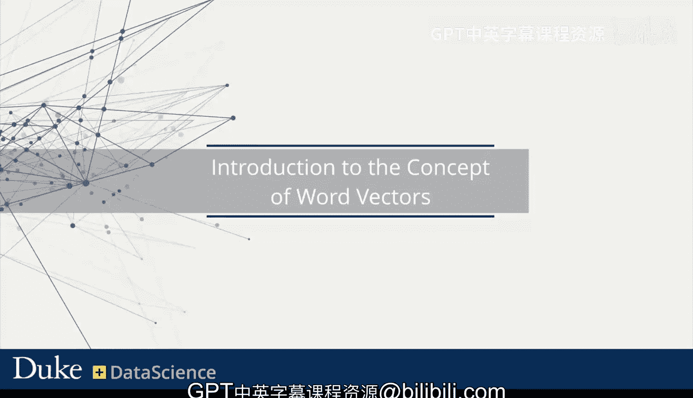
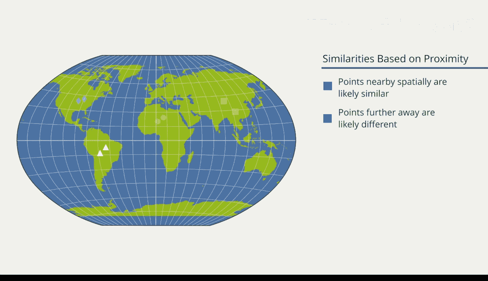
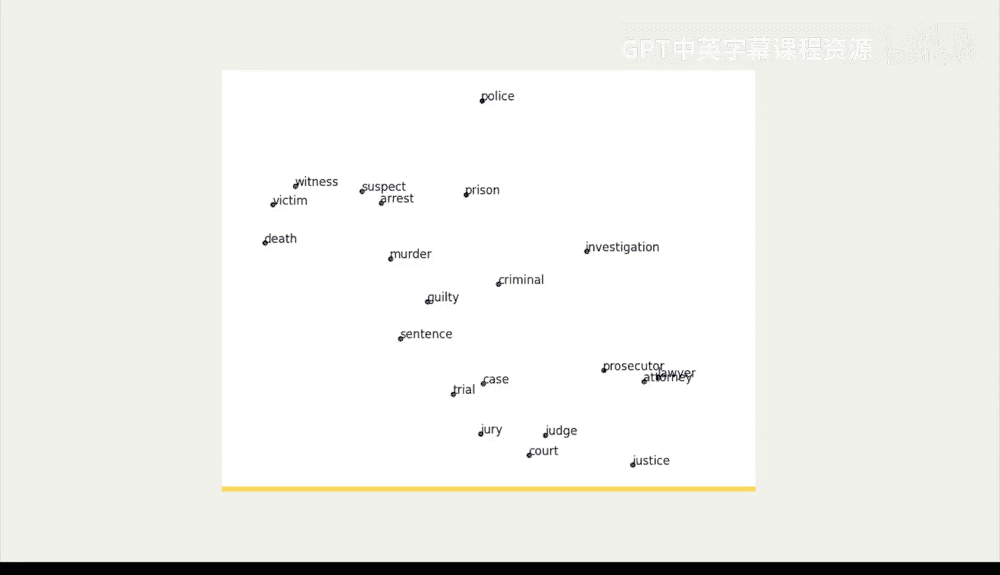
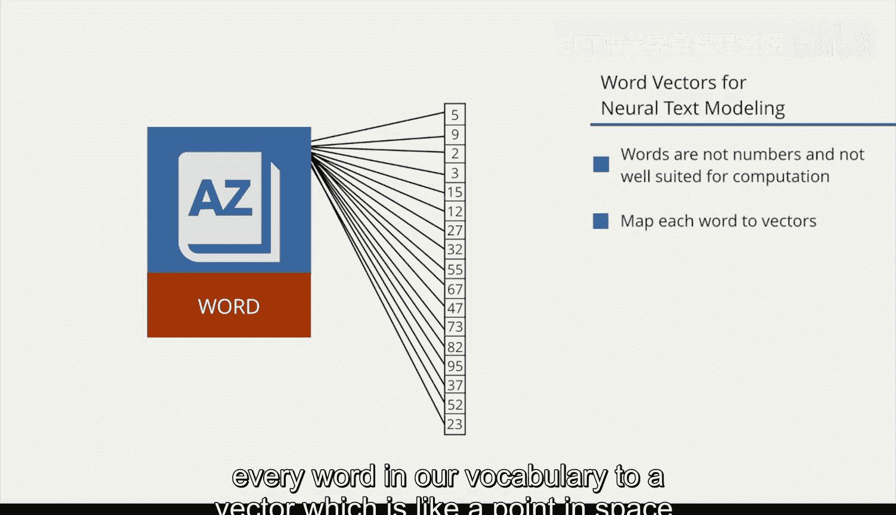
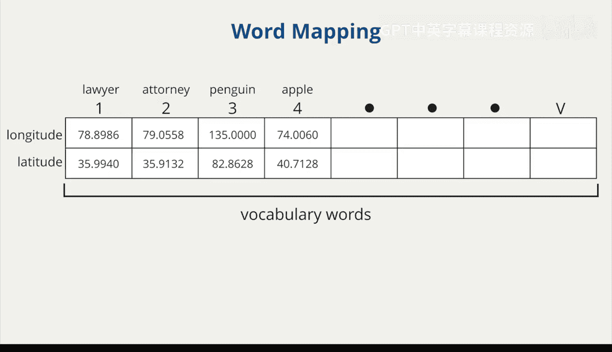

#  038：词向量概念介绍 📖

在本节课中，我们将要学习自然语言处理中的一个核心概念——词向量。词向量是将词汇映射到向量空间的技术，使得语义相近的词汇在向量空间中的位置也相近。这一概念是后续使用神经网络模型处理自然语言的基础。

---

## 从地图到词向量 🌍

上一节我们介绍了自然语言处理的基本背景，本节中我们来看看词向量这一核心概念是如何通过类比来理解的。

想象一张世界地图，上面有不同符号标记的点，例如正方形和三角形。如果地图上的两个点物理位置接近，那么它们所代表的地区特征（如文化、地理、历史）也可能相似。反之，相距较远的点则代表特征迥异的地区。地图上的每个位置可以用两个数字（经度和纬度）来表示，这构成了一个二维空间。在这个空间中，位置的接近程度反映了地区的相似性。

我们将类似的概念应用于词汇。每个词汇将被映射到一个多维空间中的一个点（向量）。在这个向量空间中，两个词的距离越近，它们的语义就越相似或相关；距离越远，则语义差异越大。

以下是这一概念的核心表述：

*   **核心概念**：每个词被映射为一个向量。语义相似的词，其向量在空间中的距离较近；语义不同的词，其向量距离较远。

---

## 词向量的基本思想 💡

上一节我们通过地图类比理解了词向量的空间相似性概念，本节中我们来具体看看其形式化定义。

我们有一个包含 **V** 个词的词汇表：`word1, word2, ..., wordV`。目标是为每个词学习一个向量表示。最初为了便于理解，我们设想将其映射到二维空间（类似经纬度），但实际应用中，词向量的维度通常远高于二维。

学习的目标是：让语义相近的词（如“猫”和“狗”）的向量在空间中彼此靠近；让语义无关的词（如“猫”和“宇宙”）的向量彼此远离。这种将词映射为向量的技术常被称为 **Word2Vec**。

下图展示了词向量空间的一个示例（尽管文字较小，但可以看出位置邻近的词确实语义相关）：

---

## 为什么需要词向量？ 🔢

上一节我们了解了词向量的目标，本节中我们探讨为什么需要将词表示为向量。

词汇本身不是数字，而是符号。然而，我们用于建模的机器学习算法通常需要数值输入。因此，我们需要一种方法将每个词转换为数值形式。

词向量正是提供了这种映射。通过将每个词表示为一个数值向量（空间中的一个点），我们就能对语言进行数学上的分析和建模。关键在于，这种表示方法捕捉了词汇间的语义关系，相似的词具有相似的向量表示。

以下是词向量价值的总结：

*   **核心需求**：算法处理需要数值输入，而词是符号。词向量实现了从符号到数值向量的映射。
*   **关键特性**：该映射保留了语义信息，语义相似性体现为向量空间的邻近性。

---

## 学习词向量 🧠

上一节我们明确了词向量的作用，本节中我们简要说明如何获得这些向量。

词向量的映射不是预先定义的，而是通过机器学习模型从大量文本数据中**学习**得到的。在后续的自然语言处理模型讨论中，学习每个词到其向量的映射将是一个核心组成部分。

有多种方法可以实现这种学习（例如，我们之后会介绍的特定神经网络架构）。重要的是，我们通常学习的是高维向量（维度 > 2），以捕捉更丰富、更复杂的语义关系。

---

## 总结 📝

本节课中我们一起学习了词向量的基本概念。

*   我们通过地图的类比引入了概念：将词映射到向量空间，用空间距离表示语义相似度。
*   我们理解了词向量是将非数值的词汇转化为算法可处理的数值向量的关键步骤。
*   我们知道了这种映射是通过数据驱动的方式学习得到的，并且通常是高维的。

在接下来的课程中，我们将具体介绍如何实现这种词向量的学习，并如何将其应用于自然语言处理任务中。