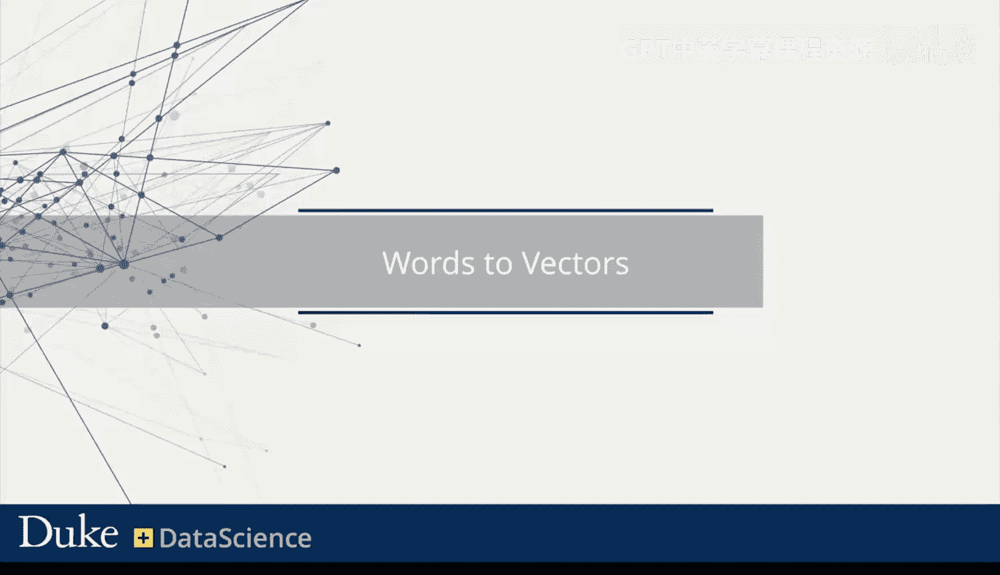
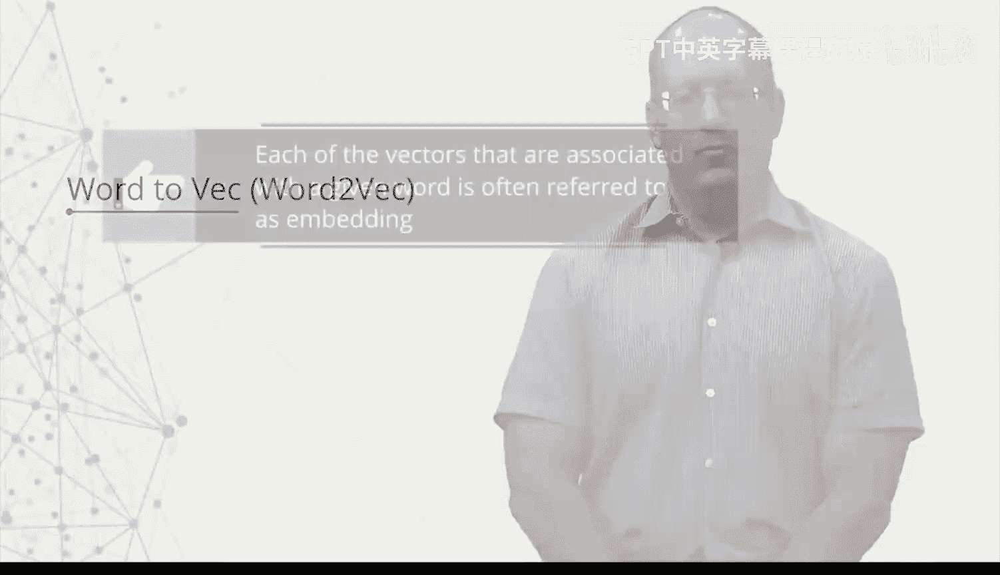
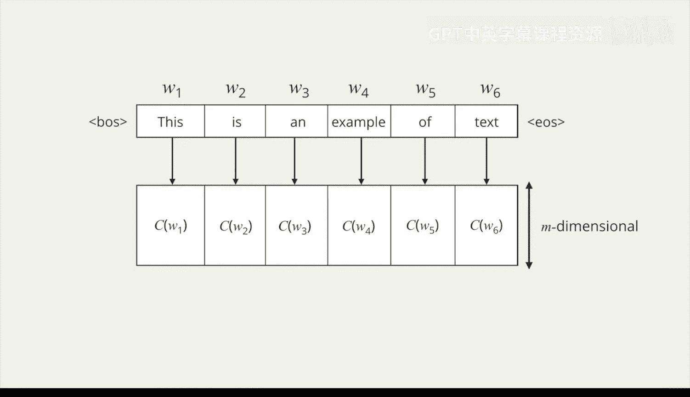

#  039：从词到向量 📖➡️🔢

在本节课中，我们将学习一个自然语言处理中的核心概念：如何将文本中的单词转换为计算机可以处理的数字形式，即“词向量”或“词嵌入”。

上一节我们介绍了将单词映射到向量的基本想法。本节中，我们将更深入地探讨这一概念，并提供更多细节。

## 什么是词向量（Word to Vector）？

将单词建模或映射为向量的想法被称为 **Word to V**（词向量）。这是一个非常自然且广泛使用的术语。与每个单词相关联的向量，有时也被称为一个 **嵌入**。这主要是为了引入一些你在阅读相关文献时可能会遇到的术语。

嵌入的概念，是指将单词“嵌入”到某个特征空间中。回想我们之前看过的地球地图图片，那是一个二维空间。在那个例子中，我们将每个单词嵌入到一个二维空间中。因此，词向量这个概念有时也被称为词嵌入。

## 核心概念与符号表示

让我们用 **Wᵢ** 来对应一个单词，它只是一个代表特定单词的符号。用 **Wᵢ** 表示我们词汇表中的第 i 个单词。

词嵌入的核心思想是，我们将取第 i 个单词，并将其映射到一个 **M 维向量**。这个向量由 M 个数字组成。在我们之前看过的二维地图例子中，M 等于 2。但我们不必局限于二维，通常 M 可能是 100 或 200，这取决于我们要解决的问题。

以下是词向量概念的关键点：

*   **映射关系**：将词汇表中的每个单词映射到一个 M 维向量。
*   **维度 M**：向量维度 M 的值取决于我们选择的具体问题，我们可以选择不同的 M 值。

## 词汇表与码本

从概念上理解，假设我们有一个由 V 个单词组成的词汇表。那么 W₁ 代表单词 1，W₂ 代表单词 2，一直到 Wᵥ 代表第 V 个单词。这就是我们的词汇表。

当我们实现词向量映射后，我们将得到一个从词汇表中每个单词（W₁ 到 Wᵥ）到向量的映射。我们将这个向量称为 **C₁**（对应单词 1），**C₂**（对应单词 2），以此类推。每个向量 **Cᵢ** 都是 M 维的。

在完成学习之后，我们会得到一个被称为 **码本** 的集合，它是一组与词汇表中 V 个单词相关联的 V 个向量。每个向量 **Cᵢ** 都与单词 **Wᵢ** 相关联。

我们希望实现的目标是：如果两个单词彼此相似（同义词或相关词），我们希望这两个单词的向量在这个 M 维空间中是相似或彼此接近的。我们将基于一个大型文本语料库来学习这些向量 **C₁** 到 **Cᵥ**。通过学习过程，我们的目标是实现：在这个 M 维向量空间中的“邻近性”概念，与相关单词的“关联性”概念联系起来。

## 一个简单的例子

考虑一个包含六个单词的文本示例。通常，我们会考虑一个代表 **句子开始** 的标记（BOS），以及一个代表 **句子结束** 的标记（EOS），这样自然语言模型就知道句子何时开始和结束。

在这个例子中，词汇表中的六个单词被映射为六个“代码”。**C_{W₁}** 对应第一个单词的代码，**C_{W₆}** 对应第六个单词的代码。

一旦我们实现了这种映射，即我们可以将词汇表中的实际单词映射为数字（在这个例子中由六个 M 维向量表示，这些向量当然由数字组成），我们就为在计算机上进行分析做好了准备，因为现在它已经可以进行数学运算了。

## 如何学习词向量？

现在我们需要思考的问题是：我们如何实际学习这些词向量？我们如何学习这些词向量，以便它们能让我们实现自然语言处理的目标？

随着课程的深入，我们将开始开发多种不同的方法来实现这一点。事实上，学习单词与向量之间关系的方法不止一种，而是有多种。这些不同的方法通常会产生非常相似的结果。这一点很重要，因为它意味着这个概念非常稳健，并不那么依赖于你使用的特定方法。有多种方法都能产生非常有效的结果。

接下来，我们将开始深入探讨学习词嵌入的技术。

---

**本节课总结**：在本节课中，我们一起学习了自然语言处理的基础——词向量（Word to Vector）或词嵌入（Word Embedding）的概念。我们了解了将单词映射为多维向量的必要性，介绍了相关的术语（如码本），并明确了学习词向量的目标：让语义相近的单词在向量空间中也彼此接近。最后，我们指出了存在多种学习词向量的有效方法，为后续课程奠定了基础。