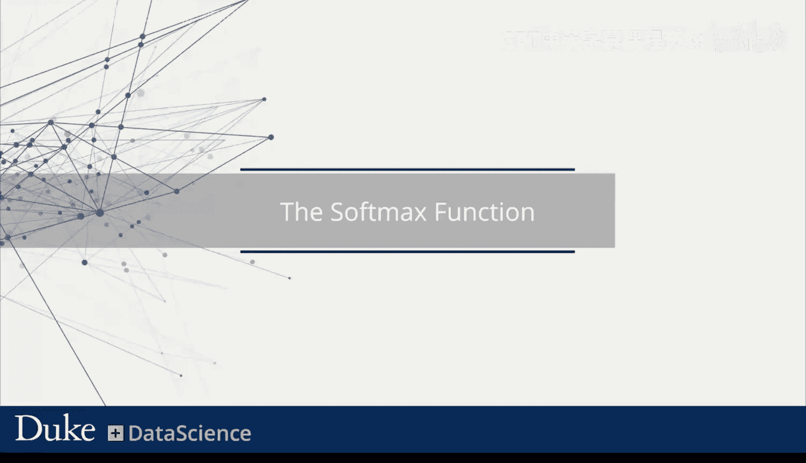
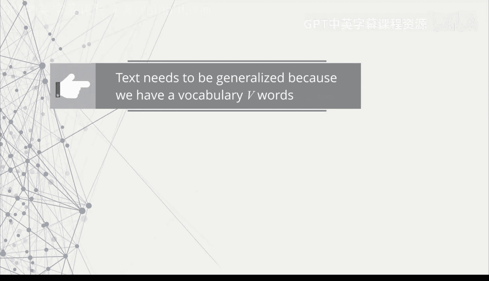
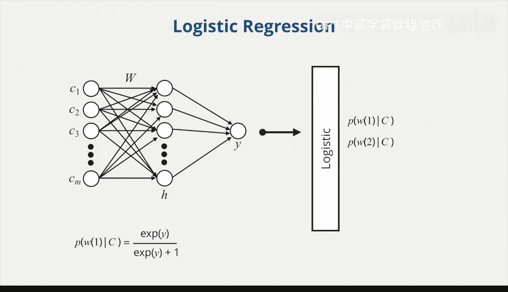
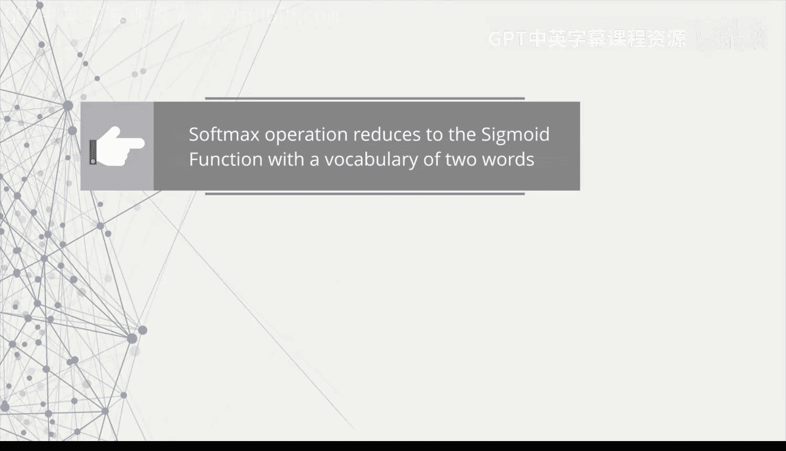
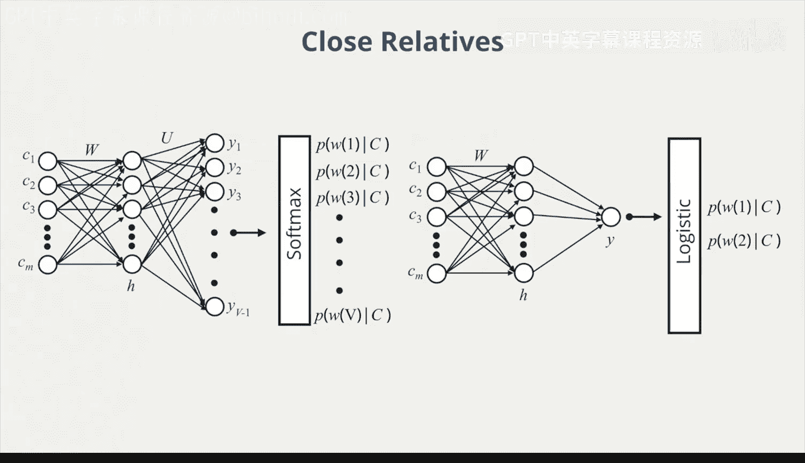

#  042：Softmax函数详解 📚

在本节课中，我们将深入探讨一个在文本神经网络模型中引入的新工具——Softmax函数。我们将了解它的作用、它与之前学过的逻辑函数的联系，以及它如何将二元分类问题推广到多类别场景。

---

## 概述

上一节我们介绍了文本的神经网络模型，该模型利用了之前学习过的多层感知机。然而，在这个文本模型中，我们引入了一个新函数——Softmax，这是我们在之前讨论多层感知机时未曾见过的。

这是一个新的工具，值得花些时间来讨论它，并将其与我们之前的工作联系起来。

---

## 从二元到多元：为什么需要Softmax？ 🔄

你或许还记得，当我们介绍逻辑回归和最初的多层感知机时，我们处理的是二元或二维的输出结果。

但在处理文本时，我们必须将其推广，因为我们不仅仅有两个单词。我们有一个包含 **V** 个单词的词汇表。因此，我们必须回答一个问题：如何计算所有可能结果的概率，而不仅仅是二元结果的概率？Softmax函数允许我们做到这一点。

---

## Softmax：逻辑函数的推广 🧮

然而，我想强调的是，从概念上讲，这个Softmax函数与我们之前用于二元结果的逻辑函数并没有太大不同。事实上，它是逻辑函数的一个**推广**。

为了帮助你回忆，这里再次展示了我们的文本神经网络模型。我们有一个单词，它由一个M维向量 **C₁** 到 **Cₘ** 表示。我们通过权重矩阵 **W** 将该输入向量映射到隐藏单元 **H**，再通过权重矩阵 **U** 将隐藏单元映射到神经网络顶部的 **V-1** 个输出（**y₁** 到 **yᵥ₋₁**）。然后，这些输出值被送入底部的函数，即 **Softmax**。

这看起来可能很复杂，不像我们以前见过的东西。但我们将看到，它实际上并不像看起来那么陌生。

通过这个Softmax函数，我们可以量化词汇表中每个单词（单词1、单词2……单词V）出现在输入单词附近的概率。我们将通过观察真实文本来进行学习，因为我们知道一个单词及其周围的单词，即我们知道“真相”。我们的目标是学习这个由权重参数 **W**、**U** 以及词向量 **C** 共同构成的文本神经网络模型。

---

## 深入Softmax方程

让我们花点时间讨论一下底部的Softmax方程。为了简单起见，我把它再次写在这里。

我们设定 **yᵥ**（对应词汇表中的第V个单词）等于0。Softmax就是底部的方程。

现在，让我们考虑一个**只有两个单词**的简单词汇表的情况。

在这种情况下，顶部那个看似复杂的方程会大大简化。我们只有两个输出单词，W₁ 和 W₂。

*   单词 W₁ 的概率，给定编码 **C**，是逻辑函数（或Sigmoid函数）σ(y₁)。
*   单词 W₂ 的概率是 1 - σ(y₁)，即 1 / (exp(y₁) + 1)。

因此，我们的文本神经网络模型在很多方面只是逻辑模型的**推广**。当只有两个单词时，它就是逻辑模型的一个特例。

需要注意的是，**Softmax操作本质上是逻辑函数（Sigmoid函数）的推广**，适用于我们拥有 **V** 个单词（而非仅两个）的词汇表的情况。在只有两个单词的情况下，它直接简化为我们熟悉的Sigmoid函数。

所以，我们可以认为，在文本神经网络建模中新引入的Softmax，与我们更熟悉的逻辑回归实际上是**近亲**，它们密切相关。Softmax操作只是逻辑连接函数的一个推广。

---

## 总结与展望 🎯

本节课我们一起学习了Softmax函数。它虽然看起来有些新，但本质上并不是一个与已有逻辑回归概念截然不同的概念。它只是一个将二元逻辑扩展到多元分类的强大工具。

现在，我们掌握了带有Softmax（逻辑函数的推广）的文本神经网络模型工具。我们已经准备好提出下一个问题：**如何利用这个模型来学习词向量，并同时学习与文本多层感知机模型相关的参数W和U？**

在接下来的课程中，我们将使用文本语料库来**同时学习所有这些参数**。