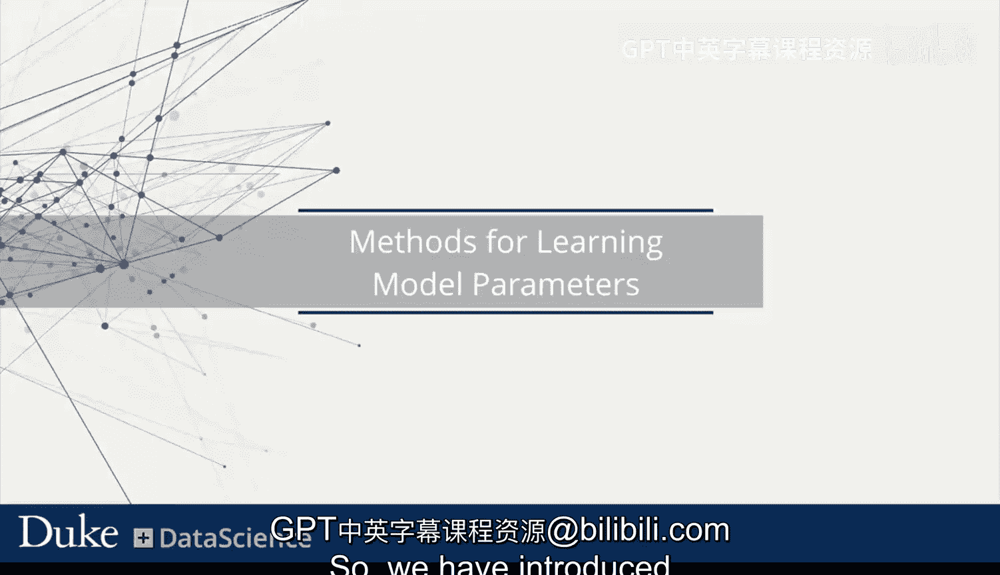
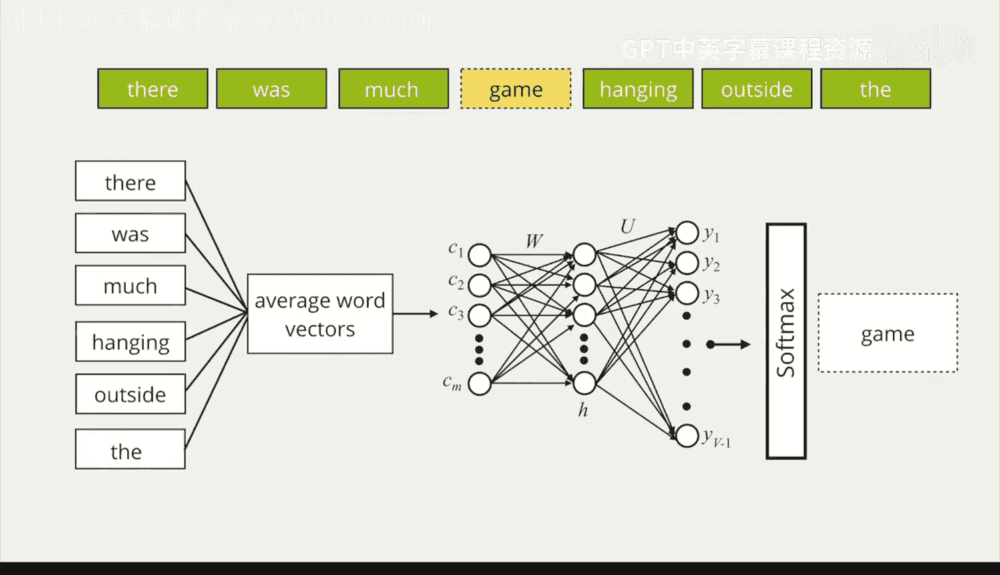
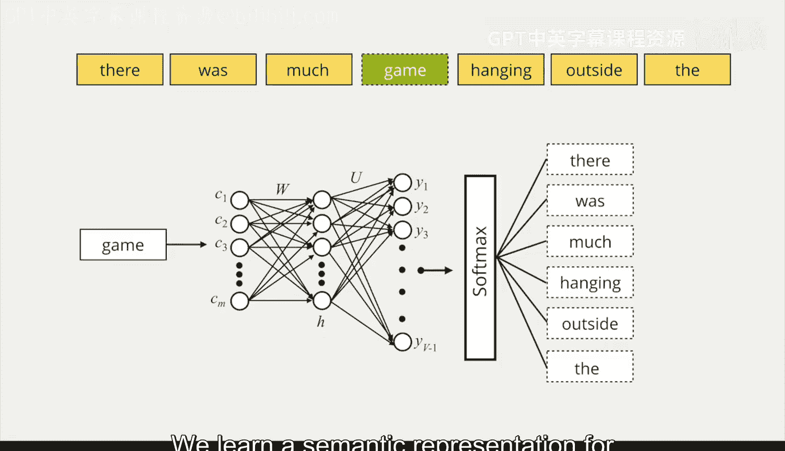
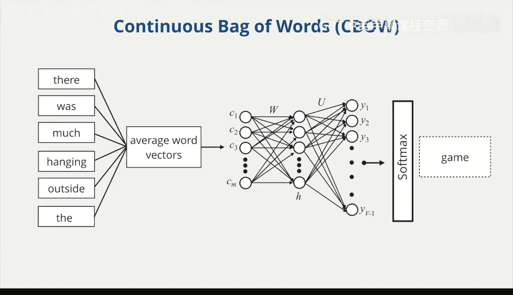
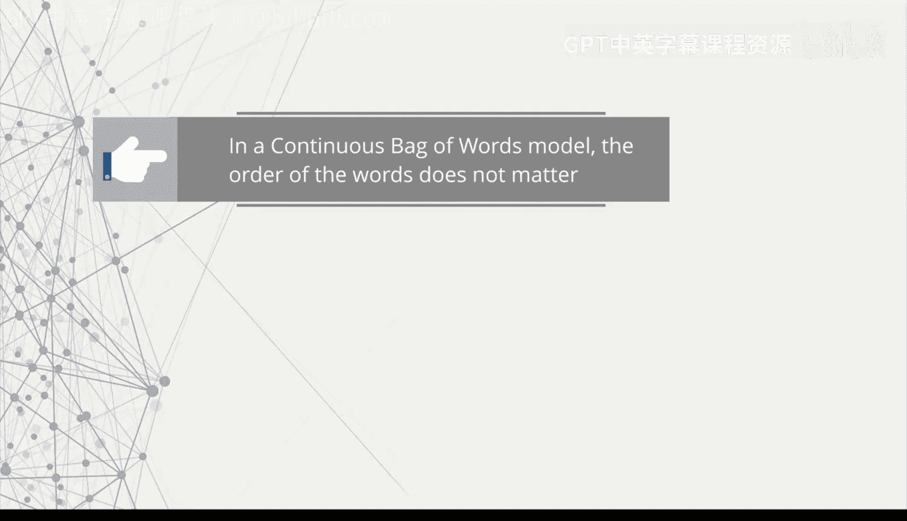
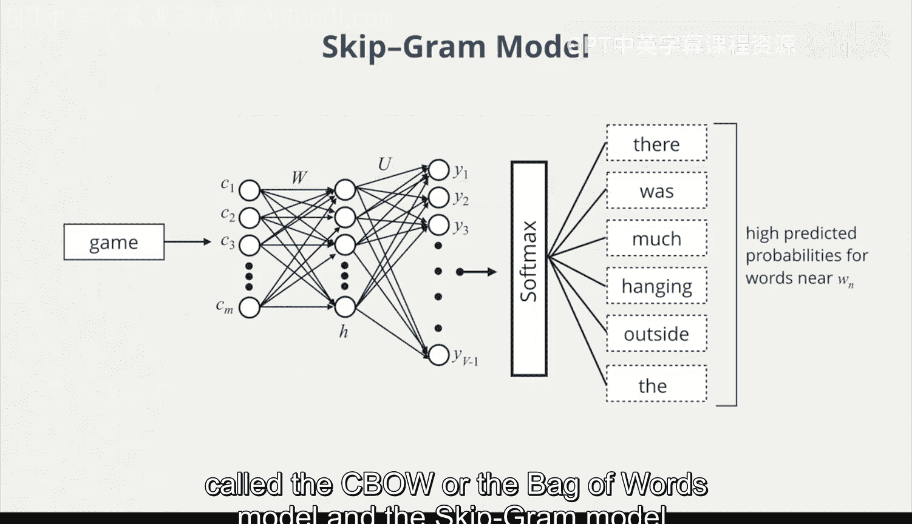
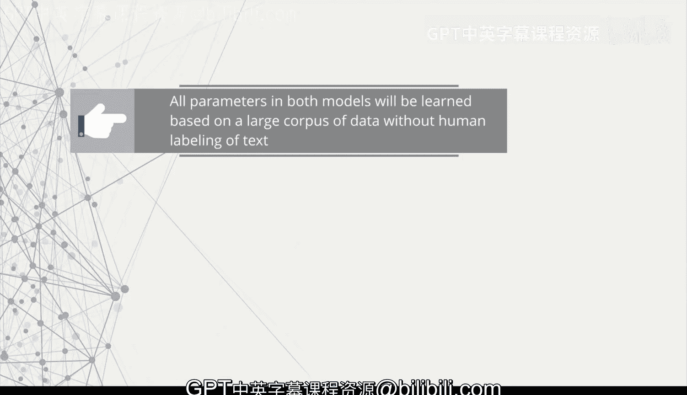

#  043：模型参数学习方法

## 概述
在本节课中，我们将要学习如何为词汇表中的每个单词学习一个向量表示，这个过程被称为学习词嵌入或词向量。我们将探讨两种核心的学习方法：连续词袋模型和跳字模型。理解这些方法是如何从大量文本数据中自动学习到单词的语义表示，是应用词向量进行后续分析的基础。

## 词向量学习的基本思想

上一节我们介绍了将词汇映射为向量的概念。但一个开放的问题是：这些词向量本身是如何学习的？

事实证明，学习这些词向量有多种不同的方法，这是一个非常活跃的研究领域。我们将介绍几种目前被广泛使用的方法。

其核心思想是：**通过单词在上下文中的出现模式来学习其向量表示**。具体来说，我们可以构建一个预测模型。

## 连续词袋模型

一种方法是利用目标单词周围的上下文单词来预测目标单词本身。

假设我们有一个文档，其中包含一系列单词。我们关注第 `n` 个单词。我们的目标是，基于它周围的单词（例如，前两个词和后两个词）来预测这个第 `n` 个单词是什么。

以下是构建此预测模型的步骤：

1.  **获取上下文向量**：假设我们已经有了上下文单词（例如，`word_{n-2}`, `word_{n-1}`, `word_{n+1}`, `word_{n+2}`）的词向量。
2.  **计算平均向量**：将这些上下文词向量进行平均，得到一个 `M` 维的向量。我们将其表示为 `c = [c1, c2, ..., cM]`。
3.  **通过多层感知机**：将这个平均向量 `c` 输入到一个多层感知机中。该网络由参数 `W`, `U` 以及偏置 `b`, `β` 定义。
4.  **使用Softmax输出概率**：在多层感知机的末端，使用一个Softmax函数。Softmax将网络的输出转换为一个概率分布，表示词汇表中 `V` 个单词中的每一个是目标单词 `word_n` 的概率。

**公式表示**：
给定上下文单词集合 `Context`，模型预测目标单词 `w_t` 的概率为：
`P(w_t | Context) = Softmax( U * f( W * avg(v(Context)) + b ) + β )`
其中 `v(word)` 表示单词的词向量，`f` 是激活函数。

因此，我们得到了一个可以预测第 `n` 个单词概率的模型。如果这个模型预测得很准确，那就意味着我们为每个单词学习的向量表示（即词嵌入）能够很好地捕捉其语义，因为上下文信息被有效地编码到了向量中。

为了更清晰地说明，我们来看一个海明威文本的例子。假设绿色高亮部分是上下文单词（“there”, “was”, “much”, “hanging”, “outside”, “the”），我们的模型需要预测中间缺失的单词“game”。通过上述步骤，模型利用上下文单词的向量来预测“game”出现的概率。训练的目标是让模型参数（包括多层感知机的参数和所有单词的词向量）能够使这个预测概率最大化。

## 跳字模型

另一种互补的方法是，**给定中心单词，来预测其周围的上下文单词**。

假设我们已知第 `n` 个单词是“game”，并且它由一个向量 `c = [c1, c2, ..., cM]` 表示。

以下是构建此预测模型的步骤：

1.  **输入中心词向量**：将中心单词“game”的词向量 `c` 作为输入。
2.  **通过多层感知机**：将向量 `c` 输入到一个多层感知机中。
3.  **使用Softmax输出概率**：在网络的末端，Softmax函数会输出一个概率分布。但在这里，这个分布表示的是词汇表中每个单词出现在中心词周围特定位置（例如，前两个或后两个位置）的概率。在实践中，模型通常会为每个上下文位置输出一个独立的概率分布。

**公式表示（简化）**：
给定中心单词 `w_t`，模型预测其某个上下文单词 `w_c` 的概率为：
`P(w_c | w_t) = Softmax( U * f( W * v(w_t) + b ) + β )`

因此，我们希望模型能够理解，当出现单词“game”时，其周围很可能出现“there”, “was”, “much”, “hanging”, “outside”, “the”这些词。通过这种方式，我们同样可以有效地学习到每个单词的语义向量表示。

## 模型对比与参数学习

我们来总结一下这两种模型：
*   **连续词袋模型**：通过上下文预测中心词。因为它对上下文单词进行平均，所以单词的顺序无关紧要，这就像把单词扔进一个袋子（Bag），故得名。
*   **跳字模型**：通过中心词预测上下文。它试图“跳过”中心词去捕捉周围的语法（gram），故得名。

在这两种情况下，我们想要学习的参数包括：
1.  所有单词的词向量矩阵 `C`（可以看作一个编码本）。
2.  多层感知机的参数 `W`, `U` 以及偏置 `b`, `β`。

**关键点**：所有这些参数都可以基于一个大型的文本语料库进行学习。**我们不需要任何人工标注的文本含义标签**，模型可以直接从文本数据本身学习到有意义的词向量表示。学习过程通常通过最大化在训练数据上预测的似然概率（或最小化损失函数）来完成。

## 总结
本节课中，我们一起学习了两种主流的词向量学习方法：连续词袋模型和跳字模型。它们的核心思想都是利用单词与其上下文之间的共现关系，通过构建一个神经网络预测任务，来无监督地学习每个单词的向量表示。学习到的词向量能够捕捉单词的语义信息，为后续的文本分析任务（如分类、情感分析等）提供了强大的基础特征。