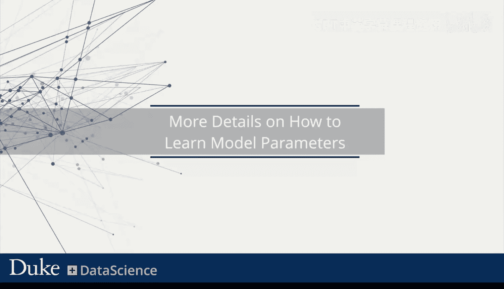
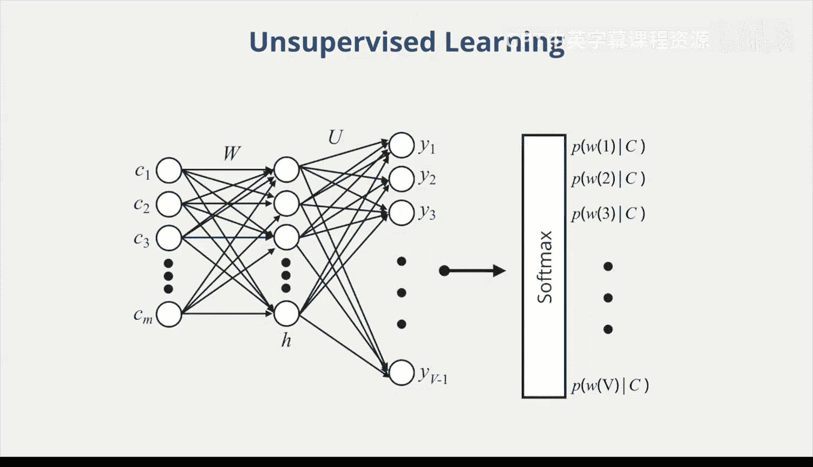
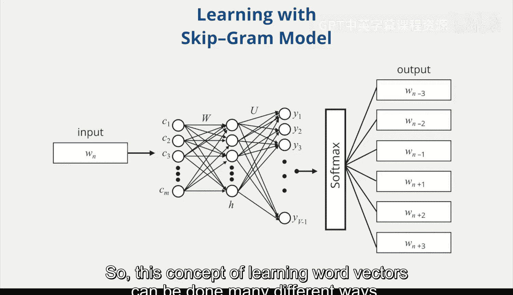
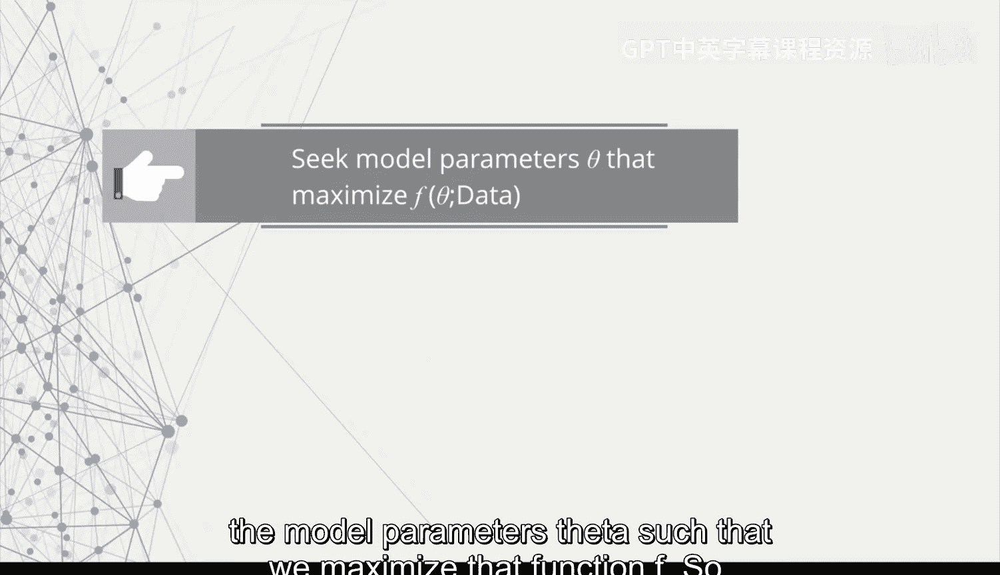

#  044：模型参数学习细节 🧠

在本节课中，我们将深入探讨机器学习模型参数学习的具体细节。我们将了解如何通过大量文本数据，以无监督的方式学习词向量和模型参数，从而构建一个能够预测上下文中单词的模型。

---

## 模型与学习目标

上一节我们介绍了Skip-gram和Bag of Words两种简单的模型形式。本节中，我们来看看“学习”这个概念的具体含义。

这里的“机器”指的是我们为文本开发的算法或模型，其核心概念是将每个单词映射到一个向量。

学习意味着我们将采用一个大型文档数据集（语料库），并基于这些文档尝试学习模型的参数。这被称为**无监督学习**，因为我们不需要人工标注文档的含义，仅从文档本身就能学习这个预测模型。

## 模型参数详解

我想强调，多层感知机（也称为神经网络）是一个非常基础的概念，在本课程及其他领域会反复出现。

我们试图学习的参数就是这个模型的参数。

模型参数主要包括两部分：
1.  代表每个单词的向量集合，用 **C** 表示。
2.  多层感知机的参数，用 **W** 和 **U** 表示。

基于softmax模型，我们可以根据输入单词 **C**（由向量C表示）来预测最可能出现的V个单词中的哪一个。

## 模型的输入与输出

在这个模型中，我们有一个输入和一个输出。我们的目标是构建一个模型，使得当我们给定输入时，能够预测输出。

*   输入：由上下文单词的向量表示。例如，对于第n个单词，我们取其周围六个单词的向量平均值作为输入。
*   输出：预测第n个单词本身的存在。

无论是使用Skip-gram模型还是Bag of Words模型，我们学习的目标本质上是相同的：学习多层感知机的参数和词向量。这两种模型只是实现这一目标的两种不同方式，学习词向量的方法还有很多。

## 学习的基本框架

无论采用哪种方式，我们的目标都是进行模型学习。让我们更深入地思考一下。

本质上，我们试图做的是预测输出单词的概率。回想一下softmax模型，我们基于输入单词C（由向量C表示）来计算V个单词中每一个的概率。

这是一个基本概念。模型的参数由 **θ** 表示。

以下是模型的核心组成部分：
*   输出单词的概率：由我们的神经网络通过softmax函数体现。
*   输入单词：代表定义神经网络输入的上下文单词。
*   输入单词的向量表示。
*   参数 **θ**：包括词向量和多层感知机的参数。

## 训练与优化

当我们进行学习时，我们假设有M个示例对。

具体来说，我们假设语料库中有M个示例。对于每个示例（第i个示例），我们有一个输入向量 **W_in^(i)** 和一个输出向量 **W_out^(i)**。这M个示例构成了我们的**训练集**。

在Skip-gram和CBoW的概念中，这M个输入输出示例可以通过扫描大型文档语料库自动生成，因此M的数量可以非常庞大。

接下来，我们建立一个称为**成本函数**的东西，用 **F** 表示。**F** 是参数 **θ** 和数据的函数。

我们表示成本函数的方式很简单，就是对训练集中所有M个示例的预测概率取对数后求和。

最后一个公式即为我们模型对所有训练集中输入输出对的预测之和。我们希望学习参数 **θ**，以**最大化**这个函数 **F**。

如果我们能很好地做到这一点，就意味着我们拥有一个能够根据输入单词有效预测输出单词的模型。这一切都基于我们从语料库中获得的M个示例。

---

**本节课总结**：我们一起深入学习了机器学习中模型参数学习的细节。我们明确了学习的目标是最大化模型在训练数据上的预测概率，这通过优化成本函数来实现。核心在于，我们利用大量无标注文本，以无监督的方式自动学习词向量和神经网络参数，从而让模型掌握单词在上下文中的关系。