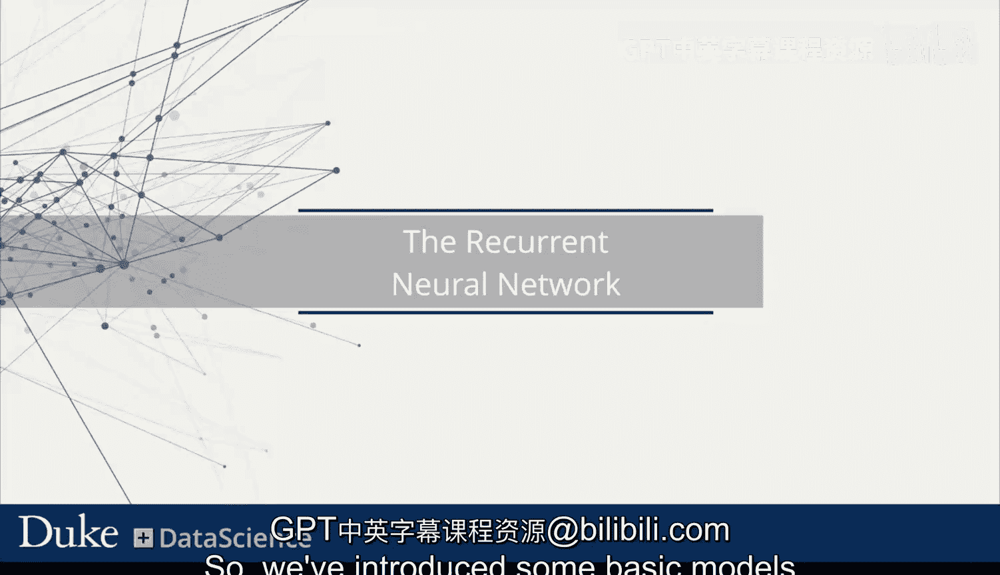
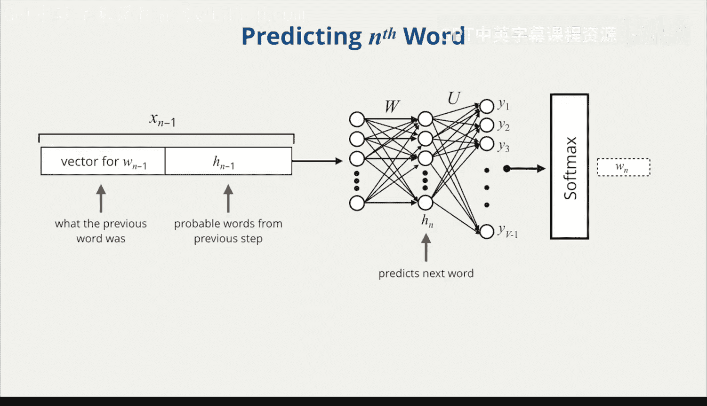
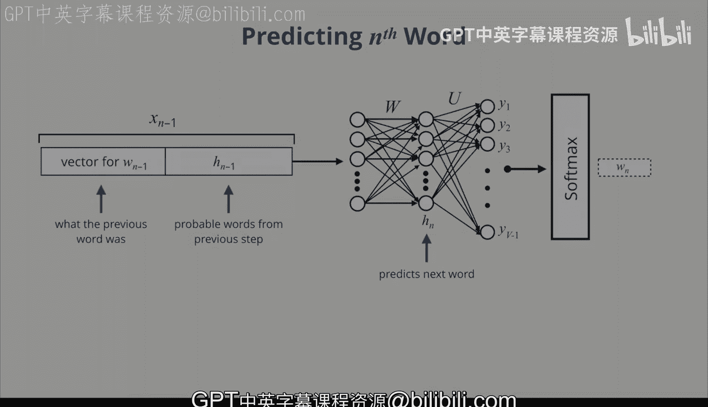

#  045：循环神经网络

在本节课中，我们将学习循环神经网络（RNN）的基本概念。这是一种用于处理序列数据（如文本）的强大工具。我们将了解RNN如何利用前文信息来预测序列中的下一个元素，并理解其核心工作原理。

## 概述

上一节我们介绍了用于自然语言处理的词向量模型，如Skip-gram和词袋模型。这些模型非常适合学习词向量（或称词嵌入）。然而，有些任务无法用这些工具完成，这促使我们引入**循环神经网络**。RNN是表示序列数据的基本框架，其“循环”意味着网络结构会重复使用。虽然RNN概念通用，但自然语言建模是其非常重要的应用场景。

## 文本合成与RNN的动机

假设我们已经学习了词向量，现在的目标可能是使用它们来执行**文本合成**，即自动生成文本。这在许多场景下非常有用，例如为图像自动生成描述，或者进行语言翻译。从语言A翻译到语言B，就需要能够合成语言B的文本。目前我们尚不具备这种工具，因此现在我们将深入探讨如何实现文本合成，这需要使用**循环神经网络**。

RNN不仅是处理文本的强大工具，也是处理任何**序列数据**的重要工具，因此理解它至关重要。

## RNN的基本工作方式

以下是我们思考循环网络使用方式的基本思路。请记住，`W_n` 代表文档中的第n个单词。我们可以将文档视为一个单词序列：`W_{n-1}`, `W_n`, `W_{n+1}` 等等。根据之前讨论的概念，每个单词都将通过一个向量来表示。

我们的目标是建立一个模型，该模型可以接收第n-1个单词及其对应的向量，同时利用前一个单词的隐藏向量 `H_{n-1}` 的知识，然后能够预测第n个单词。随着讲解深入，这个概念会变得更清晰。

我们的核心思想是：给定序列中的一个单词，我们希望模型能预测下一个单词。例如，给定单词 `W_{n-1}`，预测单词 `W_n`；给定单词 `W_n`，预测单词 `W_{n+1}`。我们希望能够一个接一个地预测单词序列。这是通过一个**重复使用**的神经网络来实现的。目前这个图示可能看起来有些令人困惑，但随着深入讲解，它会变得更清晰。

这里最重要的一点是注意这个设置的**循环特性**。请注意，神经网络和Softmax函数被重复使用，这就是为什么它被称为循环神经网络。

## 深入理解RNN结构

让我们更深入地理解这个神经网络。该神经网络在这里由两个输入来表征：
1.  `W_{n-1}`：文档中的第n-1个单词，我们将通过一个向量或嵌入来表示它。
2.  `H_{n-1}`：来自前一个单词（同样是第n-1个单词）的多层感知机隐藏向量。

我们将把这两个向量**拼接**在一起。这意味着我们将获取第n-1个单词的向量，以及与前一个单词相关的隐藏单元向量，然后将它们首尾相连组合成一个更长的向量。

接着，我们将这个组合后的向量送入一个由参数 `W` 表征的神经网络。从这个模型中，我们将预测第n个隐藏单元，它同样由一个向量表示。

这里的关键点是：我们将一个单词向量和前一个单词的隐藏单元送入一个神经网络（由参数 `W` 表征），然后预测与下一个单词（第n个单词）相关的隐藏单元。在此过程中，我们得到了一个新的隐藏向量 `H_n`。

然后，隐藏向量 `H_n` 会像我们之前所做的那样，被送入多层感知机，再经过Softmax层，最终预测第n个单词 `W_n`。

接下来，`H_n` 会被传递给序列中的下一个单词。这样，我们就可以以循环的方式预测文档中的每个单词。

请注意，来自前一个单词的隐藏向量 `H_{n-1}` 会馈入用于预测第n个单词的神经网络模型。在此过程中，我们得到一个新的隐藏向量 `H_n`，它随后被送入下一个神经网络。同时，相关的下一个单词 `W_n` 也被送入那个神经网络，然后它们预测下一个隐藏单元 `H_{n+1}`，接着再预测下一个单词。这个过程不断重复或循环发生，因此被称为循环神经网络。

不过，关键要注意的是，这个架构看起来与我们之前见过的非常相似。我希望随着我们反复观察这些神经网络，有一点变得越来越明显：这个循环网络的基本结构是一个带有某些输入并预测输出的**多层感知机**。我们之前讨论的Skip-gram和词袋模型也具有相同的基本多层感知机架构。因此，尽管这些是不同的模型，做着不同的事情，但它们的核心、每个案例的底层核心，都是多层感知机。

## 模型公式化表示

为了便于后续讨论，我们引入一些符号表示。

我们将第n-1个单词的向量，以及与第n-1个单词相关的隐藏向量 `H_{n-1}` 拼接在一起，并将这个拼接结果称为 `X_{n-1}`。所以，`X_{n-1}` 仅仅是第n-1个单词向量和隐藏向量 `H_{n-1}` 拼接在一起的符号表示。

然后，`X_{n-1}` 被送入一个模型来生成隐藏向量 `H_n`。该模型是一组权重 `W` 乘以输入 `X_{n-1}`（即对每个输入进行加权然后求和），再加上一个偏置项 `b`，最后通过一个非线性函数。这里使用的非线性函数是**双曲正切函数**，这不是唯一可用的非线性函数，但它非常流行，我们稍后会详细讨论。

因此，我们的隐藏单元 `H_n` 的模型是：
`H_n = tanh(W * X_{n-1} + b)`

接着，隐藏单元 `H_n` 被送入另一组权重 `U`（即乘以权重然后求和），再加上一个偏置项 `c`。最后一步是Softmax函数。通过这个两步过程——将输入映射到隐藏向量，然后隐藏向量通过Softmax映射为概率——我们得到了我们的模型。

用公式表示，预测单词 `W_n` 的概率为：
`P(W_n | W_{n-1}, H_{n-1}) = softmax(U * H_n + c)`

所以，这个模型在做什么？最后一个方程是在给定前一个单词 `W_{n-1}` 和前一个隐藏向量的情况下，预测第n个单词 `W_n` 是什么。这正是多层感知机所做的事情。

## RNN的核心思想

思考这个模型在做什么的关键在于：它基于两个输入来预测下一个单词（第n个单词）。

1.  它使用了来自前一个单词的隐藏向量 `H_{n-1}`。如果你思考一下，这基本上是在告诉我们关于前一步中哪些单词可能出现的**上下文信息**。因为如果你看这个模型，隐藏向量 `H_n` 预测了下一个单词是什么。所以，`H_{n-1}` 的作用是告诉我们前一步中哪些单词是可能的，它提供了上下文信息。
2.  `W_{n-1}` 告诉我们前一个单词**具体是什么**。

因此，基于 `H_{n-1}` 提供的上下文，以及前一个单词 `W_{n-1}`，我们预测下一个单词 `W_n`。这就是所谓的循环神经网络。

它被称为循环神经网络的原因是：这个由图示表示的过程会以循环的方式一遍又一遍地重复。这是一种我们可以合成或生成数据序列（这里指单词或文本序列）的方法。

## 总结

本节课中，我们一起学习了循环神经网络的基本原理。我们了解到RNN通过重复使用相同的网络结构来处理序列数据，利用前一个单词的向量 `W_{n-1}` 和隐藏状态 `H_{n-1}` 来预测下一个单词 `W_n`。其核心公式包括隐藏层的计算 `H_n = tanh(W * X_{n-1} + b)` 和输出的预测 `P(W_n | ...) = softmax(U * H_n + c)`。RNN的强大之处在于其循环结构能够捕捉序列中的上下文信息，使其成为文本合成、翻译等序列生成任务的理想工具。