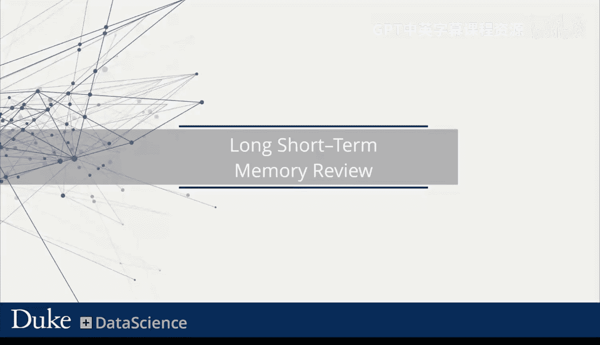
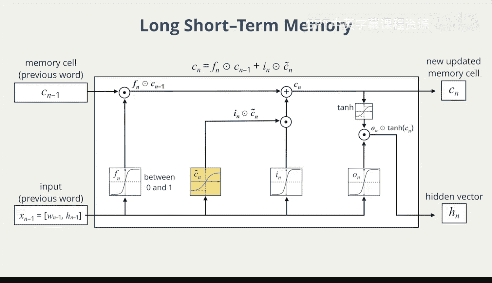
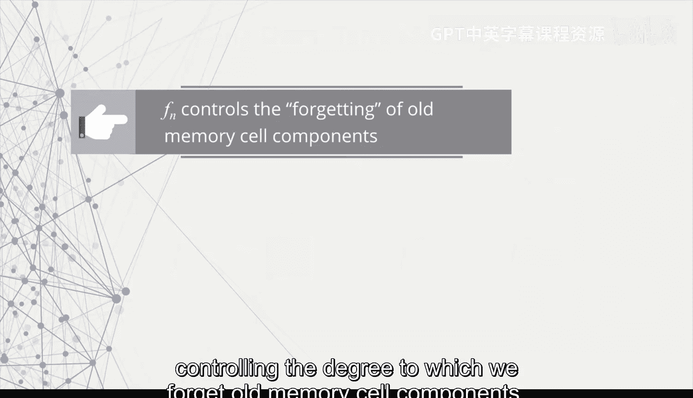
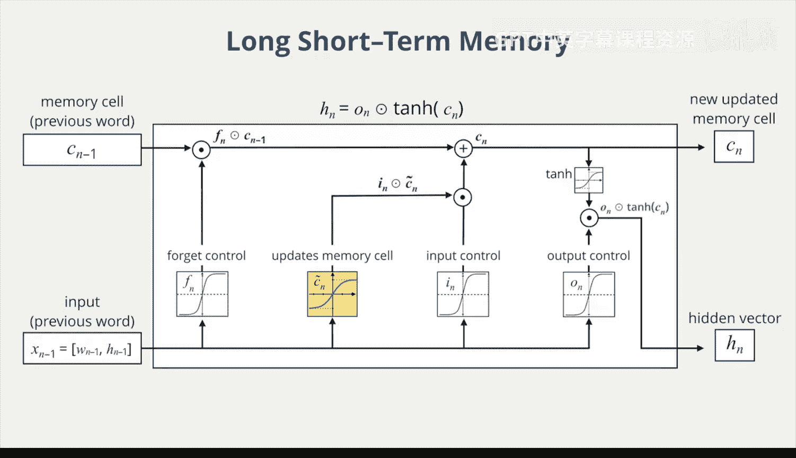
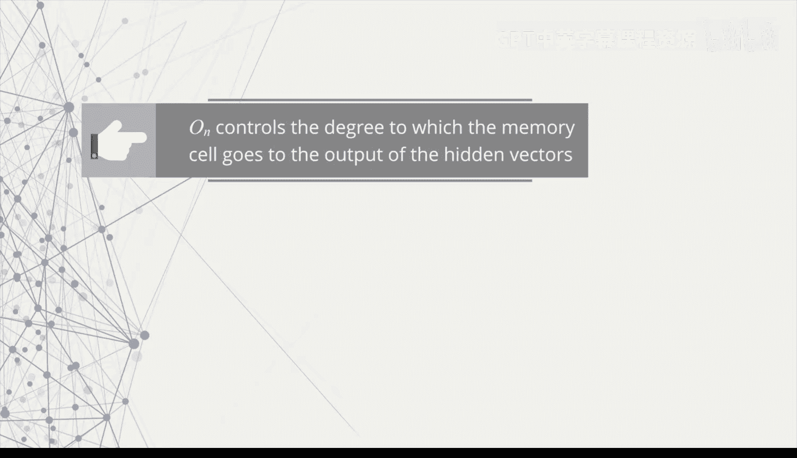
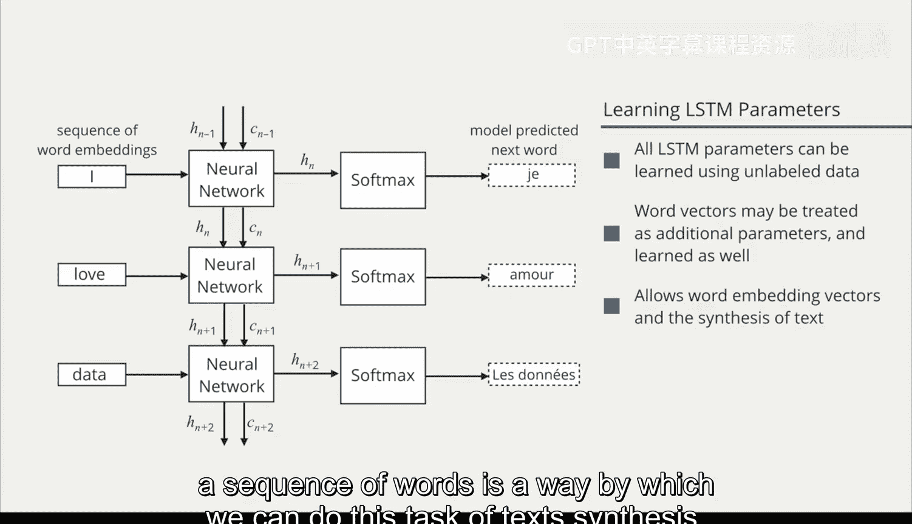

#  047：长短期记忆网络回顾 🧠

在本节课中，我们将回顾长短期记忆网络。这是一种用于建模序列数据的循环神经网络。在自然语言处理领域，由单词序列构成的语言是LSTM一个非常自然的应用场景。

上一节我们介绍了LSTM的基本概念，本节中我们将更深入地剖析其内部组件和工作原理。

## LSTM的结构与组件 🔧

LSTM是一种循环神经网络，用于对数据序列进行建模。在文档处理中，文档的每个单词由一个向量表示，因此LSTM操作的是与文档中单词相关联的向量序列。

LSTM是当前自然语言处理领域最先进的方法，在许多场景中取得了显著成果。然而，它比我们课程中讨论过的其他大多数模型都要复杂。因此，有必要退一步回顾LSTM，以便更深入地理解模型中各个组件的作用。

让我们回顾一下长短期记忆网络。它由三个控制神经网络组成，在我们的序列时间点 `n` 处，它们输出向量 `O_n`、`F_n` 和 `I_n`。

这三个神经网络本质上都具有多层感知机的基本形式。我们注意到，每个控制单元的非线性函数都是Sigmoid函数 `σ`。这意味着向量 `O_n`、`F_n` 和 `I_n` 的每个分量都是介于0和1之间的数字。

在长短期记忆网络中，除了隐藏向量 `H`，我们还引入了一个新的向量，即由 `C` 表示的记忆单元。

记忆单元由第四个神经网络更新，该网络使用双曲正切作为非线性函数。它同样是一个多层感知机，但其非线性函数是双曲正切，这意味着向量 `C̃_n` 中的每个元素都是一个介于-1和1之间的数字。

顶部的这四个神经网络随后被用来更新记忆单元 `C_n` 和隐藏变量 `H_n`。

具体做法是：利用 `F` 网络和 `I` 网络的控制输出来操作先前的记忆单元 `C_{n-1}` 和我们的新估计值 `C̃_n`。然后，其输出 `C_n`（即我们更新后的记忆单元）经过双曲正切函数处理，再与 `O` 网络的输出 `O_n` 进行运算，从而得到隐藏单元 `H_n`。

这里涉及的内容很多，让我们尝试更深入地理解一下。

## 理解控制机制 🎛️

观察记忆单元的更新输出，我们注意到向量 `F_n` 的作用是控制我们遗忘旧记忆单元分量的程度。

请记住，向量 `F_n` 的每个分量都在0和1之间。因此，如果 `F_n` 的某个特定分量接近0，那么记忆单元 `C_{n-1}` 的对应分量就会乘以一个接近0的数，这意味着它基本上会遗忘该记忆单元的输出。所以，`F_n` 控制或允许模型遗忘或擦除先前的记忆单元输出。我们使用符号 `F_n` 的原因在于，这是一种允许模型遗忘或擦除旧记忆单元的方法。

相比之下，`I_n` 控制着我们新估计值 `C̃_n` 的输入。我们所做的是：取先前的记忆单元（一个数字向量 `C_{n-1}`），将其与向量 `F_n` 逐分量相乘。`F_n` 告诉我们（记住 `F_n` 的每个输出都在0和1之间），如果 `F_n` 的某个分量接近0，那就意味着我们试图擦除或遗忘记忆单元的对应分量。因此，`F` 被称为我们的**遗忘控制**。

`I` 被称为**输入控制**，因为它控制着我们的新估计值 `C̃_n` 对 `C_n` 新估计值的贡献程度。同样，`I_n` 的每个分量都在0和1之间。如果 `I_n` 的对应分量接近0，那么 `C̃_n` 的对应分量就不会对我们的记忆单元新表示有显著贡献。相反，如果 `I_n` 的某个分量接近1，那就意味着我们新估计值 `C̃_n` 的对应分量将对新的记忆单元 `C_n` 有显著贡献。

因此，遗忘控制 `F` 和输入控制 `I` 共同控制着先前记忆单元和我们记忆单元的新表示对下一时间戳更新记忆单元 `C_n` 的贡献程度。

然后，`O_n` 是**输出控制**。它的作用是：取记忆单元 `C_n`，将其通过非线性函数双曲正切（输出介于-1和1之间）。`O_n` 也是一个数字向量，每个分量都在0和1之间。`O_n` 的每个分量与双曲正切输出的相应分量相乘，这个乘积控制着这些分量对下一个隐藏向量 `H_n` 的贡献程度。

我们还引入了第四个神经网络，即记忆单元的更新网络，由 `C̃_n` 表示。

## 总结与优势 📈

在原始的循环神经网络中，单一的循环网络在LSTM中被四个神经网络所控制。这些网络允许模型通过 `F` 控制来遗忘数据序列中的先前数据；通过 `I` 控制来输入新数据的能力；然后 `O` 控制控制着记忆单元对输出（即隐藏向量）的贡献程度。

我们引入了循环模型相同的基本概念，因为示意图中看到的基本结构是循环重复的，这就是为什么它被称为循环神经网络。

然而，它有两个输出：隐藏向量 `H_n` 和记忆单元的更新 `C_n`。

所有LSTM参数都可以使用未标记数据进行学习，因为这基本上是一个允许我们根据前一个单词预测下一个单词的模型。我们可以对文档或语料库中的单词序列进行此操作，并且不需要对文档进行人工标记。因此，我们可以将此模型应用于未标记数据。

词向量可以被视为模型中的附加参数，也可以被学习。因此，这个LSTM模型是一个允许我们学习词嵌入向量，同时也允许我们学习能够合成文本的模型。我们稍后将更多地讨论这种合成文本的能力，这对于文本翻译等应用至关重要。例如，输入文本可能是一个英语单词序列，输出可能是一个法语单词序列。如果我们要从英语翻译成法语，我们必须能够合成语言，而这个允许我们合成单词序列的LSTM，正是我们执行文本合成任务的一种方式。

LSTM模型无疑很复杂，但它是由我们之前见过的基本构件（多层感知机）构建而成的。它是一个复杂的模型，但现实是它在实践中效果非常好，为包括翻译在内的许多应用提供了最先进的结果。在下一课中，我们将展示LSTM在文本合成方面被证明非常有效的另一个应用。

本节课中，我们一起回顾了长短期记忆网络的核心结构、三个关键控制门（遗忘门、输入门、输出门）的作用机制，以及它如何通过记忆单元管理长期依赖关系。LSTM通过其精巧的设计，有效地解决了传统RNN在长序列训练中遇到的梯度消失或爆炸问题，使其成为处理序列数据（尤其是自然语言）的强大工具。