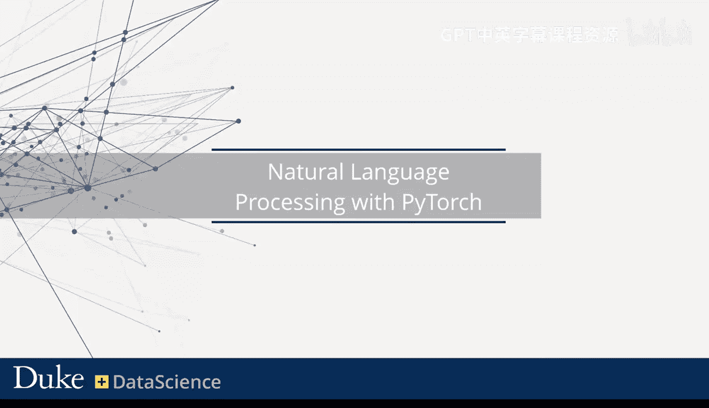
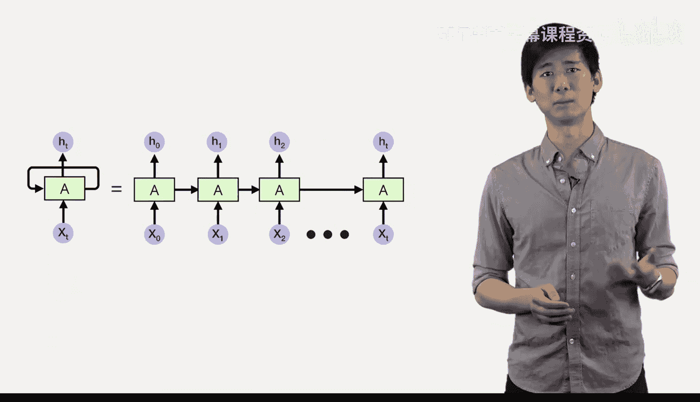

#  050：使用PyTorch进行自然语言处理 🧠📚

在本节课中，我们将学习如何使用PyTorch进行自然语言处理。我们将介绍词嵌入的概念，探索预训练的词嵌入模型，并构建一个简单的神经网络来预测电影评论的情感。最后，我们会简要概述PyTorch中的循环神经网络。



---

与计算机视觉领域类似，自然语言处理领域也因深度学习的引入而经历了重大变革。

## 词嵌入简介

在模块4中，我们介绍了**词嵌入**的概念。词嵌入是单词的向量化表示，它能够承载单词的语义信息。

其核心思想是，语义相近的单词在向量空间中的位置也相近。这可以用一个简单的公式来描述：如果单词A和单词B语义相似，那么它们的词嵌入向量 `embedding(A)` 和 `embedding(B)` 之间的余弦相似度会很高。


```python
# 示例：计算两个词向量的余弦相似度
import torch.nn.functional as F
similarity = F.cosine_similarity(embedding_A, embedding_B, dim=0)
```


接下来，我们将探索如何使用预训练的词嵌入模型。

## 探索预训练词嵌入

我们将使用一些预训练的词嵌入模型，并观察如何利用它们来寻找相似词和解决词语类比问题。

以下是使用预训练词嵌入的几个关键步骤：

1.  **加载预训练模型**：例如，使用`torchtext`库加载GloVe或Word2Vec模型。
2.  **查找词向量**：通过单词索引直接获取其对应的向量表示。
3.  **计算相似度**：通过计算向量间的距离（如余弦相似度）来找到语义上最接近的单词。
4.  **解决类比问题**：例如，通过向量运算解决“国王 - 男人 + 女人 = 女王”这类问题。

```python
# 伪代码示例：解决词语类比
vector = embedding(“king”) - embedding(“man”) + embedding(“woman”)
# 然后在所有词向量中寻找与 `vector` 最接近的向量，其结果很可能就是 “queen”
```

在了解了词嵌入的基本用法后，我们将尝试构建一个实际的应用模型。

## 构建情感分析模型

现在，我们将训练一个非常简单的神经网络模型。该模型学习如何使用词嵌入来预测电影评论的情感（正面或负面）。

以下是构建和训练情感分析模型的主要步骤：

1.  **数据预处理**：将文本评论转换为词索引序列，并进行填充以保证输入长度一致。
2.  **嵌入层**：使用预训练或随机初始化的词嵌入层将词索引映射为稠密向量。
3.  **模型结构**：构建一个简单的网络，例如嵌入层后接一个全局池化层（如平均池化），然后连接全连接层进行二分类。
4.  **训练与评估**：使用交叉熵损失和优化器进行训练，并在验证集上评估模型性能。

```python
import torch.nn as nn



class SentimentClassifier(nn.Module):
    def __init__(self, vocab_size, embed_dim, num_classes):
        super().__init__()
        self.embedding = nn.Embedding(vocab_size, embed_dim)
        self.fc = nn.Linear(embed_dim, num_classes)

    def forward(self, text):
        # text shape: (batch_size, sequence_length)
        embedded = self.embedding(text) # shape: (batch_size, seq_len, embed_dim)
        # 对序列维度进行平均池化
        pooled = embedded.mean(dim=1) # shape: (batch_size, embed_dim)
        output = self.fc(pooled)
        return output
```

掌握了基于词嵌入的简单模型后，我们来了解一种更适合处理序列数据的神经网络结构。

## 循环神经网络概述

我们将以PyTorch中的循环神经网络作为本节结尾。RNN是一类专门用于处理序列数据的神经网络，它能够捕捉文本中的时序依赖关系。

在PyTorch中，可以使用 `nn.RNN`、`nn.LSTM` 或 `nn.GRUCell` 等模块轻松构建RNN模型。它们能够接收一个序列输入，并输出每个时间步的隐藏状态或最终状态。

对于作业部分，你将在一个文本分类数据集上训练几种不同类型的模型，并比较它们的性能。


---

本节课中，我们一起学习了自然语言处理的基础知识。我们从词嵌入的概念出发，探索了预训练模型的应用，并动手构建了一个用于情感分析的简单神经网络。最后，我们简要了解了PyTorch中的循环神经网络。这些工具和方法为处理和理解文本数据提供了强大的基础。