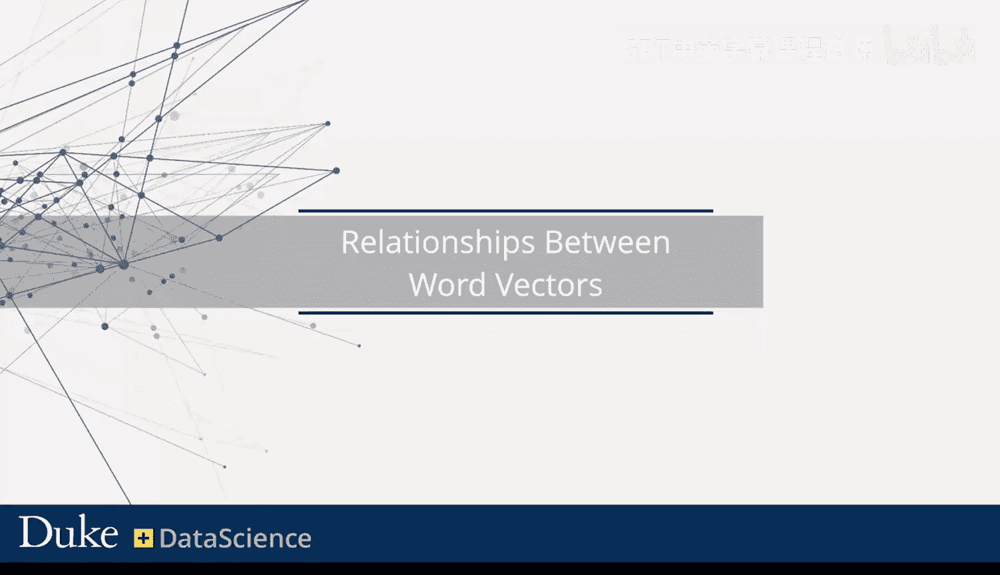
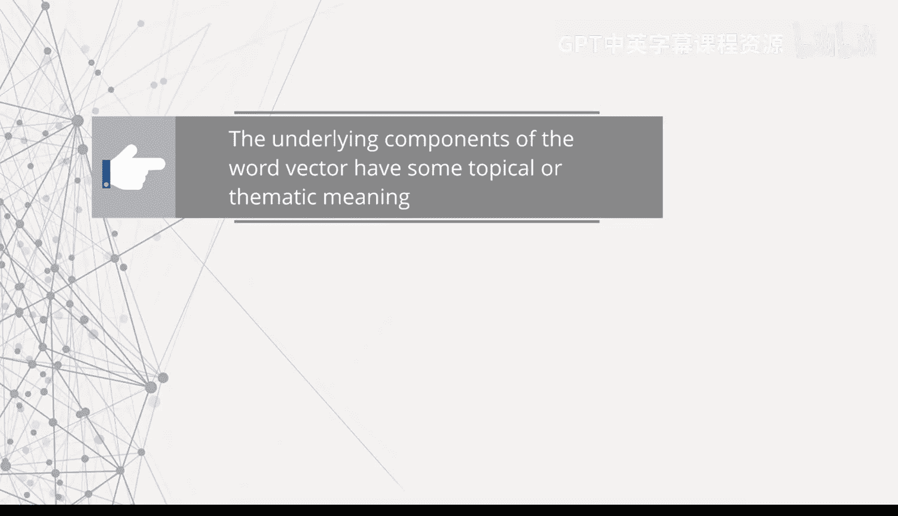
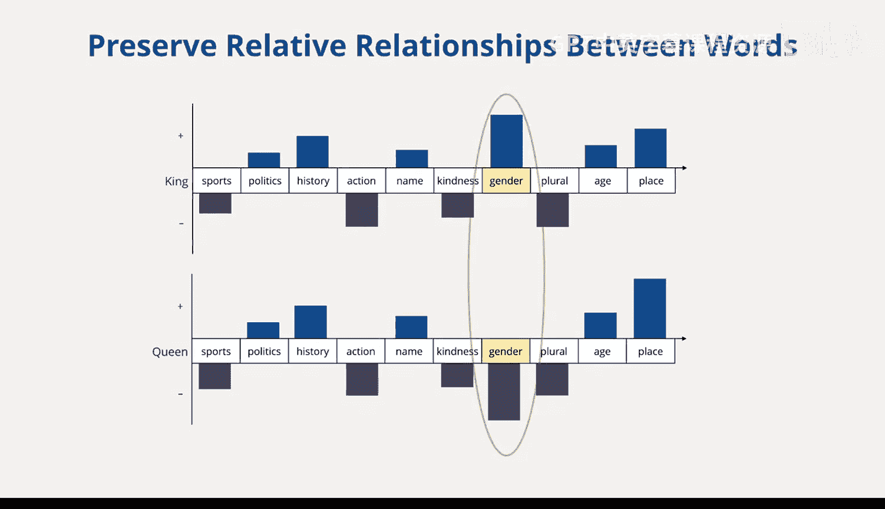
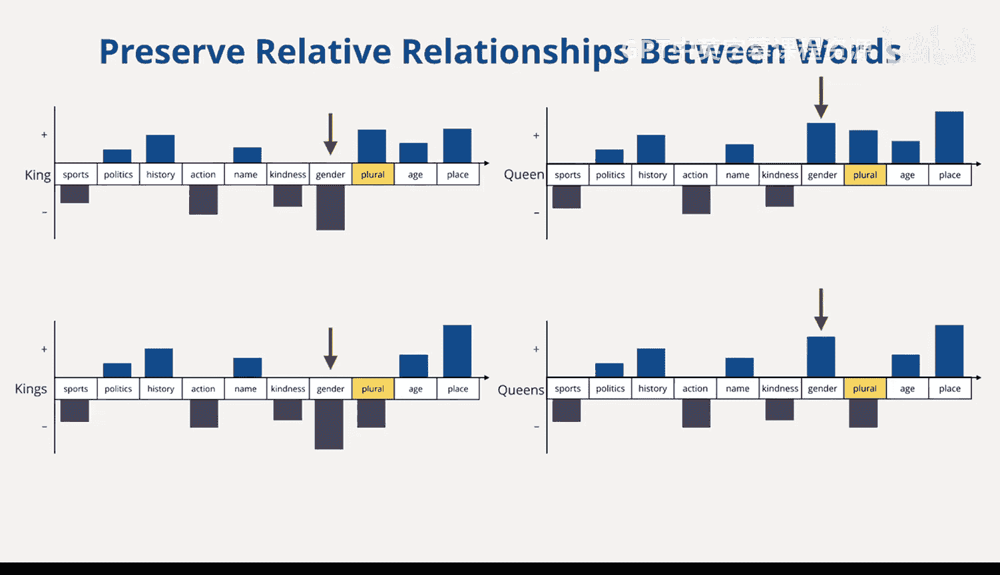
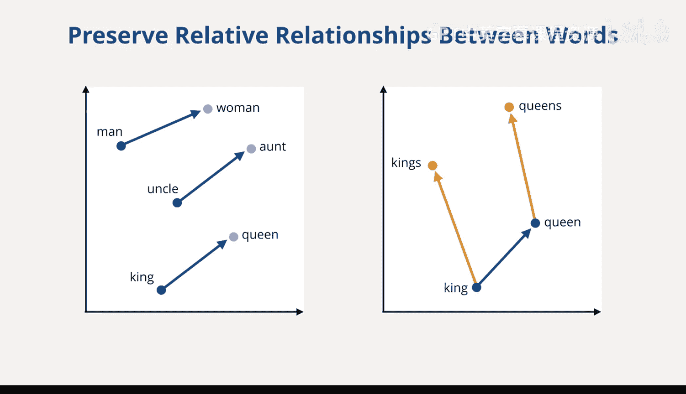
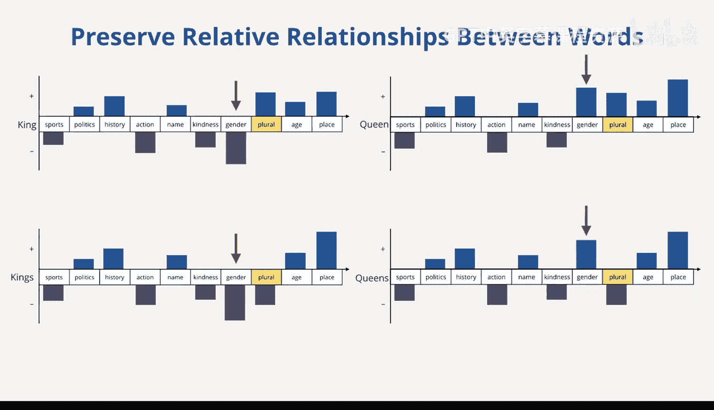
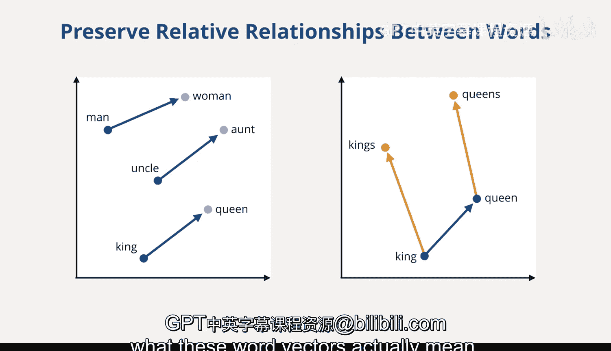

#  052：词向量间的关系 🔍

在本节课中，我们将深入探讨词向量的含义，理解其各个维度如何捕捉词语的潜在语义和关系。我们将通过具体的例子，展示词向量如何编码诸如性别、单复数等概念，并揭示这些向量在几何空间中的规律性。

---

## 词向量的语义维度

上一节我们介绍了词向量的基本概念。本节中，我们来看看词向量的各个维度具体代表什么含义。

每个词向量的分量都对应一个潜在的主题或语义特征。以下是几组含义相似但存在关键差异的词语对。

以下是“king”（国王）与“queen”（女王/王后）的对比：

*   **king** 和 **queen** 都是王室职位，含义非常相似。
*   关键区别在于，king 通常为男性，而 queen 通常为女性。
*   因此，**king** 和 **queen** 的词向量在几乎所有分量上都相同，**除了一个分量**。
*   在这个特定的分量上，**king** 的值为正，**queen** 的值为负。
*   我们可以推断，**这个分量代表“性别”**。

以下是“uncle”（叔叔/舅舅）与“aunt”（阿姨/舅妈）的对比：

*   **uncle** 和 **aunt** 对于年轻人来说含义基本相同。
*   关键区别在于，uncle 是男性，aunt 是女性。
*   同样，**uncle** 和 **aunt** 的词向量在几乎所有分量上都相同，**除了一个分量**。
*   在这个分量上，**uncle** 的值为正，**aunt** 的值为负。
*   我们再次推断，**这个分量也代表“性别”**，并且它在“king/queen”和“uncle/aunt”这两组词对中表现一致。

通过这个简单的例子，我们理解了词向量如何编码语义。这揭示了词向量所捕捉的底层机制。

---

## 单复数关系的编码

理解了性别维度后，我们再来看看词向量如何编码“单复数”关系。

以下是“king”（国王）与“kings”（国王们）的对比：

*   **king** 和 **kings** 是同一个词，区别在于一个是单数，一个是复数。
*   **king** 和 **kings** 的词向量在几乎所有分量上都相同，**除了一个分量**。
*   在这个分量上，**king**（单数）的值为正，**kings**（复数）的值为负。
*   因此，**这个分量代表词语的“单数性”**。对于单数词（king）它是正的，对于复数词（kings）它是负的。

这种关系同样适用于“queen”和“queens”。此外，请注意代表“性别”的分量在“king/kings”之间保持一致，在“queen/queens”之间也保持一致，但在“king”和“queen”之间是不同的。

核心思想是：如果我们能够通过学习得到这些词向量，并通过观察已知的、仅在某一方面有区别的词语对，我们就可以分析它们的词向量，找出相似和不同之处，从而揭示这些词向量背后关联的底层语义。

---

## 词向量关系的几何直观

之前课程的另一部分曾展示过这种关系。这里我们要表达的是，每个词语都对应一个嵌入向量或词向量（图中为二维空间表示）。

概念上存在这样的关系：**man（男人）之于 woman（女人），如同 uncle（叔叔）之于 aunt（阿姨），也如同 king（国王）之于 queen（女王）**。

如果我们讨论的关系成立，即 **king 之于 kings 如同 queen 之于 queens**，那么即使“king”和“queen”是不同的词、不同类型的词，我们也会期望在它们所表示的 D 维空间中的词嵌入或词向量之间，存在一致性的几何关系。

在右侧我们看到，“king 到 kings”的向量关系与“queen 到 queens”的向量关系是平行的。这是一种基于词语底层语义，我们期望在词向量中发现的**几何概念**。这种关系为我们理解这些词向量的实际含义提供了直观的底层逻辑。

---

## 总结

本节课中我们一起学习了词向量间的关系。我们通过“king/queen”、“uncle/aunt”的例子，看到词向量的特定维度可以编码“性别”语义；通过“king/kings”、“queen/queens”的例子，看到另一个维度可以编码“单复数”语义。最后，我们认识到这些语义关系会表现为词向量空间中的一致性几何变换（如平移），这为我们理解和解释词向量提供了强大的直观工具。