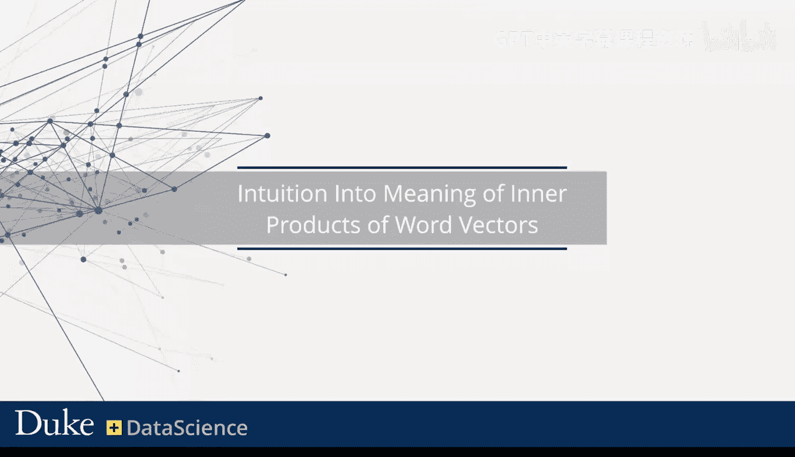
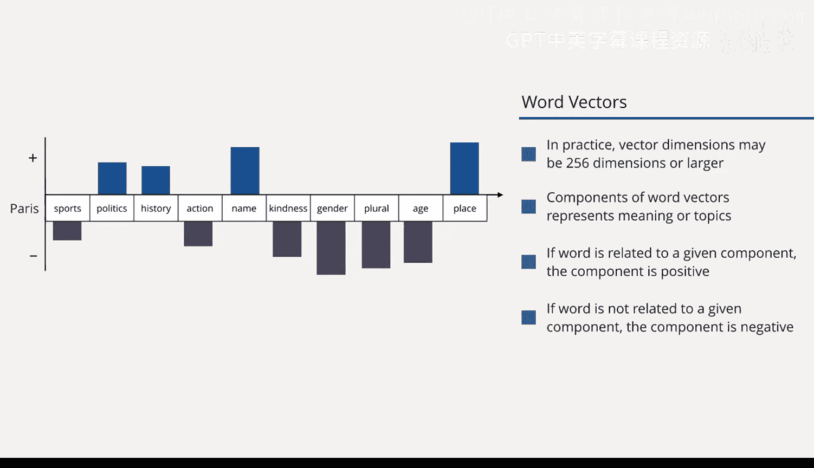
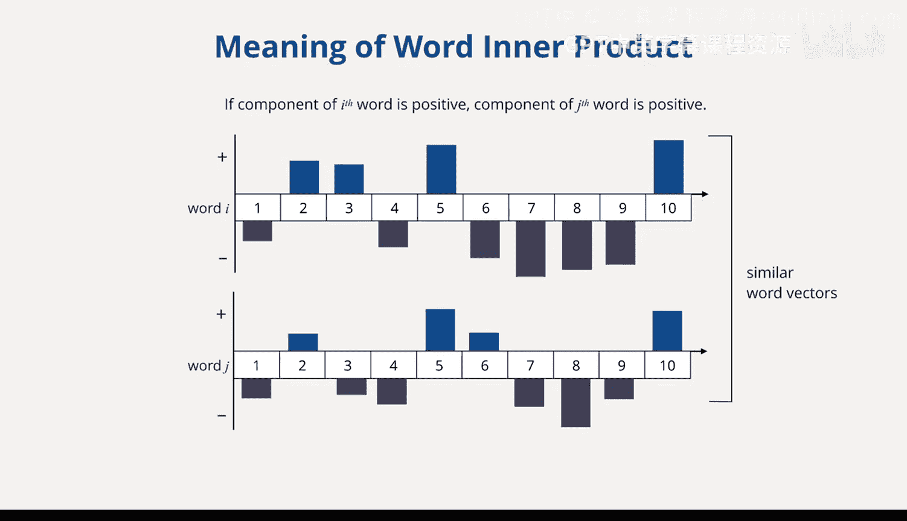
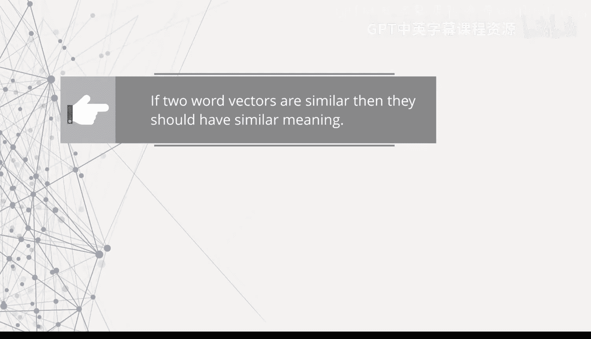
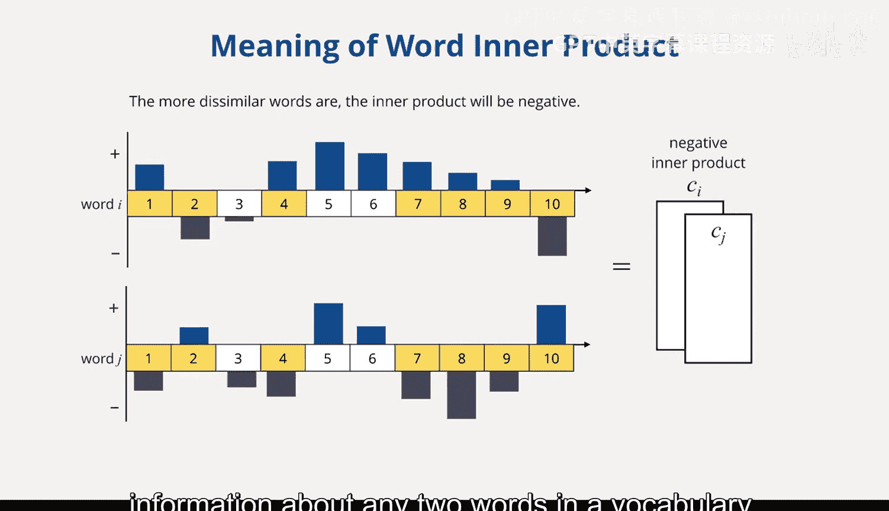
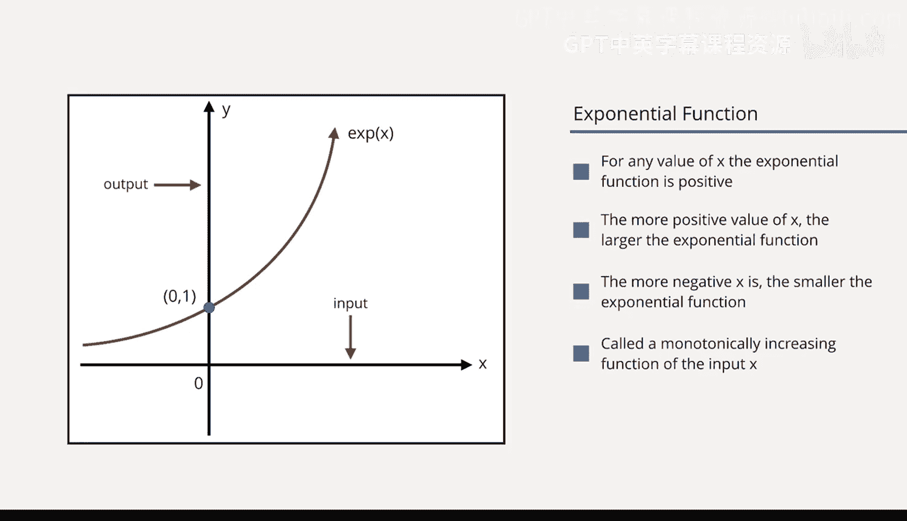
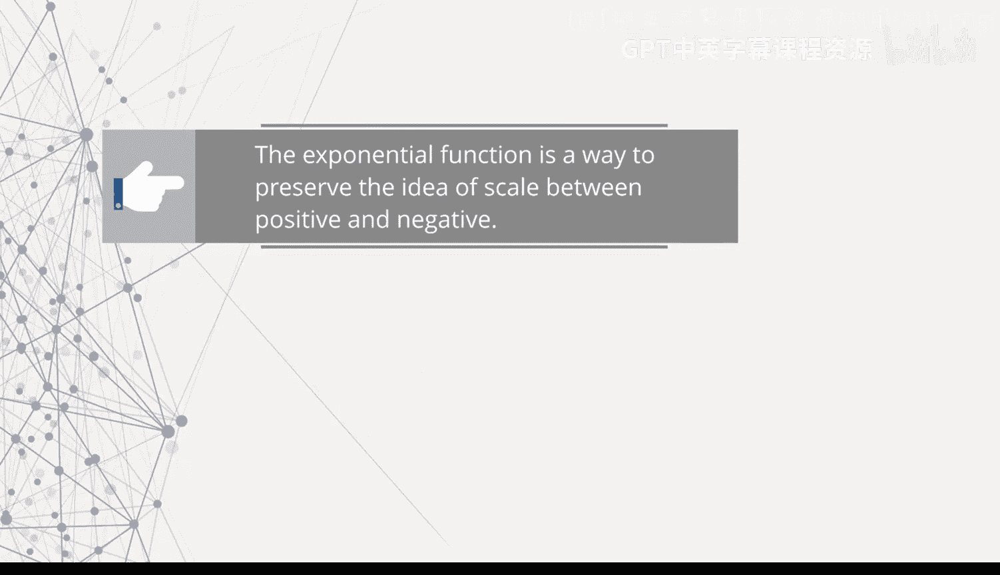
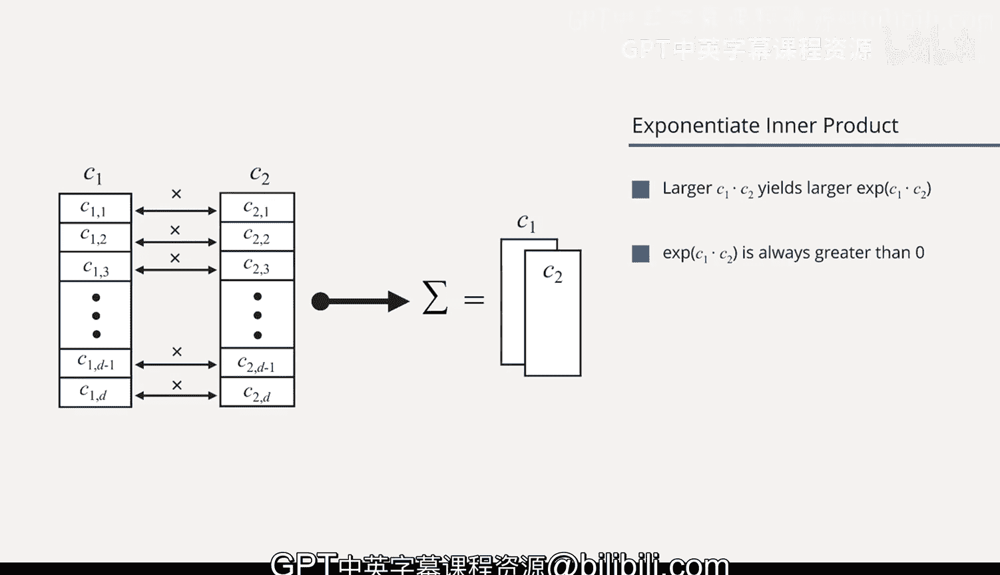

#  054：词向量内积意义的直观理解 🔍

在本节课中，我们将深入探讨词向量内积的概念，理解其含义以及如何应用。我们将从一个高度简化的10维词向量表示开始，逐步分析内积如何揭示词语之间的相似性与差异性，并解释为何在机器学习中常使用指数函数来处理内积值。

---

## 词向量的简化表示

上一节我们介绍了词向量的基本概念，本节中我们来看看一个具体的简化示例。我们使用一个10维向量来表示词语，这纯粹是为了可视化方便。在实际的自然语言处理机器学习任务中，词向量的维度通常更高，例如256或512维。

我们回到之前讨论过的“巴黎”一词的例子。每个维度都代表某种潜在的含义，例如性别、复数形式等。如果词语与某个维度代表的概念正相关，则该维度的值为正；如果负相关或不相关，则为负。

## 内积与词语相似性

现在，让我们利用这个概念来进一步理解内积的作用。假设我们从词汇表中任意选取两个词：词 **i** 和词 **j**。

以下是这两个词向量在10个维度上的示意情况：

*   在几乎所有维度上，词 **i** 和词 **j** 的符号（正或负）都是一致的。
*   例如，在第10个维度上，两者都为正；在第一个维度上，两者都为负。

由于每个维度都代表某种潜在含义，这种符号的一致性意味着这两个词向量是相似的，进而可以推断这两个词的含义也相似。

## 内积的计算与意义

内积的计算是逐分量相乘后求和。记住这个公式：`内积 = sum(向量_i的每个分量 * 向量_j的对应分量)`。

基于上述观察，我们可以推导：
*   当两个分量符号相同时（正正或负负），它们的乘积为正数。
*   如果两个词向量在大多数维度上符号一致，那么大多数乘积项为正数，求和得到的内积结果也将是一个较大的正数。
*   因此，**词语越相似，其对应词向量的内积值就越大、越正**。

相反，考虑另一种情况：

*   如果词 **i** 和词 **j** 在大多数维度上的符号相反。
*   例如，词 **i** 在第10个维度为负，而词 **j** 为正；在第一个维度上，词 **i** 为正，而词 **j** 为负。
*   符号相反的分量相乘会得到负数。当大多数乘积项为负数时，求和得到的内积结果将是一个负数。
*   因此，**负的内积值意味着两个词语不相似，含义不同**。

**核心概念**：词向量的每个维度编码了潜在语义。两个词语越相似，其向量在各维度上的符号越一致，内积值越正；越不相似，符号越相反，内积值越负。因此，内积值的正负和大小揭示了词汇表中任意两个词语之间的语义关系。

## 引入指数函数

然而，在机器学习实践中，处理有时为正、有时为负的内积值并不方便。我们希望所有数值都是正的，但同时要保留“正代表相似，负代表不相似”的序关系。

这时，指数函数 `exp(x)` 就派上了用场。以下是其关键特性：

1.  **输出恒为正**：对于任何输入 `x`，`exp(x)` 的输出总是正数。
2.  **单调递增**：如果 `x1 > x2`，那么 `exp(x1) > exp(x2)`。它完美地保留了输入值的大小顺序。

在词向量的上下文中，我们将内积值作为指数函数的输入 `x`。

*   如果两个词相似，内积 `C1·C2` 是一个较大的正数，那么 `exp(C1·C2)` 会是一个更大的正数。
*   如果两个词不相似，内积 `C1·C2` 是负数或很小的正数，那么 `exp(C1·C2)` 会是一个接近0的正数。
*   无论内积是正是负，`exp(C1·C2)` 的输出永远是正数。

因此，通过对内积取指数，我们既将所有值转换为了正数（便于后续模型计算），又通过函数的单调性完整保留了词语相似度的比较信息。这为接下来要构建的机器学习模型提供了极大的便利。

---

本节课中我们一起学习了词向量内积的直观意义。我们了解到，内积的正负和大小直接反映了两个词语在语义上的相似程度。同时，为了适应机器学习模型的需求，我们引入了指数函数 `exp(x)` 来处理内积值，使其恒为正的同时，保留了关键的序关系，为后续的建模工作奠定了基础。