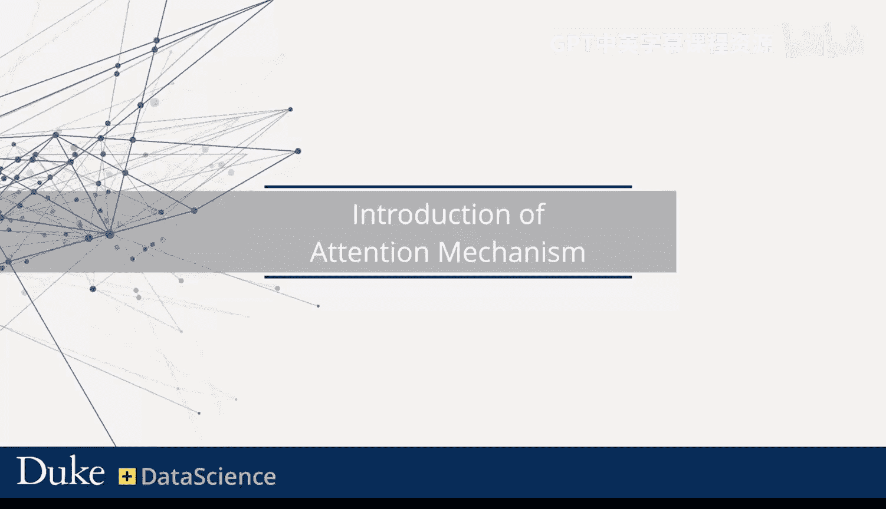
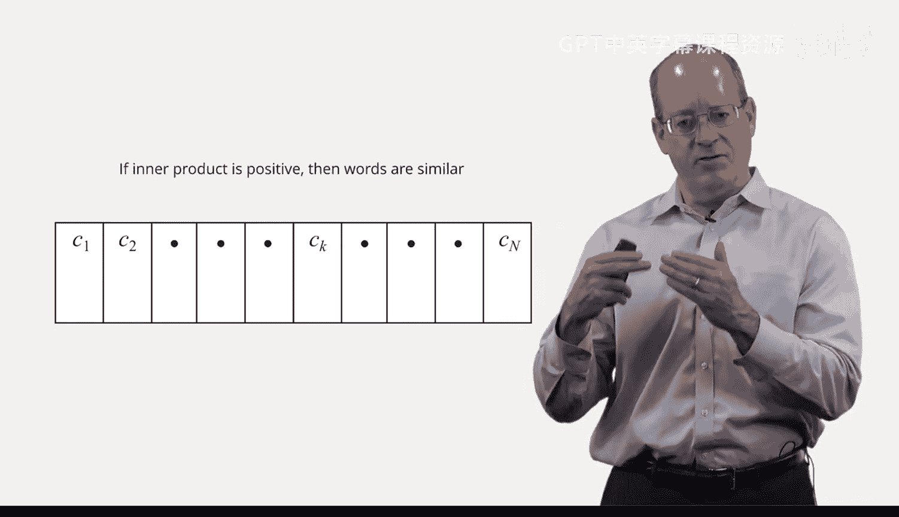
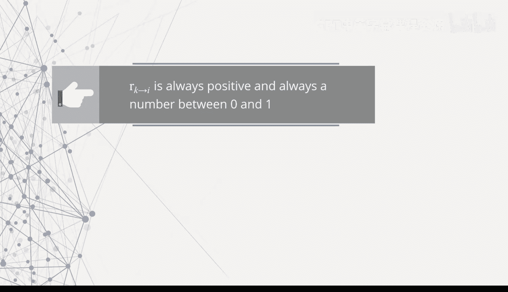
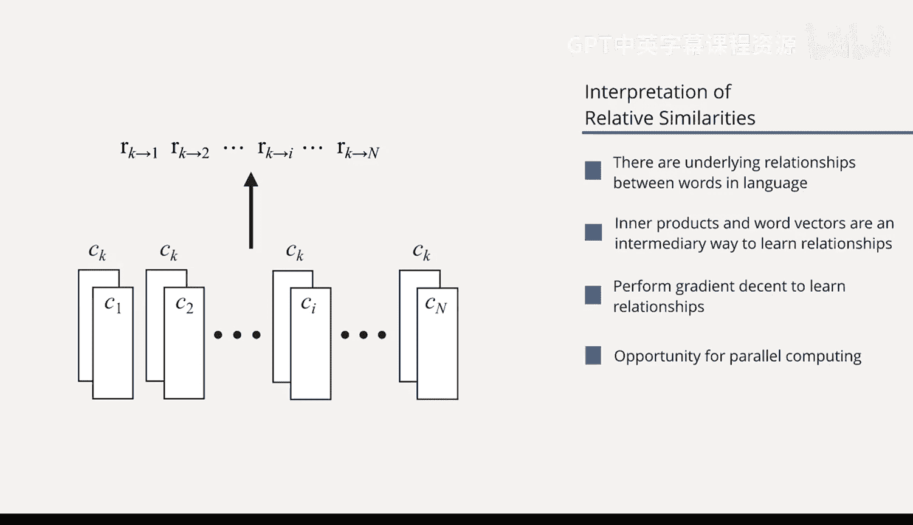
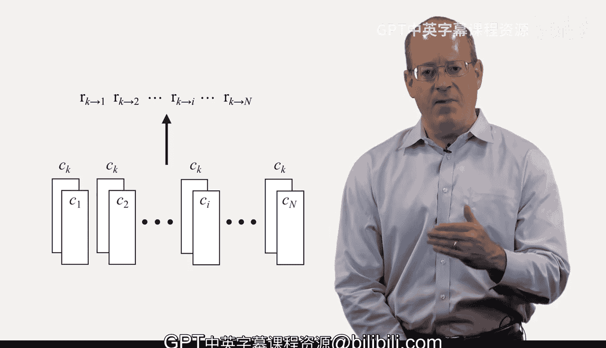

#  055：注意力机制介绍 🧠

在本节课中，我们将学习注意力机制的核心概念。注意力机制是现代自然语言处理中的关键组成部分，它通过计算词向量之间的相似度，来量化一个词与序列中其他词的关系强度。我们将从基本概念入手，逐步构建出完整的注意力计算过程。

---

上一节我们介绍了词向量的概念，本节中我们来看看如何量化词与词之间的关系。我们假设有一个包含 N 个词的句子或文档，这些词表示为 C1, C2, ..., Ck, ..., CN。

我们知道，两个词向量的**内积**是衡量它们相似度的一个指标。如果内积为正，则两个词向量相似；如果内积为负，则它们不相似。

基于此，我们将量化序列中每个词与第 K 个词的相似度。以下是计算相对相似度的三个步骤：

1.  **计算内积**：首先，取第 K 个词向量 Ck，分别与序列中所有 N 个词向量（C1 到 CN）计算内积。这量化了 Ck 与每个词的原始相似度。
    *   `相似度原始值_i = Ck · Ci`

2.  **指数化**：由于内积结果可能为正或负，我们使用指数函数 `exp()` 对其进行处理。指数函数输出始终为正，并且它是一个单调递增函数，因此能保持内积大小的相对顺序。
    *   `指数化相似度_i = exp(Ck · Ci)`

3.  **归一化**：最后，为了得到第 K 个词与第 I 个词的**相对**相似度，我们将 Ck 与 Ci 的指数化内积，除以 Ck 与序列中所有词（C1 到 CN）的指数化内积之和。这样得到的结果称为关系权重 R_{k→i}。
    *   `R_{k→i} = exp(Ck · Ci) / Σ_{j=1 to N} [ exp(Ck · Cj) ]`

这个过程——**内积、指数化、归一化**——是注意力机制的核心构造块。为了简化表示，我们通常用右边的符号来概括左边的整个计算流程。

---

现在，让我们总结一下关系权重 R_{k→i} 的特性。首先，由于经过了指数运算，R_{k→i} 的值总是介于 0 和 1 之间的正数。其次，对于固定的 K，所有 R_{k→i}（i 从 1 到 N）之和等于 1。

这意味着 R_{k→i} 量化了词 K 与词 I 的**相对关联强度**。R 值越大，表示两个词在语义或语法上的关联越强；R 值越小（趋近于 0），则表示关联越弱。语言本身存在内在的词汇关系，而 R 正是对这种关系的数学量化。

在机器学习的背景下，我们将通过梯度下降（对于大数据集则使用随机梯度下降）来学习这些词向量。模型的目标是让学习到的词向量能够通过上述计算过程，准确地反映出词汇之间的真实关系。

---

最后，需要指出这个框架的一个重要计算优势：**并行性**。计算第 K 个词与序列中所有其他 N 个词的内积，这些操作是彼此独立的，可以同时进行。

这与我们课程中介绍过的长短期记忆循环神经网络不同。循环神经网络的计算是顺序的，一步接一步，因此不适合并行计算。而注意力机制中的内积计算可以高度并行化，这恰好契合了现代图形处理器强大的并行计算能力，能显著提升模型的计算效率。

---

本节课中我们一起学习了注意力机制的基本原理。我们了解到，通过**内积**衡量词向量相似度，再经过**指数化**和**归一化**，可以得到一个词相对于序列中所有其他词的注意力权重。这个权重不仅量化了词汇间的关系，其可并行计算的特性也为高效处理自然语言任务奠定了基础。