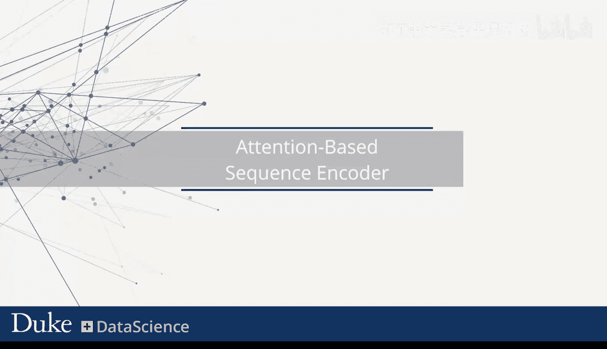
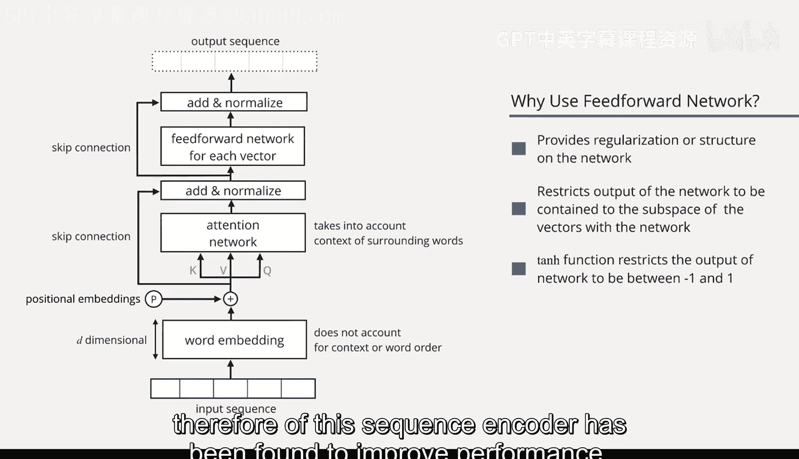
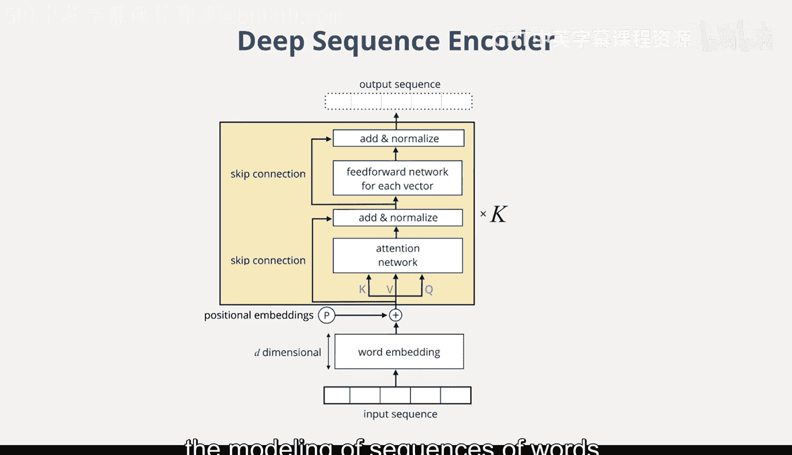
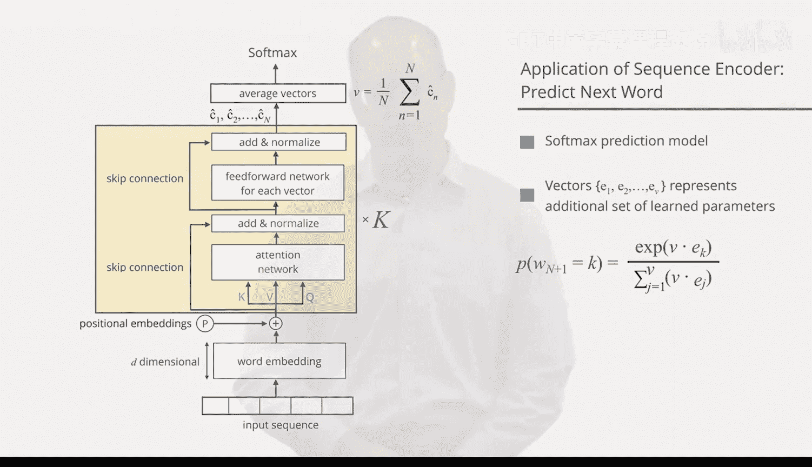

#  058：基于注意力的序列编码器 🧠

在本节课中，我们将学习一种用于建模词序列的新框架。这个框架是现代基于神经网络的序列建模方法——Transformer网络的核心。理解其每个组成部分至关重要，因为它们会反复出现。

## 概述

我们将从底部开始，逐步向上解析这个序列编码器的各个组件。该框架结合了词义、位置信息和上下文理解，是构建强大自然语言处理模型的基础。

---

### 词嵌入与位置嵌入

上一节我们介绍了建模词序列的新框架。本节中，我们来看看其第一个核心步骤：将词序列转换为向量表示。

我们首先有一个由N个词组成的序列：`W1, W2, ..., WN`。每个词会被映射到一个D维向量，这称为**词嵌入**。这些向量反映了词的含义，其D个分量编码了对应词的意义。这是一个非常重要的概念。

然而，最简单的词嵌入形式没有考虑周围词的**上下文信息**，也没有考虑词的**顺序**。

因此，下一步是引入**位置嵌入**的概念。

现在，我们将为每个词引入一个新的D维向量。这些向量与词的含义无关，而是与词的**位置**相关。根据词在序列中的位置，每个词会有一个不同的、依赖于位置的D维向量。

接着，我们将这N个位置向量与N个词嵌入向量相加。公式表示为：
`最终向量 = 词嵌入向量 + 位置嵌入向量`

此时，经过“词嵌入 + 位置嵌入”后，我们得到的向量既表征了词的含义，也考虑了词的位置。

这个简单的相加操作可能看起来有违直觉，但在实践中发现它非常有效。我们应尽可能选择简单的模型，而这个简单的想法在实践中被证明是可行的。

### 注意力机制与上下文

在考虑了词义和位置之后，我们还需要纳入**上下文**信息。

经过加和后的每个词向量，现在将扮演三个角色：**键（K）**、**值（V）**和**查询（Q）**。这些向量随后被送入我们之前讨论过的**注意力网络**中。

注意力网络能够考虑词的上下文。至此，我们通过词嵌入获得了词义，通过位置嵌入获得了位置信息，现在又通过注意力网络获得了上下文信息。

### 跳跃连接与前馈神经网络

为了避免丢失原始的嵌入向量信息，我们引入了**跳跃连接**。这意味着原始向量会绕过注意力网络，直接加到注意力网络的输出上。跳跃连接被证明能有效提升模型性能。

最后，我们引入一个**前馈神经网络**来处理这些向量。这样做有两个主要原因：
1.  **提供正则化或结构**：从数学角度，它将神经网络的输出限制在与网络相关的向量子空间内，这有助于提升性能。
2.  **约束输出范围**：通过使用双曲正切（tanh）等激活函数，神经网络的输出值被限制在-1到1之间。这种约束也被发现能改善序列编码器的性能。

### 构建深度序列编码器

上述“注意力网络 + 前馈神经网络 + 跳跃连接”的过程可以重复多次（K次）。在实践中，K通常等于6。

这种深度堆叠的结构构成了我们的最终**深度序列编码器**。它是Transformer网络中用于建模词序列的关键模块。

---

### 序列编码器的应用

一旦我们拥有了这个序列编码器，就可以用它做很多事情。以下是两个简单的应用示例：

#### 1. 情感分析

我们可能想分析一个由N个词组成的序列所表达的情感是积极还是消极（例如，对电影或餐厅的评论）。

一种简单的使用方法是：
1.  将输入序列通过编码器（词嵌入 -> 位置嵌入 -> K层注意力/前馈网络）处理。
2.  在顶部得到N个编码向量。
3.  计算这些向量的平均值，得到一个代表整个序列的向量 **V**。公式为：
    `V = (1/N) * Σ(编码向量_i)`
4.  引入一个需要学习的参数向量 **E**。
5.  通过计算 `V` 和 `E` 的点积，并经过Sigmoid函数，来量化情感倾向。公式为：
    `情感概率 = σ(V · E)`
    其中，σ 是Sigmoid函数。

#### 2. 预测下一个词

另一个常见任务是给定前N个词，预测第N+1个词是什么。

处理流程如下：
1.  同样将前N个词的序列通过编码器处理，得到N个编码向量。
2.  计算这些向量的平均值，得到向量 **V**。
3.  我们有一个词汇表，大小为V。对于词汇表中的第k个词，都有一个对应的需要学习的参数向量 **E_k**。
4.  通过Softmax函数计算下一个词是词汇表中第k个词的概率。公式为：
    `P(下一个词 = k) = exp(V · E_k) / Σ_j(exp(V · E_j))`

---

### 总结

本节课我们一起学习了基于注意力的序列编码器，它是Transformer网络的核心。我们逐步拆解了其构成：
1.  通过**词嵌入**捕获词义。
2.  通过**位置嵌入**捕获词序。
3.  通过**注意力机制**捕获上下文信息。
4.  通过**跳跃连接**保留原始信息。
5.  通过**前馈神经网络**进行正则化和约束。
6.  通过**堆叠多层（K次）** 构建深度模型，以增强表示能力。

我们还看到了该编码器在两个简单任务（情感分析和下一个词预测）中的应用。然而，这个Transformer编码框架的能力远不止于此，它将引领我们进入下一部分的学习：如何利用这些网络预测整个词序列，而不仅仅是单个词。