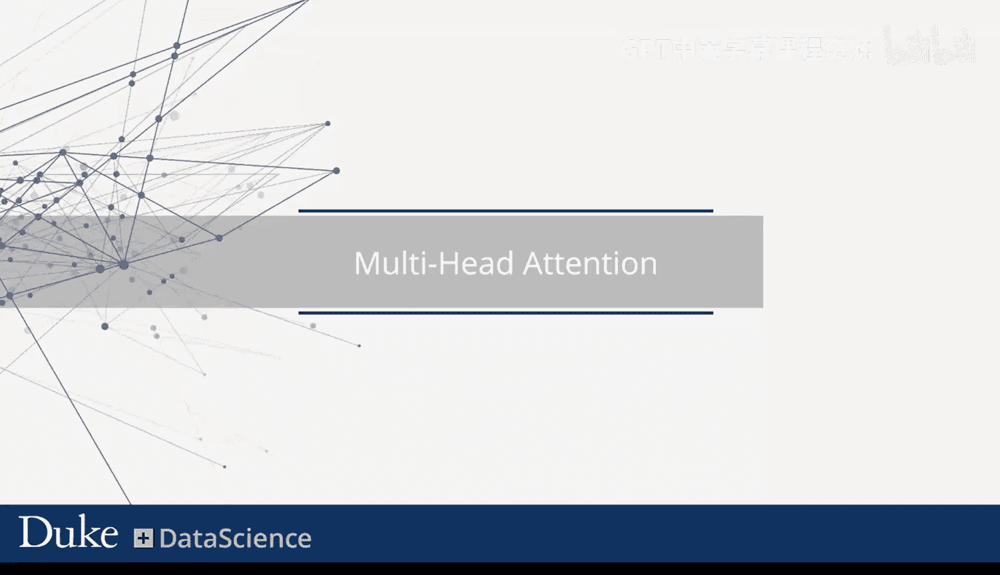
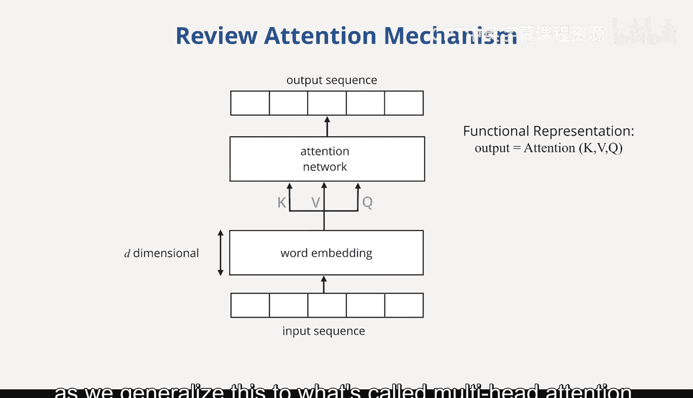
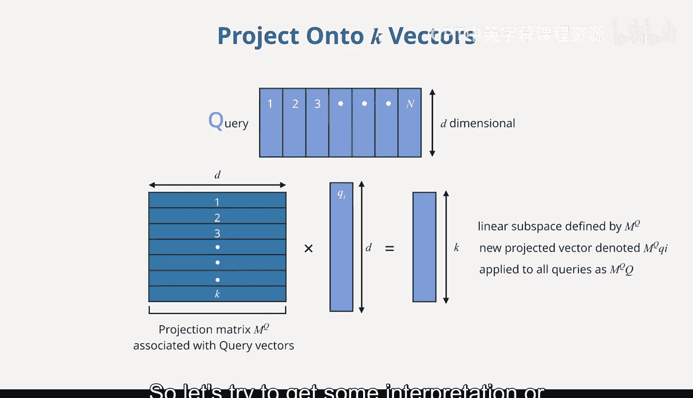
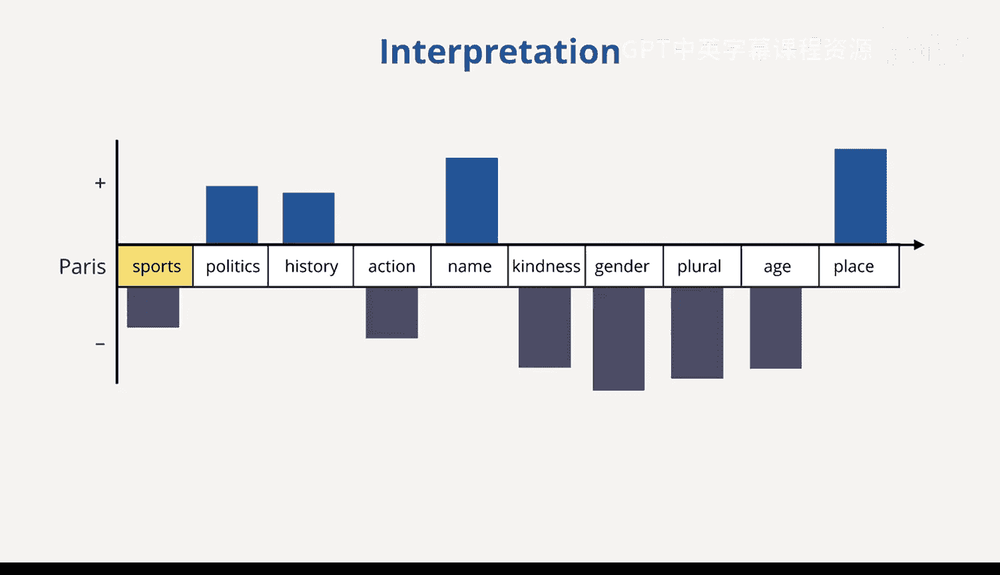
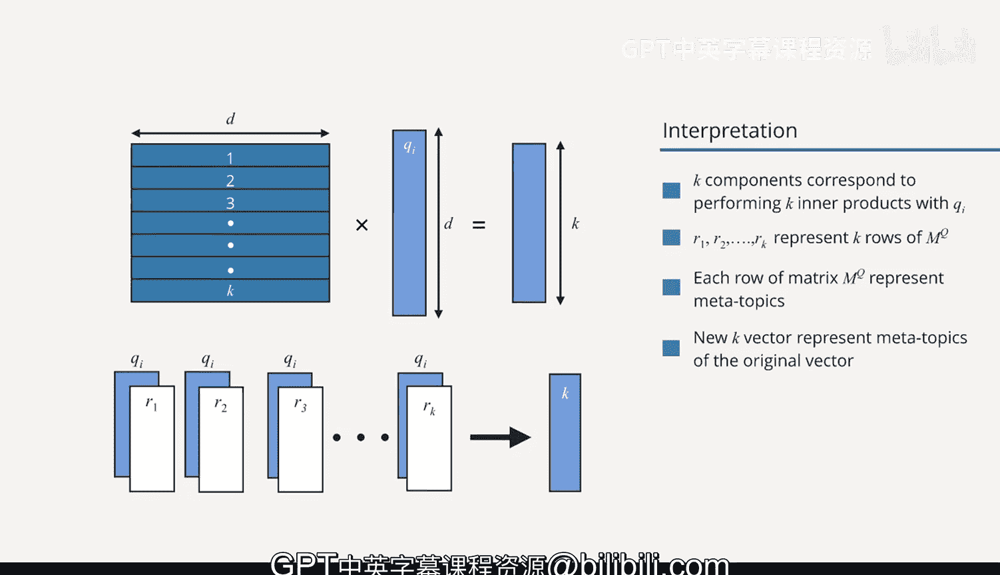

#  061：多头注意力机制

在本节课中，我们将学习Transformer网络中的一个核心概念——多头注意力。我们将从回顾已学过的注意力机制开始，然后深入探讨其如何被扩展为更强大的多头注意力形式。

## 注意力机制回顾

上一节我们介绍了注意力机制的基本原理。在Transformer网络中，注意力机制是我们已构建模型的基础，它主要通过两种方式体现。

首先，是**自注意力**。我们有一个由n个单词组成的序列，每个单词由一个向量表示。通过注意力机制，我们根据周围单词的特征来修改每个单词的向量表示。

其次，是**交叉注意力**。在序列到序列模型中，我们评估编码器输出和解码器输出之间的注意力关系。我们有一个输入序列和一个输出序列，交叉注意力帮助解码器在生成输出时关注输入序列的相关部分。

## 多头注意力概述

在原始的Transformer网络中，注意力机制被推广为所谓的**多头注意力**。接下来，我们将花一些时间理解这个概念，它是实际应用中Transformer网络的核心。

在深入之前，让我们先回忆一下注意力机制的各个组成部分。

## 注意力机制组件

在注意力机制中，我们有一个由n个单词组成的序列，它们由向量 `C1, C2, ..., Cn` 表示。我们还有一个查询向量 `Qk`，用于相对于这n个单词进行查询。

回忆查询机制，我们还有**键**：输入序列对应的n个向量 `C1, C2, ..., Cn` 就是我们的键。最后，我们还有**值**，这里的值同样是 `C1, ..., Cn`。

通过结合查询、键和值，我们实现了注意力机制。该机制将查询 `Qk` 转换为一个新的向量 `C’k`，这个新向量将查询置于 `C1` 到 `Cn` 这n个单词向量的上下文中。

## 从单头到多头

我们目前讨论的原始注意力机制如下图所示。我们有一个输入单词序列，每个单词被映射到一个词嵌入（即一个词向量）。这些向量随后被用作键、值和查询，从而实现了自注意力机制，最终产生一个输出序列。回忆一下，这个输出序列将每个词向量置于其周围所有词向量的上下文中。

为了使后续讨论更具体，我们将引入一个符号或函数形式来表示注意力机制。它是一个关于键、值和查询的函数，其输出称为输出本身。在将其推广到多头注意力时，我们将使用这个符号。

## 多头注意力的数学形式

认识到我们刚才讨论的内容，我们可以将查询视为一组n个向量 `Q`，键视为一组n个向量 `K`，值 `V` 视为一组n个向量。每个向量都是d维的。查询、键和值是我们整个课程中讨论的注意力网络的基础。

现在，如果我们考虑第i个查询（即这n个向量中的第i个），我们将对其进行一个称为**投影**的操作。

`Qi` 是一个d维向量，对应于n个向量中的第i个（i从1到N）。我们将把这个向量 `Qi` 乘以一个矩阵 `M^Q`。这个矩阵由k行组成，每一行也是d维的。

我们做的是取矩阵 `M^Q` 的每一行（用蓝色表示）与查询 `Qi` 做内积。这可以看作是将查询 `Qi` 映射到一个由矩阵 `M^Q` 的k行所张成的线性子空间上。

## 投影的直观理解

让我们尝试理解这里发生了什么。回忆一下，与每个单词相关联的嵌入向量具有潜在的主题含义。例如，单词“Paris”被映射到一个10维的嵌入向量，该向量的每个分量代表一个主题。如果单词“Paris”与该主题一致，则相关分量为正。

例如，巴黎是法国的首都，具有政治意义，因此与政治相关的第二个分量（概念上）是正的。另一方面，巴黎与体育关系不大，因此与体育相关的第一个分量略为负。

这就是词向量背后的直觉。现在，请记住，在这种情况下，每个查询都对应于与特定单词相关联的向量，并且该向量的每个分量都代表主题。

我们可以这样思考：我们取查询 `Qi`，然后将其与矩阵 `M^Q` 的第1行、第2行...第k行（我们将其表示为 `R1, R2, ..., Rk`）进行内积。我们所做的是将原始查询向量 `Qi` 投影到这个矩阵 `M^Q` 的k行上。

你可以这样理解：矩阵 `M^Q` 的每一行代表一个 overarching 的**元主题**。因此，该矩阵的每一行都在选择或强调向量 `Qi` 的某些分量。本质上，通过使用这个矩阵，我们正在突出某些重要的主题或元主题。

这对此进行了总结。因此，这个由k行组成的矩阵 `M^Q`（此处用蓝色表示），每一行都是d维，它将原始的d维查询向量 `Qi` 映射到一个新的k维向量。这个新向量的k个维度代表了原始向量的元主题。

这是一个通用概念：将查询乘以一个矩阵，从而突出与该向量相关的k个元主题。

## 总结

本节课中，我们一起学习了多头注意力机制。我们从回顾基础的注意力机制（包括自注意力和交叉注意力）开始，理解了其核心组件：查询、键和值。接着，我们探讨了如何通过投影操作将单头注意力扩展为多头注意力，即使用不同的投影矩阵为查询、键和值生成多个子空间（或称“头”），使模型能够同时关注来自不同表示子空间的信息。这种设计极大地增强了模型捕捉复杂依赖关系的能力，是Transformer架构成功的关键之一。