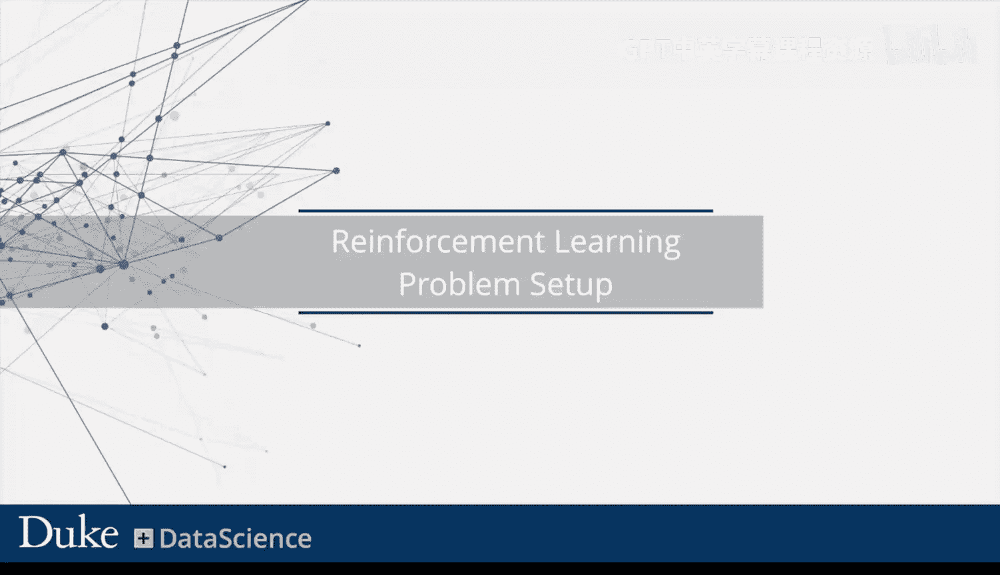
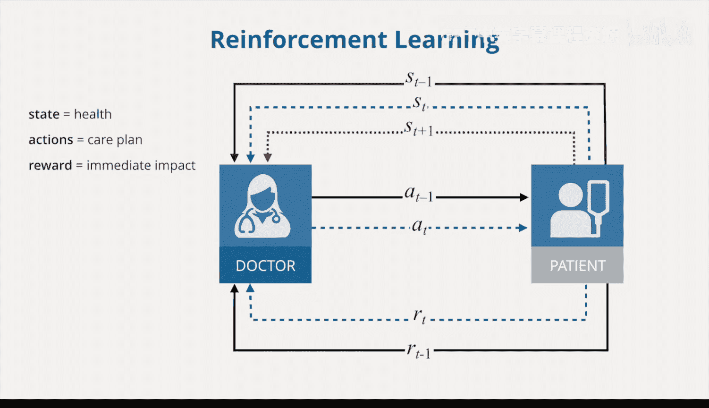
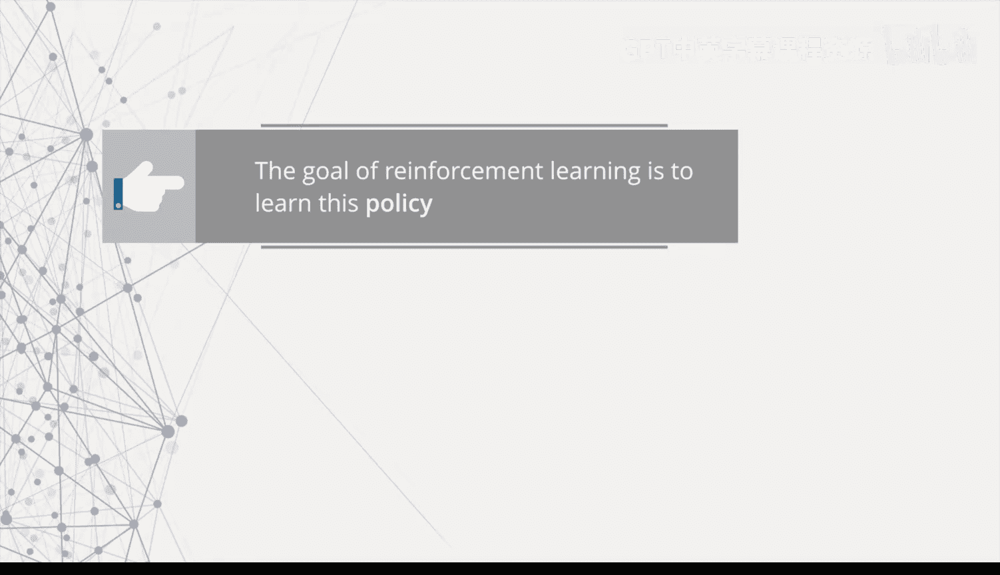
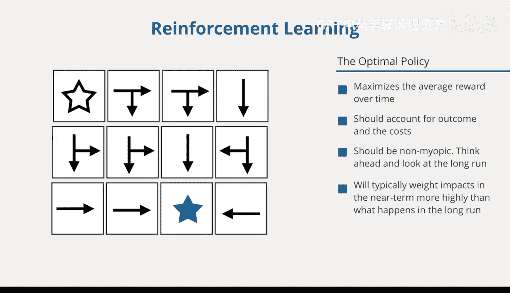
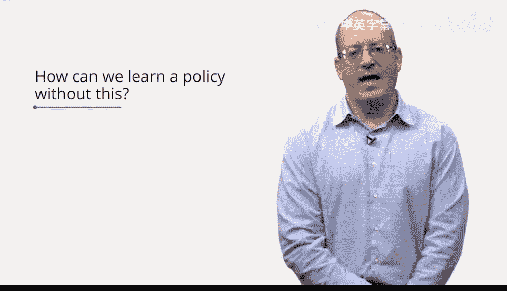
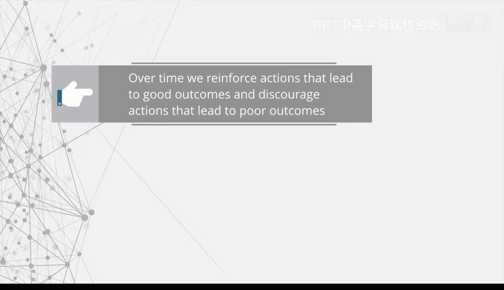
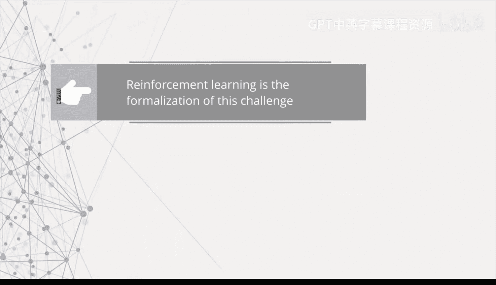
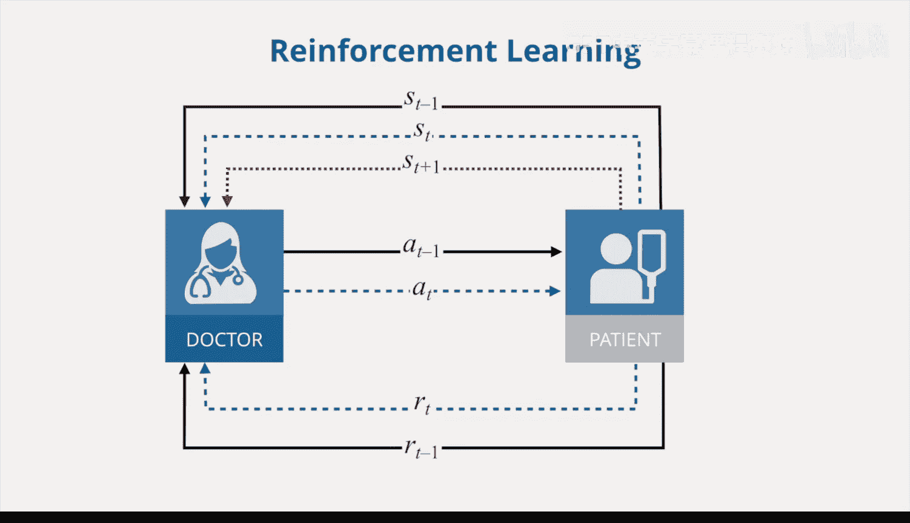
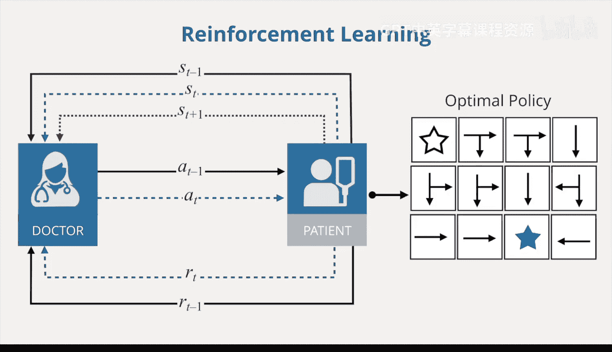

#  064：强化学习问题设置 🎯

在本节课中，我们将学习强化学习问题的基本设置方式。我们将通过一个医生与病人互动的例子，来理解强化学习中的核心概念，包括状态、动作、奖励和策略。

---

上一节我们介绍了强化学习的基本概念，本节中我们来看看如何具体地设置一个强化学习问题。

我们以医生与病人的互动为例，来引入强化学习的概念。医生通过一系列动作、奖励和观察与病人互动。具体来说，在时间 `t-1`，病人的健康状况是状态 `s_{t-1}`。医生采取一个动作 `a_{t-1}`，例如开药或考虑某个治疗方案。随后，由于健康状况改变为新的状态 `s_t`，一个奖励 `r_t` 随之产生。接着，医生再次采取动作，获得奖励 `r_t`，状态变为 `s_{t+1}`，如此循环往复。

强化学习中的交互（例如医生与病人）的特点在于，它是由一个**状态、动作、奖励**的序列构成的。这个序列按“状态 -> 动作 -> 奖励 -> 新状态 -> 新动作 -> 新奖励”的顺序不断推进。

---

上一节描述了交互的序列，本节中我们来看看强化学习的目标。

医生以及强化学习的目标，是制定一个**策略**。这个策略定义了当面对处于状态 `S` 的病人时，医生应该采取的最优动作。因此，强化学习的目标就是学习这个策略。这个策略将有效地定义护理标准，即医生应如何照护病人。

最优策略应当最大化长期的平均奖励，并综合考虑病人的治疗结果和医疗成本。策略应该是**非短视**的，这意味着它不仅要考虑对病人最直接的影响，还要着眼于长期的后果。具体来说，在这种非短视的特性下，我们通常会更重视近期的影响，而非远期的影响。但无论如何，一个非短视的策略会同时考虑当前和未来的奖励。

---

了解了目标后，我们来看看解决强化学习问题时所面临的挑战。

我们面临的挑战在于，通常我们并不知道底层的状态转移概率分布 `P(s' | s, a)`。这个概率表示，当病人在状态 `s` 时，我们采取动作 `a` 后，病人转移到状态 `s'` 的可能性。这个底层概率通常是未知的。

那么问题就来了：**在无法获知底层概率 `P(s' | s, a)` 的情况下，我们如何学习一个最优策略？**

---

既然无法直接获知模型，概念上我们可以采取的方法是：**通过体验世界来学习**。

我们可以去体验世界，尝试各种行动，并记录下发生的结果。其核心思想是，随着时间的推移，我们调整策略，以**强化**那些带来良好结果的动作，并**弱化**那些导致不良结果的动作。

这实际上正是“强化学习”这一术语的核心。在强化学习中，我们将通过反复体验世界来学习：观察世界状态，采取动作，观察新状态和获得的奖励。

通过反复经历状态、动作、奖励和新状态，我们希望学习到一个最优策略。这里的“最优”是指，从长远来看，该策略能为病人带来良好的平均结果（奖励），同时从医疗系统的角度，也能很好地控制成本。

---

因此，强化学习就是对这个基本挑战的公式化表述。

基本挑战在于：我们将通过一系列“状态 -> 动作 -> 奖励 -> 新状态 -> 新动作 -> 新奖励”的序列来体验世界，并反复进行这个过程。然后，我们希望基于这些经验，学习到一个最优策略。

这是一个非常根本的问题，也正是强化学习要解决的问题。我们将要讨论的强化学习方法，就是为了应对这一挑战。

需要认识到的重要一点是，虽然我们使用医疗健康作为主题示例（因为它对大多数人来说直观易懂），但这种试图制定长期最优策略的框架也体现在许多其他场景中。

以下是几个其他领域的例子：

*   **工厂设备维护**：考虑运营工厂车间的情况。你需要监控机器的健康状况，并决定维护计划。例如，何时应将特定机器下线进行维修或调整。等待机器完全故障可能不是好主意。因此，监控机器健康的最佳方式以及维护健康的最佳策略，也是一个强化学习问题。
*   **投资**：观察公司股价随时间的变化，你希望做出好的投资。理解股票市场的底层统计规律非常困难。因此，你可能会尝试制定一个策略，来指导你买卖哪些股票。你希望这个策略能长期带来平均意义上的正向投资结果。

我想通过这张幻灯片强调的是，虽然我们在课程中将使用医学作为主题，但强化学习这个框架是非常通用的。我们之前也曾在围棋游戏的背景下讨论过它，让机器与人类对弈。这些都是**序列决策**类型的问题。而强化学习，正是解决这类问题的一个基本机器学习框架。

---

本节课中我们一起学习了强化学习问题的基本设置。我们通过医生与病人的例子，理解了状态 `s`、动作 `a`、奖励 `r` 和策略 `π` 等核心概念，明确了学习最优策略的目标，并认识到在未知环境模型 `P(s'|s,a)` 的情况下，需要通过与环境交互的体验来学习。最后，我们了解到强化学习框架具有通用性，可广泛应用于医疗、工业、金融和游戏等多个领域的序列决策问题。