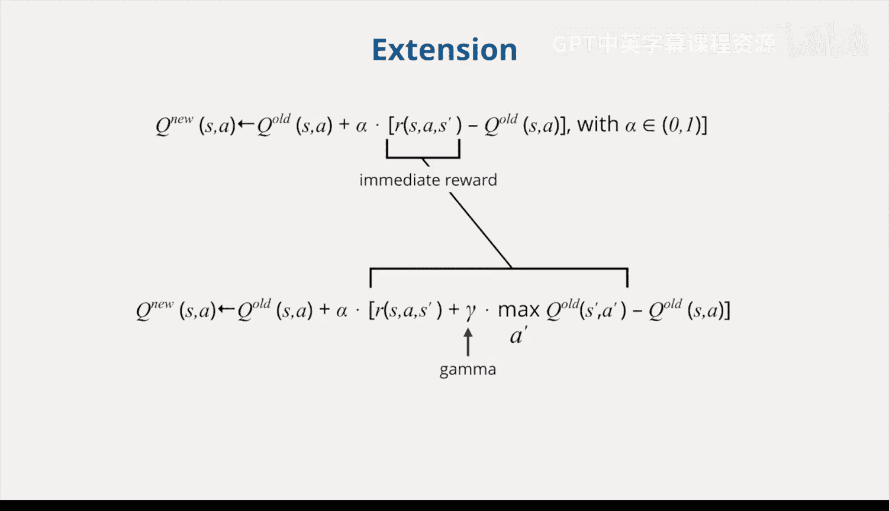
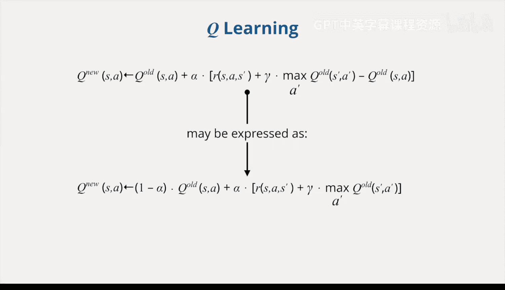
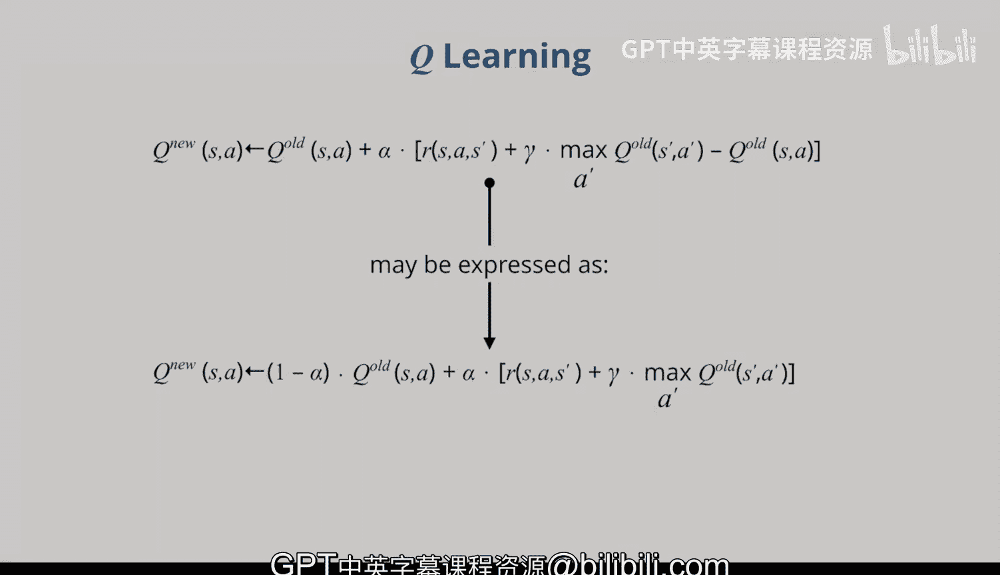

#  067：转向非短视策略 👁️


在本节课中，我们将学习如何将之前介绍的短视策略扩展为非短视策略。我们将探讨如何让智能体在决策时不仅考虑即时奖励，也考虑未来的潜在回报，从而做出更优的长期决策。


上一节我们介绍了基于即时奖励的短视策略更新方法。本节中我们来看看如何改进它，使其能够考虑未来的奖励。

## 短视策略的局限性

我们之前建立的框架虽然直观，但其解决方案是“短视”的。它只考虑了患者（在我们的例子中）获得的即时奖励。因此，我们希望将其扩展，发展出一种非短视的策略。

所谓非短视，是指我们评估的策略或Q函数，在评估在状态S下采取动作A的价值时，不仅考虑即时奖励，也考虑后续到来的奖励。

我们回顾一下之前的例子和方程。以下是之前展示的相同方程：

```
如果 R > Q_old(S, A):
    Q_new(S, A) = Q_old(S, A) + α * (R - Q_old(S, A))
否则:
    Q_new(S, A) = Q_old(S, A) + α * (R - Q_old(S, A))
```

这个方程的问题是，我们用它学习的Q函数只预测了患者的即时奖励，因此没有考虑后续可能发生的情况。

## 引入未来奖励




我们希望以一种相对直接的方式扩展这个框架。观察第一个方程，这是我们之前更新Q函数的方式：如果即时奖励R大于我们对Q函数的旧估计，就增大Q函数；如果R小于旧的Q值，就减小Q函数。但问题在于，它只基于即时奖励R。

现在，我们将对第一个方程做一个虽小但非常重要的修改。第二个方程与第一个方程完全相同，只进行了一项更改。


在第一个方程的括号里是即时奖励R。在第二个方程中，我们将用“即时奖励R”加上“γ乘以后续状态的最佳估计价值”来替换这个单独的R。


具体来说，过程是这样的：患者处于状态S，采取了动作A，然后转移到了新状态S‘。患者的新健康状态是S‘。我们需要评估处于状态S‘对患者的价值。

让我们回想一下早先的例子。假设你是一名医生，你的患者是一位年轻女性。你可以采取一个可能改善患者即时健康的行动（比如用药）。因此，S‘代表了患者改善后的健康状态，即时奖励R(S‘)很高。


但现在假设，服用这种药物会显著增加这位年轻女性未来无法生育的可能性。那么，患者现在处于一个新状态S‘，我们必须评估这个新状态对患者的好坏。对于这位年轻女性来说，如果她进入了一个无法生育的新状态，这对她可能是一个非常糟糕的状态。

## 非短视的Q学习更新规则

观察这个修改：在第二个方程中，我们用两项之和替换了单独的即时奖励R。第一项是即时奖励R，第二项是对患者处于状态S‘的价值的估计。

患者采取动作A后处于状态S‘，这对患者有何价值？我们将使用我们对Q函数的旧估计，并假设随后我们将采取在状态S‘下可能采取的最佳动作A‘。

需要注意的是，我们现在考虑的是即时奖励，加上一个打了折扣的后续奖励。后续奖励是患者在状态S‘下能获得的最大价值，即对所有可能动作A‘取最大值，由旧的Q函数参数化。γ是一个折扣因子。

γ是一种让我们能够权衡患者后续健康状态和行动的重要性相对于当前情况的方法。回到年轻女性的例子，我们想采取一个能增加即时奖励R的行动，同时我们也关心后续发生的事。但生育是未来的事，可能不如当下生存那么重要。参数γ就是这个折扣因子。

现在，我们来看每一项：
*   **R**：给患者的即时奖励。
*   **max_{A‘} Q_old(S‘, A‘)**：这是患者处于状态S‘时的预期未来奖励。
*   **γ**：折扣因子，是一个介于0和1之间的数，用于权衡我们如何看待即时奖励R相对于未来可能获得的后续奖励的重要性。

这个方程也是一个时间差分，但它是一个非短视的时间差分。新的Q函数通过旧Q函数与“非短视奖励”（即时奖励加上折扣后的后续奖励）之间的时间差来更新。

如果这个复合奖励大于我们对Q函数的旧估计，就意味着在状态S下采取动作A比我们原先认为的更有价值，因此我们增加Q函数的值。如果这个复合奖励小于我们的旧估计，那么我们可能高估了在状态S下采取动作A的价值，因此通过这个方程和时间差，我们在Q函数的估计中减小其值。

这个学习规则与之前的几乎完全相同，只是在奖励项中增加了第二项（即γ * max_{A‘} Q_old(S‘, A‘)）。这个复合奖励现在取代了我们原始设置中的部分，这就是强化学习的基础。

## 标准形式与总结

如果我们对上面的方程进行一些操作，可以将其重写为另一种形式。下面的方程只是另一种写法，对某些人来说更常见，但两个方程是等价的。

```
Q_new(S, A) = Q_old(S, A) + α * [ R + γ * max_{A‘} Q_old(S‘, A‘) - Q_old(S, A) ]
```

我们推导出的这个框架，希望相对直观易懂。虽然最终得到了一些看起来相当复杂的方程，但我们是通过相对简单的直觉到达这些方程的。这些方程是强化学习的核心，特别是被称为**Q学习**的方法。它之所以叫Q学习，是因为我们试图学习这个Q函数或Q表。





本节课中我们一起学习了如何从短视策略转向非短视策略。我们引入了考虑未来奖励的Q学习更新规则，其中通过折扣因子γ来平衡即时与未来的回报，并使用下一状态的最佳估计价值来更新当前状态-动作对的价值。这是强化学习中Q学习算法的基础。