#  069：Q学习的扩展 🚀

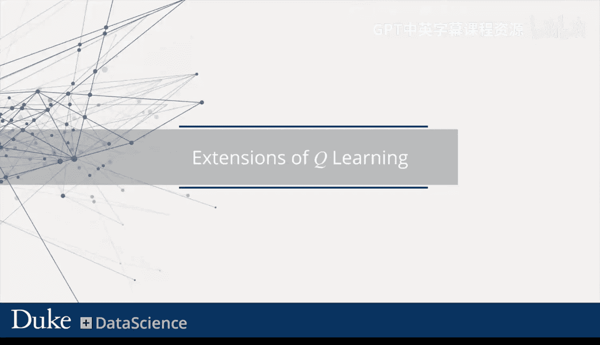

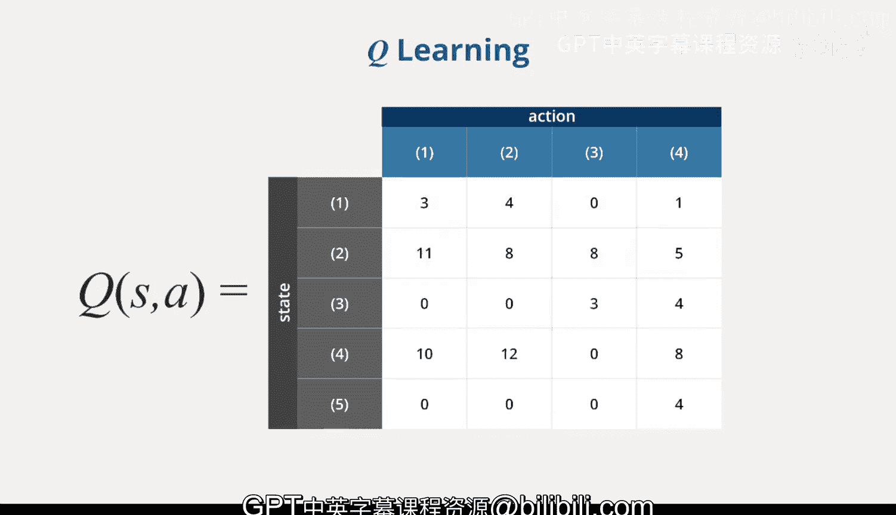

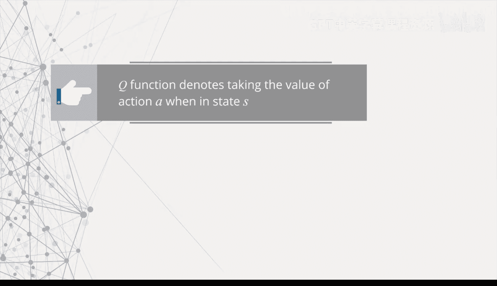

在本节课中，我们将学习Q学习算法的核心概念及其重要扩展。我们将探讨Q函数的基本更新公式，介绍SARSA算法，并深入讨论强化学习中至关重要的“探索与利用”权衡问题，以及如何通过ε-贪婪策略来平衡两者。

---

## Q学习回顾

上一节我们介绍了Q学习的基本思想。Q学习的目标是学习一个称为Q函数的近似函数。Q函数反映了智能体（在我们的例子中是患者）在状态S下采取动作A的价值。这是强化学习的核心。

Q函数的基本更新公式如下：

**Q_new(S_t, A_t) = Q_old(S_t, A_t) + α * [ R_t + γ * max_a Q_old(S_{t+1}, a) - Q_old(S_t, A_t) ]**

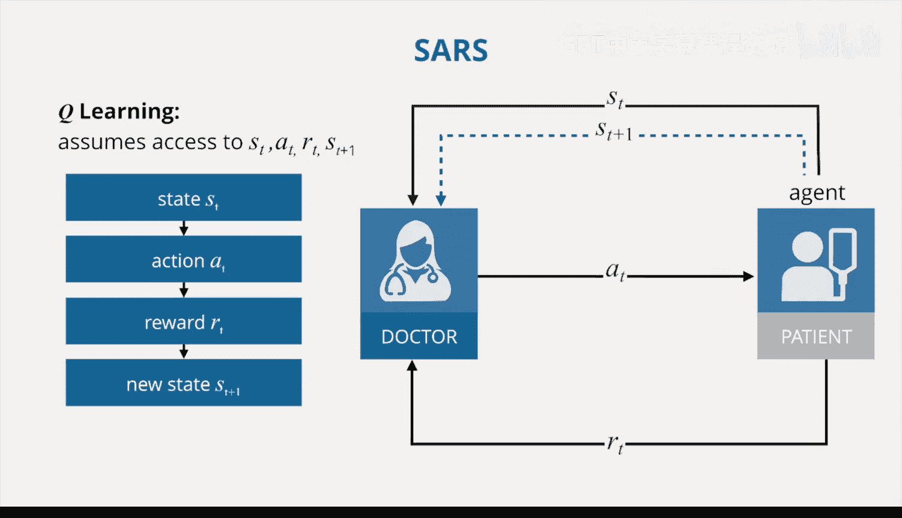

其中：
*   **α** 是学习率，控制Q函数更新的速度。实践中，通常将其设置为0.1。
*   **γ** 是折扣因子，用于衡量未来奖励的当前价值。
*   **max_a Q_old(S_{t+1}, a)** 代表基于旧Q函数对新状态S_{t+1}下所有可能动作的最大价值估计。

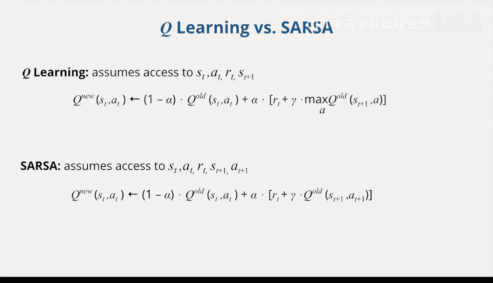

强化学习是一个被研究了几十年的领域，因此存在许多基于这个基本框架的扩展和改进方法。

---

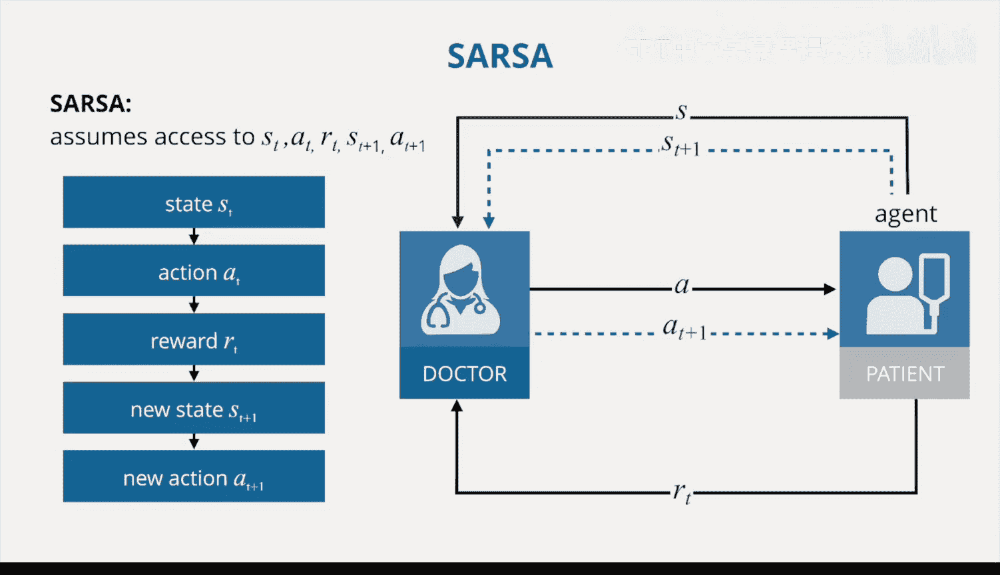

## SARSA算法

接下来，我们看看Q学习的一个简单而有效的扩展——SARSA算法。SARSA与Q学习非常相似，但有一个关键区别。

Q学习的更新基于一个“状态-动作-奖励-新状态”的序列。而SARSA则基于一个“状态-动作-奖励-新状态-新动作”的序列。SARSA的更新公式如下：

**Q_new(S_t, A_t) = Q_old(S_t, A_t) + α * [ R_t + γ * Q_old(S_{t+1}, A_{t+1}) - Q_old(S_t, A_t) ]**

请注意，与Q学习使用`max_a Q_old(S_{t+1}, a)`不同，SARSA直接使用在状态S_{t+1}下实际采取的动作A_{t+1}对应的Q值。Q学习估计的是最优未来价值，而SARSA遵循的是实际执行的策略。这两种方法展示了强化学习算法的多样性。

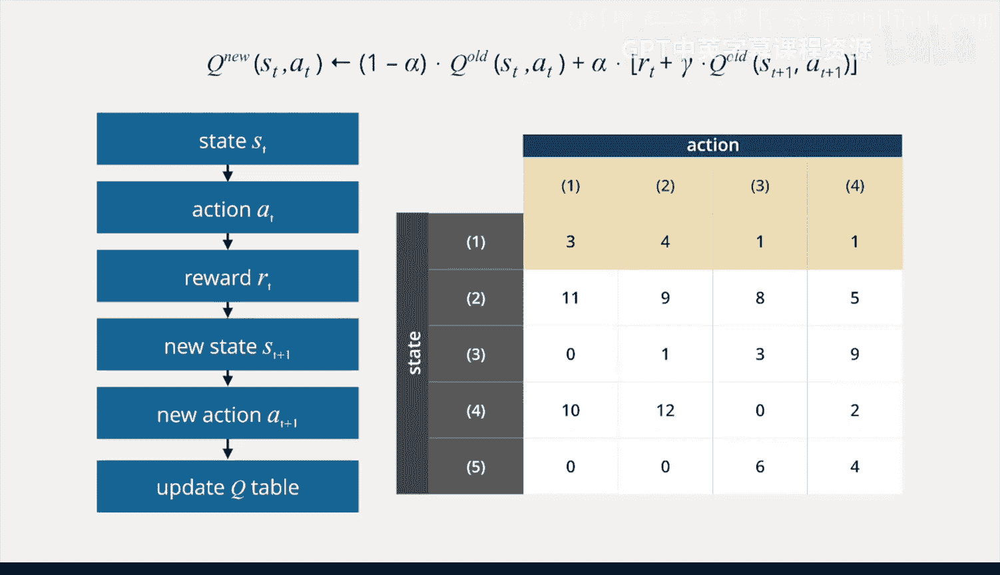

---

## 探索与利用的权衡

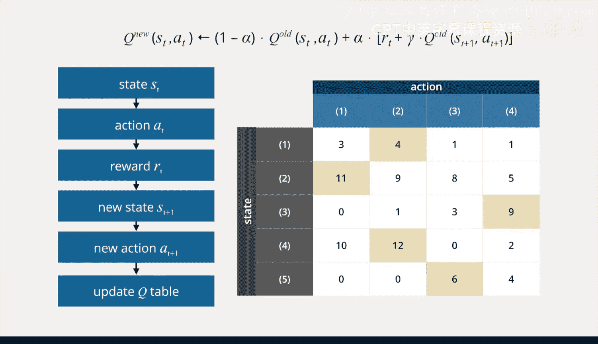

现在，让我们更深入地思考学习过程本身。在强化学习中，我们通过一系列“状态-动作-奖励-新状态”的序列来更新Q函数。这就引出了一个关键问题：在每一步，我们应该采取什么动作？

一种直观的想法是，总是根据当前对Q函数的最佳估计来选择动作。也就是说，在任何状态S下，都选择能使Q函数最大化的动作。这种方法被称为“利用”。

然而，这种方法的问题是，我们永远没有机会去“探索”。探索是指尝试不同的、可能并非当前最优的动作。这样做可能会带来意想不到的、有益的结果。如果我们只利用已知的最佳动作，Q函数可能会陷入局部最优，而无法发现真正全局最优的策略。

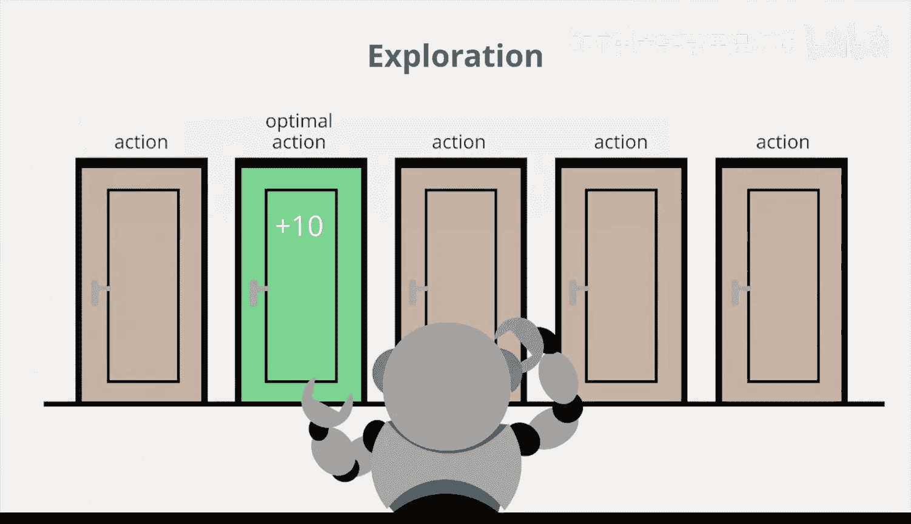

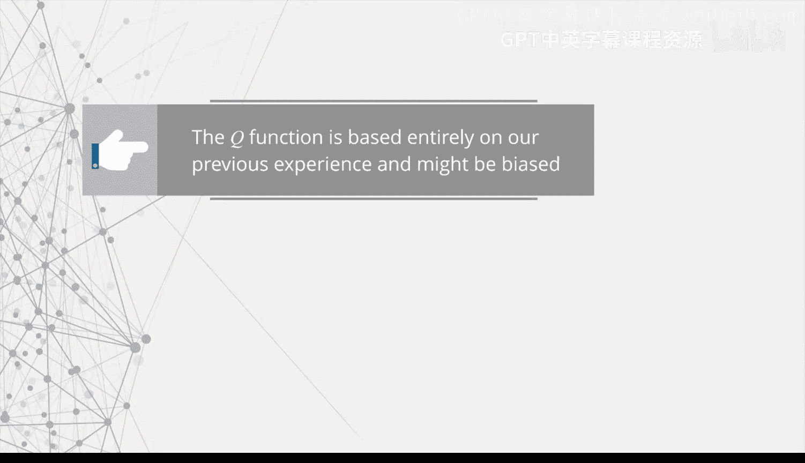

因此，在强化学习中存在一个根本性的权衡：**探索与利用**。我们需要在利用现有知识获取即时奖励，和探索未知领域以发现可能更好的长期策略之间取得平衡。

---

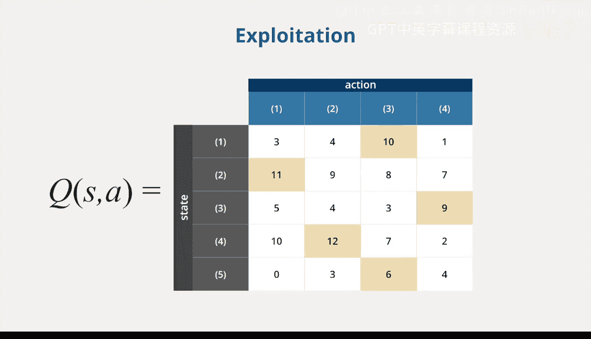

## ε-贪婪策略

为了解决探索与利用的权衡问题，实践中一种非常有效的方法是**ε-贪婪策略**。

以下是该策略的工作原理：
1.  我们设定一个小的概率值 **ε**（例如0.1）。
2.  每次需要选择下一个动作时，我们进行一次“抛硬币”：
    *   以概率 **ε**，我们进行**探索**：完全随机地选择一个动作，不考虑当前的Q函数。
    *   以概率 **1-ε**，我们进行**利用**：选择当前Q函数认为在给定状态下能带来最大预期价值的动作。

这种框架允许我们以可控的概率（ε）进行探索，从而有机会发现新的、有价值的动作，同时大部分时间（1-ε）仍在利用现有知识做出高效决策。ε-贪婪策略已被证明是提升强化学习性能的有效工具。

---

## 总结

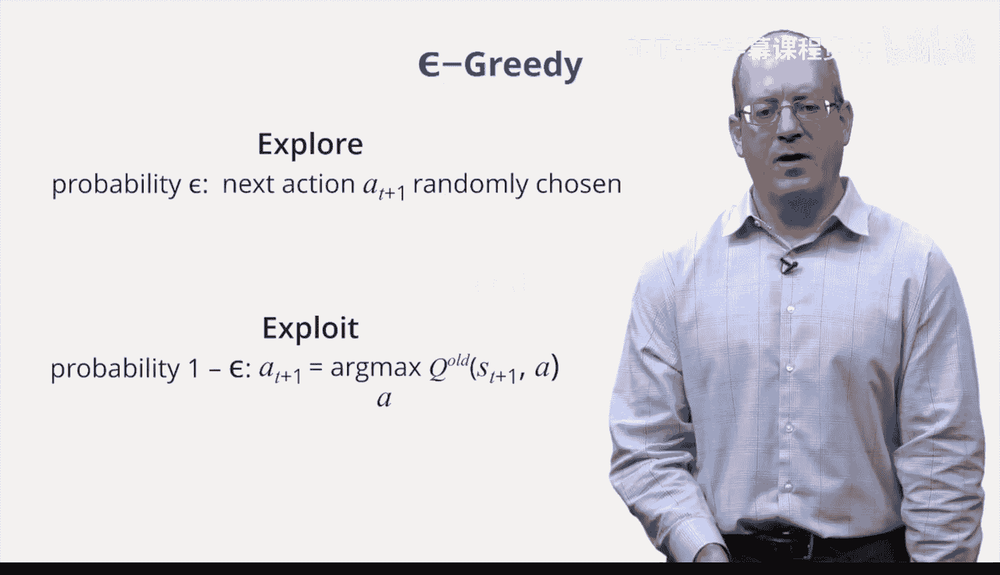

本节课中我们一起学习了Q学习的几个重要扩展。我们回顾了Q函数的核心更新公式，了解了与之相关的SARSA算法。更重要的是，我们深入探讨了强化学习中的核心挑战——探索与利用的权衡，并学习了如何使用ε-贪婪策略来巧妙地平衡两者，从而更有效地学习最优策略。