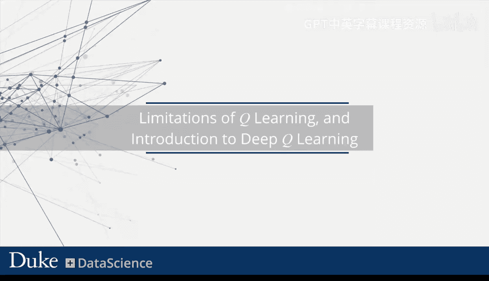
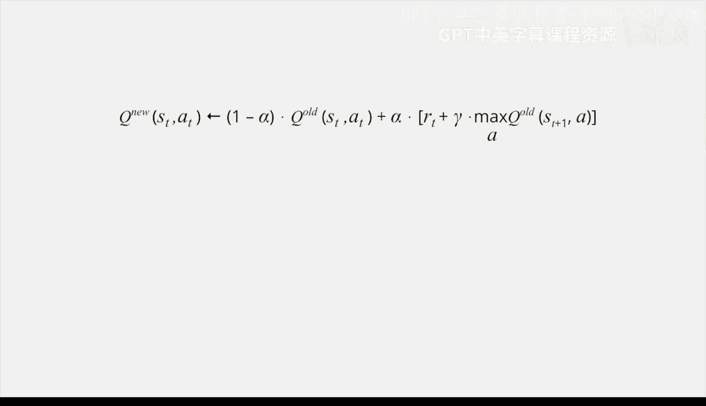
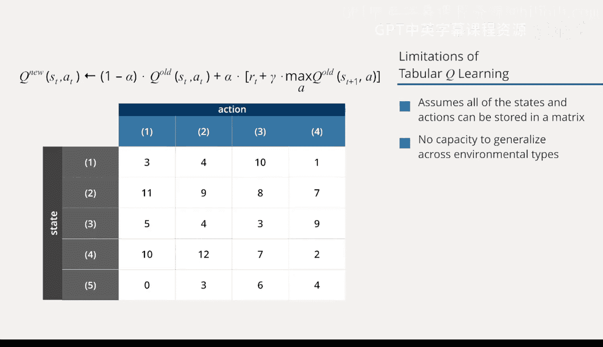
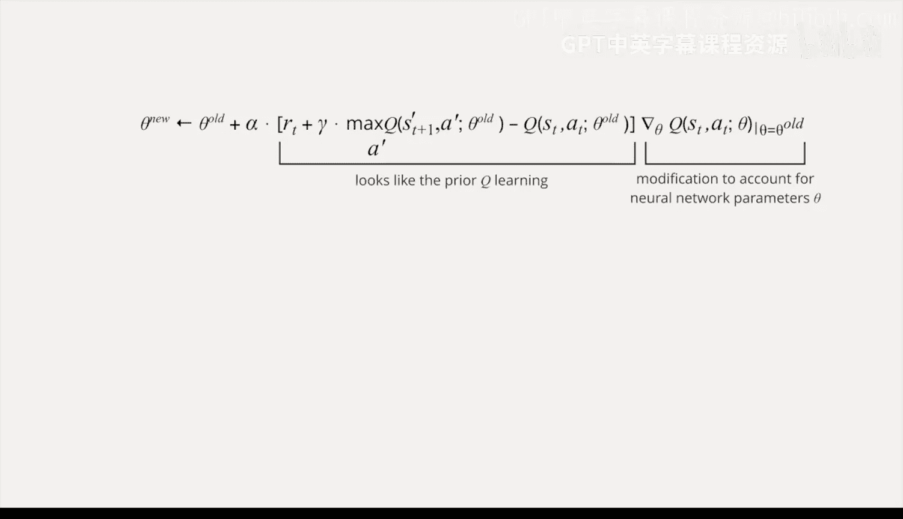

#  070：Q学习的局限性与深度Q学习介绍 🧠

在本节课中，我们将要学习Q学习的基本概念及其局限性，并由此引出一种更强大的技术——深度Q学习。深度Q学习结合了深度神经网络，能够处理更复杂、状态空间更大的问题，正是这项技术支撑了像AlphaGo这样的突破性成就。

## Q学习回顾 📚

上一节我们介绍了Q学习，它是强化学习的核心技术之一。Q学习的核心思想是通过一个Q函数来评估在特定状态下采取某个动作的长期价值。其更新过程遵循一个特定的公式。

Q学习的核心更新公式如下：
**Q(s, a) = Q(s, a) + α [ R + γ * max_a' Q(s', a') - Q(s, a) ]**

这个公式的含义是：我们根据即时奖励**R**和未来折扣奖励**γ * max_a' Q(s', a')**的估计值，来调整当前状态-动作对的价值**Q(s, a)**。参数**α**是学习率，**γ**是折扣因子。

## Q学习的局限性 ⚠️

尽管Q学习是一个强大的概念，但它存在一些重要的局限性，这些局限性促使我们寻找更先进的解决方案。

以下是Q学习的主要局限性：

1.  **表格表示法的限制**：Q学习通常假设所有状态和动作都可以存储在一个表格（矩阵）中。我们通过离散化状态和动作来构建这个表格。
2.  **可扩展性问题**：当状态和动作的数量变得非常庞大时（这在现实问题中很常见），这种表格表示法将变得不切实际，因为存储和计算成本会急剧上升。
3.  **泛化能力不足**：基于表格的Q学习方法无法对不同但相似的环境状态进行泛化。它必须为每一个独立的状态-动作对单独学习价值，缺乏从经验中提取通用模式的能力。

## 深度Q学习介绍 🚀

为了解决Q学习的局限性，我们引入了深度Q学习。深度Q学习不再假设状态和动作可以用表格表示，而是使用一个深度神经网络来近似Q函数。这种方法能够处理近乎无限的状态和动作空间。

### 深度Q网络架构

在深度Q学习中，我们用一个深度神经网络来表示Q函数。

*   **输入**：神经网络的输入是状态**s**。状态可以由**n**个数值特征构成，例如一张图像的像素值。
*   **输出**：神经网络的输出层对应所有可能动作的价值估计。例如，如果有三个可选动作，输出层就有三个节点，分别代表**Q(s, a1)**， **Q(s, a2)**， **Q(s, a3)**。
*   **参数**：这个神经网络由一组参数**θ**（Theta）定义。因此，Q函数现在表示为**Q(s, a; θ)**，意为“在参数为**θ**的神经网络下，状态**s**下动作**a**的价值”。

我们的目标从学习一个Q表格，转变为学习神经网络的最优参数**θ**。

### 学习目标与优化

深度Q学习的学习目标与Q学习在精神上是一致的：让我们的Q函数估计值尽可能接近“非短视”的奖励。

我们定义一个成本函数**U(θ)**，它衡量当前神经网络预测值与目标值之间的差距：

**U(θ) = [ R + γ * max_a' Q(s', a'; θ_old) - Q(s, a; θ) ]^2**

*   **目标值**：**R + γ * max_a' Q(s', a'; θ_old)**。这部分与Q学习相同，是即时奖励加上用**旧参数θ_old**的网络估计的未来折扣奖励最大值。
*   **当前预测值**：**Q(s, a; θ)**，即当前参数**θ**下网络的预测。

我们的目标是找到参数**θ**，使得成本函数**U(θ)**最小化。这意味着让神经网络的预测尽可能接近理想的目标奖励值。

### 通过梯度下降进行优化

为了最小化成本函数，我们使用机器学习中一种常见的方法——梯度下降。

以下是梯度下降的更新步骤：

1.  **计算梯度**：计算成本函数**U(θ)**关于参数**θ**的梯度（即多维空间中的斜率）。梯度指向函数值增长最快的方向。
2.  **反向更新**：我们沿着梯度的反方向（即函数值下降最快的方向）更新参数。更新公式为：
    **θ_new = θ_old - α * ∇U(θ_old)**
    其中，**α**是学习率，**∇**是梯度算子。
3.  **迭代**：重复上述过程，逐步将参数**θ**调整到使成本函数最小的值。

通过数学推导，我们可以得到深度Q网络参数的具体更新公式。有趣的是，这个公式的结构与传统的Q学习更新公式非常相似，都包含一个“时序差分误差”项，只是额外乘以了一个与神经网络梯度相关的项。这揭示了深度Q学习本质上是Q学习思想在函数近似框架下的自然延伸。

## 总结 ✨

本节课中我们一起学习了：
1.  **Q学习的局限性**：主要在于其表格表示法难以扩展至大规模状态/动作空间，且缺乏泛化能力。
2.  **深度Q学习的核心思想**：使用深度神经网络作为函数近似器来代表Q函数，从而克服表格法的限制。
3.  **深度Q网络的学习过程**：通过定义成本函数来衡量网络预测与目标奖励的差距，并采用梯度下降法来优化网络参数**θ**，使网络能准确估计长期奖励。

深度Q学习将深度学习的表示能力与强化学习的决策框架相结合，为处理复杂的序列决策问题（如游戏、机器人控制）提供了强大的工具。在下一课中，我们将进一步深入探讨深度Q学习的实现细节。