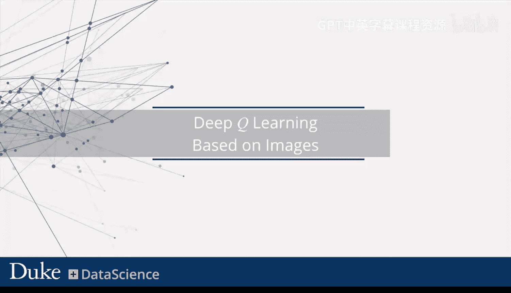
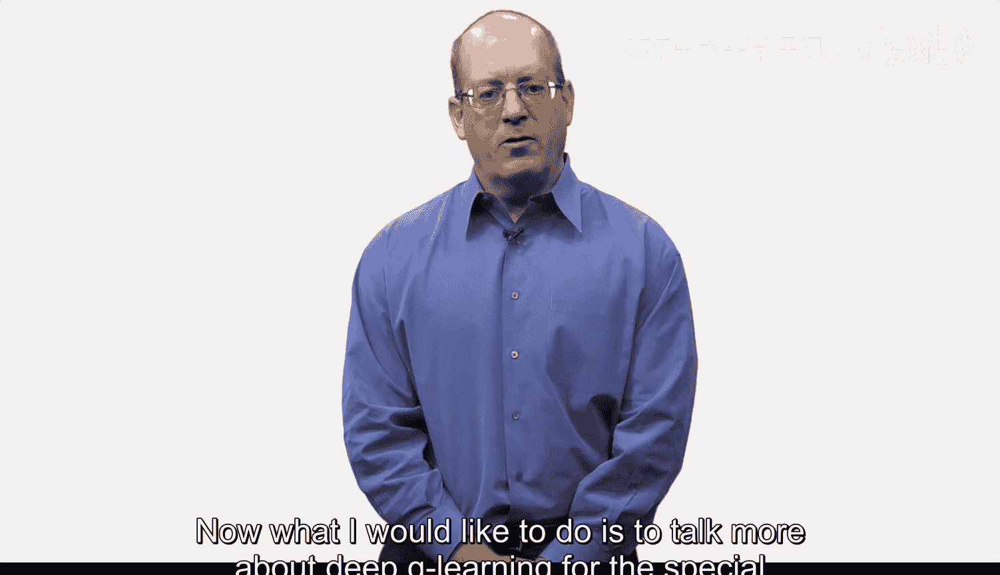
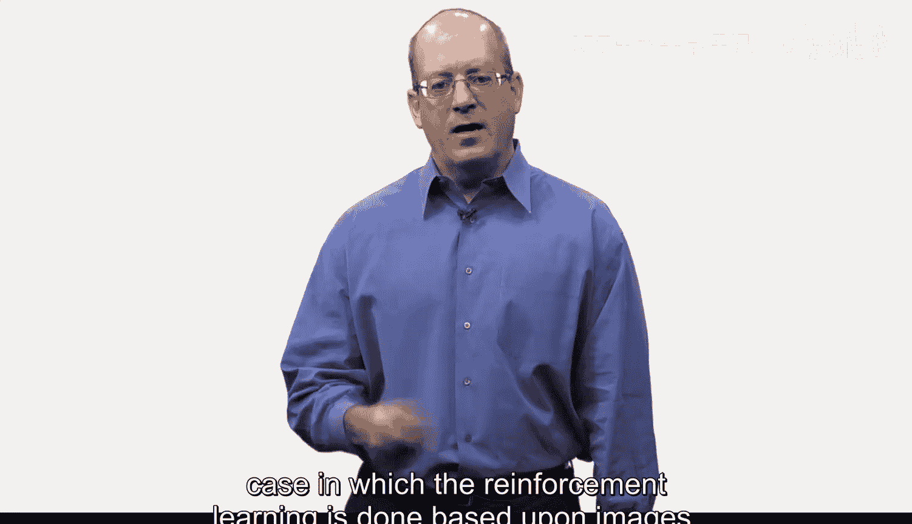
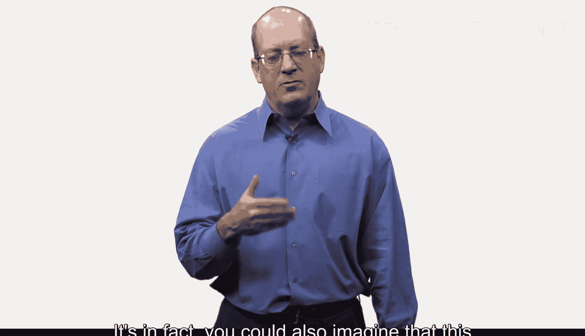
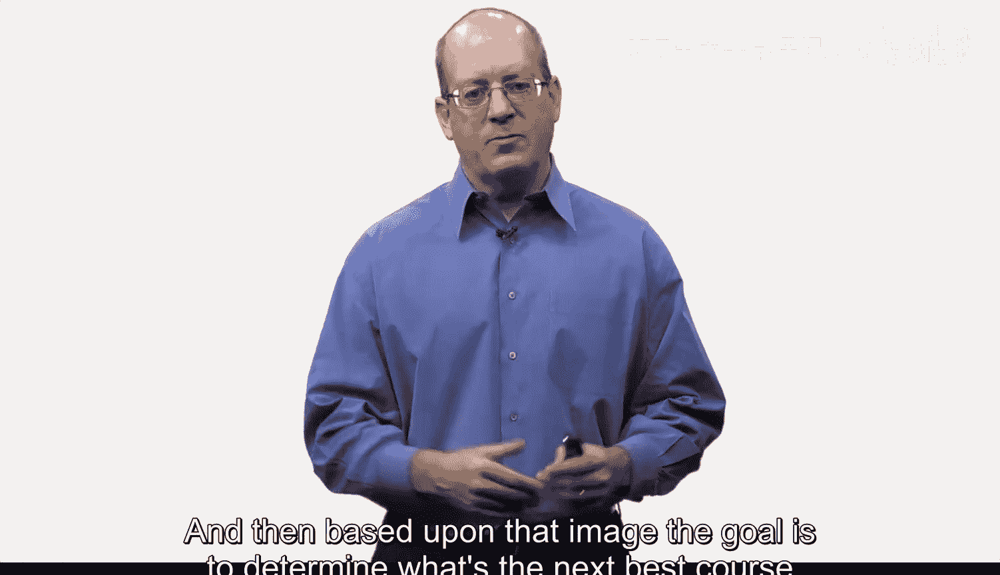
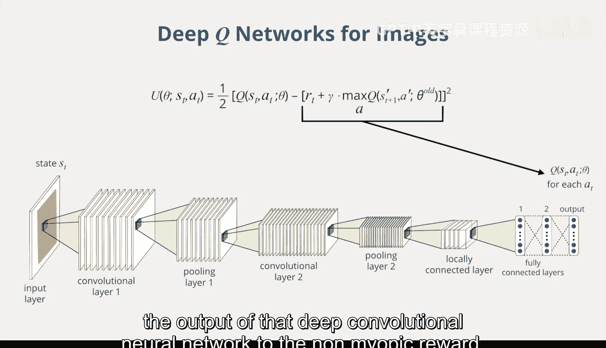
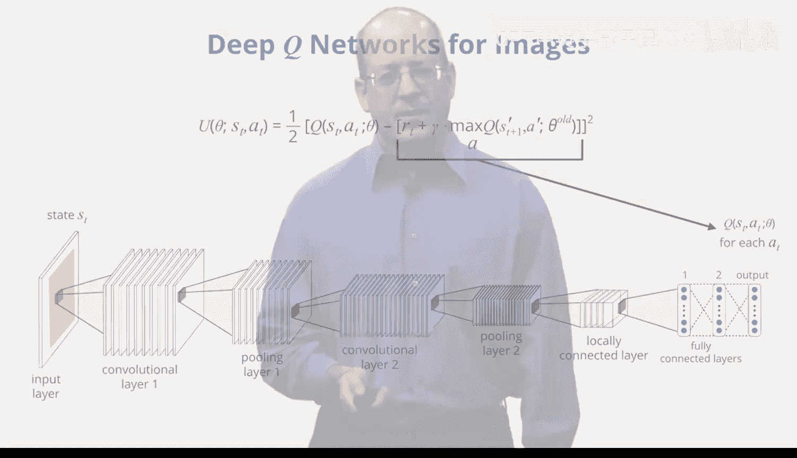

#  071：基于图像的深度Q学习 🖼️🤖

在本节课中，我们将学习深度Q学习的一个特殊应用场景：**基于图像进行强化学习**。我们将探讨如何将深度卷积神经网络与Q学习结合，使机器能够通过分析图像（例如围棋棋盘或医学影像）来做出最优决策。

---

上一节我们介绍了深度Q学习的基本概念。本节中，我们来看看当强化学习的状态输入是**图像**时，深度Q学习是如何工作的。正如我们在AlphaGo案例中谈到的，机器通过分析围棋棋盘的图像，利用深度Q学习算法来决定下一步的最优落子位置。

这个概念非常基础且重要。你甚至可以想象它在医学中的应用：例如，放射科医生获得患者的影像后，目标就是基于该图像确定对患者最佳的后续治疗方案。因此，基于图像的强化学习分析是深度Q学习的核心，值得我们深入探讨。

---

## 基于图像的Q函数优化

我们试图优化的函数仍然是Q函数，它由一个参数为 **θ** 的深度神经网络表示。这个网络的输入是状态 **s**，在这里状态就是一张**图像**（例如围棋棋盘的图片）。而输出则对应不同行动 **a** 的Q值。

我们的目标是让这个Q函数能够准确估计**即时奖励 Rt** 加上**未来奖励的折现值**。因此，代价函数 **J(θ)** 试图让 **Q(s, a; θ)** 匹配这个非短视的总体奖励。

从形式上看，这可以视为一个**监督学习**问题。原因在于，在强化学习与环境交互的过程中，我们能够观察到即时奖励 **R_t**，也能看到转移后的新状态 **s_{t+1}**。利用旧的模型参数 **θ_old**，我们可以评估新状态的价值。因此，公式中括号内的“目标值”在训练过程中是**可观测的**，我们可以用它来监督训练深度Q网络。

---

## 深度卷积Q网络 🧠

在图像处理的背景下，Q函数将通过一个**深度卷积神经网络**来表示。我们在本课程的其他部分已经介绍过CNN，这里它出现在了Q学习的上下文中。

观察这个架构图，Q神经网络从左到右依次为：
*   **输入层**：接收图像状态。
*   **一系列卷积层**：用于提取图像的层次化特征。
*   **一系列全连接层**：最终输出每个可能动作的Q值。

这是一个对深度卷积神经网络的绝佳应用。我们的学习目标，就是调整网络参数 **θ**，使得网络的输出值尽可能接近前面公式中括号内计算出的**非短视奖励目标值**。

---

## 意义与应用 🎮➡️🌍

有趣的是，这个基于我们已掌握工具（深度CNN和Q学习）的基本架构相对容易理解，而最初的AlphaGo技术正是基于此深度Q网络构建的（后续已有显著改进）。这意味着，即使在本入门课程中，我们也已经触及了促成近几十年来机器学习最重大突破之一的底层技术。

除了围棋，同样的技术已被用于自动玩许多不同的电子游戏（例如各种Atari游戏）。基于此深度Q学习框架的机器，在这些游戏上达到了超越世界顶尖人类玩家的水平。

当然，围棋或Atari游戏本身并非现实世界中非常实际的应用。但是，如果机器能玩好这类游戏，本质上意味着它拥有了一套**根据当前状态选择最佳后续行动的自适应算法**。这些游戏是我们开发技术的试验场。

这项技术最终将对人们生活产生影响的领域，是诸如**辅助临床医生**等。我们在课程开始时提到，强化学习可用于糖尿病患者药物的自动控制，以协助医生完成这项任务。因此，这项通过游戏展示的技术，拥有非常深远且潜力巨大的应用前景，很可能在全球范围内影响人们的生活。

---

## 总结 📝

本节课我们一起学习了**基于图像的深度Q学习**。我们了解到：
1.  当状态以图像形式呈现时，可以使用**深度卷积神经网络**来近似Q函数。
2.  其训练目标是最小化Q网络输出与**可观测的非短视奖励目标值**之间的差异，这类似于一个监督学习过程。
3.  这项技术是AlphaGo等突破性成果的基础，并在游戏AI中得到了验证。
4.  其核心价值在于能够学习复杂的**序贯决策策略**，未来有望在医疗、自动驾驶等需要根据视觉信息做出决策的领域发挥重要作用。