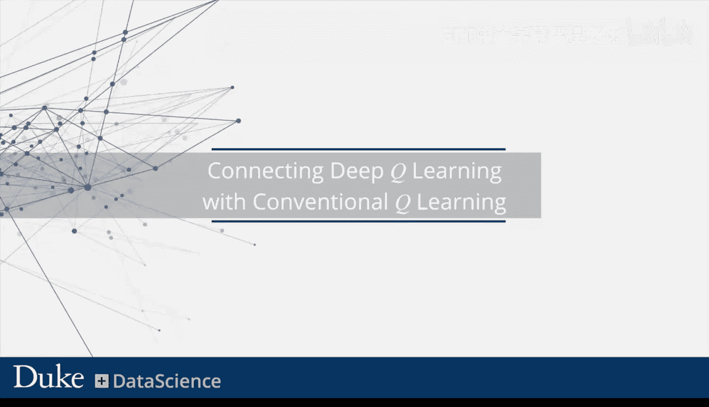
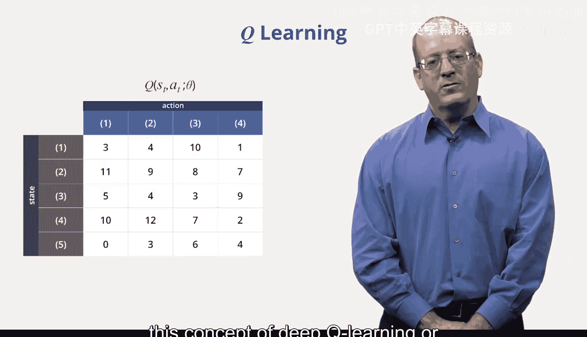
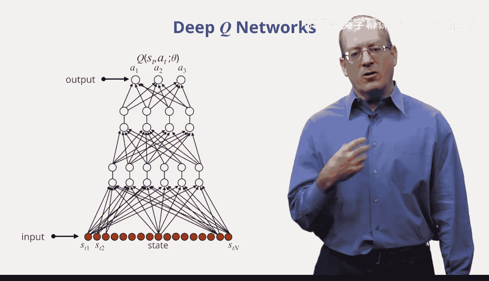
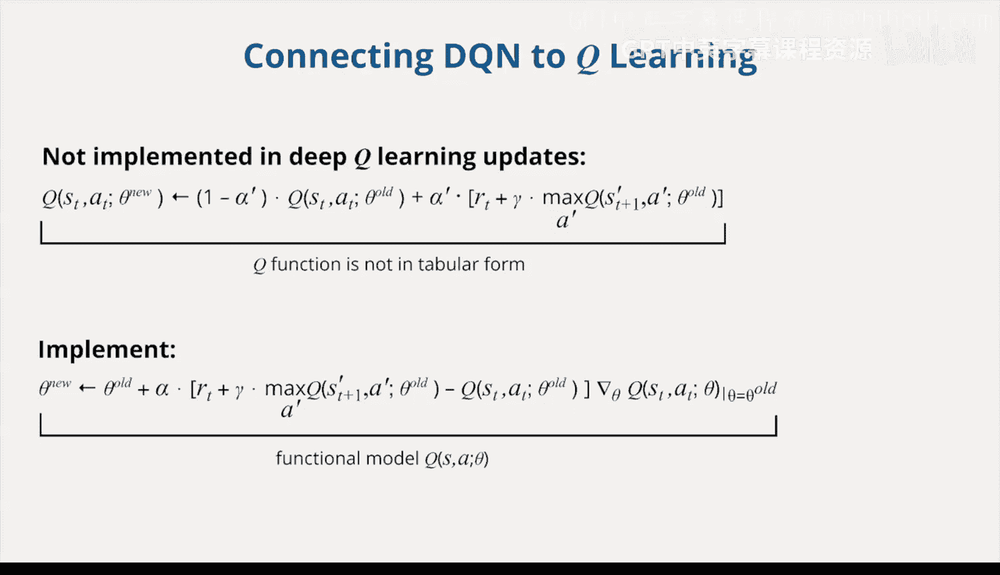

#  072：深度Q学习与传统Q学习的联系 🔗

在本节课中，我们将深入探讨深度Q学习与传统Q学习之间的数学联系。这是强化学习系列中最具技术性的一课，旨在为有数学背景的学习者提供更深层次的理解。我们将看到，在特定条件下，深度Q网络的行为本质上与传统Q学习是一致的。

## 课程回顾

上一节我们介绍了Q学习和深度Q网络的基本概念。简单来说，我们做了两件事：

1.  **传统Q学习**：我们假设状态和动作是离散且有限的，因此Q函数 `Q(s, a)` 可以表示为一个表格或矩阵。
2.  **深度Q学习**：为了解决状态空间巨大（如围棋棋盘）导致表格法不可行的问题，我们引入深度神经网络来近似表示Q函数，并学习其参数 `θ`。

以下是两种方法的直观对比：

## 深度Q学习的更新公式

深度Q网络（DQN）的核心是更新其参数 `θ`。其参数更新规则（通过梯度下降得到）和更新后的Q函数表示如下：

**参数更新规则：**
`θ_new = θ_old + α * [r + γ * max_a‘ Q(s‘, a‘; θ_old) - Q(s, a; θ_old)] * ∇_θ Q(s, a; θ_old)`

**更新后的Q函数：**
`Q(s, a; θ_new)`

其中，`α` 是学习率，`r` 是即时奖励，`γ` 是折扣因子。这个公式看起来复杂，但它与传统Q学习有着深刻的联系。

## 建立数学联系

为了揭示这种联系，我们首先定义参数的变化量 `Δθ`：
`Δθ = θ_new - θ_old`

那么，更新后的Q函数可以写为：
`Q(s, a; θ_new) = Q(s, a; θ_old + Δθ)`

现在，我们应用一个关键的数学工具——**一阶泰勒级数展开**。当参数变化 `Δθ` 很小时，我们可以对上述函数进行近似：

`Q(s, a; θ_old + Δθ) ≈ Q(s, a; θ_old) + Δθ^T * ∇_θ Q(s, a; θ_old)`

这个近似是微积分中的基本结论。接下来，我们将参数更新规则中的 `Δθ` 代入这个近似公式。

代入并整理后，我们得到：

`Q(s, a; θ_new) ≈ Q(s, a; θ_old) + α‘ * [r + γ * max_a‘ Q(s‘, a‘; θ_old) - Q(s, a; θ_old)]`

其中，我们定义了一个新的有效学习率 `α‘`：
`α‘ = α * ||∇_θ Q(s, a; θ_old)||²`

观察最终的近似公式，你会发现一个熟悉的结构。

## 与传统Q学习的对比

我们得到的近似公式，正是**传统Q学习**的更新形式！传统Q学习的表格更新规则为：

`Q(s, a) ← Q(s, a) + α * [r + γ * max_a‘ Q(s‘, a‘) - Q(s, a)]`

比较两者：

*   **深度Q学习（近似后）**：`Q_new ≈ Q_old + α‘ * (目标 - Q_old)`
*   **传统Q学习**：`Q_new = Q_old + α * (目标 - Q_old)`

它们的结构完全一致，都是将当前的Q值向“目标值”（即时奖励加折扣后的未来最大收益）调整。唯一的区别在于学习率：深度Q学习中是一个由梯度范数调整后的 `α‘`，而传统Q学习中是一个固定的 `α`。

## 核心结论与总结

本节课中我们一起学习了深度Q学习与传统Q学习之间的数学联系。

1.  **关键前提**：当深度Q网络的参数更新步长 `Δθ` 较小时，一阶泰勒展开是良好的近似。
2.  **核心发现**：在此前提下，深度Q网络的参数更新过程，**在效果上等价于**对Q函数本身进行传统Q学习式的更新。
3.  **意义**：这证明了我们为处理复杂问题而引入的深度神经网络方法，并没有脱离强化学习的基础理论框架。深度Q网络可以视为传统Q学习在连续、高维状态空间中的一种自然且强大的泛化。

因此，深度Q学习并非一个全新的、完全不同的算法，而是建立在经典Q学习思想之上，利用函数近似（深度学习）来突破其局限性的一种扩展。这统一了我们在本系列课程中学到的强化学习核心概念。

