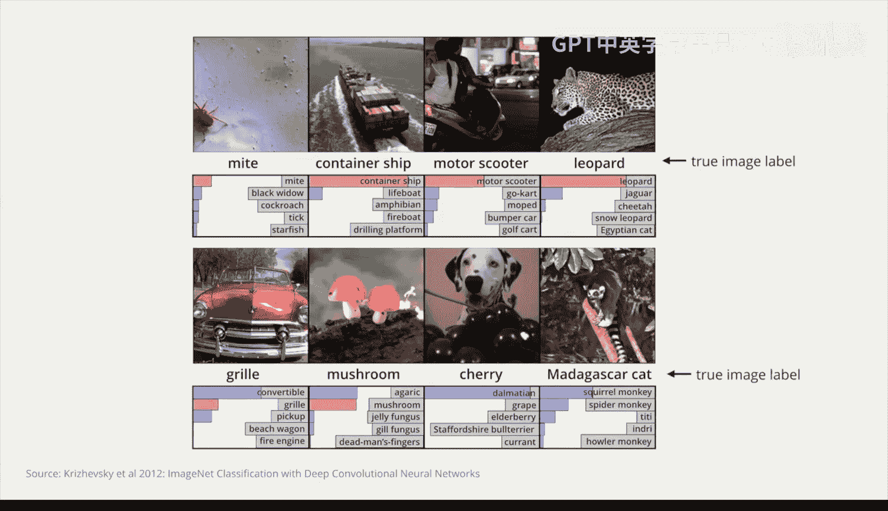
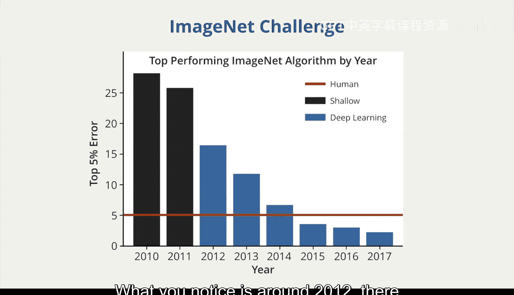
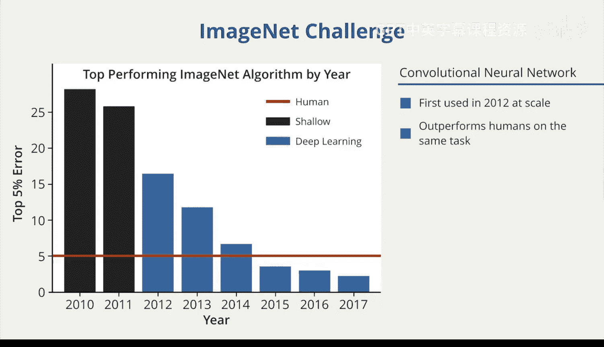
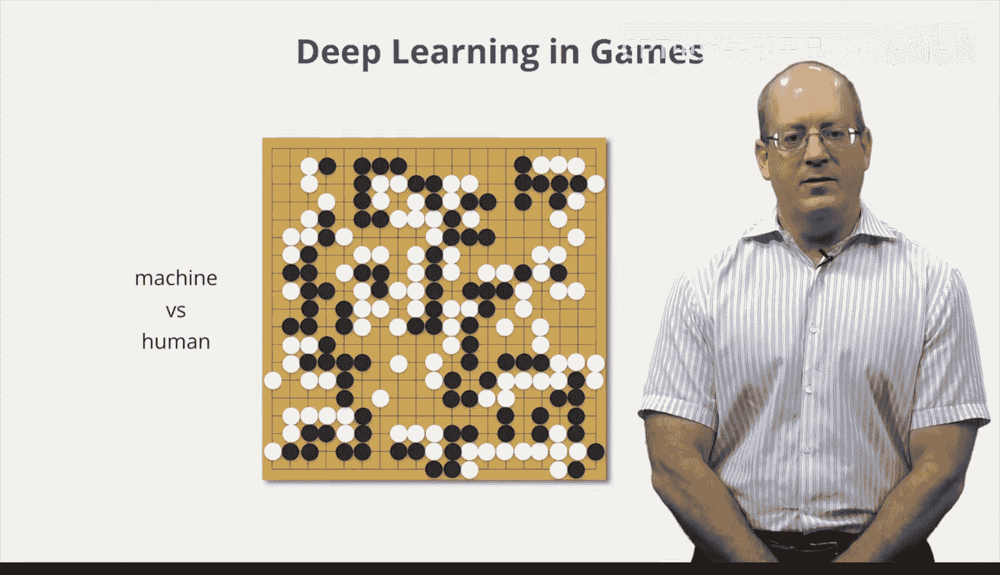

# 杜克大学《机器学习｜Introduction to Machine Learning》中英字幕 p01 01_01_02_机器学习为何令人兴奋.zh_en -BV1yjvdBQEaU_p1-

So what I'd like to do is to begin by asking the simple question what is machine learning。

 what are the basic attributes of machine learning and also why is machine learning generating so much attention in recent years Ma learning is actually a relatively old field it's been a field to study for many decades what has really captured many people's attention recently is the performance on machine learning on some very interesting tasks here is an example of one so deep learning one of the areas of that deep learning has demonstrated significant capability is in the analysis of images here are eight example images so the thing to notice about these images is that they are complicated their very real life what the machine what machine learning is doing。

This case is analyzing the image and then assigning names that label the images so what is shown is for each image you see beneath right beneath the image。

 the true label of the image and then beneath that you see the five most probable labels of the image as assigned by the machine。

 and so if you look at this a little while， you could see that the machine is doing a very。

 very accurate job in general， assigning labels to rather sophisticated images。

This is called the ImNet Chaenge and it's been an area of study for many years。

 what we're showing here are performance on the IageNe task。

Comparing different methods as a function of the year。

 So we're looking at the best performance of the algorithms or the machine learning algorithms as a function of year。

 And so we're looking at the error， the vertical axis represents error。

 and then the horizontal represents each of the years in which the study has been performed。

 What you notice is around 2012， there was a step change in performance。

 and that was when deep learning， particular convolutional neural networks were used for the first time at a scale that actually demonstrated their performance。

 And so you notice that we see a very significant improvement in performance around 2012。

And then in the subsequent years， the performance continues to improve the horizontal line which is around 5% error rate。

 is performance of a human， and so what this slide demonstrates is that in the last few years。

 deep learning in the form here of a convolutional neural network has gotten to the point where it can analyze very sophisticated images with the level of accuracy that exceeds that of a human on average。

 so this level of performance of machine learning where it actually has exceeded the performance of humans is what is generating significant attention。

 while the image is the natural images that I showed earlier or exciting this performance beyond humans is also of course of interest to many other applications such as in medicine ophthalmology or dermatology which are heavily based upon image analysis。

Machine learning has has in some cases exceeded the performance of medical doctors。

 another area where machine learning in recent years has generated remarkable performance is in playing sophisticated games while the games themselves are perhaps not of significant interest。

 the ability of a machine to solve a complex sequential problem。

 which is what is represented by a game and to perform that task in competition with a human and to beat a human is remarkable。

 the game go is an ancient game primarily played in Asia。

 it was long believed that a machine could could not beat the best human at this game in the last few years deep learning has shown a performance on the game go。

That exceeds the performance of the best players of best human players who go in the world。

 So this is a very， very significant milestone。 It's another example of how deep learning and machine learning are now solving very complex tasks。

 often with a level of performance that exceeds that of humans。

 It's this level of performance that is generating all of the excitement in machine learning in deep learning。

