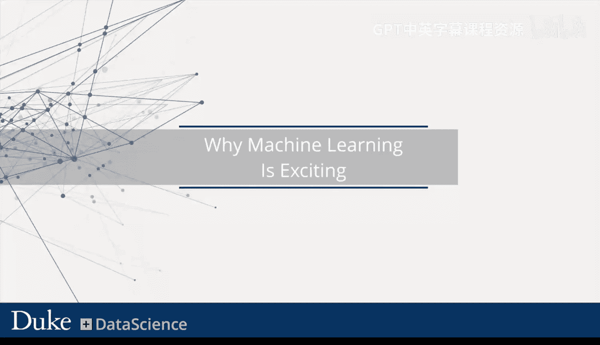
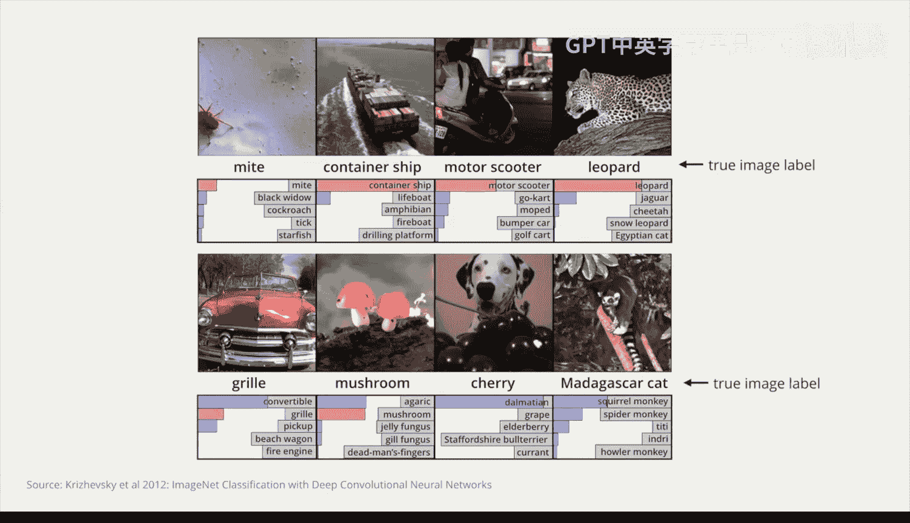
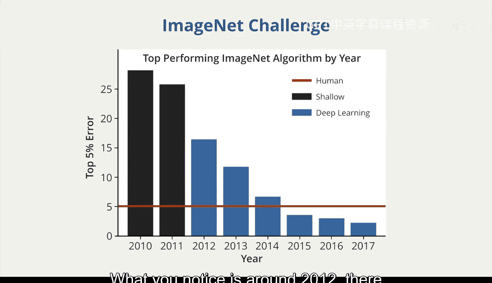
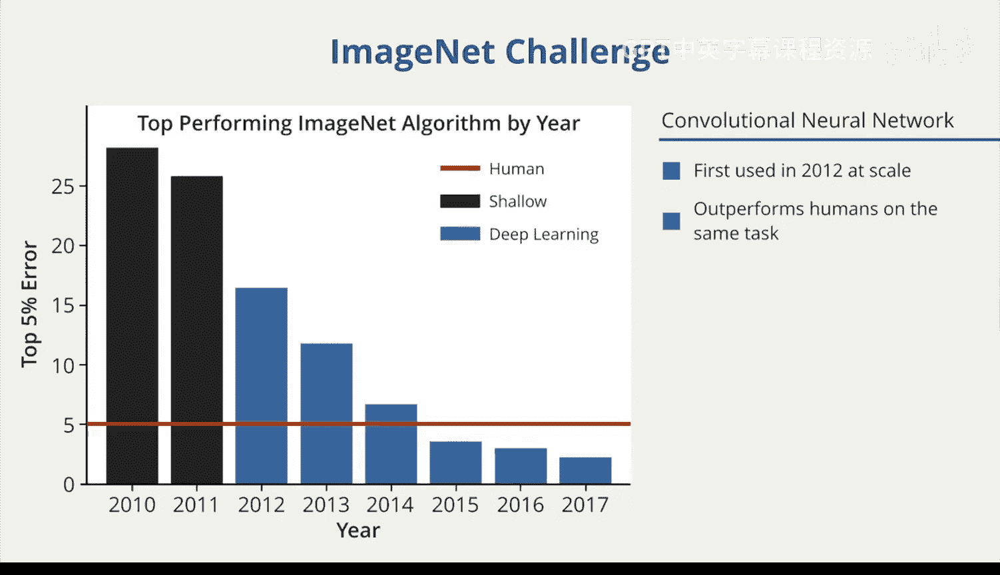
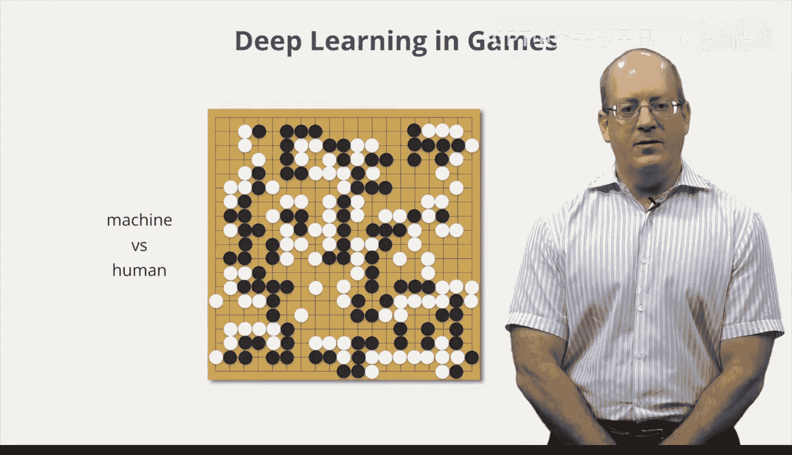
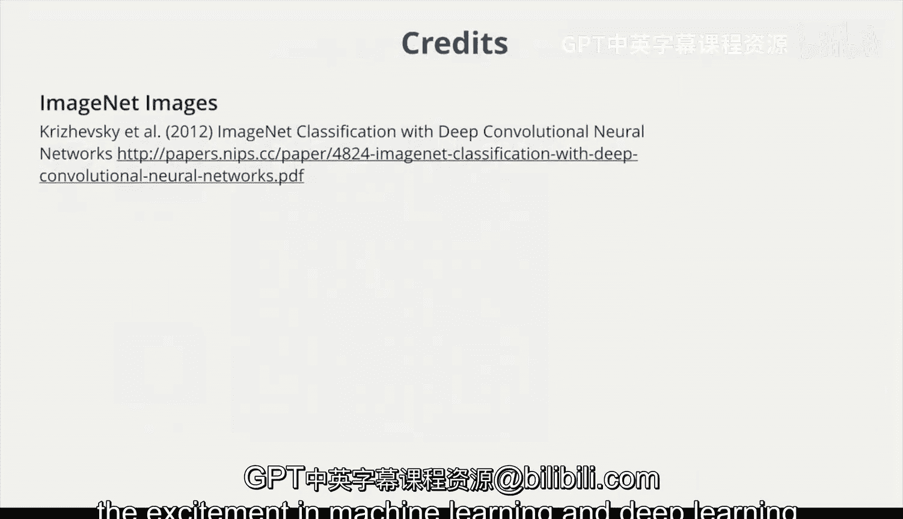

# 机器学习入门：01：机器学习为何令人兴奋 🚀

在本节课中，我们将要学习机器学习的基本定义、核心属性，并探讨近年来机器学习备受关注的根本原因。

机器学习实际上是一个相对古老的领域，其研究已持续数十年。近年来真正吸引大众目光的，是机器学习在一些极具挑战性的任务上所展现出的卓越性能。其中一个典型例子就是深度学习在图像分析领域的突破。

以下是八个示例图像。这些图像的特点是复杂且高度贴近现实生活。机器学习在此的任务是分析图像，并为它们分配描述性的标签。

对于每张图像，其下方会显示两个信息：首先是图像的真实标签，其次是机器学习模型为该图像预测出的五个最可能的标签。

观察这些结果可以发现，机器学习模型在总体上为这些相当复杂的图像分配标签时，表现得非常准确。

这个任务被称为ImageNet挑战赛，是多年来持续研究的领域。下图展示了不同年份在ImageNet任务上的最佳性能对比。

我们关注的是算法（即机器学习算法）的最佳性能随年份的变化。纵轴代表错误率，横轴代表进行研究的各个年份。

可以注意到，大约在2012年，性能出现了一个阶梯式的跃升。这正是深度学习，特别是卷积神经网络，首次被大规模应用并真正展现出其强大能力的时候。因此我们看到，在2012年左右，性能有了非常显著的提升。

在随后的几年里，性能持续改善。图中那条大约在5%错误率的水平线，代表的是人类的平均表现水平。

这张幻灯片表明，在过去几年中，以卷积神经网络形式呈现的深度学习，已经发展到能够以超越人类平均水平的准确度来分析非常复杂的图像。

正是机器学习这种超越人类表现的性能水平，引发了广泛的关注。虽然我之前展示的自然图像令人兴奋，但这种超越人类的表现当然也引起了其他许多应用领域的兴趣，例如医学中的眼科或皮肤科，这些领域严重依赖于图像分析。在某些情况下，机器学习的表现已经超过了医生。

近年来，机器学习在另一个领域也取得了非凡的成就，那就是玩复杂的游戏。虽然游戏本身可能并非重点，但机器解决复杂序列问题（这正是游戏所代表的）的能力，以及在与人类竞争中完成该任务并击败人类，是意义非凡的。

围棋是一项主要在亚洲进行的古老游戏。长期以来，人们认为机器无法在这项游戏中击败最优秀的人类选手。然而在过去几年，深度学习在围棋上展现出了超越世界顶尖人类棋手的表现。

这是一个非常、非常重要的里程碑。它是深度学习和机器学习如何解决非常复杂的任务，并且其表现水平常常超越人类的又一个例证。

正是这种水平的性能，引发了机器学习和深度学习领域的所有兴奋点。

本节课中，我们一起学习了机器学习的基本概念，并通过图像识别和围棋等具体实例，看到了机器学习，特别是深度学习，如何在近年来取得突破性进展，甚至在某些任务上超越了人类的表现。这种解决复杂问题并达到卓越性能的能力，是当前机器学习领域备受瞩目的核心原因。