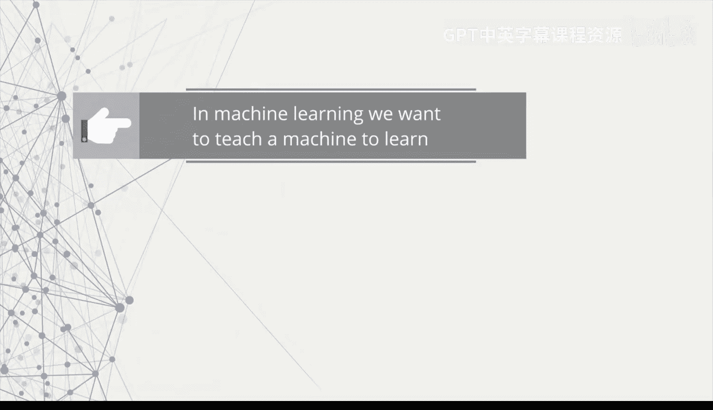
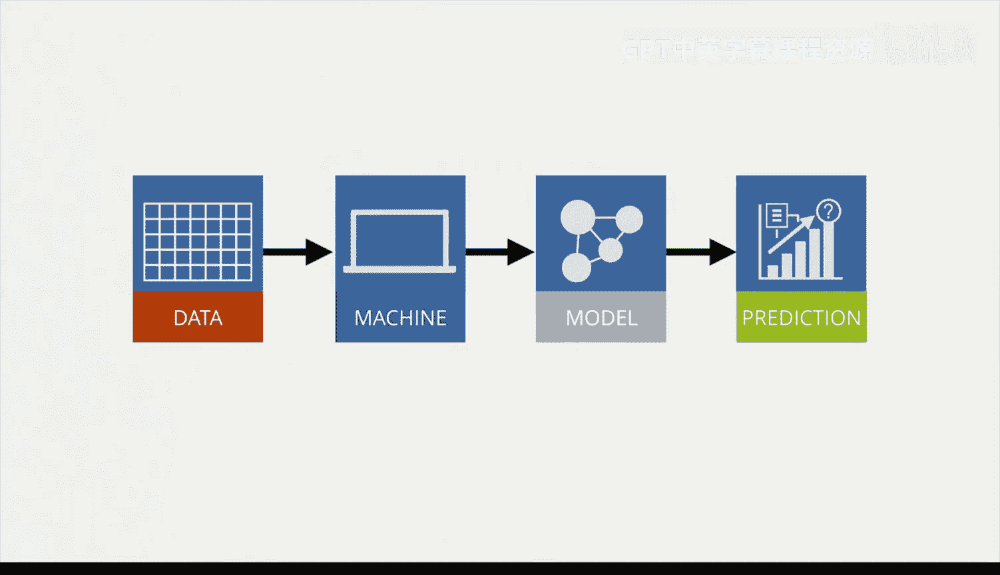
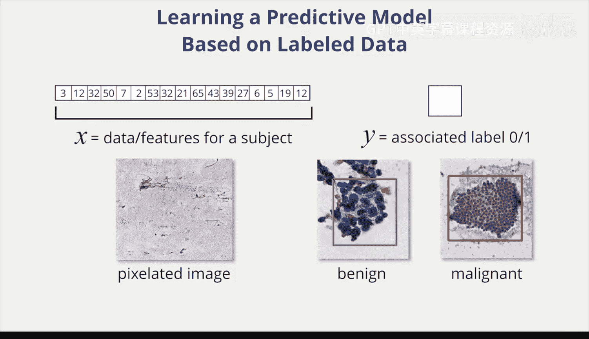
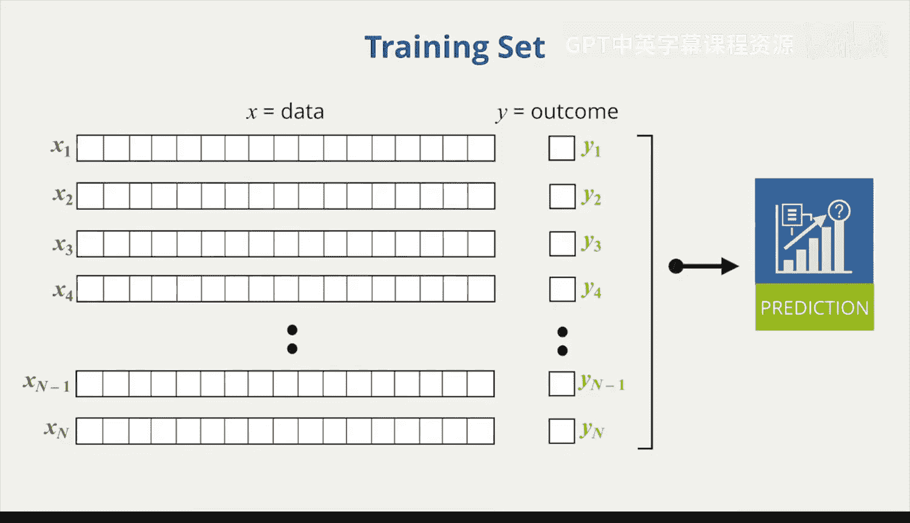
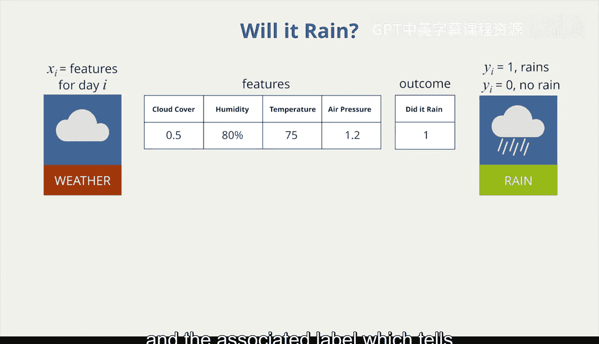
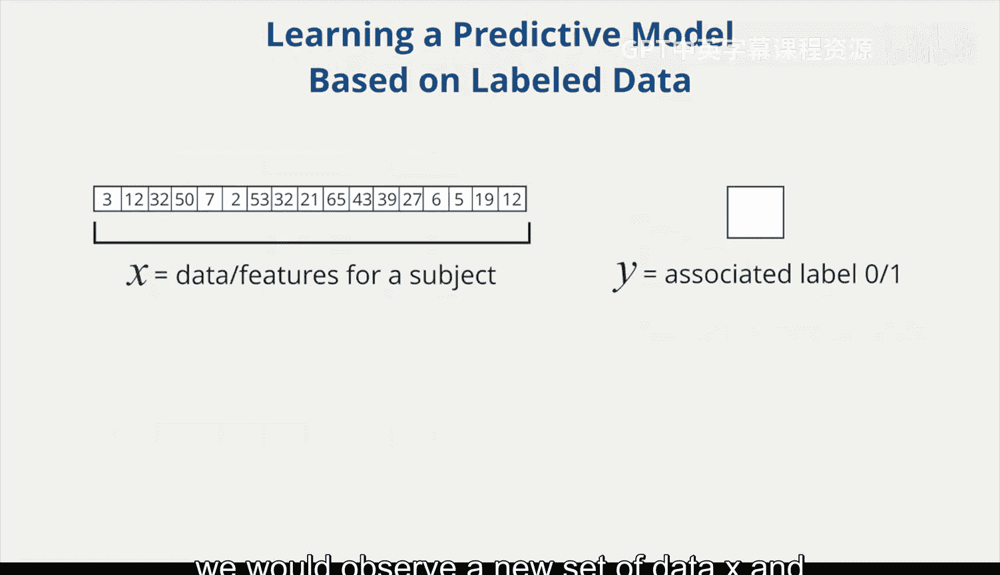

# 杜克大学《机器学习｜Introduction to Machine Learning》中英字幕 p02 02_01_03_什么是机器学习.zh_en -BV1yjvdBQEaU_p2-

So now let's try to get a little bit of a sense of how this technology works。

 so we're going to give a very simple introduction to the basic concepts that we will then dive into more and more depth subsequently so one of the key things to machine learning is the idea that we're going to teach a machine to learn and so the way that we do that is we give the machine examples and the examples are characterized by data samples and then what we would like the machine to predict of that data so here is an example where a data is just a set of numbers or a vector of numbers and then the label is what we would like to assign to that data here're to and that the label is denoted by y here for simplicity we're going to say that the label is either zero or one but we can generalize that to other labels。

So as an example， we might wish to analyze images and determine whether someone has a malignancy or not based upon what is seen in the image。

 so in this case in that case the X or the data would correspond to the pixelated image and then the label Y which here would again be binary would classify whether the image is malignant or not。

 and so the way that we teach a machine to learn and by machine we mean algorithm is we give it examples。

 so we give it many examples here n examples where an example corresponds to a data sample and then the true label so here we have n examples where we have the data X and the label Y。

 and then what we would like to do is to take this data which we call training data to teach a machine or an algorithm。

to do prediction accurately in the sense that is capable of reproducing the training data。

 in the sense that if you give it any of these vectors x， it accurately predicts the associated y。

 but more importantly， we would like it to be able to predict future performance make predictions for future example。

 so we would like to give it a new data sample X and to predict the associated Y。

To make this a little bit concrete just so that it's clear what we're talking about。

 let's consider a simple example， So let's ask the question whether it is going to rain or not on a given day so let's assume that we can measure some characteristics of the environment at a given point in time。

 for example in the morning， we look at the level of cloud cover， the level humidity， temperature。

 air pressure， etc。 these are a set of numbers， those are the data and then on a given day it either rains or not。

 we'll say that the y is equal to one if it rained and y is equal to zero if it did not rain and so the idea is is that we would have a training set which would be composed of multiple examples of the associated data which is represented by the vector X and the associated label which tells us whether it rained or not that day。

 we would then like to build a predictive model。

Wwhich takes in the training data， so the training data is on the top left it's all of the examples that we have based upon historical data of the associated conditions which are represented by X and then why whether it rained or not that day we have a mathematical model which we'll call the machine that mathematical model has parameters which are denoted by the question mark。

 those are unknown parameters， what we would like to do is to learn those model parameters such that the algorithm or the mathematical model does an accurate job of representing the training set and then ideally if we give that mathematical model a new example of conditions represented by the vector X。

 we would like that model to accurately predict whether it will rain that day and so then the key task then would be。

How well this model performs when testing and so in this case again we would observe a new set of data X and then our goal is to predict to predict the label Y so this gives a very early introduction into machine learning the key thing to take away from this is that we have training examples which correspond to data and outcomes that we would like the model to predict based upon that training data we then apply that training data to a model that model is typically characterized by a set of parameters what our goal is is to try to learn the parameters of that model such that they are consistent with the training data after we do that learning we then apply that model to new data and make predictions in the future what we will now do as we move forward is to try to。

Dig into some of these details to provide more clarity on the aspects of machine learning。

