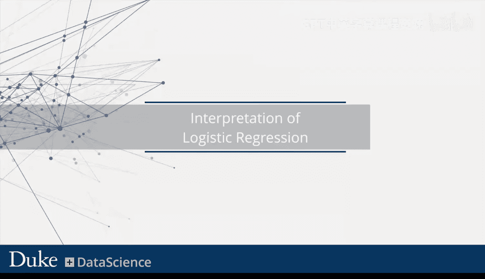
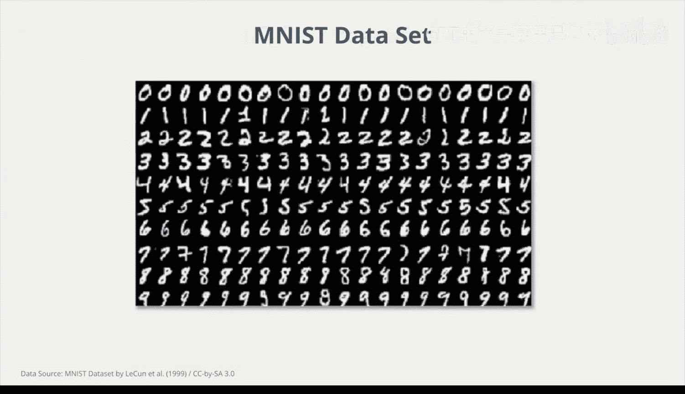
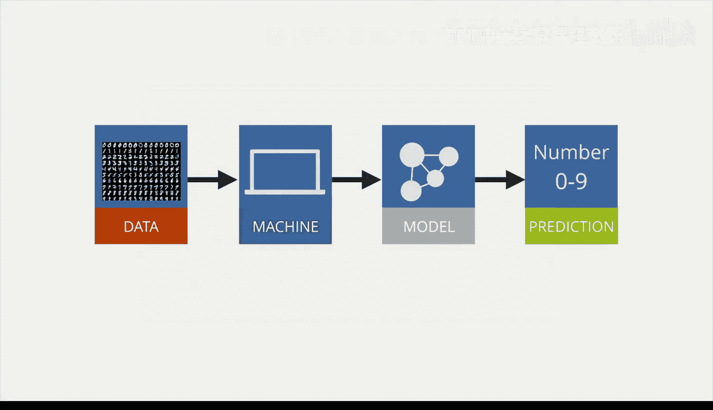
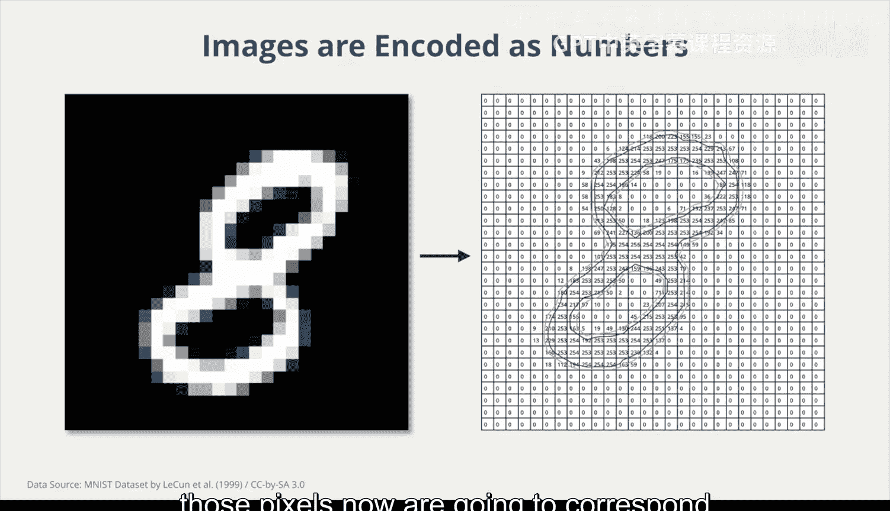
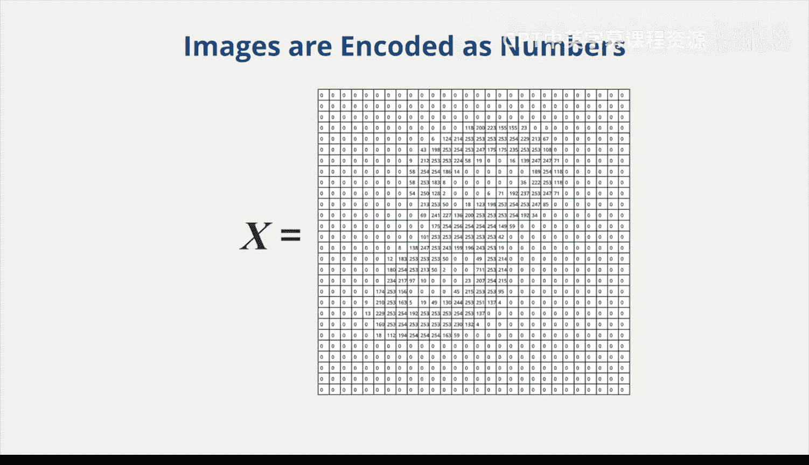
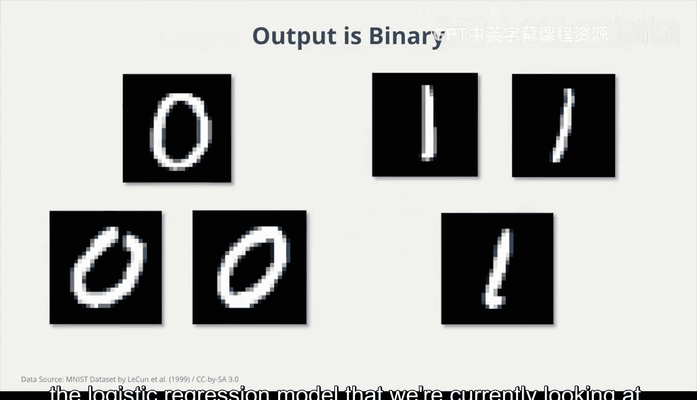
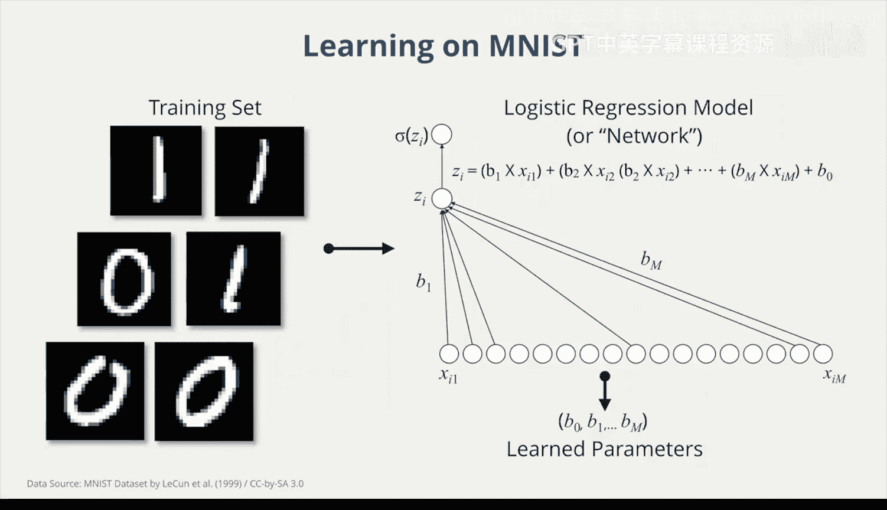
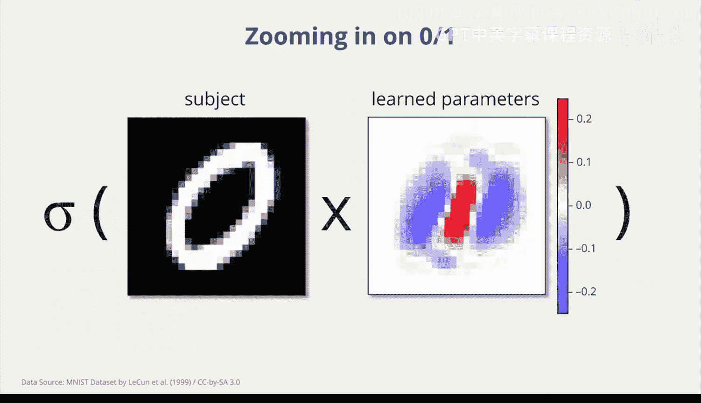
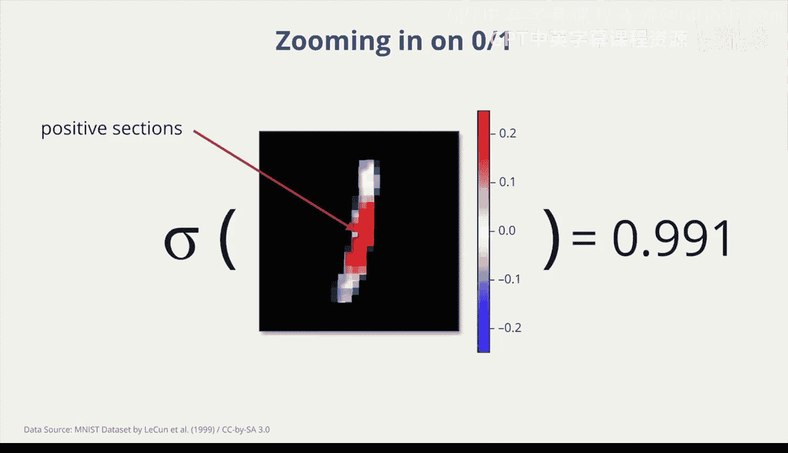
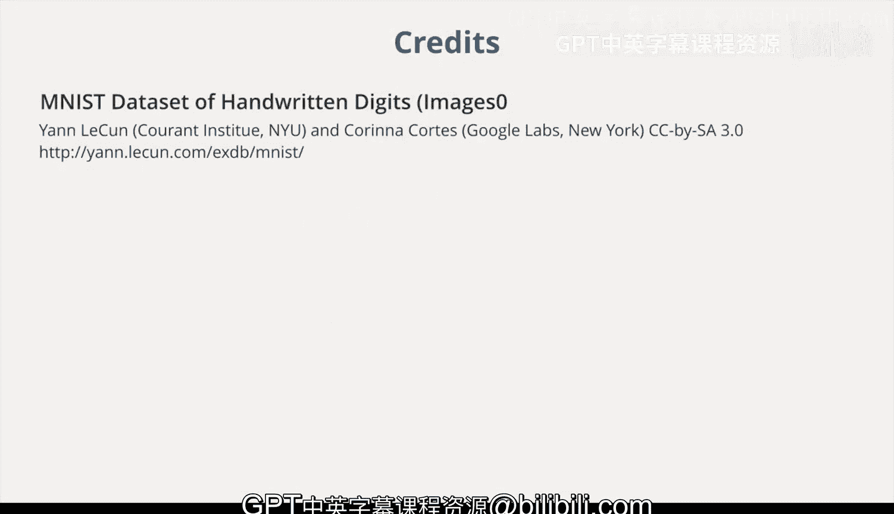

# 杜克大学《机器学习｜Introduction to Machine Learning》中英字幕 p04 04_01_05_逻辑回归的解读.zh_en -BV1yjvdBQEaU_p4-

So， logistic regression。Is one of the simplest。Algorithms that one can consider in machine learning。

 but it in many ways is not overly simple。 it's widely used and it provides a nice introduction into machine learning。

 It's therefore worthwhile to look into logistic regression a little bit more deeply and to try to use it as a model to interpret what machine learning is doing。

So to do that， let's look at a particular problem so what is shown here are some examples of handwritten digits from zero to9。

 and this is a very classic data set it's called the Mist data set What we would like to do is to build a predictive model that could look at a picture of one of these images and then can map it。

 map that picture to a digit from zero to9 would so this as one could imagine would be very applicable for analysis of human writing。

 the use of zero to9 is just an example， of course we can use this basic construct for any the analysis of any handwritten language。

So the question is how do we do this and how do we do this within the context of the tools we have at our disposal？

Particularly logistic regression。 So， again， the goal is take a picture。

 Here's a picture of an8 on the left。 And what we would do like to do is to map that to a prediction。

 And we would like the machine to look at that picture and say that that is an 8。

 The way that we do this is we take the image it is pixelized into digits。

 So that's what you see on the right。 And so each one of those pixels is the strength of the。

 of the image at that point in space。😊。

We then take that we take those pixels and those pixels now are going to correspond to the vector X that we talked about previously and that we'll talk about as well now to make this concrete。

 remember that the tools that we currently have at our disposal is logistic regression which assume that the output of our model is binary。

 so what we're going to do is we're going to consider a binary problem in particular we're going to consider the problem where a digit is either a zero or a one。

And we would like the machine to automatically look at the image and correctly say whether it is a zero or a1。

 so this is a very simple binary task。 of course we can generalize this to more than binary the binary is chosen because it's consistent with the assumptions of the logistic regression model that we're currently looking at So recall that the way that we do this is that we give a set of training data so on the left you see some examples of zeros and ones and so the training data is manifested by images and the true label。

 we have our logistic regression model so here the pixels of the image are going to correspond to to the data X we weight each of the pixel values by we multiplying by the parameters B1 through BM we sum them up。

Get the parameter Z， and then Z is said through the sigmoid function。

 and then we can say with a certain probability that we are looking at a1， a digit 1 or a digit0。

 And so what we mean by learning is to infer the set of parameters B0 through BM。

So to give an example of what this model is doing， this is what is learned in the context training a logistic regression model on those ones and zeros to try to understand this more closely。

 let's look at this example again of of a picture that corresponds to a zero and the parameters of our model which are shown in the right with the blue and the red。

So if we do the， if we do the point wise multiplication。If we do for every pixel on the left。

 we multiply it by the corresponding pixel on the right。

We do that multiplication， pixel by pixel， and then we sum all that together。

 notice that the only place where we get a strong contribution is where the white intersects the blue。

 the white of the picture intersects the blue of our filter and what happens is that that yields a very negative value。

 which after being sent through the sigmoid function yields a very low probability that this corresponds to a1。

By contrast， when we look at the case in which the digit corresponds to a1。

 the black and white image corresponds to a1， and then we multi if we look at the bottom example here。

 if we take the picture of a1 and we multiply it by the set of parameters B。

 which again is shown by the image of blue and red。

 if we take every pixel of the image and multiply it by the corresponding pixel of the set of parameters B。

 the only place where there is a strong contribution is where the positive components of the parameters B overlap with the positive components of the picture。

 we then get a strong positive value， that is then sent through the sigmoid function which yields a high probability that this is the number one。

And so this concept， I want to provide a little bit of notation， which will be useful later。

 so to provide a little bit more detail， remember what we're doing is we're taking the vector X I。

 which corresponds to our data， a set of numbers， and we're multiplying each component of X by the corresponding component of what we call a vector。

 a vector which is characterizeize by the parameters of our model B1， B2 through BM。

 and so what we're doing is we can visualize this as the data is a vector， X I。

 which is characterized by a set of pixels， the parameters of our model is a vector B。

 which represents the parameters B1 through BM， we multiply every pixel of X with the corresponding pixel of B。

 we then sum those all and。That implements the equation on the top。

This is this expression is called an inner product。

 It's an inner product between the vector X I and the vector B。

 this concise notation X I dot with a circle B is called inner product。

 that compact notation will be useful later whenever we look at more sophisticated models。

And so this model， what we're doing is we're looking at images。

 we're showing examples of cases whenever the true label is Y I equals0。

 other cases where the true label is y equal1 the filter is shown at the right What we're doing is we're taking an inner product of the data X I with B then and that gives us Rz and then that is sent through a logistic function。

 so the way that we can think of this is that the parameters of our model B are like a filter。

 and you can see that the filter looks a lot like a1 and so what the model is doing what logistic regression is doing is it's learning a filter of parameters B。

And then it multiplies that filter parameters on the data。

 if there is a strong match between the filter and the data。

 then we say there's a high probability of outcome Yi equal to one。

 if there is a low match between the filter and the data。

 we say that there's a low probability of a match between the filter and the data。And so again。

 this is ultimately sent through a logistic function， the sigmoid function。

 which then converts that into a probability。So this concept of data。

Inter product with a filter and then send through a logistic function or the sigmoid function is at the heart of logistic regression。

 What we'll do as we move forward is to use this concept from logistic regression to move to more sophisticated models that we'll find in deep learning。

