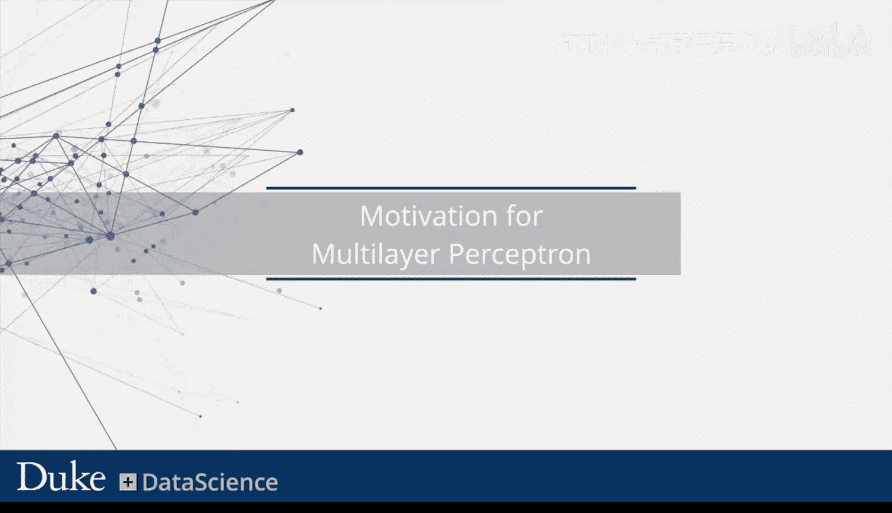
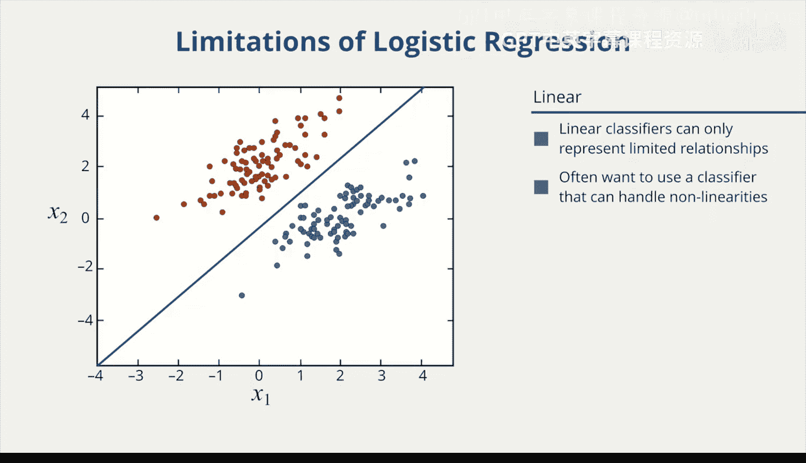
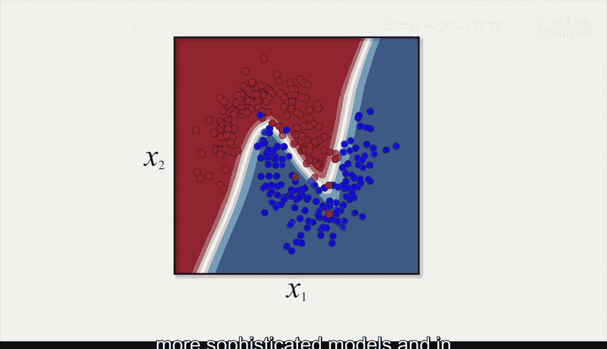
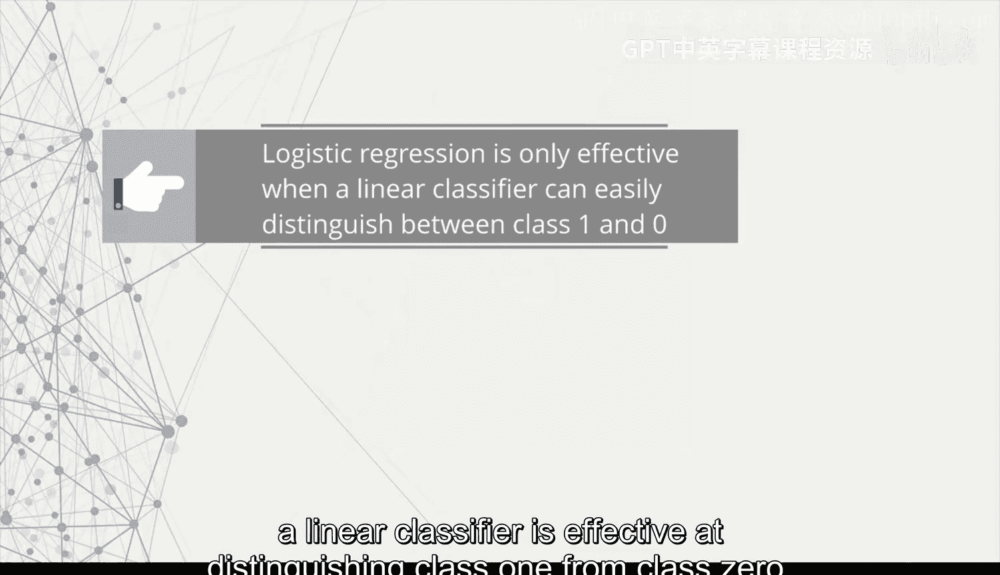

# 杜克大学《机器学习｜Introduction to Machine Learning》中英字幕 p05 05_01_07_多层感知机的动机.zh_en -BV1yjvdBQEaU_p5-

What we would like to do now is to move beyond logistic regression。

 which is a simple machine learning model and move to more sophisticated models in particular。

 something called a multilayer perceptron。 This is one of the most basic forms of deep learning iss one of the most basic forms of neural networks。

So in logistic regression， recall that what we do is we have a data Xi。

 we take an inner product of the data Xi with a set of parameters B。

 which we call a filter and that inner product Xi with B， is then added to what we call a bias。

 or just a number B not。Whi is an additional parameter that we need to learn that ultimately gives us ZI。

 which is then sent through this logistic function or this sigmoid function。

 which converts ZI to a probability， in particular， the probability that the label is equal to one。

Now， this is a very powerful model， the logistic regression， but we would like to move beyond it。

 and so the question is what's wrong with logistic regression？

So it turns out that logistic regression is a very good model in situations in which the delineation between class1 and class0 in our binary problem can be separated by a line so here or a line or a plane a line in two dimensions。

 a plane in three dimensions and what's called a hyperplane in higher dimensional problems here we're looking at a situation in which the data or two dimensions and so we're looking at x sub1 and x sub2。

 which are two the two dimensions of our data， every point here corresponds to a data point and so every point corresponds to an example of x1 x2 or a particular data and so recall that logistic regression is solving a binary。

So here， red corresponds to one class and blue corresponds to another class。 In this case。

 a line does an effective job in separating or distinguishing between the red and the blue classes。

 So for the data of this sort， logistic regression is appropriate because it designs a linear。

A linear classifier。

However， there are situations in which the data are not well separated by a linear classifier。

 so here is an example where again we have blue dots corresponding to one class and red dots corresponding to another class and you can see that the boundary。

 the decision boundary between the red and the blue dots is much more complicated than a line。

 in other words a simple line will not separate these and so what we would like to do now is to build a model that is capable of building decision boundaries between the class1 and class0 that is more sophisticated than what what a linear classifier can do and this is our motivation to going to more sophisticated models in particular the multilayer perceptron。

 the key thing to take away from this is that the logistic regression which。

I is a very nice model。 It has a limitation that it only works effectively whenever a linear classifier is effective at distinguishing class1 from class 0。

 Any other case such as the one you're looking at here in which the decision boundary is more complicated for which a linear classifier will not be effective。

 We want to use more sophisticated models， This motivates the multilayer perceptron。

 which is a natural extension of the logistic regression。

