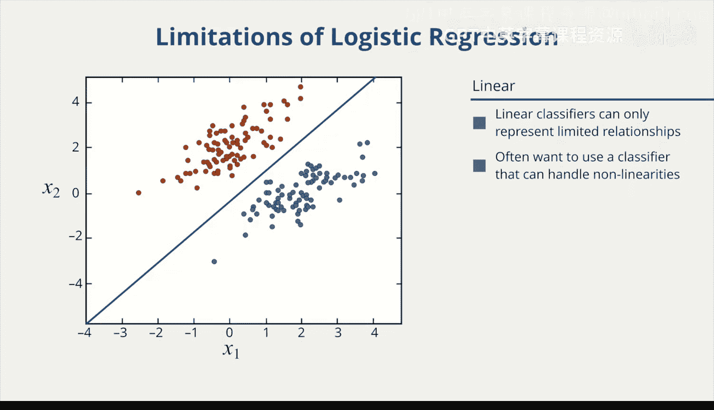
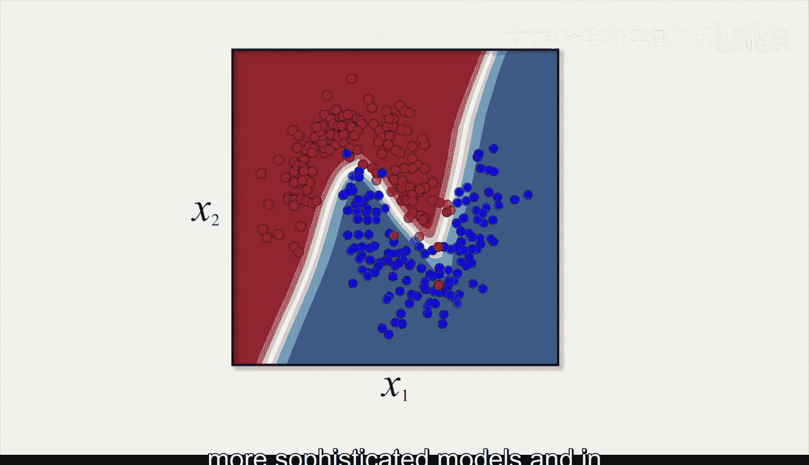
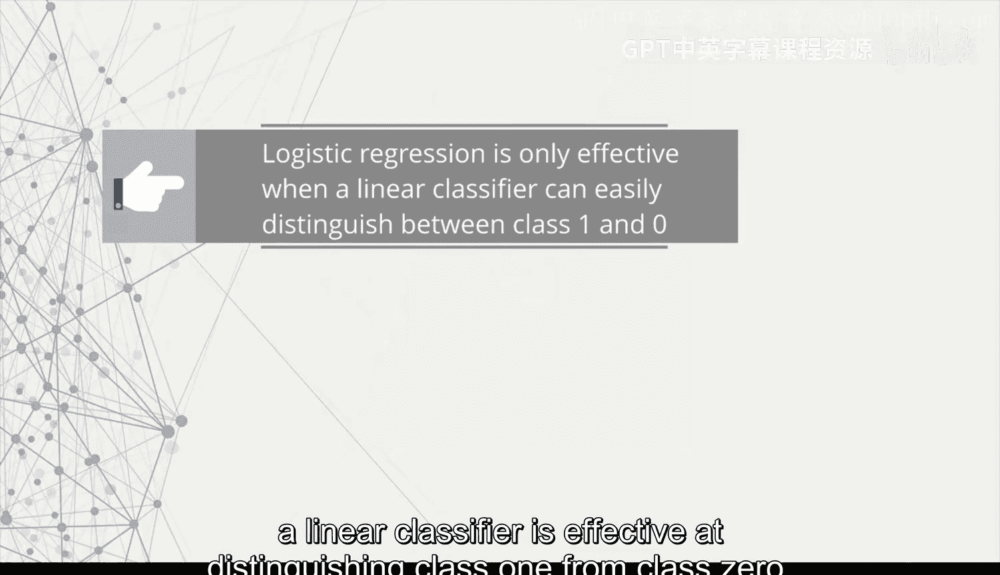

# 机器学习：05：多层感知机的动机

在本节课中，我们将要学习如何从逻辑回归模型过渡到更复杂的模型——多层感知机。我们将探讨逻辑回归的局限性，并理解为什么在数据无法被线性分类器有效分离时，需要引入更强大的模型。

## 逻辑回归回顾

上一节我们介绍了逻辑回归的基本概念。本节中，我们来看看它的具体计算过程。

在逻辑回归中，我们处理一个数据点 **X_i**。其核心计算步骤如下：

1.  首先，计算数据 **X_i** 与一组参数 **B**（称为滤波器）的内积。
2.  然后，将这个内积结果加上一个偏置项 **b_0**。
3.  最终，我们得到一个值 **Z_i**，其计算公式为：
    **Z_i = X_i · B + b_0**
4.  接着，将 **Z_i** 输入逻辑函数（或称Sigmoid函数），该函数将 **Z_i** 转换为一个概率值，即样本标签等于1的概率。

逻辑回归是一个强大的模型，但我们希望超越它。那么，逻辑回归存在什么问题呢？

## 逻辑回归的局限性

逻辑回归在二元分类问题中表现良好，但前提是类别1和类别0之间的分界可以用一条直线（在二维空间中）、一个平面（在三维空间中）或一个超平面（在更高维空间中）来清晰划分。

以下是逻辑回归适用的情况：
*   数据分布在二维空间中（例如 **x_1** 和 **x_2**）。
*   每个数据点对应一个 **（x_1, x_2）** 坐标。
*   红色点代表一个类别，蓝色点代表另一个类别。
*   一条直线可以有效地将红色类别和蓝色类别分开。

对于这类数据，逻辑回归是合适的，因为它本质上设计了一个**线性分类器**。

## 引入非线性问题的必要性

然而，存在一些情况，数据无法被线性分类器很好地分离。

以下是一个非线性问题的例子：
*   蓝色点对应一个类别，红色点对应另一个类别。
*   红色点和蓝色点之间的决策边界比一条直线复杂得多。
*   简单的直线无法分离这些类别。

因此，我们需要构建一个能够创建比线性分类器更复杂的决策边界的模型。这促使我们转向更复杂的模型，特别是**多层感知机**。

## 核心动机总结

本节课中我们一起学习了从逻辑回归过渡到多层感知机的动机。

关键要点是：逻辑回归是一个优秀的模型，但它有一个局限性，即仅在**线性分类器**能有效区分类别1和类别0的情况下工作良好。在任何其他情况下，例如当决策边界更复杂、线性分类器无效时，我们就需要使用更复杂的模型。这自然引出了对逻辑回归的扩展——**多层感知机**。