# 杜克大学《机器学习｜Introduction to Machine Learning》中英字幕 p06 06_01_01_多层感知机概念.zh_en -BV1yjvdBQEaU_p6-

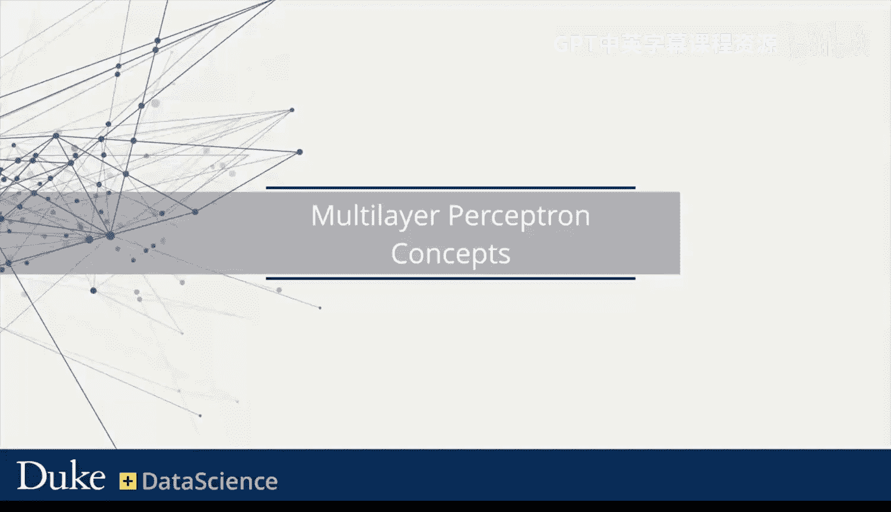

Multilay perceptron， which we're going to introduce now is actually a rather direct or natural extension from logistic regression。

 So remember that x sub i corresponds to the Ih data example and it has M components x subi1 through x sub i M and recall that in logistic regression what we did was we took each each component of the data multiplied it by a parameter。

 added that up and mapped it to a variable Z， and then that variable Z was sent through a sigmoid function which is represented by the symbol sigma。

 What we're going to do here is the same concept as in logistic regression but instead of doing it one time we're going to do it K times and so now what we're doing is we're doing effectively K implementation。

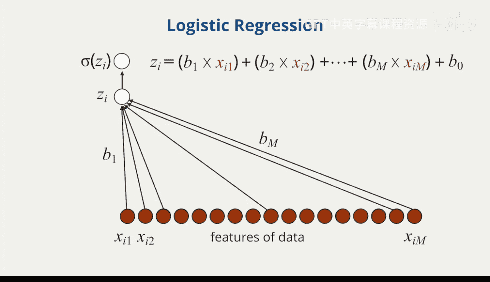

Of what we did with logistic regression。Wwhich are going to map the data X to a k dimensional vector。

 which is represented by the probability from0 to1 of what we call k latent processes or features associated with the data These are called latent because these are representative of things that in the data characteristics of the data。

 we cannot in principle observed then those klant features are sent through a logistic regression model to ultimately yield a binary probability for the classification of the data And so this is very much like logistic regression。

 but what we have done is introduced instead of doing logistic regression directly from the data to the binary outcome。

 what we're doing is we're doing logistic regression we're first going from。

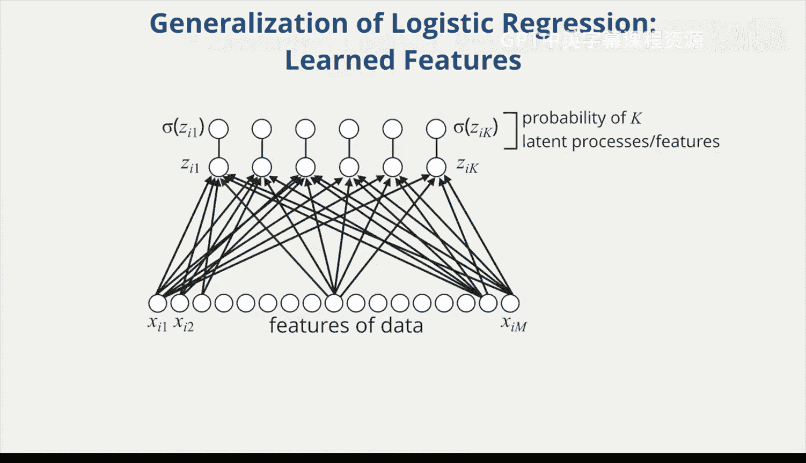

Data to k latent processes or the probabilities on those K latent processes。

 and then that corresponds to a k dimensional feature vector。

 and then that K dimensional feature vector is used to apply logistic regression。

 which is then ultimately yields a outcome， the probability that the data corresponds to class y equal to 1。

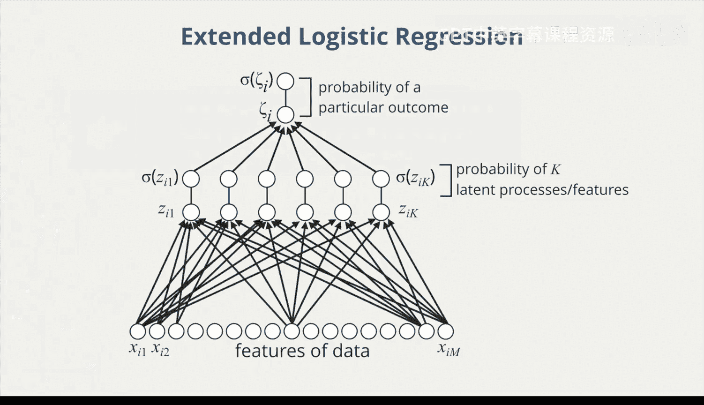

And so what this can be viewed as as logistic regression being performed on the K features instead of being performed directly on raw the initial data。

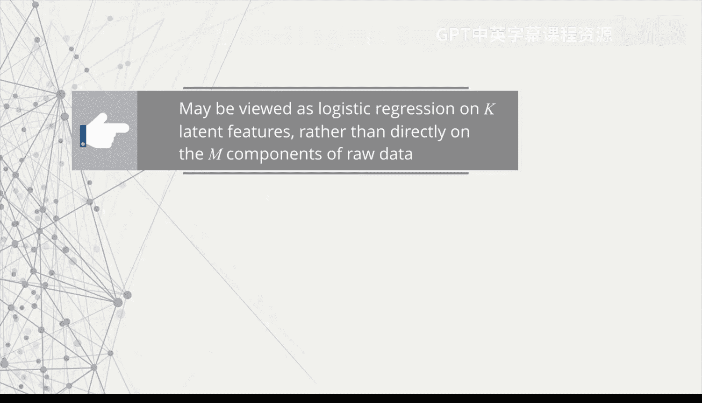

Now， just to give some motivation for why doing the simple logistic regression may not be as effective and to motivate why the newer model。

 this model that we've introduced here may be more effective。

 so let's go back to the problem of digit recognition and ask let's examine the situation。

for which our goal is to perhaps identify handwritten examples of the number four so what you're seeing here are four examples of handwritten representations of the number four and so you can see that people have many different ways of writing the number four if we were to use logistic regression which as you recall takes a single filter B。

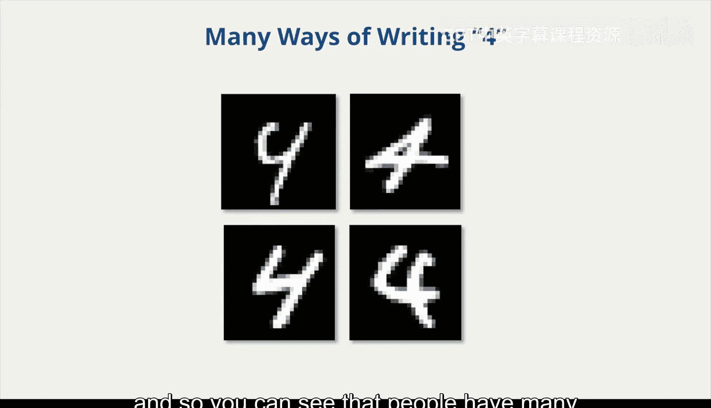

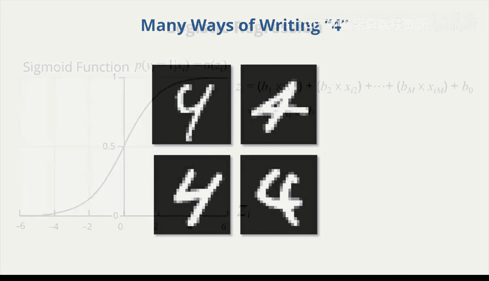

And does it enter product with the data X I。What would typically happen is you might find that that filter。

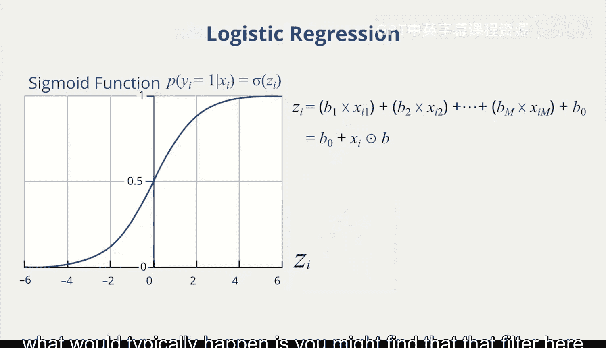

Here， represented by the values of the pixels in the image to the in the image to the right might look like an average4。

 So this average 4 doesn't look like any of the four。

 So the idea of building a classifier based upon a single filter of this type seems undesirable。

 So alternatively， we might consider a situation in which we have three。Intermediate filters。

 So if we go back to our multilayer perceptron， we can take our data。

 which here corresponds to the pixels of the image and instead of multiplying them by filters that correspond to one average four we might consider K equal to three filters which correspond to four different ways in which one might draw the number four。

 So what we see on the right are examples of what three filters might look like and then those the latent features that are inferred will then be used to ultimately make a final prediction about whether the number four is present。

 So the key idea and going to this new model。

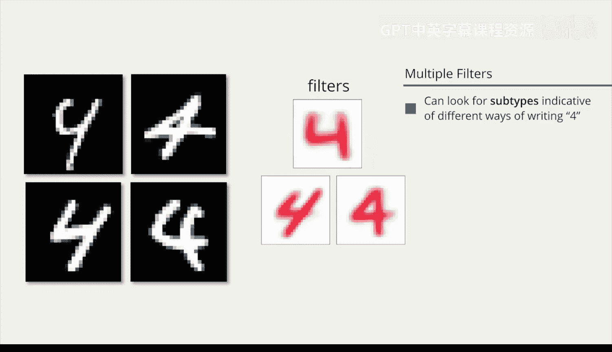

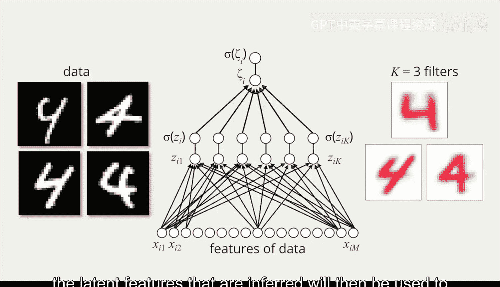

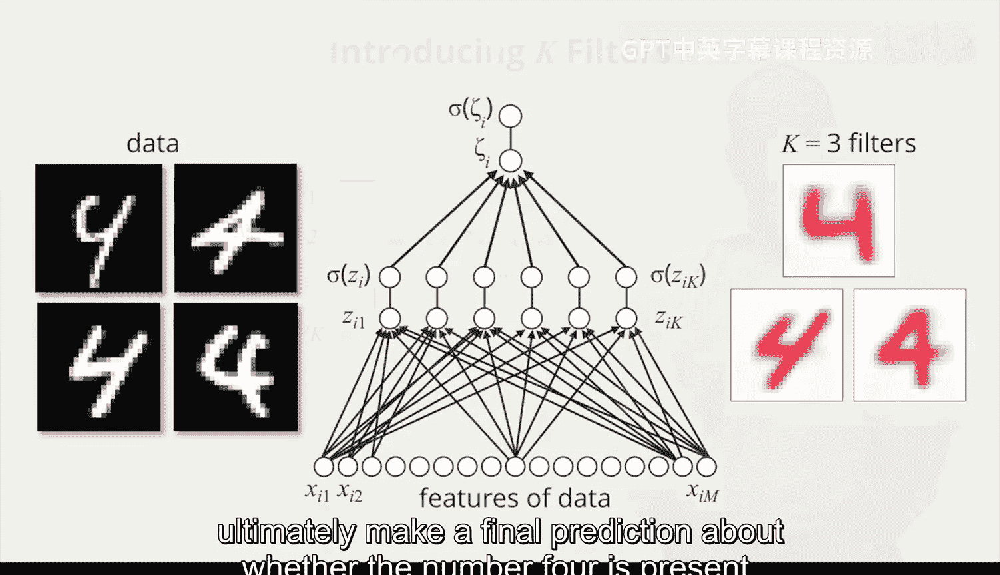

Is that we're no longer going to limit ourselves to a single filter。B， to examine the data。

 we're going to introduce K filters。

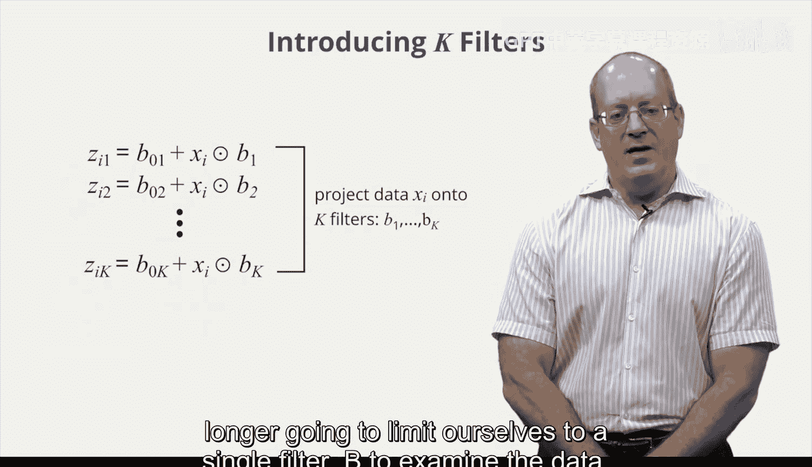