# 机器学习：06：多层感知机概念

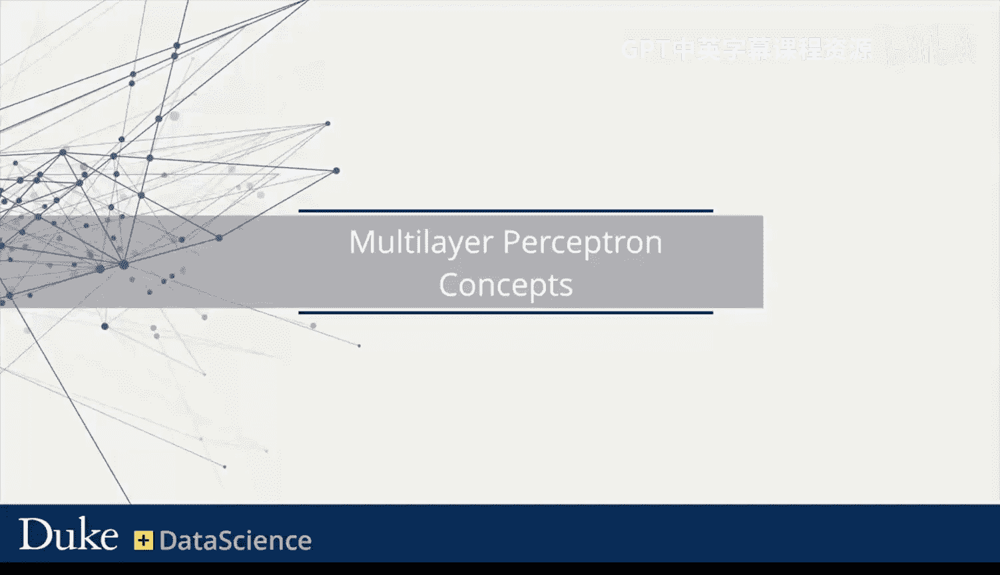

在本节课中，我们将要学习多层感知机的基本概念。多层感知机是逻辑回归的一个直接且自然的扩展。我们将从回顾逻辑回归开始，逐步引入多层感知机的结构，并通过一个手写数字识别的例子来理解其优势。

## 逻辑回归回顾

上一节我们介绍了逻辑回归的基本模型。现在，让我们简要回顾一下。

在逻辑回归中，对于第 `i` 个数据样本 `x_i`（它有 `M` 个分量 `x_i1` 到 `x_iM`），我们执行以下操作：
1.  将每个数据分量乘以一个对应的参数。
2.  将这些乘积相加，得到一个变量 `Z`。
3.  将变量 `Z` 输入到一个Sigmoid函数（用符号 `σ` 表示）中，最终输出一个介于0到1之间的概率值。

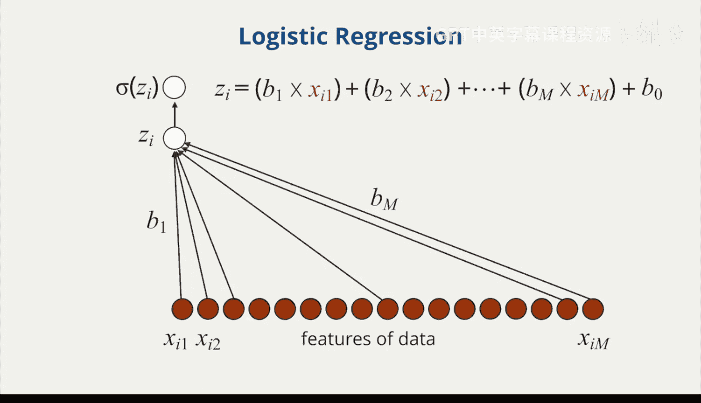

这个过程可以用以下公式表示：
`Z = w_1 * x_i1 + w_2 * x_i2 + ... + w_M * x_iM + b`
`P(y=1|x_i) = σ(Z)`

## 从逻辑回归到多层感知机

上一节我们回顾了逻辑回归，本节中我们来看看如何将其扩展为多层感知机。

多层感知机的核心思想与逻辑回归相同，但我们不是只执行一次上述过程，而是执行 `K` 次。这相当于并行地实现了 `K` 个逻辑回归模型。

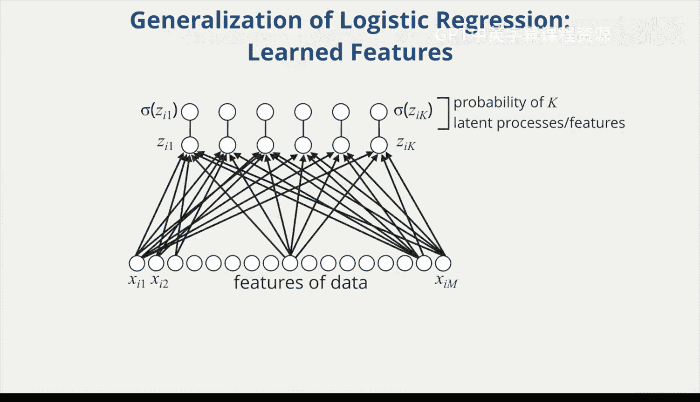

以下是多层感知机的构建步骤：
1.  我们将数据 `X` 映射到一个 `K` 维向量。这个向量的每个分量都是一个介于0到1之间的概率值，代表了与数据相关的 `K` 个潜在过程或特征。
2.  这些特征被称为“潜在”的，因为它们代表了数据中我们无法直接观察到的某些特性。
3.  然后，这 `K` 个潜在特征被送入另一个逻辑回归模型，最终产生一个用于数据分类的二元概率。

因此，这可以看作是**在 `K` 个特征上执行逻辑回归**，而不是直接在原始数据上执行。

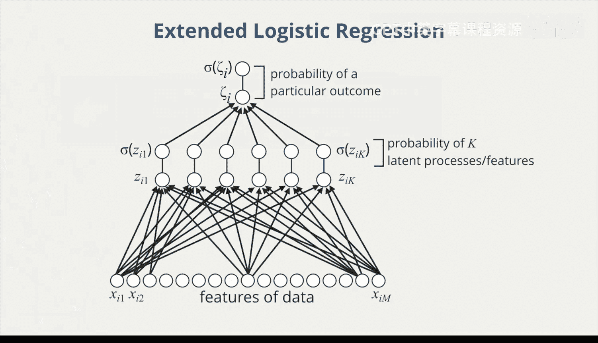

## 为何需要多层感知机？

为了理解为什么简单的逻辑回归可能不够有效，以及为什么需要引入多层感知机，让我们回到手写数字识别的问题。

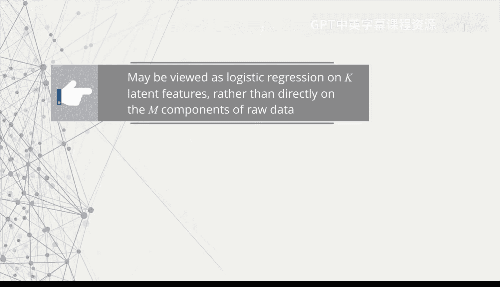

假设我们的目标是识别手写的数字“4”。下图展示了人们书写数字“4”的几种不同方式：

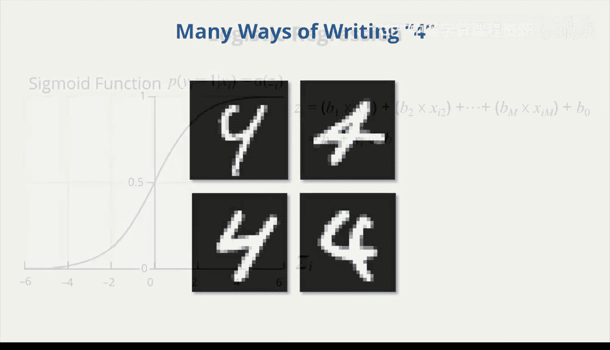

如果使用逻辑回归，我们通常会得到一个单一的滤波器 `B`，它可能看起来像一个“平均的4”，如下图所示：

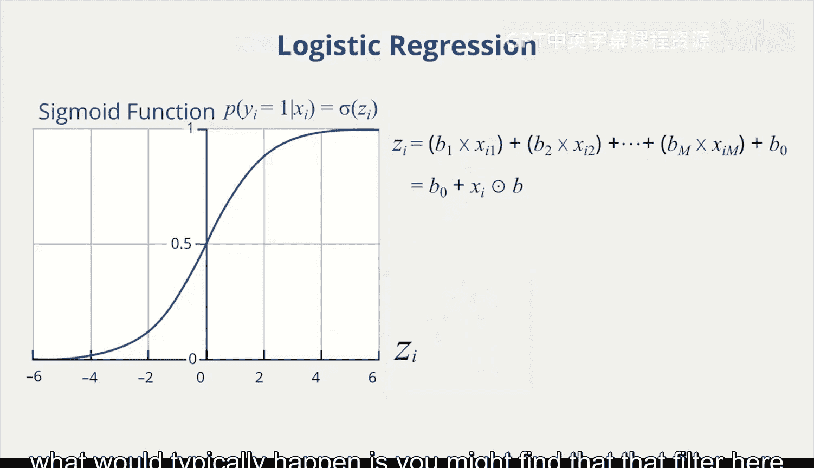

这个“平均的4”看起来并不像上面任何一个具体的“4”。因此，基于这种单一滤波器构建分类器的想法似乎并不理想。

## 多层感知机的优势

作为替代方案，我们可以考虑拥有多个中间滤波器的情况。这正是多层感知机所做的。

我们不再将自己限制于单个滤波器 `B` 来检查数据，而是引入 `K` 个滤波器。例如，我们可以设置 `K=3`，这三个滤波器可能对应书写数字“4”的三种不同方式，如下图所示：

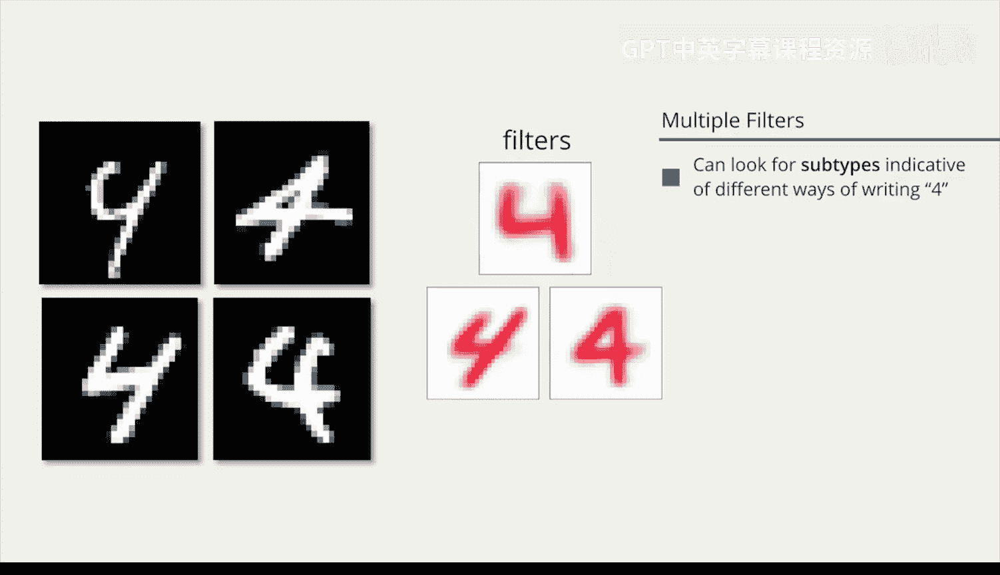
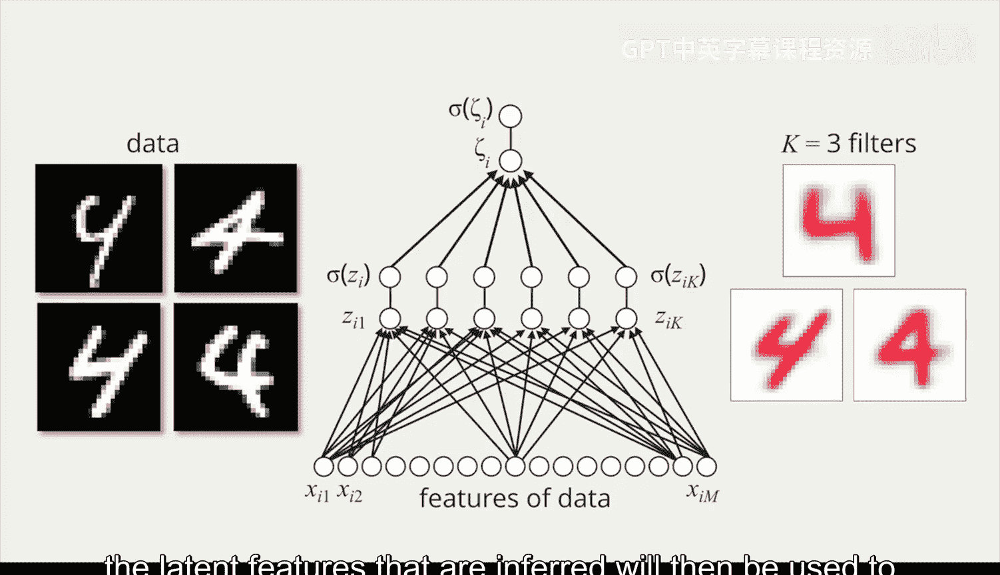
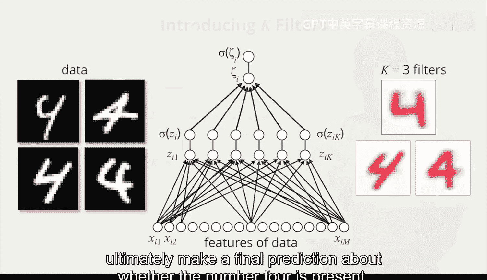

然后，从这些滤波器中推断出的潜在特征将被用来最终预测数字“4”是否存在。

## 总结

本节课中我们一起学习了多层感知机的基本概念。我们了解到：
*   多层感知机是逻辑回归的直接扩展，通过引入一个包含 `K` 个潜在特征的中间层来工作。
*   其核心优势在于不再依赖单一的、可能过于简化的特征（如“平均的4”），而是能够并行学习并组合多种不同的特征模式。
*   这使得模型能够更好地捕捉数据的复杂性和多样性，例如在手写数字识别中处理同一数字的不同书写风格。

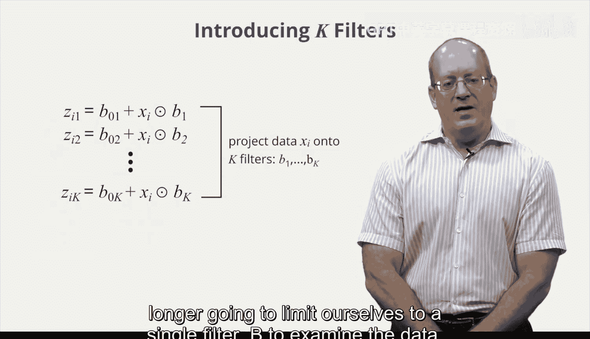

通过将数据映射到一组更有表现力的潜在特征上，再进行分类，多层感知机为处理更复杂的模式识别问题提供了强大的基础。