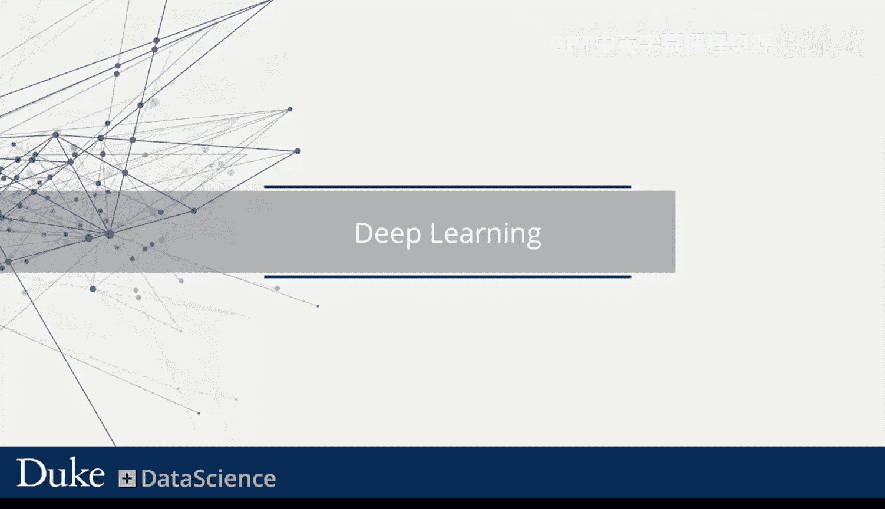
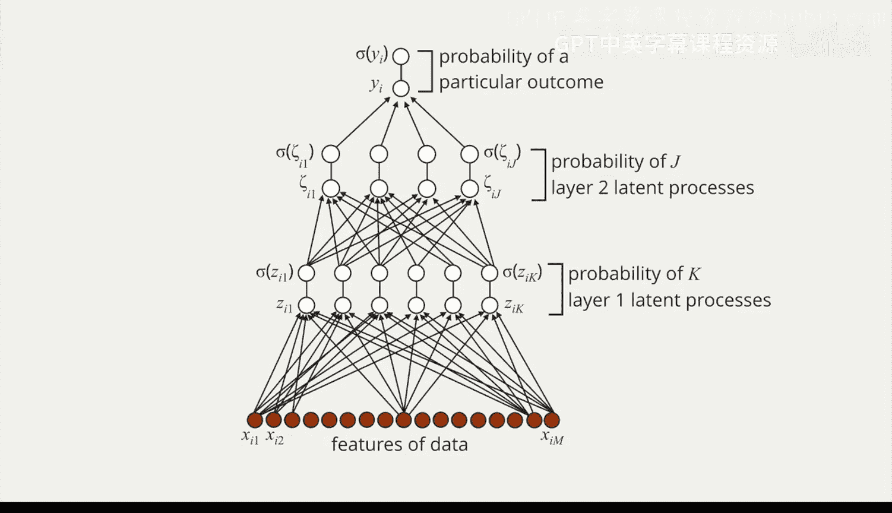
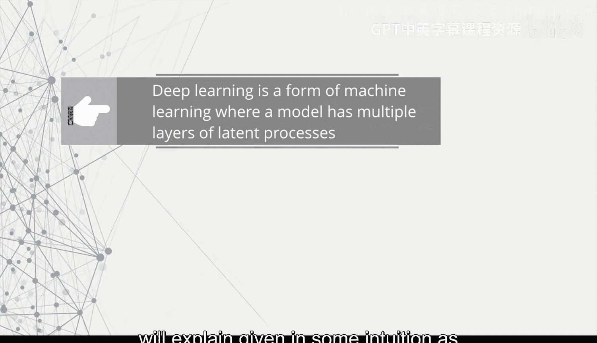
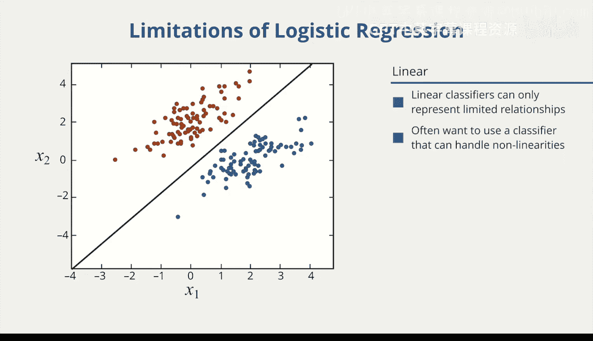
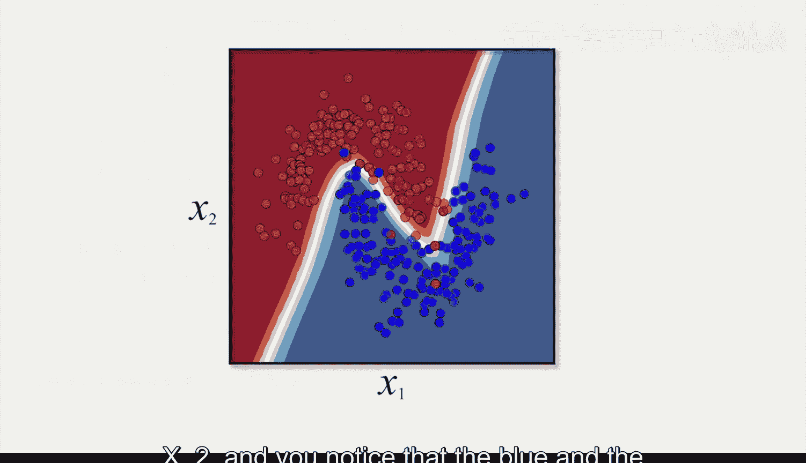
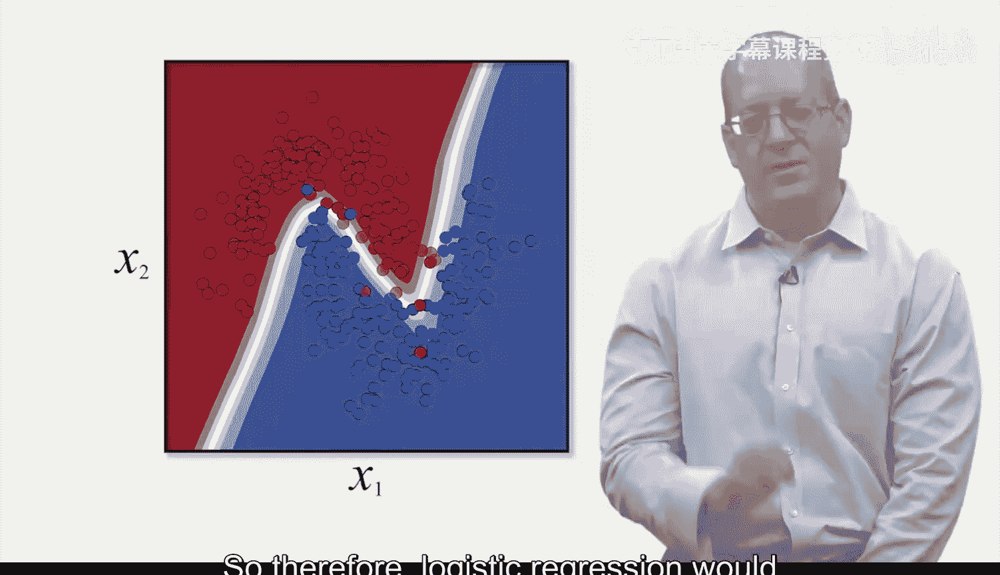
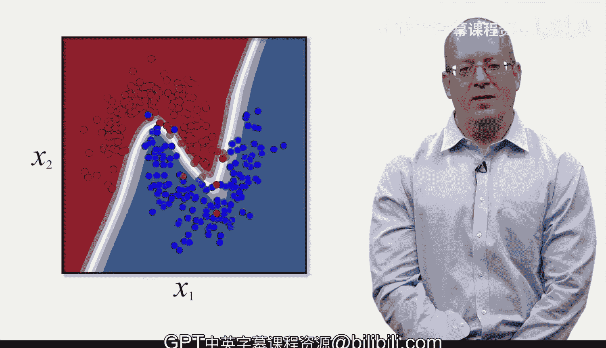

# 杜克大学《机器学习｜Introduction to Machine Learning》中英字幕 p08 08_01_03_深度学习.zh_en -BV1yjvdBQEaU_p8-

So at the beginning， I explained that deep learning is now a very important area of machine learning。

 we're now going to get a sense of what we mean by deep learning。

So now let's what we're going to do here is the same thing we did before。

 but we're going to do it twice， so starting at the bottom。X is our feature vector。

 it has M components， so X， which is the I data sample。

 has M features which are represented X1 XI2 through XIM， those are the circles at the bottom。

 those are the features of our data。Each of the features of the data is multiplied by a parameter vector B and sum together and we do this K times for for K different templates。

 B1 through BK and then after sending that through a logistic function。

 we get the probability of each of those k latent features or latent features and that probability is a number between01 binary and then what we're going to do is instead of going directly into a logistic。

F a logistic regression to make a binary classification What we're going to do now is predict layer what we call layer2 latent processes so now you could start to get a concept of what we mean by deep because now we have two layers of latent processes so at the bottom we have our data those data are then mapped to probabilities on latent processes and we repeat this process and then we get a layer2 a layer two latent processes again represented by probabilities and then at the top of this model we then do logistic regression which is a way for us to do binary classification。

And then at the top we have a probability that the label is y equal1 or y equals0。

 so now when we look at this， the model is certainly more complicated and we'll talk about that complication and what it implies later。

 but we at least now can get a sense of what we mean by deep so deep learning。

iss a form of machine learning where our model is deep in the sense that it has multiple layers of latent processes。

 and in a subsequent example we'll explain given in some intuition as to what these latent processes mean。

Always at the top， we have a logistic regression classifier。

 which is giving us the probability of the binary output y equal 1 or y equals0。

 but then before we get to that， the intermediate layers correspond here to K latent features at layer 1。

And J Lant features at layer2。 Now as you might imagine。

 you can go to even deeper models here we have a two layer model。 We can go to a three layer model。

 a four layer model where we have three or four layers of latent processes。

So the key thing to notice is that this model， which is a very classic model。

Wwhich is called a multilayer perceptron， it's also called a neural network。

 is basically built up by a sequence of repeated application of the logistic regression。

 so we now start to understand why the logistic regression is such a fundamental model because every component of the multilayer perceptron。

 which is a fundamental form of a neural network， can be viewed as a repeated application of logistic regression。

Now。One of the key things that this multi layer perceptron does。 And so。

 a question that you might ask yourself is， why would we go to such a。Complicated model。

 This is certainly more complicated than the logistic regression。

But recall that the logistic regression had limitations。

 One of those limitations was that the decision boundary。Between the two types of data。

 the y equals 1 and y equals0。

Was required to be linear， a。And so with this more complicated multi layer perceptron。

It turns out that we can learn decision boundaries， which are far more sophisticated。

 So here is another example where again， the the red。

Dots correspond to data of one label and the blue dots correspond to data of another label。

 and you notice in this case， in this two dimensional feature space， so in this case the vectors X。

Have two components represented X1， x2。 And you notice that the blue and the red dots cannot be separated by a line。

 So therefore， logistic regression would be would be ill suited for data of this form。

 And it turns out that oftentimes data is of this form。 So therefore。

 the logistic regression in its simple form is often inappropriate。

 So this motivates going to a more sophisticated model。 This multilayer perceptron。

In this figure。What we're showing is the probability of the data。

 and so red means high probability of the red data and blue represents high probability of the blue data。

 and this is the output of a multilayer perceptron。

