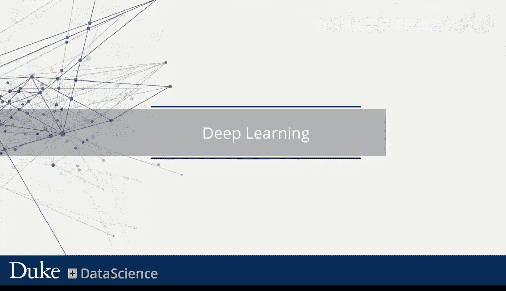
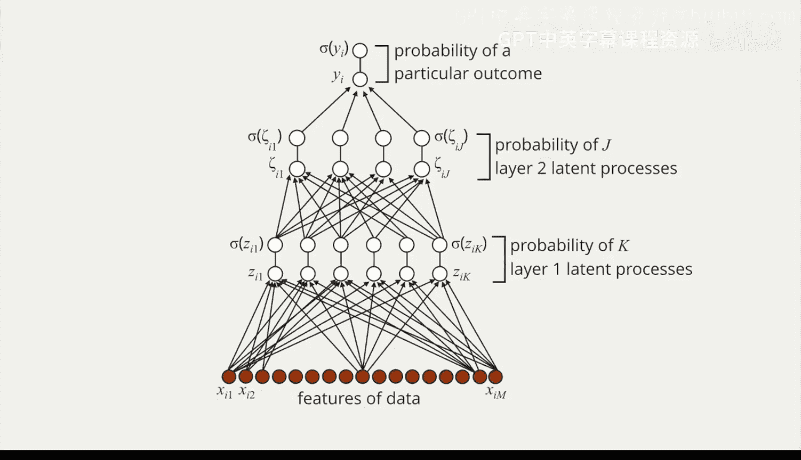
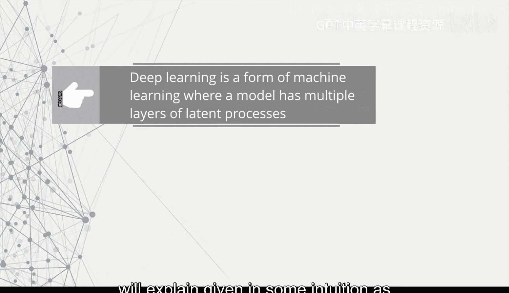
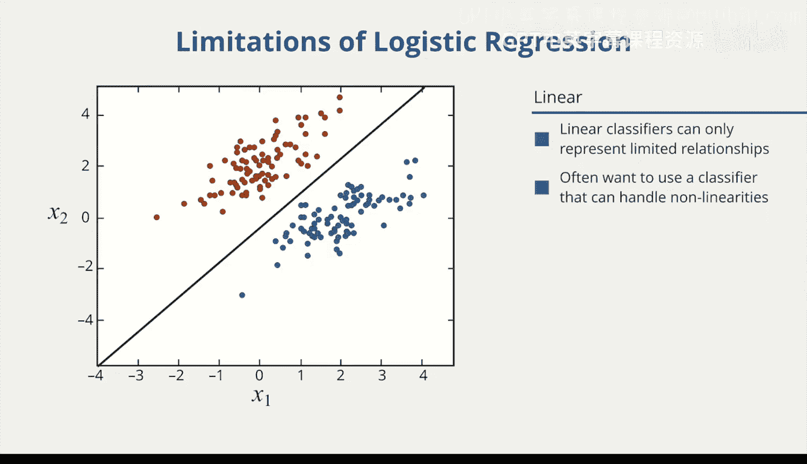
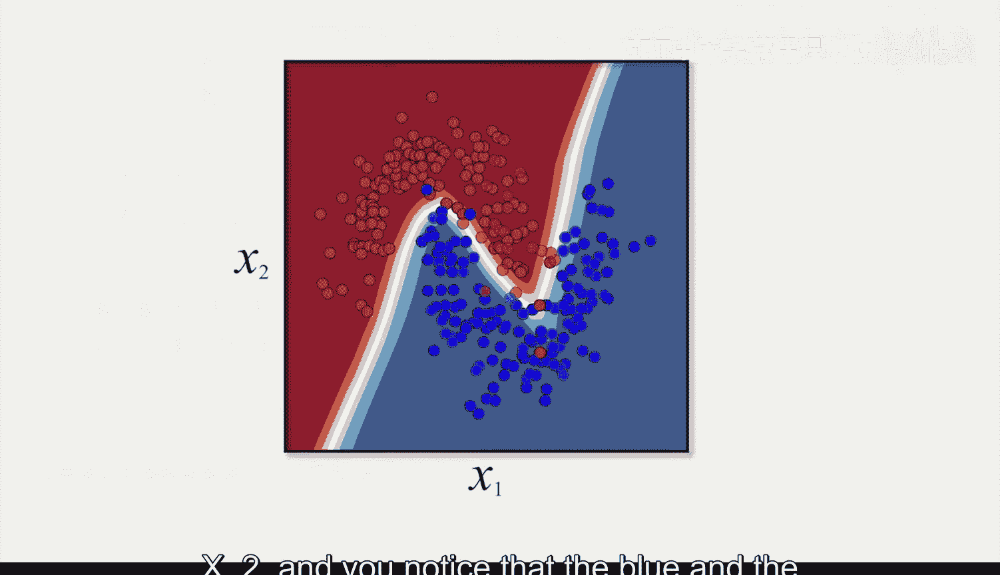
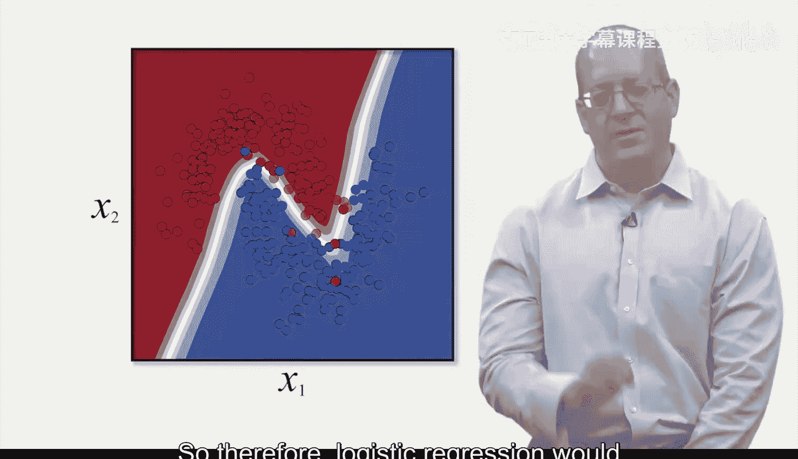
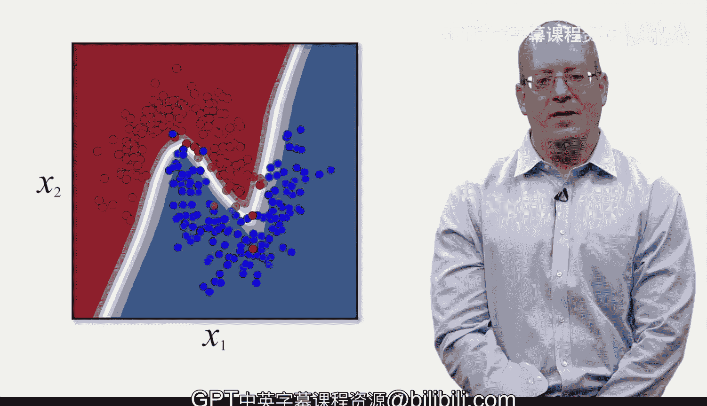

# 机器学习入门：08：深度学习 🧠

在本节课中，我们将要学习深度学习的基本概念。深度学习是机器学习中一个非常重要的领域，我们将通过一个具体的模型——多层感知机（也称为神经网络）来理解“深度”的含义。我们将看到，深度学习模型通过堆叠多个“潜在过程”层，能够学习比逻辑回归更复杂的决策边界。

---

## 什么是深度学习？ 🤔

在课程开始时，我们提到深度学习是机器学习中一个非常重要的领域。现在，我们来理解一下深度学习的含义。

深度学习是机器学习的一种形式，其“深度”体现在模型具有**多层潜在过程**。在后续的例子中，我们将解释这些潜在过程的直观含义。

---

## 从逻辑回归到多层感知机 🔄

上一节我们介绍了逻辑回归模型。本节中，我们来看看如何通过重复应用逻辑回归来构建一个更深的模型。

我们将重复之前的过程，但这次进行两次。从底部开始，`X` 是我们的特征向量，它有 `M` 个分量。对于第 `i` 个数据样本，其特征 `X_i` 由 `X_i1` 到 `X_iM` 表示，即底部的圆圈。

以下是构建第一层潜在特征的过程：
*   每个数据特征乘以一个参数向量 `B` 并求和。我们对 `K` 个不同的模板（`B1` 到 `Bk`）重复此操作。
*   将结果通过一个逻辑函数（logistic function），我们得到每个潜在特征的概率，这是一个介于 0 和 1 之间的数字。

与之前直接进行逻辑回归以完成二元分类不同，我们现在要预测第二层的潜在过程。现在，你可以开始理解“深度”的概念了，因为我们有了**两层潜在过程**。

在底部是我们的数据，这些数据被映射到第一层潜在过程的概率上。我们重复这个过程，得到第二层潜在过程，同样由概率表示。在这个模型的顶部，我们再进行逻辑回归，以实现二元分类。在顶部，我们得到标签 `y` 等于 1 或 0 的概率。

---

## 模型的深度与结构 🏗️

现在观察这个模型，它显然更复杂了。我们稍后会讨论这种复杂性及其含义。但至少我们现在能理解“深度”的含义了。

在模型的顶部，总是一个逻辑回归分类器，它给出二元输出 `y=1` 或 `y=0` 的概率。但在到达顶层之前，中间层对应着第一层的 `K` 个潜在特征和第二层的 `J` 个潜在特征。

正如你所想象的，我们可以构建更深的模型。这里展示的是一个两层模型。我们可以构建三层、四层甚至更多层潜在过程的模型。

---

## 为什么需要更复杂的模型？ 💡

一个关键问题是：我们为什么要使用如此复杂的模型？它确实比逻辑回归更复杂。

但请回忆，逻辑回归有其局限性。其中一个局限是，两类数据（`y=1` 和 `y=0`）之间的**决策边界必须是线性的**。

而对于这种更复杂的多层感知机，事实证明我们可以学习**复杂得多的决策边界**。

这里有一个例子：红点代表一类标签的数据，蓝点代表另一类标签的数据。在这个二维特征空间（`X` 向量有 `X1` 和 `X2` 两个分量）中，蓝点和红点无法用一条直线分开。因此，逻辑回归不适合这种形式的数据。而现实中的数据往往就是这种形式。所以，这促使我们转向更复杂的模型——多层感知机。

---

## 多层感知机的效果展示 🎨

在这张图中，我们展示的是数据的概率。红色区域表示属于红色数据的概率高，蓝色区域表示属于蓝色数据的概率高。这是多层感知机的输出结果。

可以看到，模型学习到了一个非常**复杂、非线性的决策边界**，成功地将两类数据区分开来。

---

## 核心概念总结 📝

本节课中我们一起学习了：
1.  **深度学习**：一种具有**多层潜在过程**的机器学习模型。
2.  **多层感知机/神经网络**：一种经典的深度学习模型，其基本构建块是**逻辑回归**的重复应用。
3.  **模型深度**：通过堆叠更多层，可以构建更深的模型。
4.  **优势**：与逻辑回归只能产生线性决策边界不同，多层感知机能够学习**复杂的非线性决策边界**，从而处理更广泛的数据模式。

关键要点是，这个被称为多层感知机（也叫神经网络）的经典模型，基本上是通过**重复应用逻辑回归**序列构建起来的。现在我们开始理解为什么逻辑回归是如此基础的模型，因为构成神经网络基本形式的多层感知机的每一个组成部分，都可以被视为逻辑回归的重复应用。