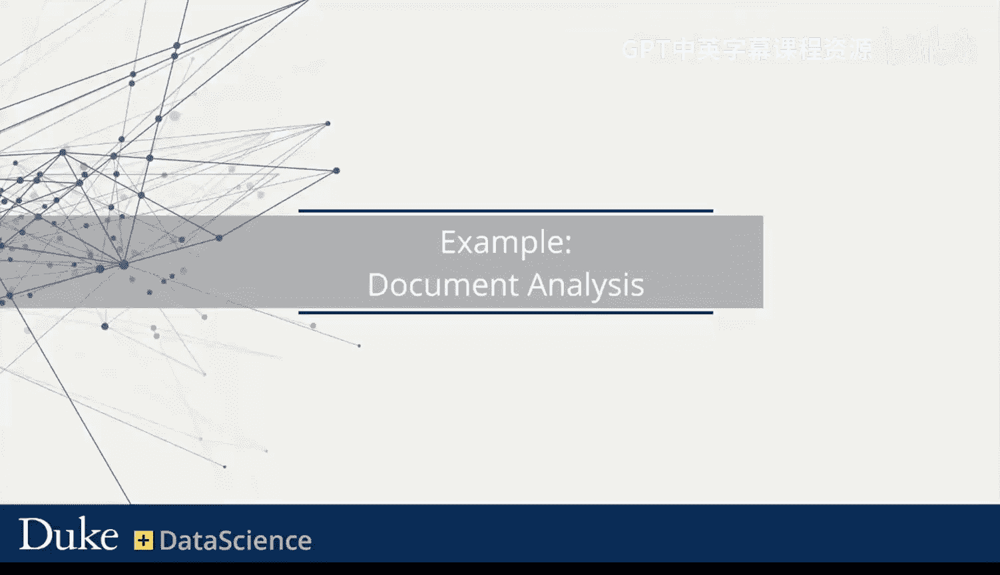
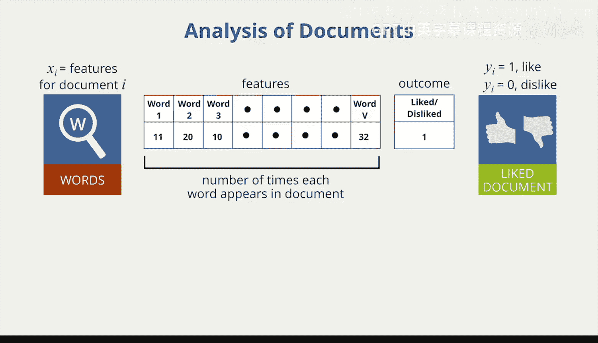
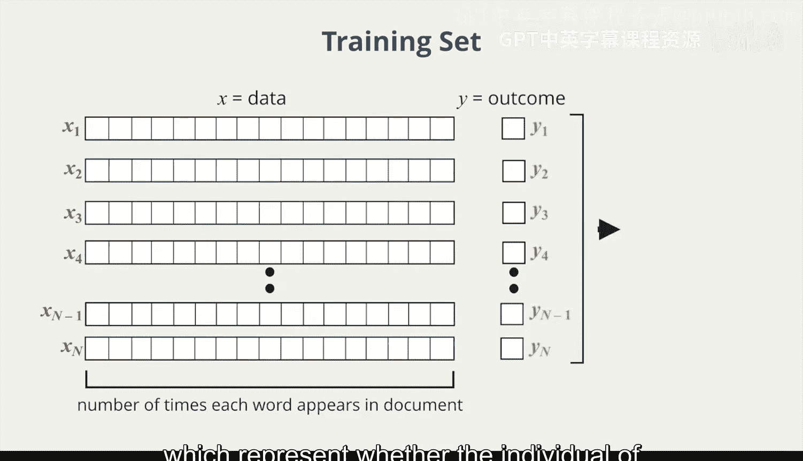

# 杜克大学《机器学习｜Introduction to Machine Learning》中英字幕 p09 09_01_04_文档分析示例.zh_en -BV1yjvdBQEaU_p9-

In the previous lesson， we introduced the concept of the multilay perceptron。Which， in many ways。

 is the most fundamental。Example of a neural network。

Now it is a relatively complicated and sophisticated model， it's a very powerful model。

But there may be some confusion about how it works， why it works， why is this a good model。

So what we would like to do in this lesson。Is to spend a little bit of time working through or talking through。

An example， to try to give some intuition as to what we mean by these latent features and these latent processes。

 what does that mean？So let's consider。A relatively simple but important example。

So let's assume that our job is to analyze documents。And so here， a document is just a set of words。

And so remember that X I。is a vector which represents a set of features for the I data of interest and for us now in this example。

 that what we mean is that X I represents the features of document I here in the context of document analysis。

And the simplest， perhaps the simplest way that we can do this is just to count the words。

 so assume that we're given a document。And let's assume that we have a vocabulary。

That is composed of V words。 So the vocabulary size is V。

And what we're going to do to characterize a given document here。

 document I is simply count the number of times each word appears in the document。

 and then what we're going to do is we're going to make a prediction based upon that feature vector。

 and so here a prediction we're going to still limit ourselves to the binary case for simplicity。

 and so what we would like to do is given the document。And given the words in the document。

 we want to make a prediction about whether a given person will like the document or find it interesting or whether they will dislike it。

 So in the binary case， what we'll say is if they like it， the label will be one， why will be one。

If they dislike it， y will be equal to zero？

And so we're given data for training， remember when we do learning。

 the first thing we have to assume is that we have data with which to learn。

 so the data is used to teach the model or to teach the algorithm and when we talk about learning what we mean by learning is learning the parameters。

Of our model。So in this case， we're going to assume that we have。We have n documents。

Represented by X1， x2 through X N， these are feature vectors which simply represent the number of times in each case that each of the V words is manifested in the document。

 and then were also given labels Y1 through Y N， which represent whether the individual of interest liked or disliked the document。

 our goal is to build a model such that if we're given a new vector X for a new document that the person has never seen before。

 we want to make a prediction will they like it or not like it。

