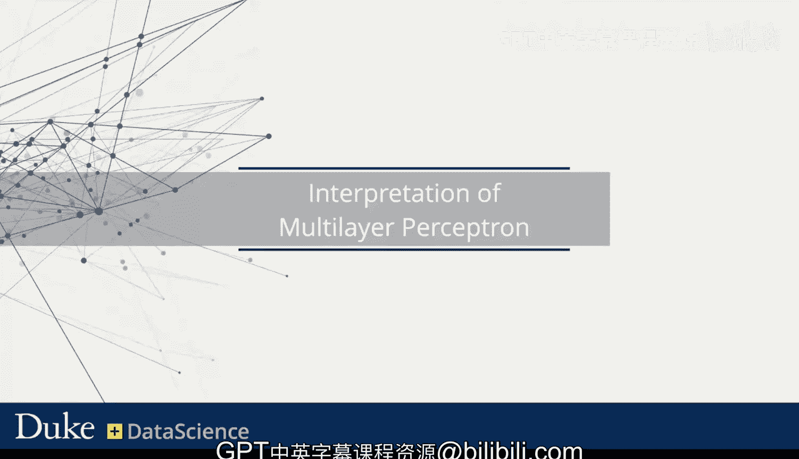
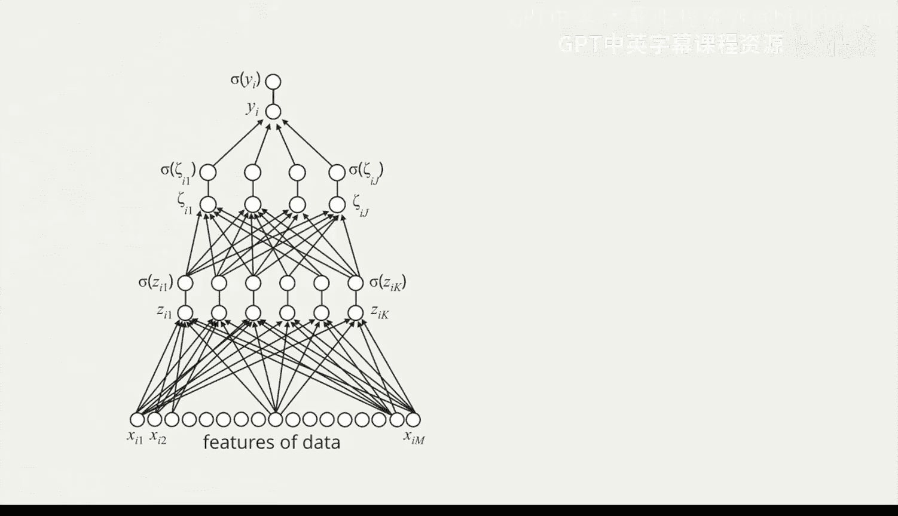
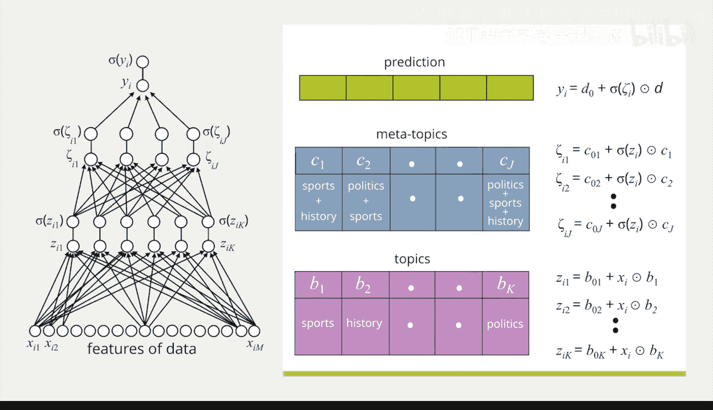

# 杜克大学《机器学习｜Introduction to Machine Learning》中英字幕 p10 10_01_05_多层感知机解读.zh_en -BV1yjvdBQEaU_p10-

Now the way that we're going to do this。

Is using a multi layerer perceptron？And so so just to remind you of how this works。

 so the multilayer perceptron is shown on the left， this is represented at the first layer。

 so we start at the bottom and work our way up， so let's look at what's going on for the first layer。

So remember， what we're going to do is logistic regression essentially k times。

 so the data X are the counts of words for the Ith document and B1， B2， BK。

 our templates with which we take the inner product。Between X I and each of those templates。

 B1 B2 through Bk。 So the question is， in the context of this example。What might。

 what might B1 through B， K represent， What might those templates mean。

 And so there might be some latent topics。That are characteristic of the document， so remember。

We get to see the words。And then there are latent processes in the data or here in the document that we don't explicitly get to see。

 but we understand documents and the documents are usually about some subject。

So the way that we might think about this is that B1， which is the first filter。

 might be representative of words that are characteristic of a particular topic， for example， sports。

 So therefore in our vocabulary of V words， there might be a subset of words that have high likelihood of appearing when the subject is sports。

 And so what we would expect is that the template B1 or the filter B1 with which we take the inner product of the data。

 if that filter is characteristic of the latent。pic sports。

 we would expect that that template B1 would have high values for words that are characteristic of sports and would basically have zero values for components which correspond to words that have nothing to do with sports as another example。

 B2。Which it corresponds to the second latent process may correspond to topic a topic corresponding to history so that in that case。

 we would expect that the template B2 would have high values for words that are associated with history and essentially zero values for words that have nothing to do with history。

 and then this can be done for each of the K latent topics in for example。

 the K topic might be associated with politics。 So a way to think about this is we're given a feature vector X I。

 which represents the counts of words in the document。

 we're going to take an inner product of X I with K。Filters or K templates。

 we can think of these as representing Klant processes in the context of documents。

 we might think of these as topics， topicss of sports， history politics。

 and so the features that come out of the first layer of our model represent given the words that we see in our feature vector。

 What is the probability that this document is about sports。

 What is the probability from zero to one， that this document is about history。

 What is the probability from zero to one， that this document is about politics。

Those are the K or can be thought of as the K latent processes or features that come out of the first layer。

Of our model。So now we go to the second layer。And now we're going to do the same thing。

 We're going to take the outputs of the first layer， which are represented as sigma Z。

 which represent the features that come out of the first layer Z。

 that then go through the sigmoid function， which turn it into a probability from 0 to 1。

 We play exactly the same game， we take those features and now multiply them by layer2 filters。

 which will represent as C1， C2 through Cj so there in this case， J filters that were manifesting。

So what do these filters represent？Well， these filters might emphasize certain features from layer1 and remember the features from layer1 correspond to topics。

 so therefore we could think of the filters C1 through CJ representing metatopics。

 which means combinations of topics from layer1， so remember the layer1 topics correspond to things like sports history politics。

The layer2 filters z1 through CJ。arere basically providing weighting on the layer1 features and so for example。

 C1， the template C1 may have high strength for the features at layer1 that correspond to the topics from sports in the topic from history。

 so therefore if C1， if the output of the template or filter C1 is large that implies that the document is about a combination of sports and history。

 in other words， the history of sports。If C2 for example。

 might emphasize the features from layer that are associated with politics and also sports。

 so these metatopics which means combination of topics， C2 for example。

 might represent how politics is connected to sports and so therefore if the document is about politics and sports。

 we would expect that when we take the inner product at layer2 with C2。

 the output would be high and so this is done for each of the filters C1 through CJ and so again to think about this。

The data X， which in this case is a count of words at layer 1。

The filters B1 through BK are looking for topics， in other words。

 sets of words that are associated with certain topics and layer 2。

 the filters C1 through CJ are looking for metatopics， which means combinations of topics。

And then finally， when we get to the top， this logistic regression at the top。

 what we're doing is we're making a decision and we're asking the question。

 given the metatopics that seem to be apparent， characteristic of the latent features at layer2。

 what is the probability that the person of interest is going to like the document or not。

 and so again， if we look at what this layer2 metatopics represent if a person is interested in the history of sports。

 then we would expect that if the filter Z1 when we take it in a product of the features sigma Z1。

 when we take it in a product of the features， Sigma Z I with filters C1。

 if C1 is characteristic of sports and history， and if the person of interest likes the history of sports。

 then we would expect that that the filter at layer3。

D that filtered D would look for the situation in which metatopics associated with the history of sports was high。

 And so in this way， we manifest a deep architecture。

 which has an intuitive meaning of what these latent features represent。 Now， this。

 this is a relatively simple example， chosen specifically to try to give some intuition。

 It's not always the case that the latent features are easily interpreted。

But this hopefully gives you some intuition as to why a deep learning model might work well and captures aspects。

 latent aspects of the data that we're interested in。

