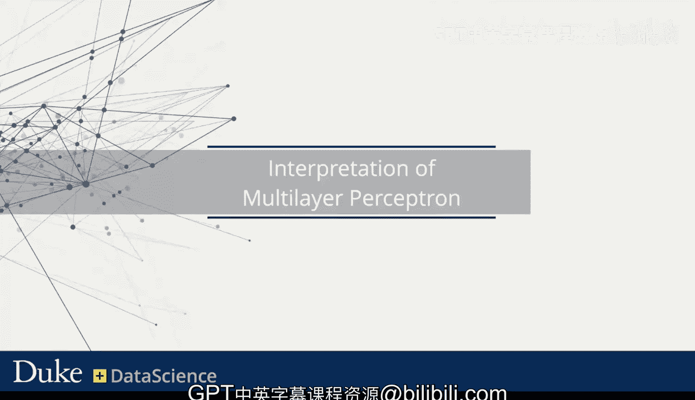
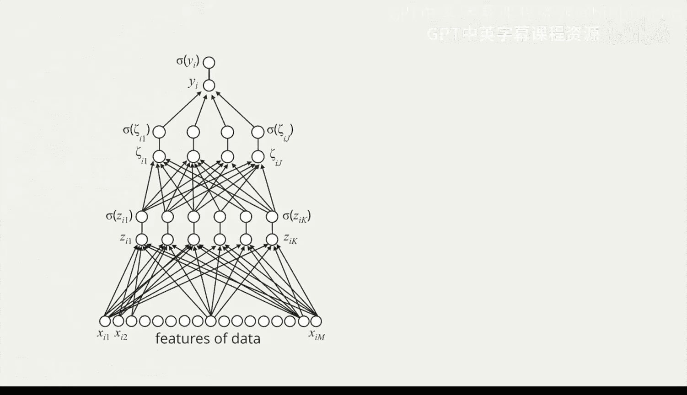
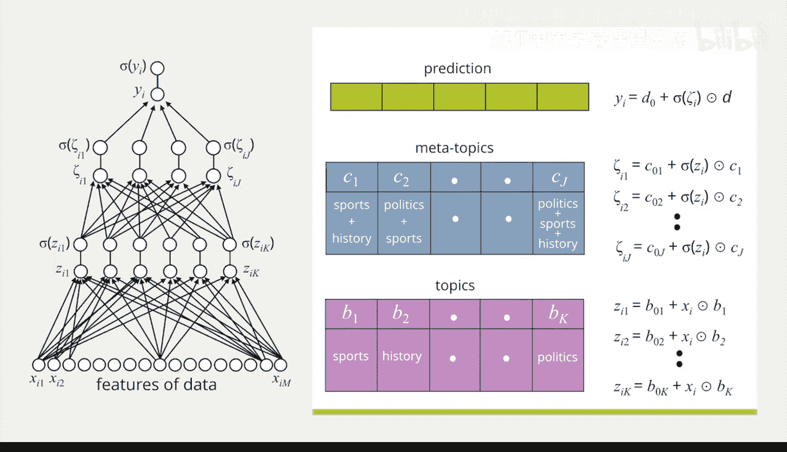

# 机器学习：10：多层感知机解读 🧠

在本节课中，我们将学习多层感知机的工作原理，并通过一个文档分类的实例，深入理解其每一层所代表的含义。我们将看到，多层感知机如何通过逐层抽象，从原始数据中提取出有意义的潜在特征，并最终用于预测。

---

上一节我们介绍了多层感知机的基本结构。本节中，我们来看看如何将其应用于一个具体的例子——预测用户是否喜欢某篇文档。

我们将使用多层感知机来完成这个任务。首先，回顾一下它的工作原理。左侧展示了一个多层感知机结构，我们从底层开始，逐层向上分析。现在，让我们聚焦于第一层。

本质上，第一层会进行K次逻辑回归运算。数据 `X` 代表第 `i` 篇文档的词频统计向量。`B1, B2, ..., Bk` 是我们用来与 `X_i` 做内积的K个模板或滤波器。

在这个例子中，`B1` 到 `Bk` 这些模板可能代表什么含义？它们可能代表文档中一些潜在的、具有代表性的主题。我们能看到文档中的词汇，但数据（或文档）背后存在一些我们无法直接观察到的潜在过程。我们理解文档，知道文档通常围绕某个主题展开。

因此，我们可以这样理解：第一个滤波器 `B1` 可能代表与某个特定主题（例如“体育”）相关的特征词汇。在包含 `V` 个词的词汇表中，当主题是“体育”时，会有一个子集的词有很高的出现概率。我们期望，如果滤波器 `B1` 代表了“体育”这个潜在主题，那么它在与“体育”相关的词汇分量上会有较高的值，而在与“体育”无关的词汇分量上值基本为零。

同理，第二个滤波器 `B2` 可能对应第二个潜在过程，例如“历史”主题。在这种情况下，我们期望 `B2` 在与“历史”相关的词汇上有高值，在其他词汇上值接近零。以此类推，每个 `K` 个潜在主题都可以这样处理，例如第 `K` 个主题可能与“政治”相关。

我们可以这样总结：给定一个代表文档词频的特征向量 `X_i`，我们将用它和 `K` 个滤波器（或模板）做内积。这些滤波器可以理解为代表了 `K` 个潜在过程；在文档语境下，我们可以将它们视为主题，如体育、历史、政治。因此，从模型第一层输出的特征，代表了在给定观察到的词汇特征向量的情况下，该文档关于体育、历史、政治等主题的概率（一个0到1之间的值）。这些就是第一层输出的 `K` 个潜在过程或特征。

---

了解了第一层如何提取主题特征后，现在我们进入第二层。我们将进行完全相同的操作。

我们将第一层的输出（表示为经过Sigmoid函数 `σ(Z)` 处理后的特征概率）作为第二层的输入。然后，用这些特征与第二层的滤波器 `C1, C2, ..., Cj`（这里假设有 `J` 个滤波器）相乘。

那么这些滤波器代表什么？它们可能强调第一层特征中的某些组合。记住，第一层的特征对应着各种主题。因此，我们可以将滤波器 `C1` 到 `Cj` 理解为代表“元主题”，即第一层主题的组合。

例如，第一层主题可能对应体育、历史、政治。第二层的滤波器 `C1` 到 `Cj` 基本上是对第一层特征进行加权。举例来说，模板 `C1` 可能对第一层中与“体育”和“历史”主题相关的特征赋予较高的权重。因此，如果滤波器 `C1` 的输出值很大，那就意味着这篇文档是关于体育和历史的组合，即“体育史”。

再例如，`C2` 可能强调与“政治”和“体育”相关的第一层特征。这个元主题代表了政治与体育的联系。因此，如果一篇文档同时涉及政治和体育，当我们用 `C2` 在第二层做内积时，输出值就会很高。这个过程对每个滤波器 `C1` 到 `Cj` 都会执行。

我们可以这样概括：在层1，数据 `X` 是词频统计，滤波器 `B1` 到 `Bk` 寻找的是主题（即与特定主题相关的词汇集合）。在层2，滤波器 `C1` 到 `Cj` 寻找的是元主题（即主题的组合）。

---

最后，当我们到达顶层的逻辑回归时，我们是在做决策。我们提出的问题是：给定在第二层潜在特征中显现出来的、具有代表性的元主题，目标用户喜欢这篇文档的概率是多少？

再次审视第二层的元主题：如果一个人对“体育史”感兴趣，那么我们会期望，当代表“体育与历史”的元主题（即滤波器 `C1` 的输出）很高时，顶层用于决策的滤波器 `D` 会寻找这种情况。如果目标用户喜欢体育史，那么滤波器 `D` 就会在代表“体育史”的元主题值高时，给出高的预测概率。

通过这种方式，我们构建了一个具有深层架构的模型，并且这些潜在特征具有直观的含义。当然，这是一个相对简单的例子，是特意为了提供一些直觉而选择的。并非所有情况下潜在特征都如此易于解释。

但希望这个例子能让你对深度学习模型为何有效，以及它如何捕捉我们感兴趣的数据的潜在方面，有一些直观的理解。

---

**本节课总结**

本节课中，我们一起学习了多层感知机在文档分类任务中的具体解读。我们通过一个例子看到：
*   **第一层** 的滤波器（如 `B1, B2`）可以理解为在寻找文档的**基础主题**（如体育、历史）。
*   **第二层** 的滤波器（如 `C1, C2`）则在组合这些基础主题，形成更复杂的**元主题**（如体育史）。
*   **最终层** 的逻辑回归则基于这些元主题，做出最终的预测（如用户是否喜欢）。

这个过程展示了深度学习模型如何通过多层非线性变换，从原始数据中逐层抽象出越来越高级和复杂的特征表示，从而完成复杂的预测任务。