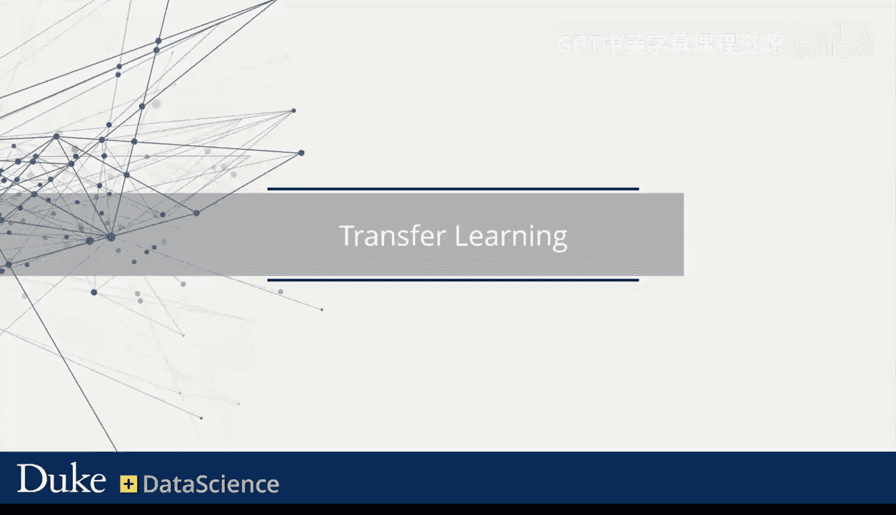
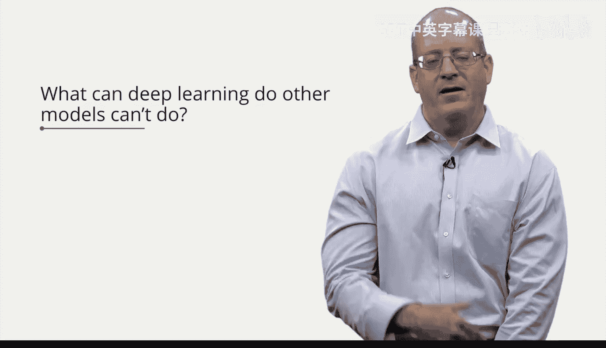
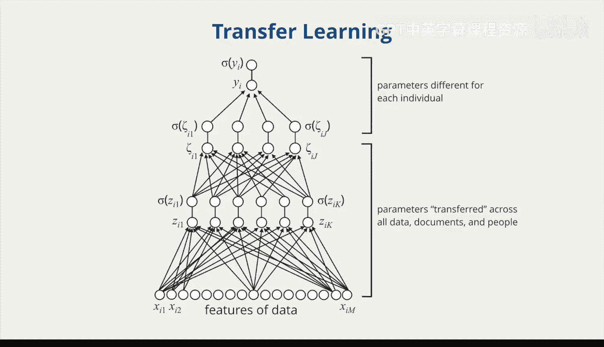
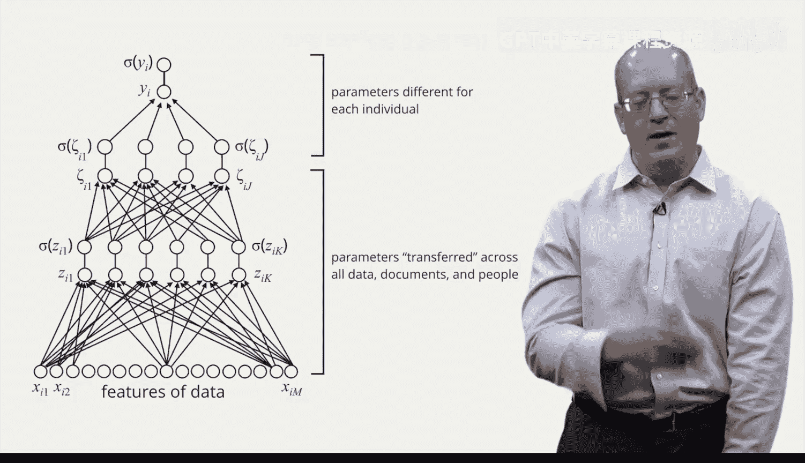
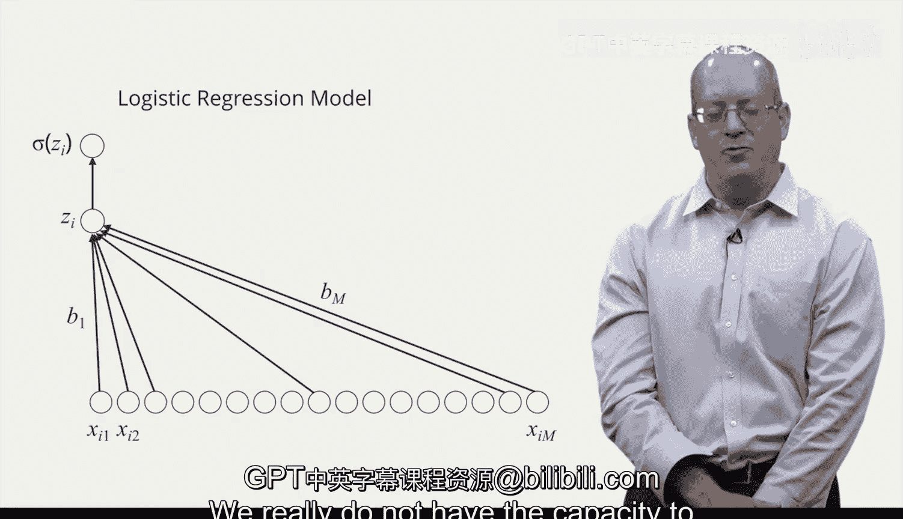

# 杜克大学《机器学习｜Introduction to Machine Learning》中英字幕 p11 11_01_06_迁移学习.zh_en -BV1yjvdBQEaU_p11-

Another question that， you know， I to try to give a sense again of why is deep learning so powerful。

 What can deep learning do that is not done easily by， by other models。

 So if we go back to this model。 This is a model that allows us to make predictions about。

Whether a person of interest will like or dislike certain documents。

And the like or dislike of those documents in this example are controlled by whether that document is characterized by certain topics and metatopics and whether the person of interest likes those particular topics and metatopics。

Now we can now think of how we could use this multilayer perceptron to analyze multiple people。

 so oftentimes we're interested not in predicting how just one person is going to like documents。

 we're interested in how many people might like documents。So a way that we。

Can think about this is the first and second layers of our model， recall。

 are looking for the presence of topics and metatopics in our document。So therefore。

 the first two layers of our model are actually characterizing the documents。

 they don't really characterize the person， they characterize the documents themselves。

 and so consequently what we could do and they analyze if we wanted to build models for many different people。

What we can do is the first two layers of this model or the parameters associated with the first two layers of this model。

Can be shared or reused。In models of multiple people。 so therefore。

 from the standpoint of model buildings， So remember， when we do model learning， we have to use data。

 training data to learn。 and so if I can reuse the first two layers of this model across many different people。

 in other words， across data from many different people。

Then that means that I have the opportunity to leverage much more data than I otherwise could to learn the parameters of the first two layers of our model。

And then the top layer， which characterizes whether a given particular person likes particular metatopics。

 this has to be person dependent。And so the thing to of that I want to try to communicate here is that as we look at this deep architecture。

The lower layers or the layers in the model that are closest to the data at the bottom are characteristic of the data。

The layer at the top is characteristic of the person。 and so we call this transferred learning。

 and so if I have data from many different people。

I can transfer data from one person to the other when learning the parameters of the bottom of the model。

 and then I only use data from the person of interest to learn the parameters at the top。

 So this transfer of learning allows a much more efficient use of data。

 So in addition to the other advantages of deep learning that we talked about earlier。

 such as the ability to learn a more general decision boundary a more sophisticated decision boundary between the features of data characteristic of label y equal 1 and y equals0。

 the other significant advantage of deep learning and here the multilayer perceptron is it offers us the ability to do transfer learning which allows us to use our data in a much more efficient way。

 instead of using data from one person to build one model for one person and then use data from。

Another person to build a model for that person， what we can do is we could take the data across all of our people and therefore have much more data to share that data or transfer that data across the different subjects and then use all of it to learn the bottom parameters of our model and then only use the data associated with a given person to learn the relatively small set of parameters at the top。

And so now thinking back to the logistic regression。

 which was kind of our starting point in our building block algorithm。

 this is a very simple model and is therefore a nice place to start， however。

 it doesn't have the capacity。Like this multi layer perceptron to do transfer learning。

 so with the logistic regression， we have separate parameters B1 through BM。

 if we want to build a predictive model of whether a person likes a document or not。

 we really do not have the capacity to do transfer learning in the same way。

