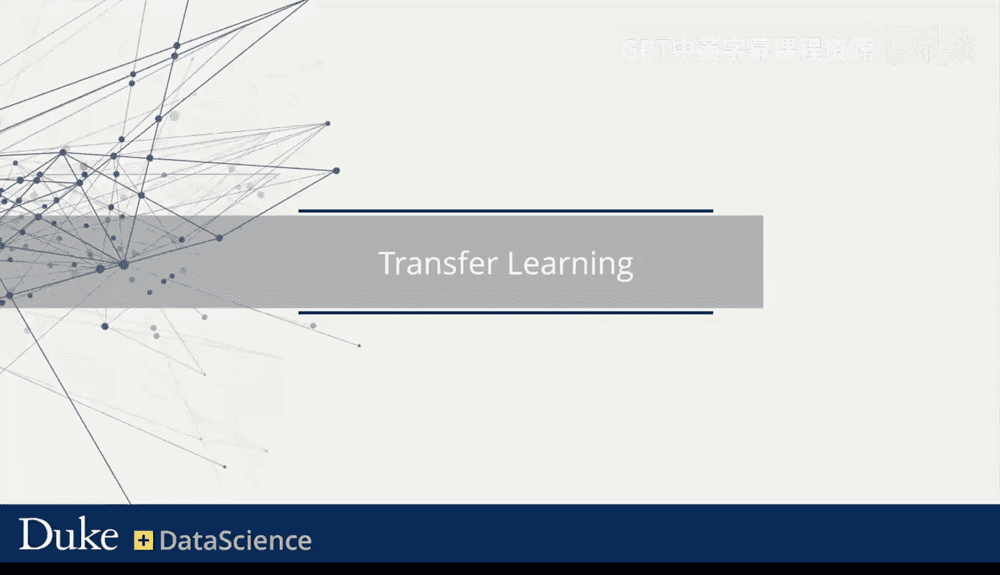
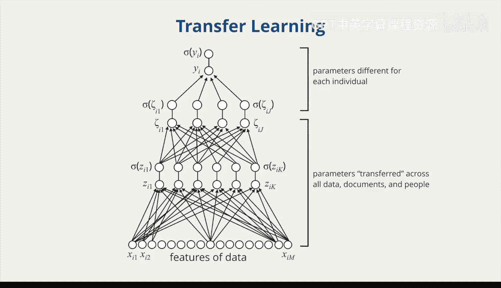
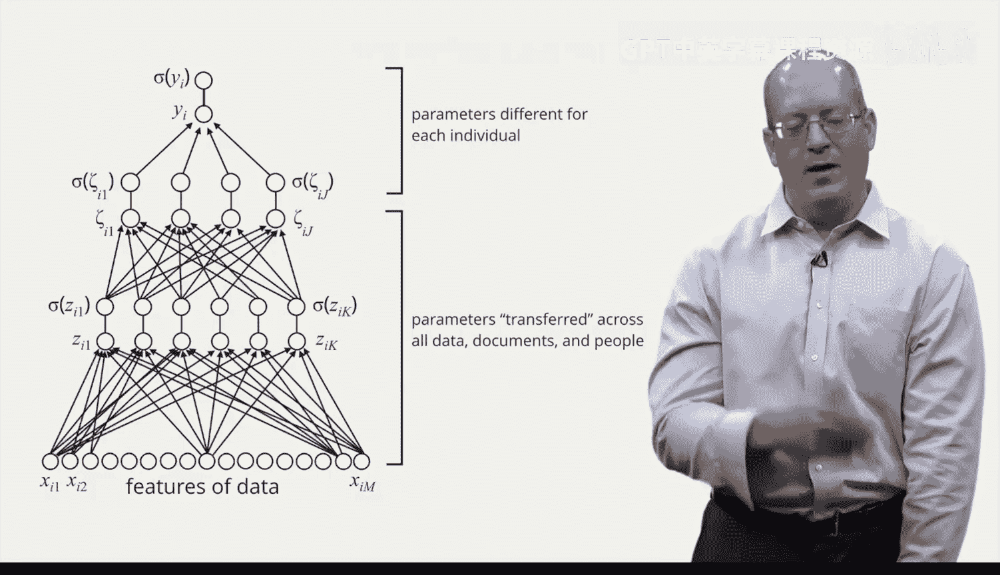
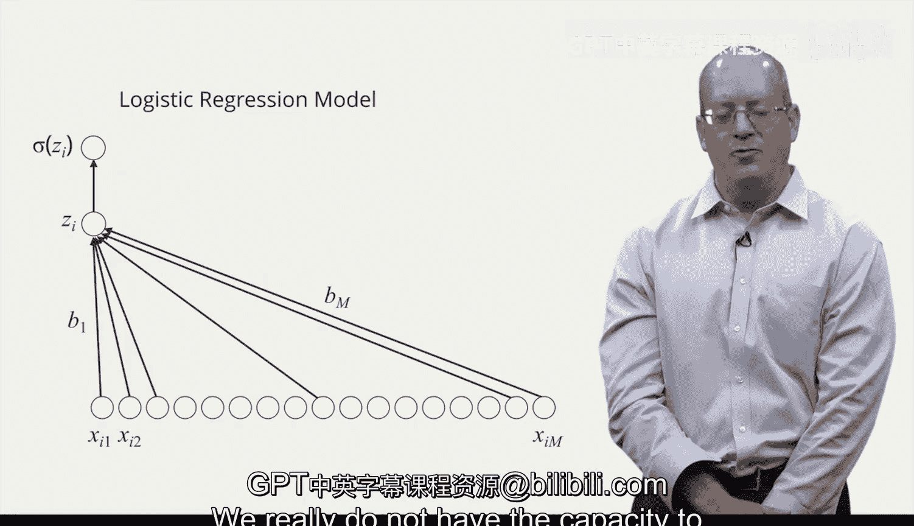

# 机器学习入门：11：迁移学习 🧠

在本节课中，我们将探讨深度学习的一个关键优势：**迁移学习**。我们将了解它如何通过共享模型底层参数，实现更高效的数据利用，从而构建针对多个个体的预测模型。

---

上一节我们介绍了多层感知机（MLP）如何通过其深层结构学习复杂的决策边界。本节中，我们来看看MLP的另一个强大能力——**迁移学习**。

考虑一个预测用户是否喜欢某篇文档的模型。模型的**第一层和第二层**负责从文档中识别**主题**和**元主题**。因此，这两层实际上是在**表征文档本身**，而非特定用户的偏好。

以下是迁移学习的核心思路：
*   **共享底层参数**：当我们想为多个不同用户构建模型时，可以**共享或复用**模型的前两层参数。这意味着，我们可以利用所有用户的数据来共同学习如何更好地表征文档。
*   **个性化顶层参数**：模型的**顶层**负责判断特定用户是否喜欢识别出的元主题，这部分参数是**用户依赖**的，需要针对每个用户单独学习。

这种设计带来了显著的数据效率优势。我们无需为每个用户从头开始、仅用其个人数据训练一个完整模型。相反，我们可以汇集所有用户的数据来学习强大的、通用的文档表征（底层参数），然后仅用单个用户的数据来微调顶层的个性化偏好参数。

回想我们最初的构建模块——逻辑回归模型。它是一个简单的模型，公式如下：

**`P(y=1|x) = σ(β₀ + β₁x₁ + ... + βₘxₘ)`**

其中，`σ`是Sigmoid函数。虽然逻辑回归是一个很好的起点，但它不具备像多层感知机那样的**分层结构**。在逻辑回归中，所有参数`β₁`到`βₘ`都与最终的预测直接相关，无法清晰地将“数据表征”与“任务决策”分离开来，因此难以实现同样高效的迁移学习。

---

本节课中我们一起学习了**迁移学习**的概念。我们了解到，深度神经网络的分层结构允许我们将模型的**底层**（靠近数据输入）设计为学习**通用数据特征**，而将**顶层**设计为学习**特定任务**。通过跨多个相关任务或用户**共享底层参数**，我们可以更充分地利用数据，仅用相对少量的个性化数据来学习顶层参数，从而高效地为多个个体构建强大的预测模型。这是深度学习超越逻辑回归等简单模型的另一个关键优势。