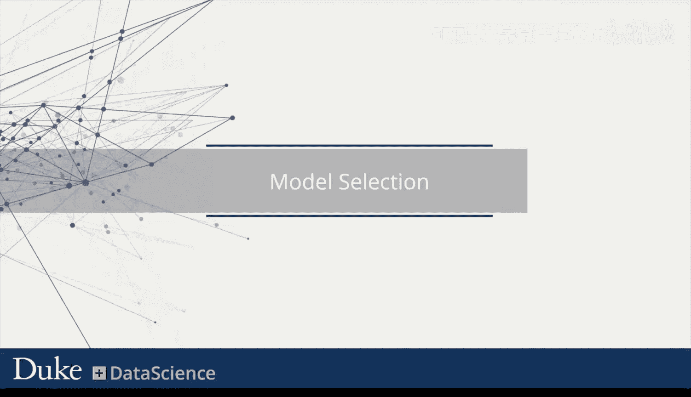
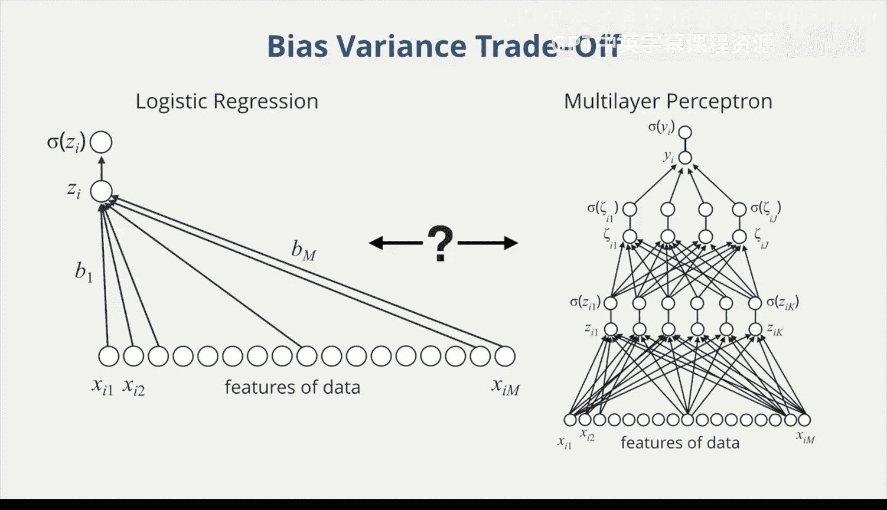
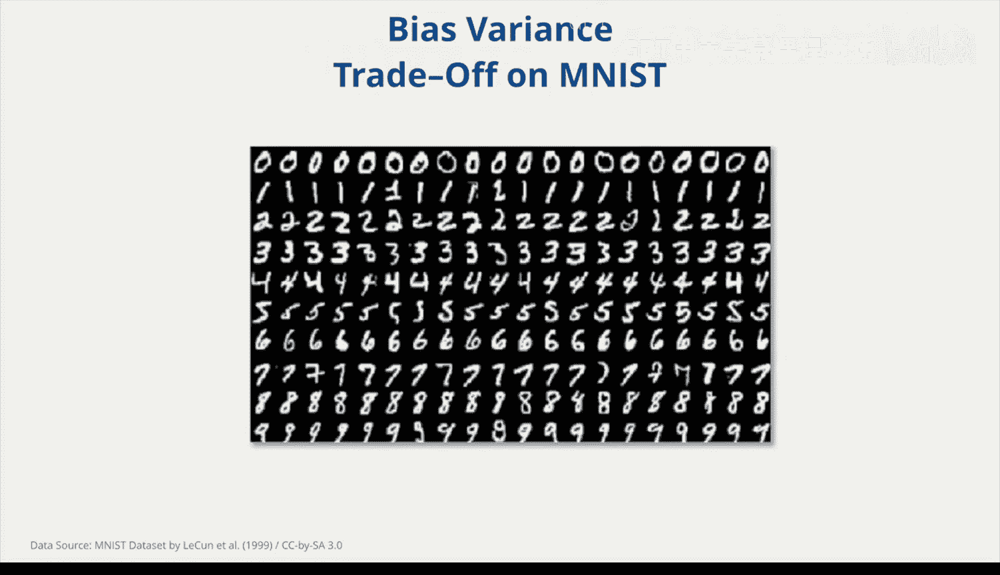
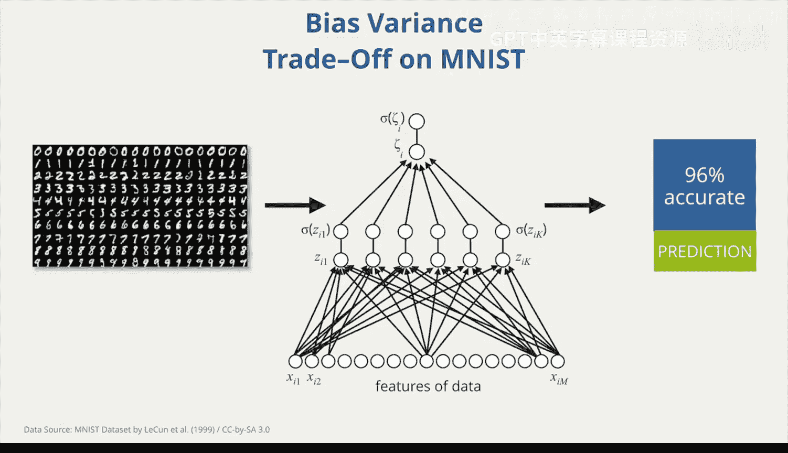
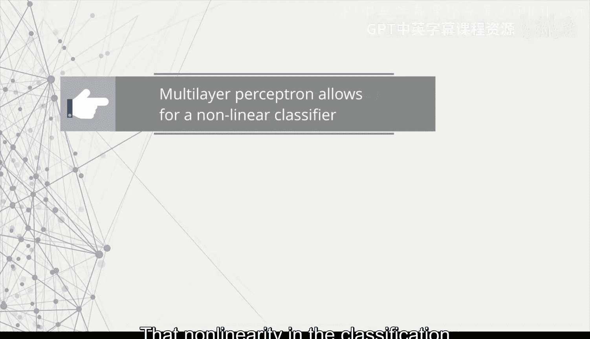

# 杜克大学《机器学习｜Introduction to Machine Learning》中英字幕 p12 12_01_07_模型选择.zh_en -BV1yjvdBQEaU_p12-

Oftentimes in machine learning。We have a question of model selection。

There may be multiple different models that one might use to represent the data and you have to make choices and the way to make those choices oftentimes is gained through experience。

So this is， you know with the tools that we have developed thus far。

 we can look at a particular example of model selection that we might consider with the tools that we have。

 so recall that X subi is the I data sample， it has M components so we represent the data as XI1 through XIM the M components of the data。

In the logistic regression， we take the data。 We take an inner product。

With the weights B1 through BM， so we basically multiply each component of the data Xi with a respective component of the vector B we sum that those products up we then get azi we typically then add a bias and then finally this is sent through a sigmoid function denoted by sigma from which we get a probability of an outcome that's a very simple model it may be very effective in some situations another model that we now have at our disposal is the multilayer perceptron which we see at the right and so again at the bottom we have the data Xi1 through XM the M components of the data instead of directly going through a logistic regression to make a classification decision in this case we show two intermediate layers of latent features and then at the top the latent features。

At the top are again， sent through a logistic regression to make a classification。

So here through this picture， we can see the connection between the logistic regression and the multilayer perceptron。

 the multilayer perceptron has logistic regression in it at the top of the model。

 but there are intermediate features that are manifested through this neural network or multilayer perceptron。

 So the question that one often we'll have is which model to use。

And so this is something that in machine learning is called the bias variance trade off。

And the way to think about this is that if you look at the logistic regression model。

 it's a relatively simple model， the number of parameters in the model is relatively small。

 the multilayer perceptron by contrast， is a rather complicated model， a rather sophisticated model。

But consequently， it also has a lot more parameters。

And so the variance， what we think about when we talk about variances is that if I were to take different examples of data。

 if I were to look at a situation where I have n different data samples and I were to train my model using those data samples。

 if I were to look at different instantis of those N training examples。

 how much variation would there be in the model。And so with the simple model。

 because of the fact that it is biased towards simplicity。

The amount of variance that we would expect to see in different training scenarios with different training of n samples of data。

We would expect in the logistic regression case that the amount of variance that we would see between different training scenarios would be small on the multilayer perceptron case。

 given the added complexity， we might anticipate that it has greater variation from training on one example of data to training on another example of data。

 and so this is called the bias variance tradeoff， we oftentimes will bias a model towards simplicity such that there is not a lot of variance。

 however， that bias or that simplicity might undermine performance。

 So to show a simple example of this MNist is a very widely used data set for digit recognition。

 So here we're looking at 10 digits0 through 9 and the objective is to take one of those little pictures of a digit。

To send it in the pixels that correspond to that little picture are going to be the elements of our data X I。

 so a simple model that we might consider to do this is the logistic regression in that case the pixels of the image are directly weighted by B1 through BM and then sent to a sigmoid and then a classification decision is made if you do this。

If you try to solve the MIS problem with a logistic regression。You would， for example。

 see an accuracy of around 91%。If we use， by contrast the multi layerer perceptron。

 we could see that the performance oftentimes can improve to 96% accuracy。

And so this is an example where the added sophistication。

Of the more complicated multilayer perceptron here。

 actually there's only one additional layer relative to to the logistic regression yields a significant improvement in performance。

 The reason that this is true， we've talked about this elsewhere。

 is that the logistic regression is restricted to a linear classifier where the multilayer perceptron allows a-line classifier and that nonlineity in the classification decision yields improved performance。

 The other thing that I should briefly note is that this is a 10 class problem So we have digits from  zero to 9 and so therefore this is not a binary problem。

 This is a10 class problem for simplicity I'm using the same binary logistic regression in multilayer perceptron pictures。

 but in the actual implementation at the top of the network we have a 10。

Clas classification problem or algorithm， which is manifested as a generalization of the logistic or sigmoid link function。

And it's called the softftm， we'll talk more about the softftm elsewhere in our class。

