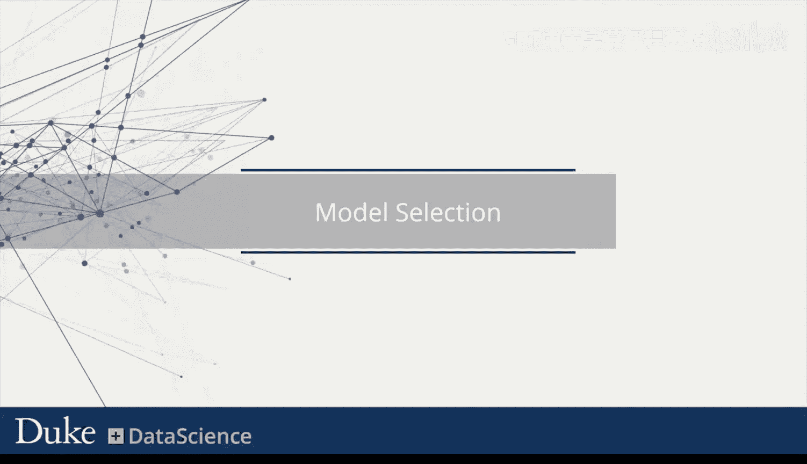
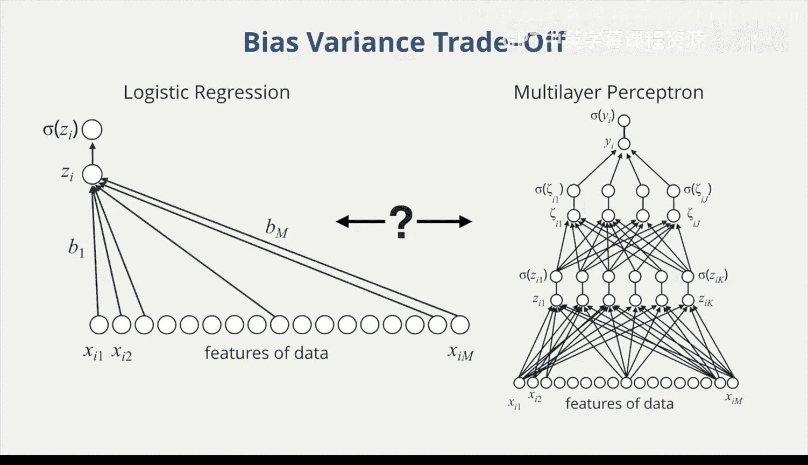
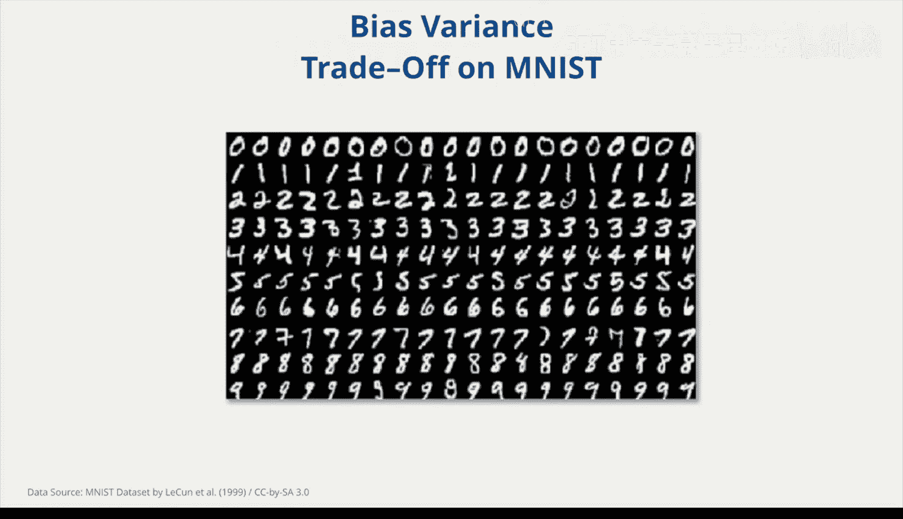
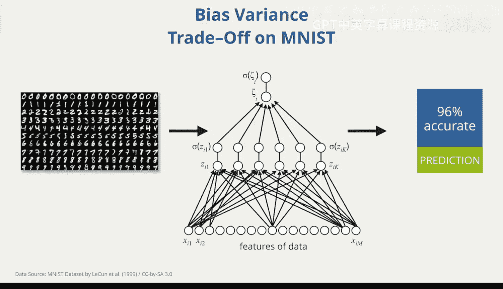
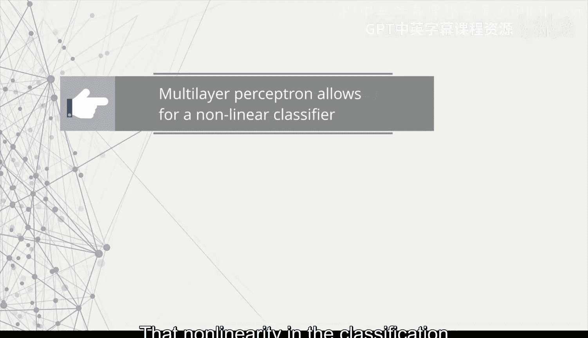

# 机器学习入门：12：模型选择

在本节课中，我们将要学习机器学习中的一个核心问题：模型选择。当面对多种可能的模型时，我们需要决定使用哪一个。我们将通过一个具体的例子，利用目前学到的工具来理解如何进行选择，并探讨一个重要的概念——偏差-方差权衡。

## 模型选择问题

在机器学习中，我们常常面临模型选择的问题。可能有多种不同的模型可以用来表示数据，我们需要做出选择。做出这些选择的方法通常来自于经验。

利用我们目前开发的工具，我们可以考虑一个具体的模型选择例子。

## 逻辑回归模型

首先，回顾一下逻辑回归模型。设 **X_i** 为第 i 个数据样本，它有 M 个分量，因此数据表示为 **X_i1** 到 **X_iM**。

在逻辑回归中，我们取数据与权重 **B1** 到 **BM** 的内积。具体来说，我们将数据的每个分量 **X_i** 与向量 **B** 的对应分量相乘，然后将这些乘积求和，得到一个值 **z_i**。我们通常会加上一个偏置项 **b**，最后将这个结果送入一个称为 **σ** 的 sigmoid 函数。这样，我们就得到了一个结果（例如，属于某个类别的）概率。

这是一个非常简单的模型，在某些情况下可能非常有效。

**公式表示：**
`z_i = Σ (B_j * X_ij) + b`
`P(y=1 | X_i) = σ(z_i) = 1 / (1 + exp(-z_i))`

## 多层感知机模型

我们现在掌握的另一个模型是多层感知机。同样，在底部我们有数据 **X_i1** 到 **X_iM**。与直接通过逻辑回归进行分类决策不同，这里我们展示了两个中间层（潜在特征层）。顶层的潜在特征再次通过一个逻辑回归来进行分类。

通过这张图，我们可以看到逻辑回归和多层感知机之间的联系。多层感知机在其模型顶部包含了逻辑回归，但通过这个神经网络或多层感知机，还产生了中间特征。

## 偏差-方差权衡

那么，我们经常面临的问题是：该使用哪个模型？这在机器学习中被称为**偏差-方差权衡**。

理解这一点的方法是：观察逻辑回归模型，它是一个相对简单的模型，模型中的参数数量相对较少。相比之下，多层感知机是一个相当复杂、精密的模型，因此它也有更多的参数。

当我们谈论**方差**时，我们考虑的是：如果我取不同的数据样本，如果我有一个包含 N 个不同数据样本的情况，并用这些数据样本来训练我的模型，那么在不同的 N 个训练样本实例下，模型会有多大的变化。

对于简单模型，由于其偏向于简单性，我们预期在不同的训练场景下，使用不同 N 个数据样本进行训练时，所观察到的方差量会较小。在多层感知机的情况下，考虑到其增加的复杂性，我们可能会预期，从一个数据样本训练到另一个数据样本训练，其变化会更大。

这就叫做偏差-方差权衡。我们常常会使模型偏向于简单性，这样方差就不会很大。然而，这种偏差或简单性可能会损害性能。

## 一个具体例子：MNIST手写数字识别

为了展示一个简单的例子，MNIST 是一个非常广泛用于数字识别的数据集。这里我们处理 0 到 9 这 10 个数字，目标是根据数字的小图片（像素）进行分类，这些像素将构成我们的数据 **X_i**。

以下是我们可以考虑的两种模型及其性能对比：

*   **逻辑回归模型**：在这种情况下，图像的像素直接由 **B1** 到 **BM** 加权，然后送入 sigmoid 函数进行分类决策。
    *   **性能**：如果尝试用逻辑回归解决 MNIST 问题，准确率大约在 **91%** 左右。
*   **多层感知机模型**：相比之下，如果我们使用多层感知机，性能通常可以提升到 **96%** 的准确率。

这是一个例子，说明更复杂的多层感知机（这里实际上只比逻辑回归多了一个层）所带来的精密度提升，确实能显著提高性能。

之所以如此，是因为逻辑回归仅限于线性分类器，而多层感知机允许非线性分类器。分类决策中的这种非线性带来了性能的提升。

另外需要简要说明的是，这是一个 10 类问题（数字 0 到 9），因此不是二分类问题。为了简化，我使用了相同的二分类逻辑回归和多层感知机示意图，但在实际实现中，网络顶部是一个用于 10 类分类的算法，它表现为逻辑或 sigmoid 连接函数的泛化，称为 **Softmax** 函数。我们将在课程的其他部分更多地讨论 Softmax。

## 总结

本节课中，我们一起学习了机器学习中的模型选择问题。我们比较了逻辑回归和多层感知机这两种模型，并引入了**偏差-方差权衡**的核心概念：简单模型（如逻辑回归）通常方差小但可能偏差大（性能受限），而复杂模型（如多层感知机）可能方差大但偏差小（潜力性能更高）。最后，我们通过 MNIST 手写数字识别的例子，看到了更复杂的模型如何通过引入非线性来提升实际性能。理解这种权衡对于在实际问题中选择合适的模型至关重要。