# 杜克大学《机器学习｜Introduction to Machine Learning》中英字幕 p13 13_01_08_神经网络早期历史.zh_en -BV1yjvdBQEaU_p13-

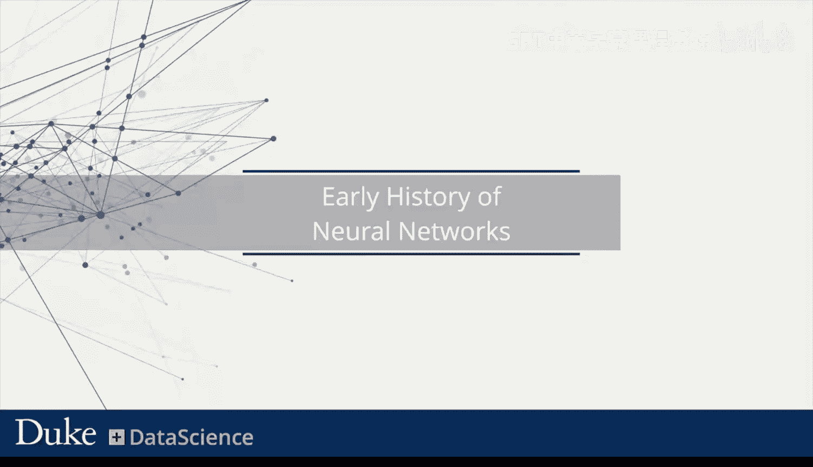

Consequently I think it's a good idea to take a look at history。

 the history of the multilayer perceptron， this is meant somewhat as tongue in cheek， in other words。

 not meant to be too precise on things like dates， but it is accurate in the sense that it tells us the history of multilayer perceptrons and neural networks and that history I think is a cautionary tale which will come to towards the end of this lesson。

So the multilay perceptron， which we've introduced here。

Which is at the heart in many ways of deep learning。

 So it consequently seems like a very new it looks interesting。

 So one might think that it is something that was just invented。

 but actually the multilayer perceptron was invented in around 1960 or 1959。

 So it actually has been around a long time。 So this baby is to connote the idea of the birth of the multilayer perceptron。

And so let's look at the history。 so 1960 was a long time ago computing power was not what it is today。

 so while the multilayer perceptron was developed， its use was limited。

 the other aspect of that is the amount of data that we had that one had in 1960 was significantly less than we have today so from that early birth in 1960 the next big innovation occurred in 1986 which is a technique called back propagation and back propagation is a method that allows us to learn the parameters of the model in a very efficient way so from the back propagation is a very important model from the standpoint of computational making the model computationally relevant the other thing to note is in 1986 we had far more significant computational power So again know what I want to reflect here are what I'm calling the seasons of neural netnet。

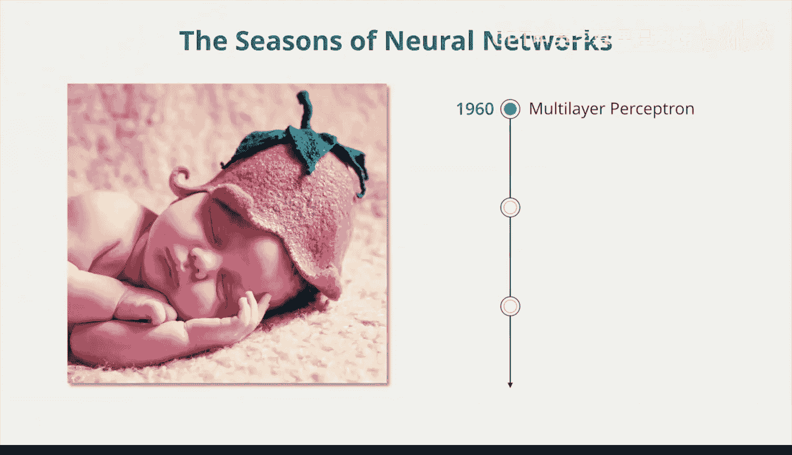

It will become clear why we're calling it the seasons of neural networks as we move through this。

 so in 1986 the back propagation model was developed for the multilayer perceptron。

 we are having increasing computational power， increasing access to data。

 this seems like a very bright future。

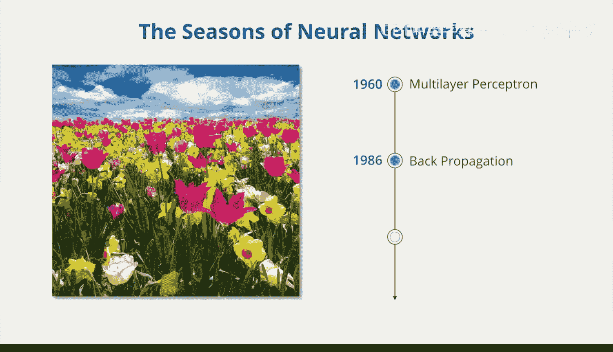

In 1989， a model called the convolutional Ne network was developed and we'll talk about the convolutional neural network elsewhere in this module。

 this was as will be seen later and later part of the module。

 the convolutional neural network was a key technology for analyzing images and that again， 1989。

 so that was shortly after the back propagation， this was a significant period of optimism。

 so as we look at the seasons of neural networks summer， very hot very promising period of time。

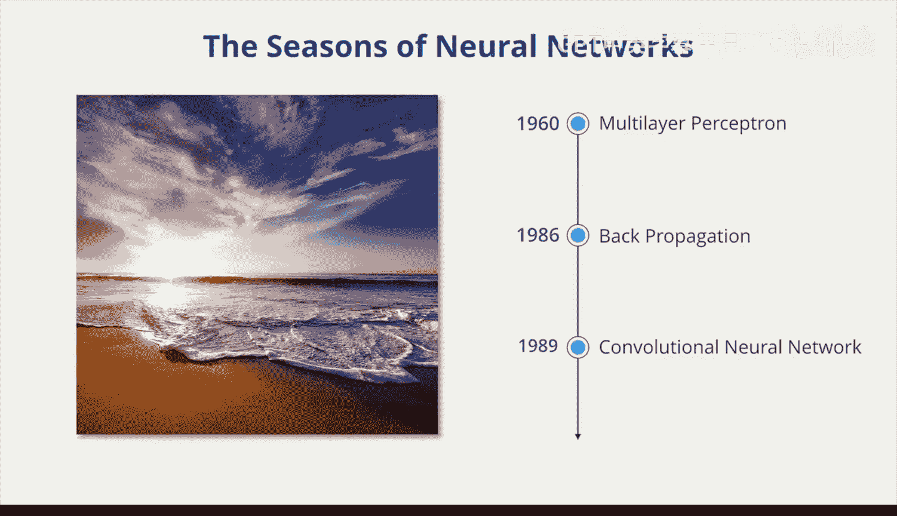

So around that time， because of the enthusiasm that neuralnets had engendered。

 people started to apply them in what I'll call the wild。

 which means applying them to data sets in the real world and that occurred in the early 1990s and so now we've gone from summer into a rather cold winter。

 and the reality is at that time， the models did not perform well。

 the enthusiasm that existed previously was proven to be unwarranted from the standpoint of how they actually performed in the wild。

And there were many reasons for this， but a lot of it was that recall that the neural network is a much more complicated model than the logistic regression and the amount of data that one might need to train such a model well is significantly increased in the early 90s people really didn't fully understand that these models did not perform well。

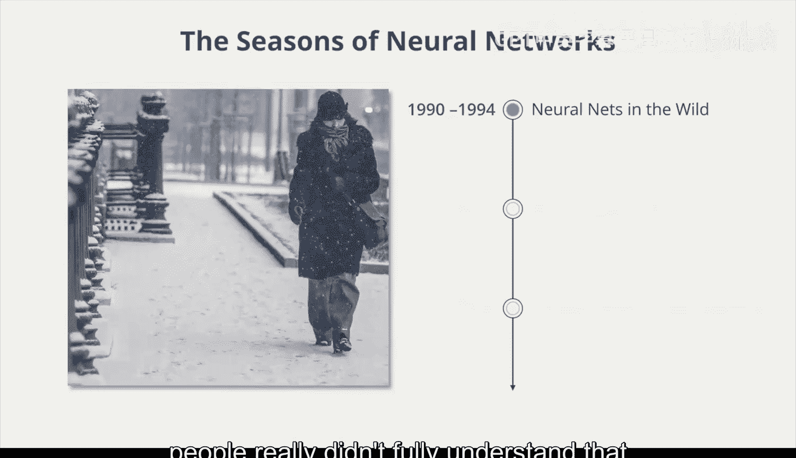

Around 1995， another key development was something called long shortter memory。

 It's a bit of a weird name。 We will talk about that as well later in this module long short termm memory is a very key technology for analyzing data that varies as a function of time。

 So for example， music or audio signals vary as a function of time。

 video varies as a function of time。 long short termm memory is very well suited for that。

 The key thing I want to reflect in this slide is again that in the mid-90s， there was again。

 some enthusiasm， excitement about the potential of neural networkss。

 The other thing to note that I want to highlight here is that the convolutional neural network。

 which is at the heart of the modern revolution in neural networkss and in deep learning was developed in 1989。

 a long time ago， the long long short term。Memory， which is now used widely for natural language processing or for analyzing text。

 as we'll see later in the module， was developed in 1995。

 and so the key technologies which are driving the current revolution in deep learning actually existed at or before 1995。

 so this tells us that there were some things that were missing at that time。

 that that led to problems as we'll see and that the underlying technology really hasn't changed。

 what's changed are some other factors which we'll discuss in a moment。

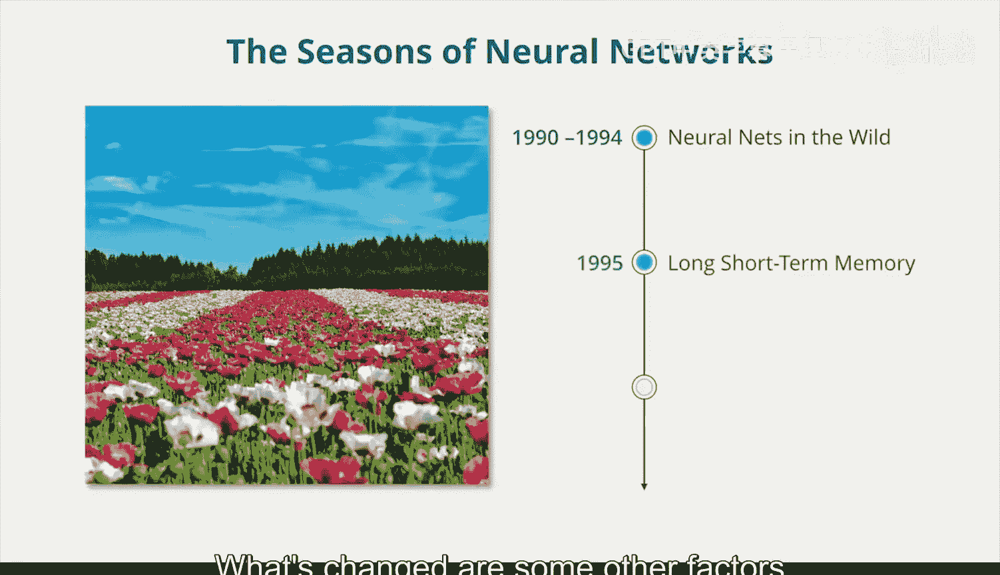

So after the introduction of long term short term memory and we had back propagation and we had the convolutional neural network。

Again， people tried to use neural networks in the wild and you can see this picture denotes fall。

 not exactly winter， but it is getting chilly during this time again。

 neural networks did not perform as well as often advertised。

 other methods in machine learning came to the forefront。

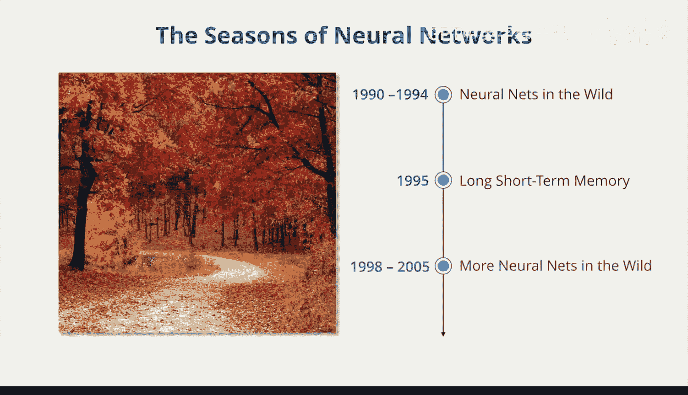

From roughly around 2005 to 2010 in machine learning， there was and again， this is tongue and cheek。

 but fairly accurate， a period of banishment。 In other words。

 in the in machine the main machine learning forums。

 people did not do neural networks or at least did not speak about neural networks at all。

 and the reason was is that the technology really had not performed well enough up to that point and other methods that were simpler perhaps easier to understand or to interpret。

 worked much better。 So literally up until the end of around 2010 or thereabouts in machine learning community。

 one did not even use the term neural networks for fear that if somebody were to use that word。

 they might be banished or even laughed at。

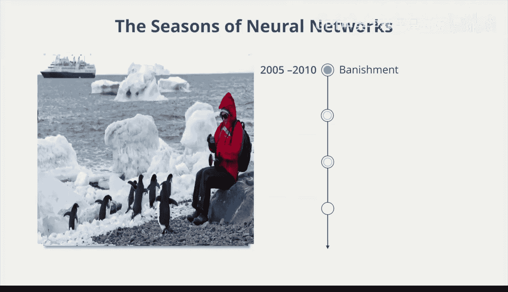

Then because of the fact that neural networks， the term neural networks。

had come to mean such a negative thing based upon its history and based upon how it performed in the wild with real data。

There was a need。Actually to change the name because if you use， as I said。

 if you use the word neural network around 2010， people might even laugh at you and so some people decided to rebrand the technology with the idea that there was now a new moment where this technology really could work effectively but nobody would pay attention to it just because of the name so this brought to the for a new name around roughly around 2010 deep learning and so deep learning recall the multilayer perceptron as a multilayer architecture。

 remember that that was invented in 1960 and so there's actually not very much new about deep learning except the name it's kind of a cool name and it's not neural networks and people were willing to give it a second look so we've gone from the banishment of winter。

 the depth of winter to a spring。Maybe this is the time。

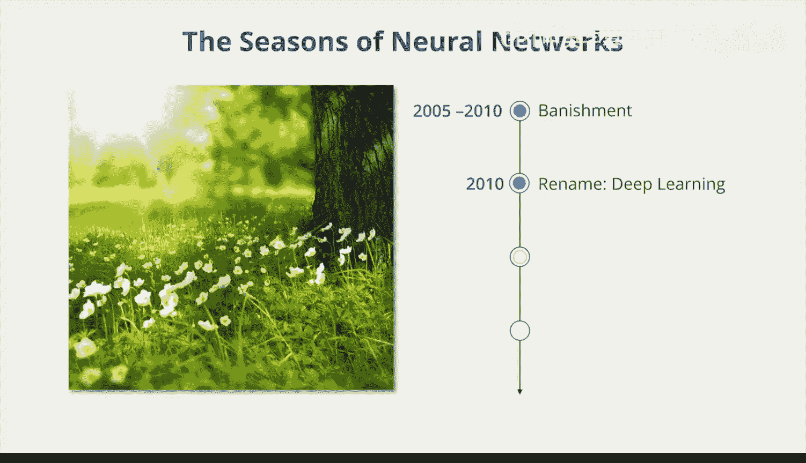

Around 2013， a key moment occurred in this。And notice we've now moved to a time of spring in hope。

So the CNN， which was developed in 1989 by Jan Lacoon and his colleagues。

Which dates back to 1989 was applied to two was applied in the context of two things that did not exist in 1989 and did not exist up until very recently。

 So the GPU is a graphical processor unit， this is a computing platform that was originally developed for the gaming community。

 It turns out to be a very effective tool for parallel or a form of parallel computation。

 So the GPU provided a computational platform that we did not have previously the other piece of this is IageNet。

 ImageNe was a data or is a data set of images over a million images。

And so what we see happen in 2013 is the CNN。The deep convolutional neural network。

 which we will talk about in more detail later in the module。Which dates back to 1989。

 which went through many seasons of despair。Was combined with modern computing。

 the graphical processor unit， and was combined with massive quantities of images over a million labeled images。

 so these are images for which we had the labels and recall that to do learning we often need labels。

In 2013， it was demonstrated that using this technology。

 one could demonstrate a market improvement in performance relative to other other approaches。

 And so this was a fundamental advance。 But the thing to notice is that the underlying deep learning technology。

 which really was the convolutional neural network。

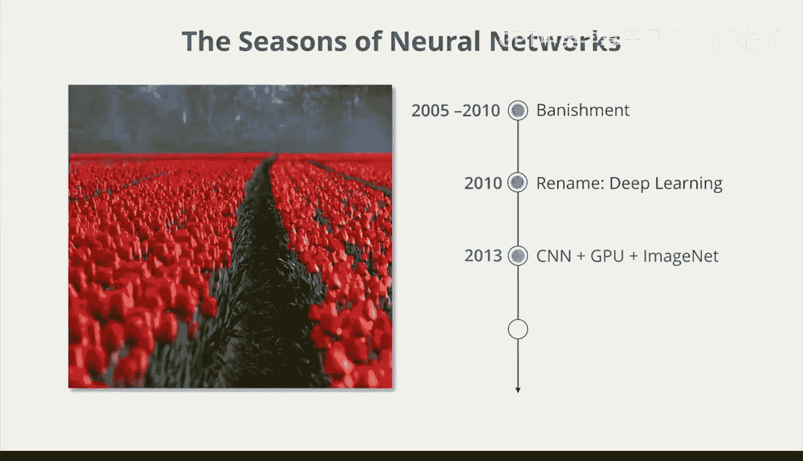

Han't changed。And then around 2015。AlphaGo occurred。

Alphago also was based upon the convolutional neural network and something called reinforcement learning。

 and Alphago demonstrated the capacity to play the game go at a level that exceeded the performance of humans。

 and now in addition in the context of CNN and image analysis。

 we've also exceeded the performance of humans， and so the story that this history tells us is that the underlying technology of deep learning。

 which is really a rebranding of neural networkss， dates back to 1960 with the multilayer perceptron。

 1989 with the convolutional neuralnet。And long term， long term， short term， long， short term memory。

 roughly 1995， that technology。Is decades old。What's changed to constitute this really exciting moment for machine learning is that we have brought extraordinary computational power in the form of the GPU and massive quantities of data。

 Inet and others。 when you bring these together。The performance of these neuro deep neural networks or these deep learning models can oftentimes exceed the performance of humans。

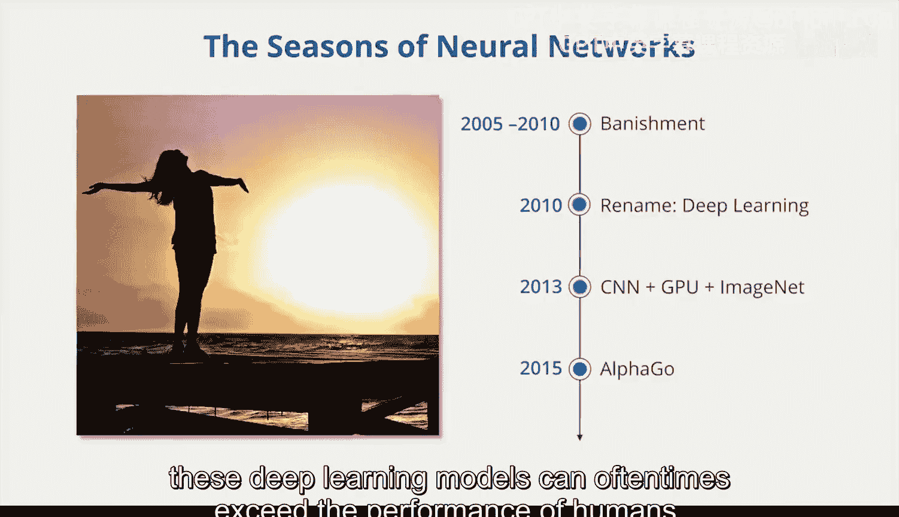

So the thing that I just want to conclude this little history is to remember that we should be humble because at every moment in that history where we saw spring or summer only to be followed by winter。

There were moments of tremendous excitement that and then disappointment。

 And so we have learned a lot over those decades， and we know a lot more。

 We now know the importance of computational power。

 We know the importance of massive quantities of data。

But the lesson that I think we need to take from this is that if we do not understand this history。

 we may be doomed to repeat it， and so there are situations for which the simple logistic regression model on the left may actually be more appropriate than the deep neural network。

 and so one of the keys as we move forward with this technology is to understand where the deep learning is effective。

 what type of deep learning is effective and also where simpler models might be appropriate。

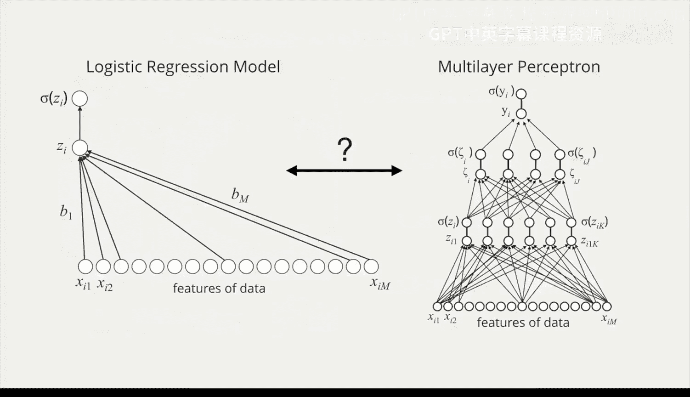

So there's a very famous idea called Aham's Razor。And what it basically says is that if you have two ways of describing data。

 in other words， if you have two models of data。And they are equally good at describing the data。

 You should always choose the simpler model。 One should always look for simplicity。

 And so when we look， when we look at the simple。

But often effective logistic regression。And the more complicated。Deep neural network。

 One must always recognize that it's probably a good idea to look at data from both perspectives and where the simple model works。

 the simple model should be used， but there are often situations as history has shown us for which these deep architectures do indeed provide performance。

 which is well beyond that of simpler methods。

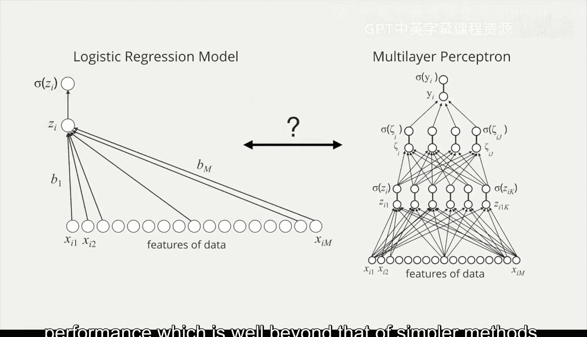

So as we move forward in this module， we'll start to study in greater detail why it is that these more sophisticated deep architectures yield performance that has generated so much recent excitement and deep learning and deep neural networks。

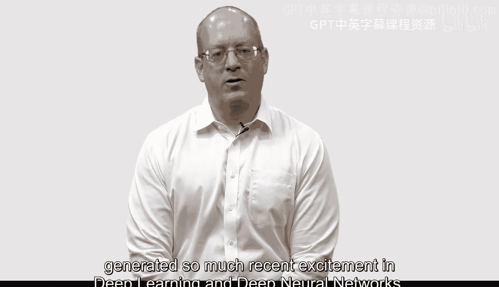