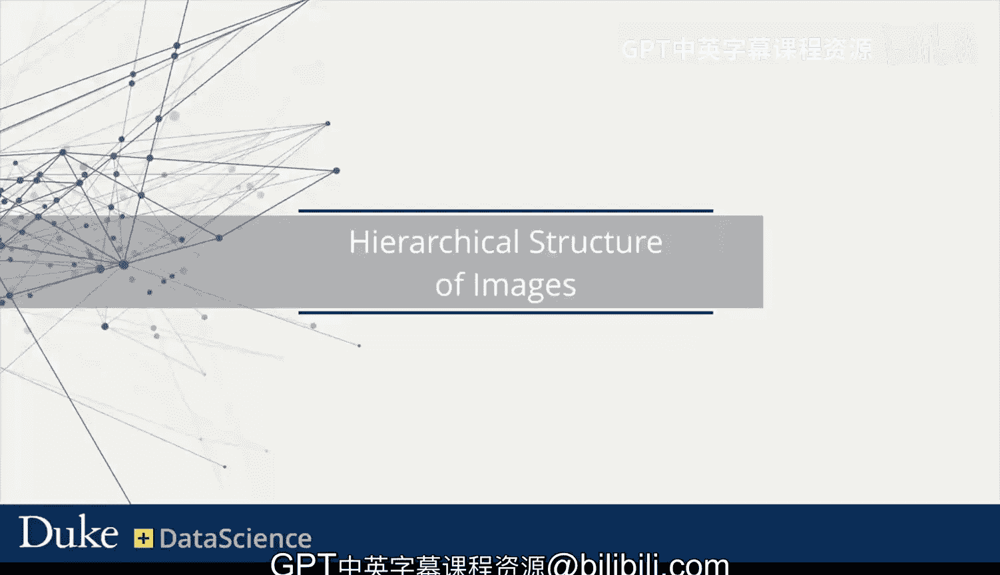
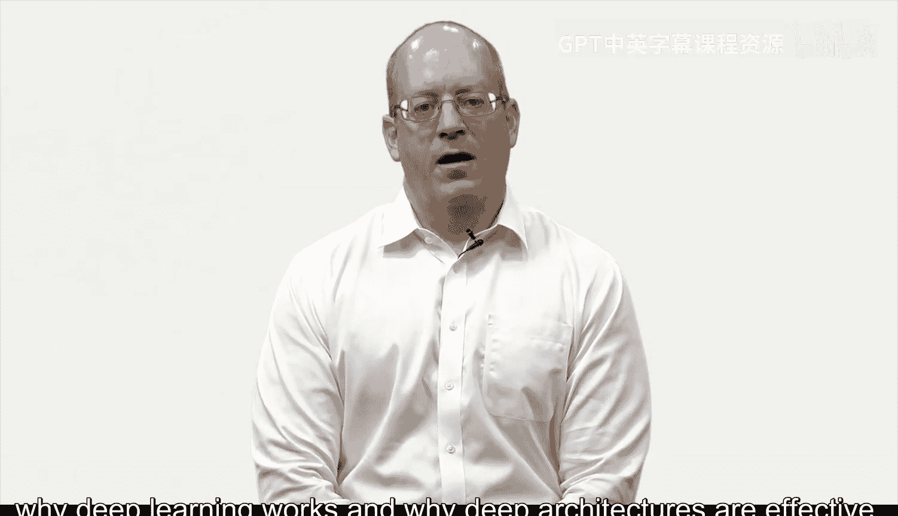
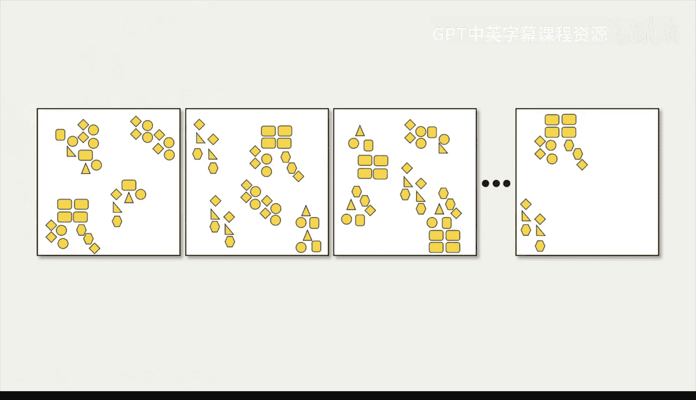
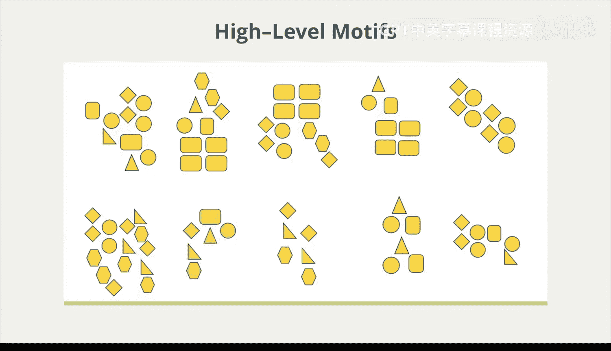
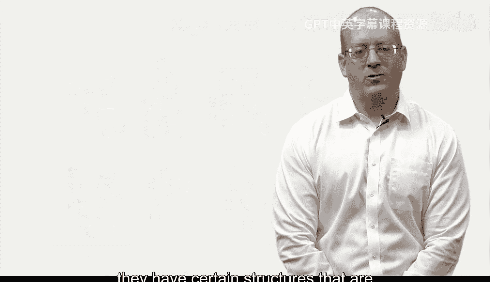
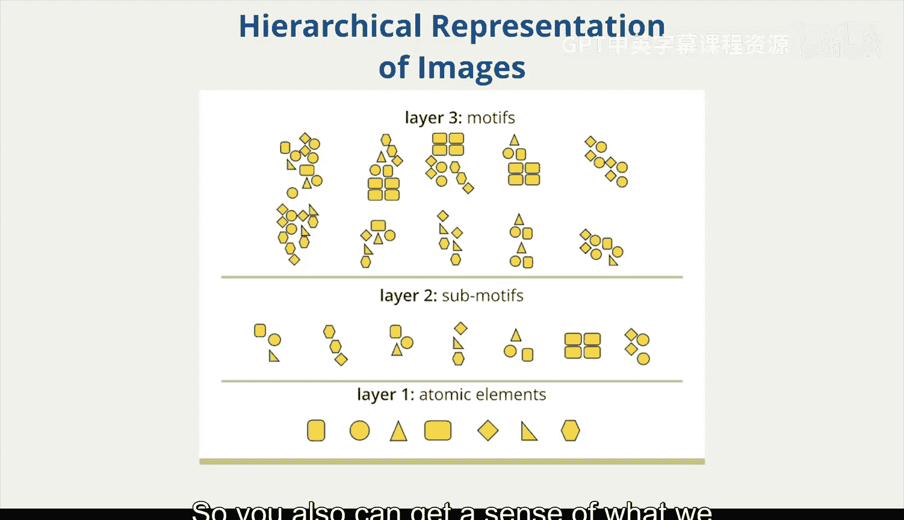
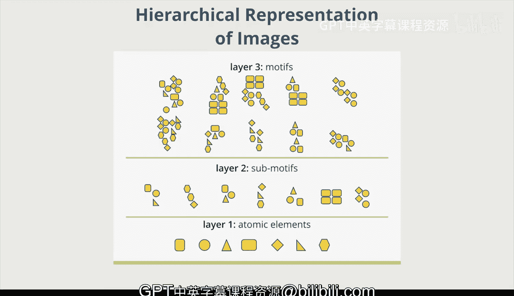

# 杜克大学《机器学习｜Introduction to Machine Learning》中英字幕 p14 14_01_01_图像的层次结构.zh_en -BV1yjvdBQEaU_p14-

So we have discussed in some detail the multilay perceptron。And have tried to give some intuition。

Into why it works effectively。However， the multilayer perceptron is not appropriate for all data。

 and in our history of deep learning in neural networks。

 we discussed the briefly discussed the convolutional neural network。

 which is one of the most significant pieces of technology。

From the standpoint of analyzing images and many types of data that we're interested in are in the form of images。

 and so what I would like to do in this lesson is to try to provide an intuitive understanding of what the convolutional neural network is doing and why it works and through that discussion it is hoped that one will also get a greater understanding of why deep learning works and why deep architectures are effective。

So in this lesson， we're going to focus on images and we're going to focus on how one analyzes images using neural networks。

 and as we've discussed elsewhere in this module。The technology that we're going to discuss here。

 the convolutional neural network in many settings。

Is demonstrating performance for for analyzing images that exceeds the performance of humans。

 So this is truly remarkable， remarkable technology。

And it's worthwhile to try to understand it from an intuitive perspective。So to do that。

 what we're going to do is consider。What I'll call toy images。

 so toy means these are cartoon representative images to try to provide intuition。

 these of course are not real images， but the ideas that we're going to develop here are indeed transferable to real images and so recall that to do learning we need multiple data samples。

Here the data samples will be in the form of images。

 so the data we're going to analyze are images and so what I'm showing in this slide are three images and then an additional piece of an image where each of these squares represents an image and the shapes that you see within the image are the fundamental building blocks that constitute the image。

 so what we're going to do is we're we're going to look at the analysis of these simple toy images with the goal of trying to gain some understanding of the underlying motivation for the deep architecture。

So the thing that I。Want you to notice。

About these images。Is that each of them。Is composed。

Of examples of these what I call high level motifs。

That are shifted to different locations within the image。

 So not any one image is composed of all of the motifs。

But each image is characterized by a subset of the motifs。

 and the location of those motifs changes from image to image。

 So if you think about images that you might see in the real world。

 you notice that they have certain structures that are repeated， such as edges， corners， textures。

 shapes。

This is characteristic of all virtually all natural images。

 And so this characteristic is something that we want to leverage or exploit in the context of the deep convolutional neural network。

 These toy images will allow us to get a sense of how this works。 So， again。

 each image is composed of a subset of these motifs。

 each of which is shifted to a different location。Within the image。Now。

 let's look at these motifs a little bit more closely。What we notice is that each of the motifs。

Is composed of。Often repeated substructure。 So what I'm doing here is highlighting。

That within some of the motifs， we see a repeated substructure。

And then another repeated substructure。And another repeated substructure。

And another repeated substructure。 So the thing that I want to try to communicate through these slides is that the overall image。

Is composed of a subset of shifted motifs。Each of the motifs are themselves composed of shifted what I call submotifs。

That repeat within the image。And so the way that I would like you to think about the data。

 if we start at the top。Each image is composed of a subset。Of these motifs。

These are at what I'll call layer3 of the model。Each of the motifs at layer 3 is composed of。

A subset of shifted versions of the submotifs。And then each of the submotifs is composed of basic。

 what I'll call atomic elements， which are these fundamental shapes。

 So the key thing to take away from this slide。Is that we believe that data can be represented in a hierarchy。

 And so you also can get a sense of what we mean by deep or multilayed structure。

 And so what we want to do is to try to build a model that captures this structure that captures this representation of images。

 So the question is， how can we build a model that can capture the intuition in the way that images might be constituted through a hierarchy of this form。

