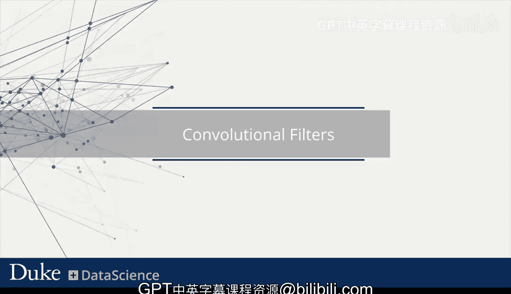
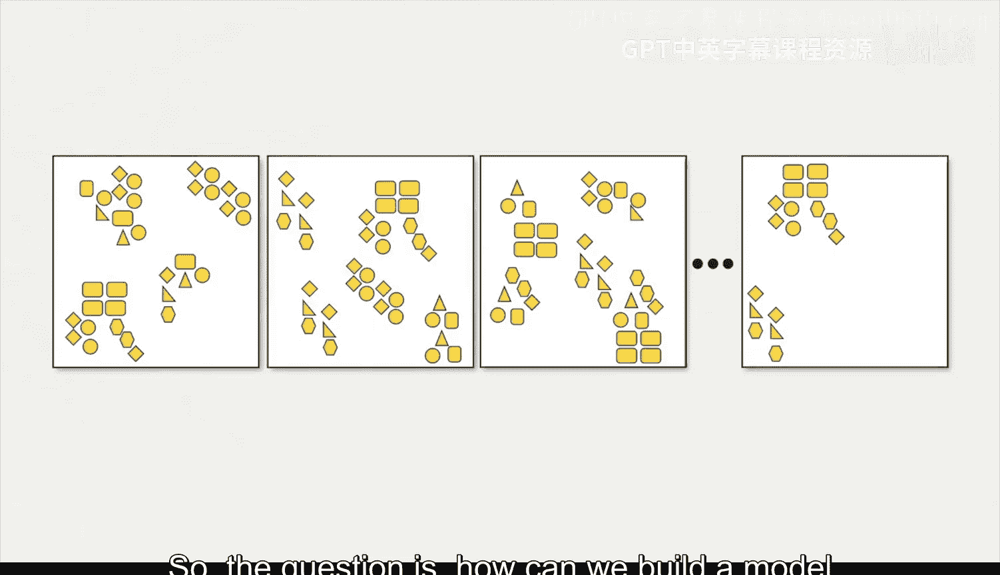
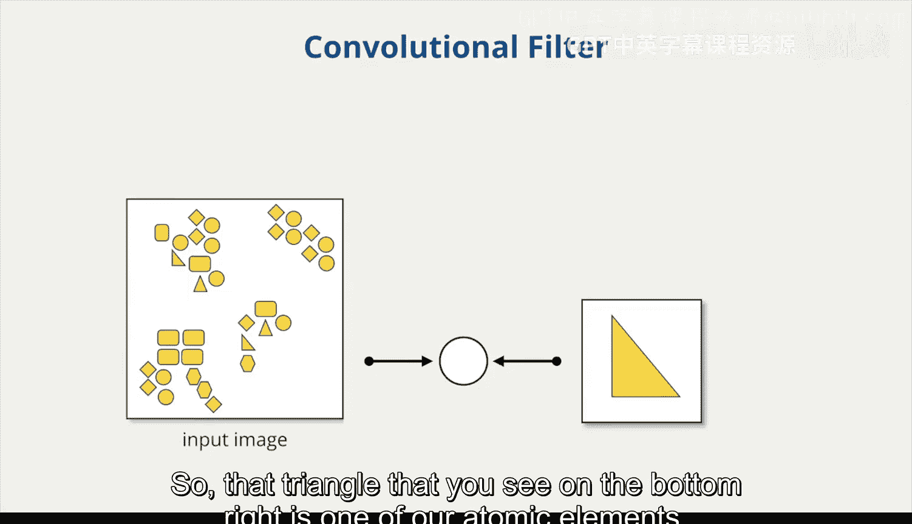
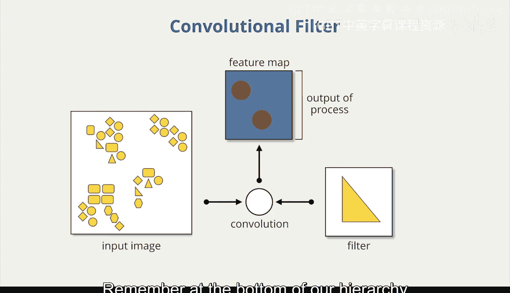
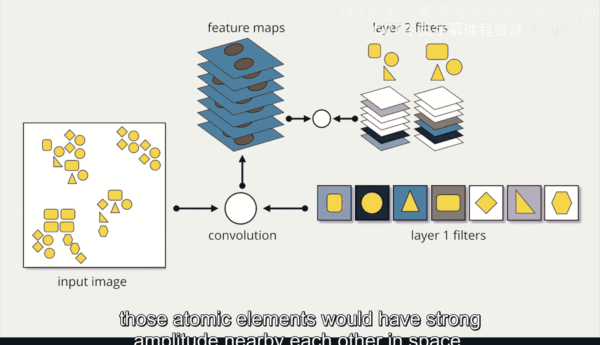
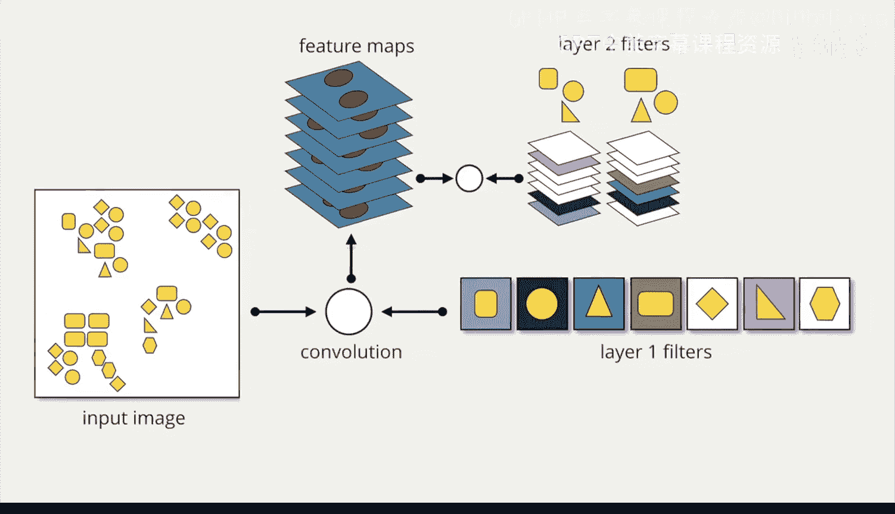
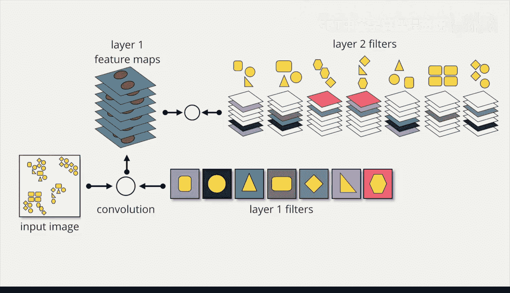
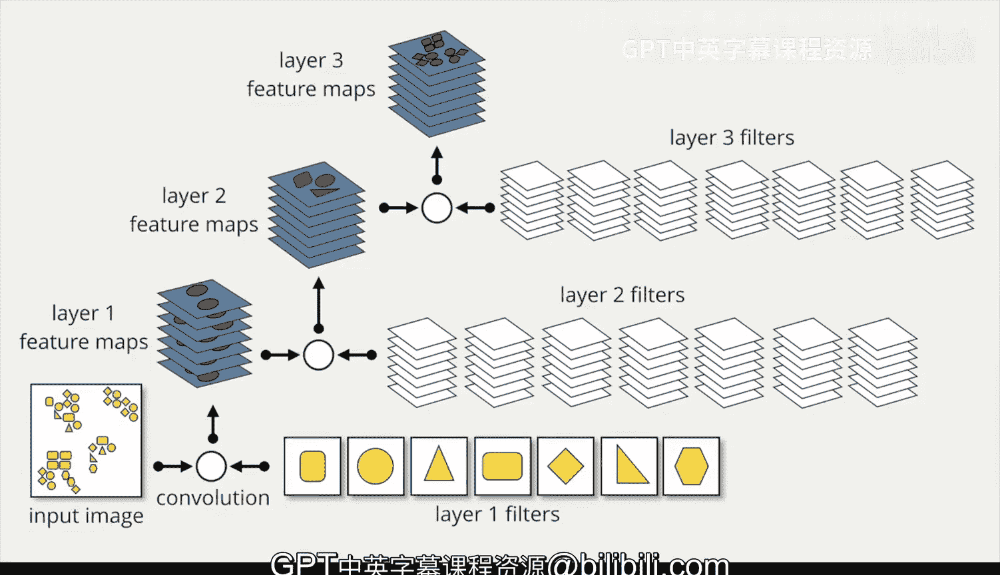

# 杜克大学《机器学习｜Introduction to Machine Learning》中英字幕 p15 15_01_02_卷积滤波器.zh_en -BV1yjvdBQEaU_p15-

So this is to recall the image， just to remind you of the quote unquote data。

 these are toy demonstration images to denote this concept。So the question is。

 how can we build a model to actually capture this phenomenon？

 So what I'm showing at the bottom left is an example image。 So this again， is our toy。

 an example toy image。

And what we would like to do is to start at the bottom of our hierarchy and to look for one of those atomic elements。

 So that triangle that you see on the bottom right is one of our atomic elements。

 And what we're going to do is we're going to shift。

That， that triangle。To every location。Yin。

In the image。 So we're going to shift。The atomic element here， the triangle。

To every possible location in the two dimensional image。 And we're going to calculate a correlation。

 a correlation which measures how similar the local region in the image is to our atomic element。

 which we'll call a filter。 And so on the top。What we're showing is the output of that process。

 So if you look carefully at the image on the bottom left。

 you'll notice that there are two locations within that image where that triangular atomic element on the bottom right is manifested and so when we shift that atomic element to every possible position in twodimenional space of the image when the atomic element lines up with a point in the image where that triangle is actually manifested。

 we get a high correlation or a high match and so what we're looking at on the top is a map we call it a feature map and what it is meant to depict is the degree of match or the degree of correlation between the atomic filter at bottom right with every location in an image。

And so red in the top image， red means strong or high。 and so at those two circular points。

 those are the locations where that the triangle， that that atomic triangle is manifested in the image everywhere else or the triangle is not manifested。

 the match or the correlation between the filter and the image at that location is very small。

 the process by which you shift that atomic element， the triangle。To every location and image。

 that process has a name is called convolution。So this is why the name convolutional neural network。

 the convolution is manifested by shifting that filter to every location in the image。

Now we have multiple atomic elements， not just one。 remember at the bottom of our hierarchy。

 we had multiple atomic elements， so now what I wish to depict here is at the left we have again one of our images and then at the right we have each of the atomic elements。

What we're going to do is shift each of those atomic elements。Each of those fundamental filters。

1 by one to every location in the image through that two dimensional convolutional process that I talked about。

And what we're going to get is a feature map for each atomic element。 So remember a feature map。

Deotes how strongly that atomic element matches the local region in the image， so we call that a map。

 it's a map that reflects the degree of match between the atomic element and the image and we do that for each of the atomic elements。

 and so therefore we get a stack or multiple feature maps。

 and so that depiction a stack of rectangles or squares is meant to reflect each of the feature maps for the respective filters。

So using this process， we can see how we can identify each of the atomic elements。

The the lowest layer in the hierarchy。 So the next question becomes。

 how can we identify the submotifs， Remember， the submotifs are composed of combination of combinations of shifted versions of the atomic elements。

So now what we're going to do is we're going to repeat the process where we're gonna。

 we're going to convolve or shift。Filters。To every twodial location in the feature map。

 But here now the filters are many stacks of of atomic elements。

 And so what I am trying to depict here is one of the submotifs。

 which is composed of a square and ellipse and a triangle。

 We're trying to find that submotif composed of those three fundamental elements。

 So fundamental atomic elements。What we would expect。

If that set of three shapes constituting that submotif， if that is present in the image。

 what we would expect is that the respective layers of the feature maps corresponding to the square。

 the ellipse。And the triangle would be high， strong。And we can do this for another of the submotifs。

 So here now is showing a different submotif and so here those three fundamental shapes correspond to three different layers in this stack of feature maps and what we would expect is that if that submotif is present。

 then the respective components the respective feature maps associated with those atomic elements would be have strong amplitude nearby each other in space。

 and so we can do this for each of the submotifs and so what this slide is depicting is that each of the atomic elements for notational purposes is assigned a color。

And the filters at the second layer。Correspond to the submotifs and so what this is showing via the colors is those are the layers that we would expect those respective filters at the second layer to have strong amplitude if they correspond to the respective submotif。

So by constituting this filtering process at the second layer。

 we can now search for each of these submotifs， and so then we repeat the process。

 so now we're going to convolve these second layer filters which are designed to look for those submotifs。

 we're going to convolve them with the feature maps from layer1。

The process of convolving each of the filters。From layer two with the feature maps from layer one is going to yield a new set。

Of feature maps。What we'll call the layer 2 feature maps。

 These layer 2 feature maps are going to be telling us where each of the submotifs are manifested in the image。

And now we can repeat this process once again， so now at layer2 in the middle of the slide on the right。

 we see each of the filters corresponding to the submotifs and now what we're looking for is the top layer。

 the top layer motif， that top layer motif is composed of four of the submotifs and so each of those four submotifs is assigned a color。

And what we're seeing is that when we look at the layer  three filters to manifest the motif。

 we have strong excitation。Nearby physically of four of the corresponding submotifs。

And so then we can do this for each of the motifs at the top layer of the model。

 So now we're going to have filters which are designed for each of the motifs at layer 3。

 And then finally， after this convolution， So we're going to convolve。

Or shift to all two dimensional spatial locations， the layer 3 filters with the layer 2 feature maps。

 and then finally constitute a layer 3 feature map。

