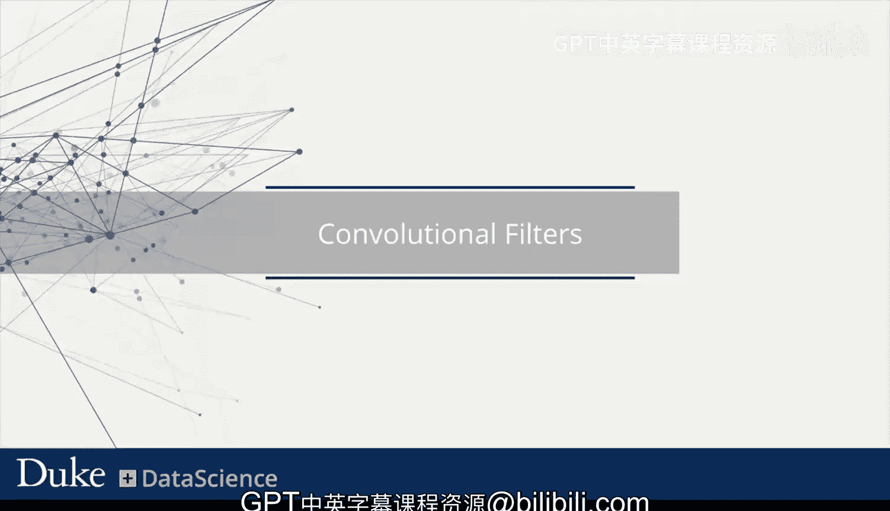
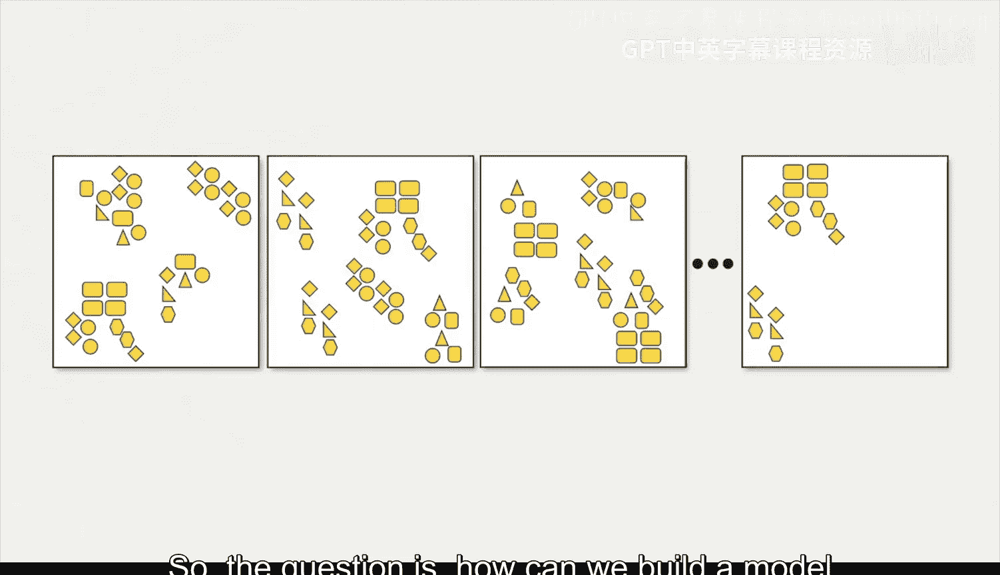
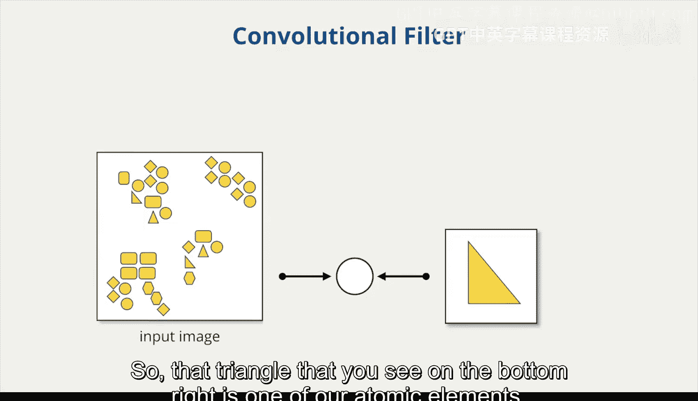
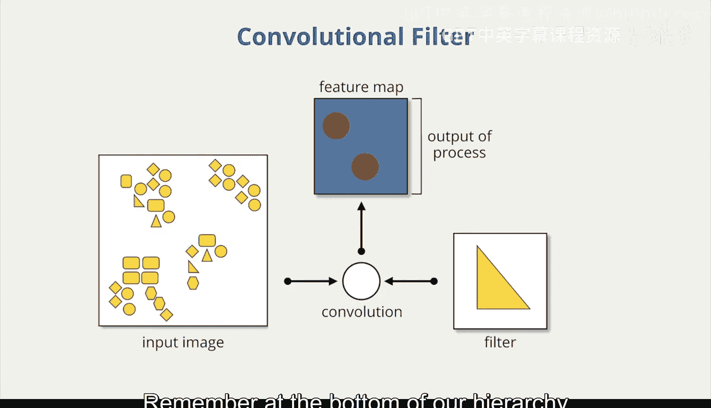
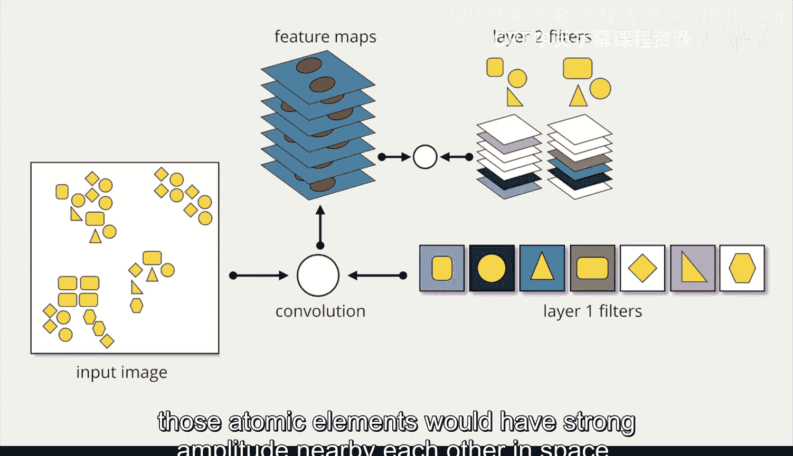
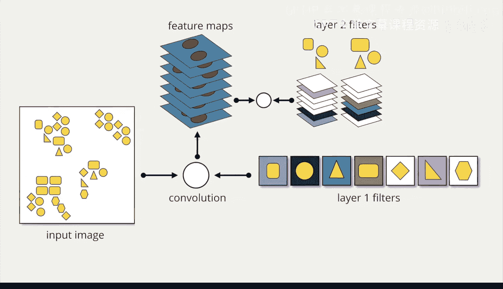
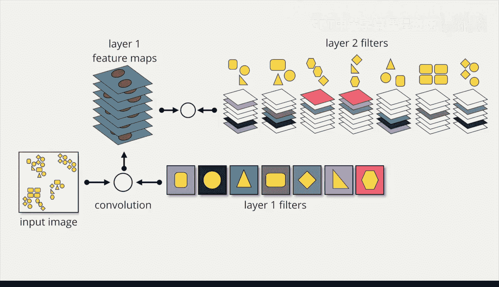
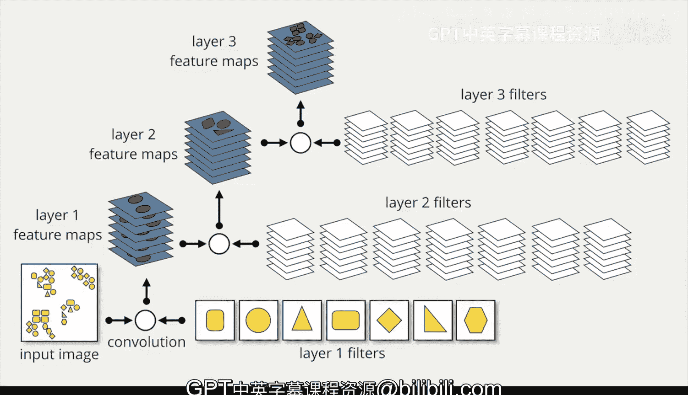

# 机器学习：15：卷积滤波器 🧠

在本节课中，我们将学习卷积神经网络（CNN）中的一个核心概念——卷积滤波器。我们将了解如何通过滤波器从图像中提取基本元素，并逐步构建更复杂的特征表示。

---

## 概述

卷积神经网络通过模拟视觉系统的层次结构来处理图像。这个过程始于识别图像中的基本“原子”元素，然后组合这些元素以识别更复杂的“子图案”和“图案”。本节课将详细解释这一过程，即如何使用卷积滤波器在图像中定位和识别这些元素。

---

## 从原子元素开始

上一节我们介绍了视觉层次结构的概念。本节中我们来看看如何构建一个模型来捕捉这种现象。

下图是一个示例图像，我们将用它进行演示。

我们的目标是从层次结构的底部开始，寻找那些原子元素。右下角的三角形就是我们的一个原子元素。

我们将把这个三角形滤波器**移动**到图像中的**每一个位置**。

在图像的每个二维位置上，我们都会计算一个**相关性**。这个相关性衡量了图像局部区域与我们的原子元素（即滤波器）的相似程度。

这个过程的结果显示在顶部，我们称之为**特征图**。它描绘了右下角的原子滤波器与图像中每个位置的匹配或相关程度。

*   在顶部的图像中，**红色表示强相关或高匹配**。
*   两个圆形点就是图像中实际存在该三角形的位置。
*   图像中其他不存在该三角形的位置，滤波器与图像的匹配度或相关性非常小。

将原子元素（三角形）移动到图像中每个位置的过程，有一个专门的名称，叫做**卷积**。这就是“卷积神经网络”名称的由来。

---

## 处理多个原子元素

我们不止有一个原子元素。在层次结构的底部，我们有多个原子元素。

下图左侧是我们的一个图像，右侧是各个原子元素。

以下是处理步骤：
1.  我们将通过前面提到的二维卷积过程，把每一个基本滤波器依次移动到图像中的每个位置。
2.  每个原子元素都会生成一个特征图。该图反映了该原子元素与图像的匹配程度。
3.  我们对所有原子元素都进行此操作，因此会得到**多个特征图的堆叠**。

图中堆叠的矩形或方块就是为了表示各个滤波器对应的特征图。

通过这个过程，我们可以看到如何识别层次结构最底层的每个原子元素。

---

## 识别子图案

下一个问题是：如何识别子图案？记住，子图案是由原子元素经过组合和位移后构成的。

现在，我们将重复卷积过程，但对象发生了变化。我们将把滤波器与第一层的特征图进行卷积。不过，这里的滤波器是由多个原子元素堆叠构成的。

下图描绘了一个子图案，它由一个正方形、一个椭圆形和一个三角形组成。

我们试图找到由这三个基本元素构成的子图案。如果图像中存在这个子图案，我们预期对应的特征图层（正方形、椭圆形、三角形）会在空间上彼此邻近的位置出现高强度响应。

我们可以为每个子图案进行此操作。为便于表示，每个原子元素被分配了一种颜色。

第二层的滤波器对应着各个子图案。图中的颜色表示，如果图像中存在相应的子图案，我们预期第二层的这些滤波器会在对应位置产生强响应。

通过在第二层构建这个滤波过程，我们现在可以搜索每一个子图案。

---

## 构建更高层特征

然后我们重复这个过程。现在，我们将这些设计用于寻找子图案的第二层滤波器，与第一层的特征图进行卷积。

将第二层的每个滤波器与第一层的特征图进行卷积的过程，将产生一组新的特征图，我们称之为**第二层特征图**。这些图将告诉我们每个子图案在图像中的位置。

现在我们可以再次重复这个过程。在幻灯片右侧中间的第二层，我们看到对应各个子图案的滤波器。现在我们要寻找的是顶层的图案。

顶层图案由四个子图案构成，每个子图案被分配了一种颜色。我们看到，当使用第三层滤波器来识别该顶层图案时，四个对应的子图案会在物理空间上邻近的位置产生强响应。

我们可以为模型顶层的每个图案进行此操作。现在，我们将拥有为第三层的每个图案设计的滤波器。

最后，经过这次卷积——即将第三层滤波器与第二层特征图在所有二维空间位置上进行卷积——我们将最终构成**第三层特征图**。

---

## 总结

本节课中，我们一起学习了卷积滤波器的核心工作原理。我们从识别单个原子元素开始，通过**卷积**操作生成特征图。然后，我们扩展到多个原子元素，生成特征图堆叠。接着，我们利用这些基础特征，通过更高层的卷积来识别由原子元素组合而成的**子图案**。最后，我们重复这一过程，构建更深的层次来识别完整的**图案**。这个过程形象地展示了卷积神经网络如何通过分层抽象，从像素中逐步提取出复杂的语义信息。