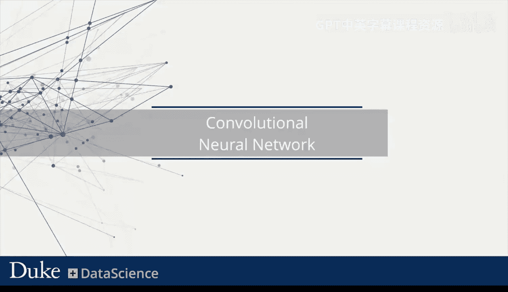
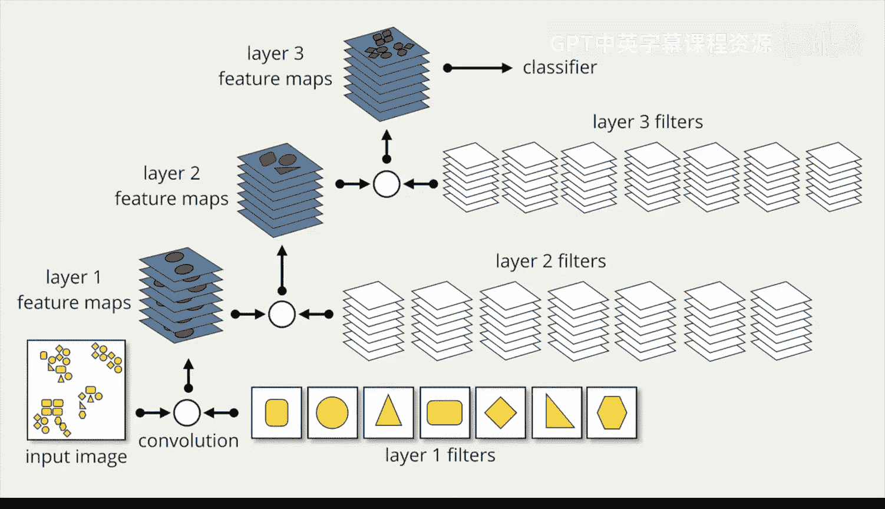
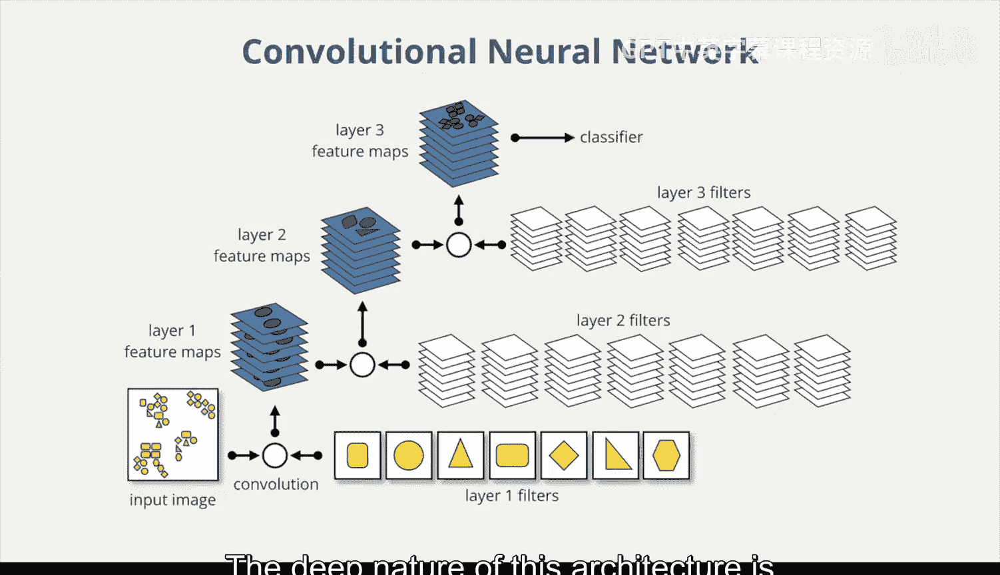
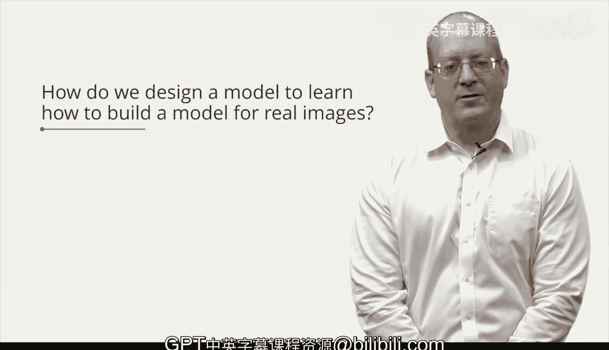

# 杜克大学《机器学习｜Introduction to Machine Learning》中英字幕 p16 16_01_03_卷积神经网络.zh_en -BV1yjvdBQEaU_p16-

And then finally， we're going to make a classification decision。

 the classification decision will be based upon the features at the top of the model or at layer 3。

 so the thing that is really important to notice about this deep architecture is that it's manifested by repeated application of the same process。

 so beginning at the bottom。We take the original image on the bottom left。 We， we convolve。

That image with a set of atomic or fundamental building block images。

 so convolve means that we take each of those atomic elements。

 We shift it to every location in the image。 After we're done with that， we get a map。

 what we call a feature map， which is a reflection of how how how the degree to which each of the atomic elements is manifested within the image。

 we do that for each atomic element， and we get what we call a stack of features。

 a stack of feature maps。We then。That gives us the map by which the basic fundamental building blocks are manifested in the image。

 We then constitute layer 2 filters。 Those layer 2 filters are looking for combinations of elements of from the first layer which are simultaneously excited near by each other。

 So if we have simultaneous first layer atomic elements， which are excited near each other。

 they constitute a submotif。 And so the layer two filters are searching for those。

For those those submotifs， we convolve the layer two filters。

With the layer1 feature maps and then we get a layer two feature maps。

 and then we constitute layer 3 filters， which are now designed to look for motifs。

 convolve those filters with the layer2 feature maps and then finally we get a layer3 feature map that layer 3 feature map is our final feature map and then based upon those features we're going to make a classification decision we're going to decide the classification of the image。

 So for example， if we're doing radiological studies in medicine。

 the classification that we might do is to determine whether the image。

 the medical image corresponds to a benign or a malignant tumor， for example。

 that might be a classification decision， we would make that classification decision is based upon the features at the top of the network。

So this architecture。Is called a convolutional neural network。

The convolution is manifested through this shifting process。

 the neural network is manifested for some other technical details。

 which I'm leaving out here for simplicity the deep nature of this architecture is evident through the deep construction。

So now the next thing that we have to ask ourselves。

Is now that we have some intuition on how we might design an architecture of this form in the real world。

 we don't deal with toy images and we don't deal with these simple shapes。 And so the question is。

 how do we design a model。That allows us to learn。How to build a model like this。For real images。

 and that will be the next topic that we will take up in our next lesson。

